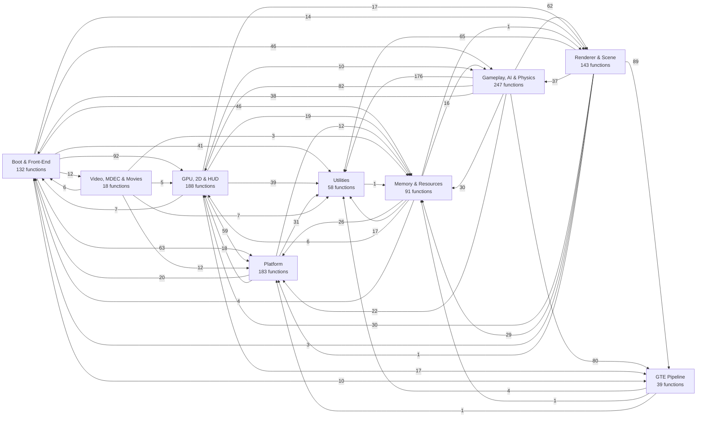
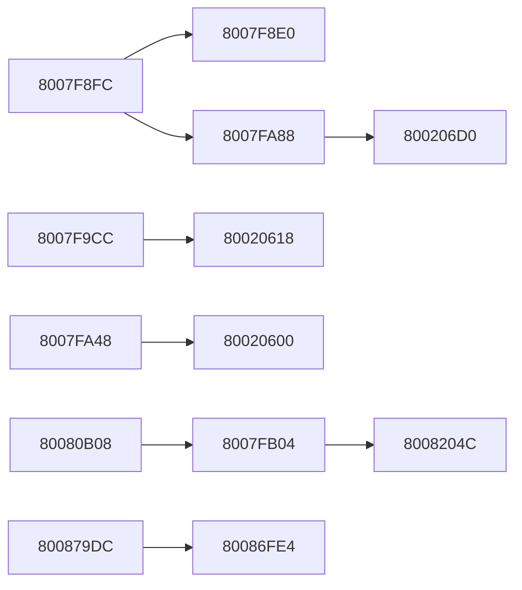
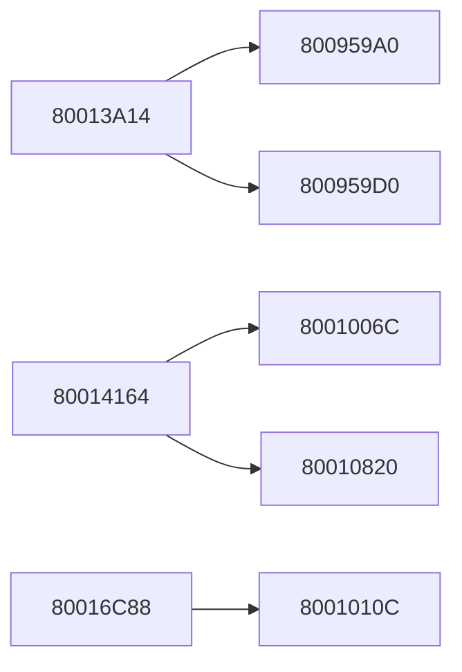
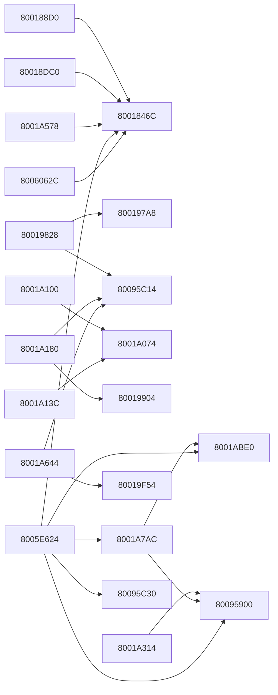
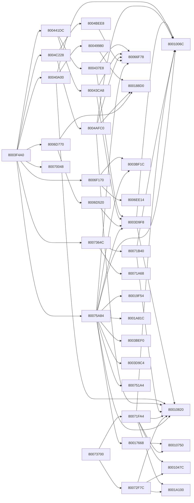

# Function map - documented functions (1099 units)

Markdown map of every function whose source carries a `// Categories:` line: the category is the first line of each `src/game/<addr>.c`, sizes come from `config/us/matching_units.json`, edges from `analysis/edges.json`.

**Reading the map.** Each node is a documented function (hex address). Edges are **direct calls** and only between two documented functions, so a missing edge means "the caller lies outside this set" or "not in the graph", never "no call". `jalr` calls, jump tables and `address_taken` edges are not drawn. The category column shows the full primary path, further tags of line 1 in short form after `·`.

Regenerate with `python3 tools/build_function_map.py` (add `--check` in CI to detect a stale map); do not edit this file by hand.

## Areas

One box per area; the number on an edge is the count of direct calls between documented functions of those areas.



## Areas in detail

### Boot & Front-End - 132 functions, 114 calls inside the area

Start, main loop and front-end. `func_80076A2C` is the **logical** entry point: the PS-X-EXE startup (PC0 `0x80096520`) clears `.bss`, computes the heap from `D_8009EA04`/`D_8009EA08`, sets `$gp` and calls it. Memory, file and image paths run from here, then the screen state machine on `D_8009FA00`.

The area is large, so only the connected functions are drawn; the table below lists every member.



```mermaid
graph LR
    f8001ef8c --> f8001ef34
    f80024904 --> f80069b58
    f80024904 --> f800780dc
    f800249bc --> f80069d04
    f80024a24 --> f80031984
    f80024a24 --> f8003f79c
    f80024a24 --> f8004ab4c
    f80024a24 --> f8005130c
    f80024a24 --> f8005a2b0
    f80024a24 --> f8005a738
    f80024a24 --> f800609f4
    f80024a24 --> f80060e28
    f80024a24 --> f80069b58
    f80024d14 --> f80019d88
    f80024d14 --> f8002a5ac
    f80024d14 --> f8003f854
    f80024d14 --> f8004ccdc
    f80024d14 --> f80059db0
    f80024d14 --> f8005a068
    f80024d14 --> f80069d04
    f80024e3c --> f80024904
    f80024e3c --> f80024a24
    f800259d8 --> f80047690
    f80025b7c --> f8001eb6c
    f80025b7c --> f800249bc
    f80025b7c --> f80024d14
    f80025b7c --> f80025348
    f80025b7c --> f80047690
    f800260b8 --> f80025f58
    f800260b8 --> f8005780c
    f800260b8 --> f80060a0c
    f800267c8 --> f80025f58
    f800267c8 --> f800260b8
    f800267c8 --> f8005780c
    f80026ddc --> f800267c8
    f80027510 --> f8001bbac
    f80027510 --> f8001eb6c
    f80027510 --> f8001ef34
    f80027510 --> f80026d1c
    f80027510 --> f80026d5c
    f80027510 --> f80026d9c
    f80027510 --> f80026ddc
    f80027510 --> f80026e1c
    f80027510 --> f80026e5c
    f80027510 --> f8003f570
    f80027510 --> f80047690
    f80027510 --> f800486fc
    f80027510 --> f8004cd6c
    f80027510 --> f8004cecc
    f80027510 --> f8004d598
    f80027510 --> f8005780c
    f80027510 --> f80069d0c
    f80027d70 --> f800486fc
    f80027ee4 --> f80027ebc
    f800287f4 --> f80024e3c
    f800287f4 --> f800259d8
    f800287f4 --> f80025b7c
    f800287f4 --> f80027ee4
    f800287f4 --> f80028618
    f800287f4 --> f8003fad4
    f80029974 --> f800298ec
    f8002a810 --> f8004d664
    f8002a810 --> f8004d958
    f8002c584 --> f8004d444
    f8002c584 --> f8006314c
    f8002eed8 --> f8006314c
    f80039298 --> f800398ec
    f800398ec --> f8004d958
    f8003c590 --> f8003c500
    f8003f570 --> f8003f2ac
    f8003f570 --> f8003f530
    f8003fad4 --> f8003c590
    f8004c324 --> f8004aad4
    f8004ccdc --> f8004d598
    f8004ccdc --> f8004d958
    f8004cecc --> f8003fd10
    f8004cecc --> f8004d958
    f8004d3fc --> f8004d3d4
    f8004d444 --> f8004d3d4
    f8004d4d4 --> f8004d444
    f80055e10 --> f8005780c
    f80069b58 --> f80069b1c
    f80076a2c --> f800287f4
    f80076a2c --> f8007bfcc
    f80077708 --> f80077ffc
    f800778e4 --> f80078650
    f800778e4 --> f800788b4
    f800780dc --> f80077ffc
    f80078210 --> f80078650
    f80078650 --> f800785f8
    f80078650 --> f800787d8
    f80078650 --> f800788b4
    f8007a5f0 --> f80078650
    f8007b854 --> f80078650
    f8007b854 --> f8007b460
    f8007bcf4 --> f8007b460
    f8007c0f8 --> f8001ef34
    f8007c6f0 --> f8001eaec
    f8007c6f0 --> f8001ef34
    f8007c6f0 --> f8007c0f8
    f8007c80c --> f8001ec04
    f8007c80c --> f8007bfcc
    f8007dd08 --> f8007d2dc
    f8007ea78 --> f800776b8
    f8007ea78 --> f80077708
    f8007ea78 --> f80077ffc
    f8007f1f8 --> f80078740
    f8007f1f8 --> f8007ea78
    f8008125c --> f800776b8
    f8008125c --> f80077708
    f8008125c --> f80077ffc
    f8008125c --> f80078210
    f8008125c --> f80078650
    f80082154 --> f80078740
    f80019d88["80019D88"]
    f8001bbac["8001BBAC"]
    f8001eaec["8001EAEC"]
    f8001eb6c["8001EB6C"]
    f8001ec04["8001EC04"]
    f8001ef34["8001EF34"]
    f8001ef8c["8001EF8C"]
    f80024904["80024904"]
    f800249bc["800249BC"]
    f80024a24["80024A24"]
    f80024d14["80024D14"]
    f80024e3c["80024E3C"]
    f80025348["80025348"]
    f800259d8["800259D8"]
    f80025b7c["80025B7C"]
    f80025f58["80025F58"]
    f800260b8["800260B8"]
    f800267c8["800267C8"]
    f80026d1c["80026D1C"]
    f80026d5c["80026D5C"]
    f80026d9c["80026D9C"]
    f80026ddc["80026DDC"]
    f80026e1c["80026E1C"]
    f80026e5c["80026E5C"]
    f80027510["80027510"]
    f80027d70["80027D70"]
    f80027ebc["80027EBC"]
    f80027ee4["80027EE4"]
    f80028618["80028618"]
    f800287f4["800287F4"]
    f800298ec["800298EC"]
    f80029974["80029974"]
    f8002a5ac["8002A5AC"]
    f8002a810["8002A810"]
    f8002c584["8002C584"]
    f8002eed8["8002EED8"]
    f80031984["80031984"]
    f80039298["80039298"]
    f800398ec["800398EC"]
    f8003c500["8003C500"]
    f8003c590["8003C590"]
    f8003f2ac["8003F2AC"]
    f8003f530["8003F530"]
    f8003f570["8003F570"]
    f8003f79c["8003F79C"]
    f8003f854["8003F854"]
    f8003fad4["8003FAD4"]
    f8003fd10["8003FD10"]
    f80047690["80047690"]
    f800486fc["800486FC"]
    f8004aad4["8004AAD4"]
    f8004ab4c["8004AB4C"]
    f8004c324["8004C324"]
    f8004ccdc["8004CCDC"]
    f8004cd6c["8004CD6C"]
    f8004cecc["8004CECC"]
    f8004d3d4["8004D3D4"]
    f8004d3fc["8004D3FC"]
    f8004d444["8004D444"]
    f8004d4d4["8004D4D4"]
    f8004d598["8004D598"]
    f8004d664["8004D664"]
    f8004d958["8004D958"]
    f8005130c["8005130C"]
    f80055e10["80055E10"]
    f8005780c["8005780C"]
    f80059db0["80059DB0"]
    f8005a068["8005A068"]
    f8005a2b0["8005A2B0"]
    f8005a738["8005A738"]
    f800609f4["800609F4"]
    f80060a0c["80060A0C"]
    f80060e28["80060E28"]
    f8006314c["8006314C"]
    f80069b1c["80069B1C"]
    f80069b58["80069B58"]
    f80069d04["80069D04"]
    f80069d0c["80069D0C"]
    f80076a2c["80076A2C"]
    f800776b8["800776B8"]
    f80077708["80077708"]
    f800778e4["800778E4"]
    f80077ffc["80077FFC"]
    f800780dc["800780DC"]
    f80078210["80078210"]
    f800785f8["800785F8"]
    f80078650["80078650"]
    f80078740["80078740"]
    f800787d8["800787D8"]
    f800788b4["800788B4"]
    f8007a5f0["8007A5F0"]
    f8007b460["8007B460"]
    f8007b854["8007B854"]
    f8007bcf4["8007BCF4"]
    f8007bfcc["8007BFCC"]
    f8007c0f8["8007C0F8"]
    f8007c6f0["8007C6F0"]
    f8007c80c["8007C80C"]
    f8007d2dc["8007D2DC"]
    f8007dd08["8007DD08"]
    f8007ea78["8007EA78"]
    f8007f1f8["8007F1F8"]
    f8008125c["8008125C"]
    f80082154["80082154"]
```

28 further functions of this area without a documented connection (see the table below): `func_8001E4E4`, `func_8001EA20`, `func_8001EFF8`, `func_8001F0B8`, `func_8001F158`, `func_8002A5F4`, `func_8002E630`, `func_8003CF20`, `func_800586D4`, `func_80070730`, `func_8007799C`, `func_80079F54`, `func_8007A7A0`, `func_8007B17C`, `func_8007CA34`, `func_8007CFA0`, `func_8007E1A4`, `func_80080038`, `func_800822CC`, `func_8008263C`, `func_8008A044`, `func_8008AE70`, `func_8008B05C`, `func_8008B71C`, `func_8008B750`, `func_8008B770`, `func_8008B790`, `func_80091270`.

| Function | Bytes | Categories | calls (documented) | called by (documented) |
|---|---|---|---|---|
| `func_80019D88` | 8 | Game Engine > World Reset | - | `func_80024D14` |
| `func_8002A5AC` | 8 | Game Engine > World Reset | - | `func_80024D14` |
| `func_80059DB0` | 8 | Game Engine > World Reset | - | `func_80024D14` |
| `func_8005A068` | 8 | Game Engine > World Reset | - | `func_80024D14` |
| `func_8005A738` | 8 | Game Engine > Init | - | `func_80024A24` |
| `func_80069D04` | 8 | Game Engine > State Machine | - | `func_800249BC`, `func_80024D14` |
| `func_80031984` | 12 | Game Engine > Init · Map | - | `func_80024A24` |
| `func_8005130C` | 12 | Game Engine > Init · Placement | - | `func_80024A24` |
| `func_8005A2B0` | 12 | Game Engine > Init · Textures | - | `func_80024A24` |
| `func_800609F4` | 12 | Game Engine > Init · Object Setup | - | `func_80024A24` |
| `func_8008AE70` | 12 | Input > DualShock · Controller | - | - |
| `func_8008B71C` | 32 | Input > DualShock · Controller | - | - |
| `func_8008B750` | 32 | Input > DualShock · Controller | - | - |
| `func_8008B770` | 32 | Input > DualShock · Controller | - | - |
| `func_8008B790` | 32 | Input > DualShock · Controller | - | - |
| `func_8004D4D4` | 36 | Game Engine > Object Setup > Spawn Queue · Object Spawning | `func_8004D444` | `func_80031690`, `func_8003A8C0` |
| `func_8001F158` | 40 | Game Engine > Timing · Interrupts | `func_80091510` | `func_8001E540` |
| `func_80025348` | 40 | Game Engine > Frame · Asset Loading | `func_8001B4A8`, `func_80024EC8` | `func_80025B7C` |
| `func_80027EBC` | 40 | Game Engine > Frame · Display | `func_8001B4A8`, `func_80024EC8` | `func_80027EE4` |
| `func_8004D3D4` | 40 | Game Engine > Entity Lifecycle · Object Pool | - | `func_8004D3FC`, `func_8004D444` |
| `func_80060E28` | 40 | Game Engine > Object Registry · Memory Management | `func_80017EBC` | `func_80024A24` |
| `func_80027D70` | 44 | Game Engine > Frame · HUD | `func_800486FC` | - |
| `func_8004D664` | 56 | Game Engine > Object Lookup · Entity Lifecycle | - | `func_8002A810`, `func_8002C174`, `func_8002D664`, `func_800324E0`, `func_80058378`, `func_80058D78` |
| `func_8008B05C` | 56 | Input > DualShock · Controller | - | - |
| `func_8001EA20` | 60 | Game Engine > Input > Player Select | - | `func_800569EC` |
| `func_8001EB6C` | 60 | Input > Controller > Rumble · Controller | - | `func_80025B7C`, `func_80027510` |
| `func_80069B1C` | 60 | Game Engine > State Machine · Entity Script | - | `func_80069B58` |
| `func_800788B4` | 60 | Game Engine > Menu System · Text | - | `func_800778E4`, `func_80078650` |
| `func_8001BBAC` | 64 | Game Engine > Frame · Display | `func_8001B4A8` | `func_80027510` |
| `func_8001EAEC` | 64 | Input > DualShock · Controller | - | `func_8007C6F0`, `func_8007C940` |
| `func_80026D1C` | 64 | Game Engine > Frame · Scratchpad, Entity Update | - | `func_80027510` |
| `func_80026D5C` | 64 | Game Engine > Frame · Scratchpad | `func_80062FB4` | `func_80027510` |
| `func_80026D9C` | 64 | Game Engine > Frame · Scratchpad, Entity Script | - | `func_80027510` |
| `func_80026DDC` | 64 | Game Engine > Front-End > Map Screen · Scratchpad | `func_800267C8` | `func_80027510` |
| `func_80026E1C` | 64 | Game Engine > Frame · Scratchpad | `func_80066E98` | `func_80027510` |
| `func_80026E5C` | 64 | Game Engine > Frame · Scratchpad | `func_80066C9C` | `func_80027510` |
| `func_8003F530` | 64 | Game Engine > Frame · Scratchpad | `func_8003F4A0` | `func_8003F570` |
| `func_80047690` | 64 | Game Engine > Frame · Display | `func_8002A16C`, `func_80047554` | `func_800259D8`, `func_80025B7C`, `func_80027510`, `func_80082DDC` |
| `func_800586D4` | 64 | Game Engine > Stack Trampoline · Entity Update | `func_80055988` | `func_800588D4` |
| `func_8001F0B8` | 68 | Game Engine > Timing · Interrupts | `func_80091510` | `func_80076EB0` |
| `func_8004D3FC` | 72 | Game Engine > Entity Lifecycle · Object Spawning | `func_80017EBC`, `func_8004D3D4` | `func_80036BD4` |
| `func_8006314C` | 72 | Game Engine > Event Queue · Slot Table | - | `func_8002C584`, `func_8002EED8`, `func_800378BC`, `func_80041488`, `func_80041C6C` |
| `func_8003CF20` | 76 | Game Engine > Entity Lifecycle · Memory Management | `func_800181D4` | `func_8003D240` |
| `func_80069D0C` | 76 | Game Engine > State Machine · Entity Script | - | `func_80027510` |
| `func_800776B8` | 80 | Game Engine > Front End · Level Table | - | `func_8007EA78`, `func_8007F8FC`, `func_8008125C` |
| `func_8001EF34` | 88 | Game Engine > Input > Controller | - | `func_8001E7B8`, `func_8001EF8C`, `func_80027510`, `func_8007C0F8`, `func_8007C6F0`, `func_8007C940` |
| `func_8005780C` | 88 | Game Engine > Input > Edge Detection | - | `func_800260B8`, `func_800267C8`, `func_80027510`, `func_80055E10`, `func_800569EC` |
| `func_800785F8` | 88 | Game Engine > Menu System · Menu Navigation | - | `func_80078650` |
| `func_8001E4E4` | 92 | Input > Controller Init · Device Init | `func_800200A8`, `func_80091480`, `func_80095878` | `func_80076EB0` |
| `func_8003FD10` | 92 | Game Engine > Command Queue · Object Spawning | `func_800402DC` | `func_8004CECC` |
| `func_8008263C` | 100 | Game Engine > Front-End Configuration · Memory Management | `func_800181D4` | `func_80024EC8` |
| `func_800249BC` | 104 | Game Engine > Game State > Reset | `func_80017D20`, `func_800198DC`, `func_80019BA4`, `func_8001B448`, `func_80023BF8`, `func_80029EB8`, `func_80047868`, `func_80069D04`, `func_80069D58` | `func_80025B7C` |
| `func_8001EF8C` | 108 | Input > Controller > Pad Poll · Controller | `func_8001EF34` | `func_800879DC` |
| `func_8004AB4C` | 112 | Game Engine > Object Pool · Effects | `func_80017EBC`, `func_8008CD20` | `func_80024A24` |
| `func_8004AAD4` | 120 | Game Engine > Object Pool · Effects | - | `func_8004C324` |
| `func_800298EC` | 136 | Game Engine > Event Queue | `func_800452C8` | `func_80029974`, `func_80069D68` |
| `func_80024E3C` | 140 | Game Engine > Screen Loading · File Access | `func_80024904`, `func_80024A24`, `func_800833A8`, `func_8008CD30` | `func_800287F4` |
| `func_80079F54` | 140 | Game Engine > Front-End Configuration · Slot Table | `func_80082DDC` | - |
| `func_800822CC` | 140 | Game Engine > Front-End Configuration · Encoding | `func_8001E4C0`, `func_800210D0`, `func_8008CCC0` | `func_80080B70` |
| `func_8001EC04` | 144 | Input > Controller Setup · Controller Input | - | `func_8007C80C`, `func_8007C940`, `func_80080984` |
| `func_8003C500` | 144 | Game Engine > Object Setup · Map, Scene List | - | `func_8003C590` |
| `func_8004CCDC` | 144 | Game Engine > Entity Lifecycle · World Reset | `func_8004D598`, `func_8004D958` | `func_80024D14` |
| `func_8004D444` | 144 | Game Engine > Object Setup > Spawn Queue · Object Spawning | `func_80017EBC`, `func_8004D3D4` | `func_8002C584`, `func_80039418`, `func_8004D4D4`, `func_80057914`, `func_80058C3C`, `func_8005E47C`, `func_8005E9E4`, `func_8005EB74`, `func_8005ECB8`, `func_8005EE04` |
| `func_800486FC` | 148 | Game Engine > Frame · HUD | `func_80029748`, `func_800485AC`, `func_800487CC`, `func_80049260` | `func_80027510`, `func_80027D70` |
| `func_8004D958` | 148 | Game Engine > Entity Lifecycle · Sound | `func_800457B8`, `func_80069D68` | `func_8002A810`, `func_8002FF6C`, `func_80030060`, `func_80031120`, `func_80031C74`, `func_8003532C`, `func_80036E6C`, `func_800398EC`, `func_8003B144`, `func_8004CCDC`, `func_8004CECC`, `func_8005027C`, `func_80055988` |
| `func_8004CD6C` | 152 | Game Engine > Message Dispatch · Entity Update | - | `func_80027510` |
| `func_80078740` | 152 | Game Engine > Front End · Menu Navigation | - | `func_8007F1F8`, `func_8007FB04`, `func_80082154` |
| `func_8007CA34` | 152 | Game Engine > Options Menu · Volume | `func_8002A58C`, `func_800451B4`, `func_800451F8`, `func_80045238`, `func_80045288`, `func_80045294`, `func_80046A34` | - |
| `func_80082154` | 152 | Game Engine > Front End · Memory Card | `func_80078740`, `func_8008204C` | - |
| `func_80027EE4` | 156 | Game Engine > Interactive Loop · Frame Timing | `func_80027EBC`, `func_800451EC` | `func_800287F4` |
| `func_800778E4` | 172 | Game Engine > Front End · Menu System | `func_80078650`, `func_800788B4` | - |
| `func_80024904` | 184 | Game Engine > Game State > Init · Mission Setup | `func_80017C68`, `func_800197A8`, `func_80019828`, `func_80019A64`, `func_8001B2C8`, `func_80029F50`, `func_8004783C`, `func_80069B58`, `func_800780DC`, `func_8008CCB0` | `func_80024E3C` |
| `func_8003F79C` | 184 | Game Engine > Init · Spawn Tables, Memory Pools | `func_800194DC` | `func_80024A24` |
| `func_8003FAD4` | 188 | Game Engine > Screen Teardown · Scene List, Display Setup | `func_80019584`, `func_8003BC0C`, `func_8003C590`, `func_80092C8C`, `func_80092F38` | `func_800287F4` |
| `func_8007BFCC` | 188 | Game Engine > Front-End Configuration · Port Presets | - | `func_80076A2C`, `func_8007C80C`, `func_80080984` |
| `func_8001EFF8` | 192 | Game Engine > Frame · GPU, Display Setup | `func_8001BFA8`, `func_8001BFE4`, `func_80092C8C` | - |
| `func_8007D2DC` | 192 | Game Engine > Front-End Configuration · Loadout | - | `func_8007DD08` |
| `func_80077FFC` | 196 | Game Engine > Front End · Save Data | - | `func_80077708`, `func_800780DC`, `func_8007EA78`, `func_8008125C` |
| `func_800287F4` | 200 | Game Engine > Screen Dispatch · Resources, Graphics | `func_80010030`, `func_80024E3C`, `func_800259D8`, `func_80025B7C`, `func_80027EE4`, `func_80028618`, `func_80029E64`, `func_8003FAD4`, `func_80048E28`, `func_80048E94` | `func_80076A2C` |
| `func_8004D598` | 204 | Game Engine > Entity Lifecycle · Object Pool | `func_800181D4` | `func_80027510`, `func_8004CCDC` |
| `func_8008A044` | 212 | Input > DualShock · Controller | - | - |
| `func_80055E10` | 216 | Input > Action Mapping · Player, Weapons | `func_8005780C`, `func_8006BA50`, `func_8006C34C` | `func_800588D4` |
| `func_80078210` | 220 | Game Engine > Menu System · Front End | `func_80078650` | `func_8008125C` |
| `func_800787D8` | 220 | Game Engine > Menu System · Menu Navigation | - | `func_80078650` |
| `func_80029974` | 236 | Game Engine > Event Queue · Controller Input | `func_800298EC`, `func_80029DD8`, `func_800452C8` | `func_80069D68` |
| `func_80078650` | 240 | Game Engine > Menu System · Text | `func_800785F8`, `func_800787D8`, `func_800788B4` | `func_800778E4`, `func_80078210`, `func_8007A5F0`, `func_8007B854`, `func_8007FB04`, `func_8008125C` |
| `func_8007C6F0` | 284 | Game Engine > Front-End Configuration · HUD | `func_8001EAEC`, `func_8001EF34`, `func_80078B34`, `func_8007C0F8`, `func_80082EF0` | - |
| `func_80024D14` | 296 | Game Engine > Game State > Reset | `func_80017764`, `func_80017D20`, `func_800181D4`, `func_800198DC`, `func_80019BA4`, `func_80019D88`, `func_8001B448`, `func_80023BF8`, `func_80029EB8`, `func_8002A5AC`, `func_8003F854`, `func_80047868`, `func_8004CCDC`, `func_80059DB0`, `func_8005A068`, `func_80069D04`, `func_80069D58` | `func_80025B7C` |
| `func_8002A810` | 304 | Game Engine > Entity Lifecycle · Occupancy | `func_80031690`, `func_8003B898`, `func_8004D664`, `func_8004D958` | `func_8002AD58`, `func_8002B784`, `func_8002C174`, `func_80058D78` |
| `func_8007C80C` | 304 | Game Engine > Controller Setup · Controller Input | `func_8001EC04`, `func_80046C84`, `func_8007BFCC` | - |
| `func_800780DC` | 308 | Game Engine > Object Setup > Registry · Init | `func_80017EBC`, `func_8001E4C0`, `func_80077FFC`, `func_8007F9CC` | `func_80024904` |
| `func_8007799C` | 312 | Game Engine > Front-End Configuration · Text Tables | `func_80089914`, `func_8008CCB0`, `func_8008CCC0` | - |
| `func_80025F58` | 352 | Game Engine > Options Menu · Formatting | `func_800451E0`, `func_8004522C`, `func_80045288`, `func_800452C8`, `func_8008CCC0`, `func_8008CD30` | `func_800260B8`, `func_800267C8` |
| `func_8003F570` | 372 | Game Engine > Frame · Entity Script | `func_8003D240`, `func_8003F2AC`, `func_8003F530`, `func_8003FF7C`, `func_8004C2B8`, `func_8005E0AC` | `func_80027510` |
| `func_80091270` | 376 | Game Engine > Frame · Interrupts | - | `func_8008204C`, `func_80085C4C`, `func_800879DC`, `func_80087D48`, `func_8008ECFC`, `func_8008EF7C`, `func_8008F244`, `func_8008FAC8`, `func_800908D4`, `func_80090C18`, `func_80090E00`, `func_80090FA0`, `func_8009113C`, `func_8009520C`, `func_800953F0`, `func_800954DC`, `func_800955C8`, `func_8009570C` |
| `func_8003F2AC` | 380 | Game Engine > Entity Lifecycle · Object Spawning, Entity Update | `func_8003E984`, `func_800498F0` | `func_8003F570` |
| `func_80077708` | 380 | Game Engine > Front End · Level Table | `func_80077FFC` | `func_8007EA78`, `func_8008125C` |
| `func_80025B7C` | 384 | Game Engine > Screen State Machine · Module Teardown | `func_8001EB6C`, `func_80023BF8`, `func_800249BC`, `func_80024D14`, `func_80025348`, `func_80029DD8`, `func_80047690`, `func_80092C8C` | `func_800287F4` |
| `func_80039298` | 384 | Game Engine > Message Dispatch · Entity Update | `func_8002AD58`, `func_80038754`, `func_800395A8`, `func_800398EC` | - |
| `func_8007CFA0` | 408 | Game Engine > Options Menu · Gauge, Sound | `func_8004522C`, `func_80045288`, `func_800452C8`, `func_800788F0`, `func_80078B34`, `func_8007CE04` | - |
| `func_800259D8` | 420 | Game Engine > Screen Frame · Display Setup | `func_8001B4A8`, `func_8001BFD8`, `func_8002385C`, `func_80024EC8`, `func_80025370`, `func_80025690`, `func_80047690`, `func_80056634`, `func_8006AB38`, `func_80086134`, `func_80092660` | `func_800287F4` |
| `func_80069B58` | 428 | Game Engine > State Machine · Entity Script, Random | `func_80019668`, `func_80069B1C` | `func_80024904`, `func_80024A24` |
| `func_8007A5F0` | 432 | Game Engine > Front-End Configuration · Menu System | `func_80078650` | - |
| `func_80028618` | 476 | Game Engine > Gameplay Frame Loop · Rendering, Camera | - | `func_800287F4` |
| `func_8003F854` | 480 | Game Engine > World Reset | `func_800181D4`, `func_8005E22C` | `func_80024D14` |
| `func_8002A5F4` | 540 | Game Engine > Object Setup > Spawn · Object Spawning | `func_80013BD8`, `func_8003FA34` | `func_8002AD58` |
| `func_8003C590` | 552 | Game Engine > Object Setup · Map, Scene List | `func_8003B3D8`, `func_8003C500` | `func_8003FAD4` |
| `func_8007A7A0` | 560 | Game Engine > Front-End Configuration · HUD | `func_80046C84`, `func_800788F0` | - |
| `func_8007E1A4` | 584 | Game Engine > Front-End Configuration · Options, Text | `func_80046C84`, `func_80048E28`, `func_800492A0`, `func_800788F0`, `func_80089914`, `func_8008CD30` | - |
| `func_8007B17C` | 632 | Game Engine > Front-End > Screen Prompt · Prompt Queue, Controller | `func_800788F0`, `func_80078B34` | - |
| `func_8007BCF4` | 660 | Game Engine > Front-End > List Screen · Menu Text, Rendering | `func_800493C0`, `func_800788F0`, `func_80078B34`, `func_8007B460`, `func_8008CD30` | - |
| `func_8004C324` | 676 | Game Engine > Entity Lifecycle · Object Pool, Object Dynamics | `func_800181D4`, `func_8003A8C0`, `func_8003C7B8`, `func_8003C980`, `func_8004AAD4`, `func_8004ABE4`, `func_8004B5F8` | - |
| `func_800398EC` | 740 | Game Engine > Message Dispatch · Entity Script, Entity Update | `func_8002AD58`, `func_800382B4`, `func_80038A00`, `func_800397AC`, `func_8003BA50`, `func_8004D958` | `func_80039298` |
| `func_80024A24` | 752 | Game Engine > Init · Mission Setup | `func_80013A14`, `func_80017C68`, `func_800197A8`, `func_80019828`, `func_80019A64`, `func_80019D60`, `func_8001B2C8`, `func_80029F50`, `func_80031984`, `func_8003F79C`, `func_8004783C`, `func_80049690`, `func_8004AB4C`, `func_8005130C`, `func_80056924`, `func_80059BFC`, `func_8005A2B0`, `func_8005A738`, `func_800609F4`, `func_80060E28`, `func_800617D8`, `func_80063428`, `func_80069B58`, `func_8008347C`, `func_800860CC`, `func_8008CCB0` | `func_80024E3C` |
| `func_8002EED8` | 936 | Game Engine > Object Behaviour > Spawn Path · Object Spawn, Animation Frame | `func_80010234`, `func_80010750`, `func_800188D0`, `func_8001AC28`, `func_8002AD58`, `func_8006314C`, `func_80067684` | `func_8002F7C8` |
| `func_80060A0C` | 972 | Game Engine > Cheat Codes · Player, Weapons | `func_8003BA50`, `func_8005A0C4`, `func_8006BE90` | `func_800260B8` |
| `func_8007F1F8` | 976 | Game Engine > Front-End > Character Entry · Rendering, 2D Drawing, Sound | `func_80046C84`, `func_80048E88`, `func_80049100`, `func_800492A0`, `func_800493C0`, `func_80078740`, `func_800788F0`, `func_80078B34`, `func_8007EA78`, `func_8007F128`, `func_80082EF0` | - |
| `func_8007B460` | 1012 | Game Engine > Front-End Configuration · Slot List, Atlas | `func_800788F0`, `func_80082AB0`, `func_80082B0C`, `func_8008CD30` | `func_8007B854`, `func_8007BCF4` |
| `func_80076A2C` | 1156 | Game Engine > Front-End Main Loop · Resources, Graphics, Input, Platform | `func_8001B2C8`, `func_8001B448`, `func_80025370`, `func_800287F4`, `func_80076EB0`, `func_80076FE0`, `func_80077050`, `func_80077088`, `func_800780C0`, `func_8007BFCC`, `func_8007F8BC`, `func_8007F8CC`, `func_8007F8E0`, `func_8007F9CC`, `func_8007FA48`, `func_8007FA88`, `func_8007FACC`, `func_80080B08`, `func_80083130`, `func_80089D44`, `func_8008CC90`, `func_8008CCB0`, `func_8008CD30`, `func_800965C8` | - |
| `func_8007DD08` | 1180 | Game Engine > Front-End Configuration · Loadout, Text | `func_800788F0`, `func_80078B34`, `func_8007D2DC`, `func_8007D7CC` | - |
| `func_8007B854` | 1184 | Game Engine > Front-End > List Screen · Menu Navigation, Front-End Configuration | `func_80046C84`, `func_80078650`, `func_80078B34`, `func_8007B460`, `func_8008CCA0`, `func_8008CCB0` | - |
| `func_8004CECC` | 1288 | Game Engine > Command Queue · Entity Script, Entity Update | `func_8002A5B4`, `func_8003FD10`, `func_800457B8`, `func_8004D958` | `func_80027510` |
| `func_800267C8` | 1364 | Game Engine > Front-End > Map Screen Row · Menu Actions, Tile Renderer, 2D Drawing, Map | `func_8001C214`, `func_80025F58`, `func_800260B8`, `func_80046C84`, `func_80049100`, `func_80049340`, `func_800576A8`, `func_8005780C`, `func_8005AB8C`, `func_8006680C` | `func_80026DDC` |
| `func_8002C584` | 1436 | Game Engine > Object Setup > Message 2 · Object Attachment, Actor Transform | `func_80010234`, `func_80010750`, `func_80017668`, `func_800188D0`, `func_8002AD58`, `func_80044988`, `func_8004D444`, `func_80060668`, `func_8006314C`, `func_80067684` | `func_8002D664` |
| `func_8007EA78` | 1460 | Game Engine > Front End · Front-End Configuration, Level Table | `func_800776B8`, `func_80077708`, `func_80077FFC` | `func_8007F1F8` |
| `func_8007C0F8` | 1524 | Game Engine > Front-End Configuration · Schematic, Gouraud Quad | `func_8001EF34`, `func_800788F0`, `func_80082AB0`, `func_80082EF0`, `func_8008CD30` | `func_8007C6F0` |
| `func_800260B8` | 1808 | Game Engine > Options Menu · Text, Menu Navigation | `func_8001C214`, `func_80025E18`, `func_80025F58`, `func_800451B4`, `func_800451F8`, `func_8004522C`, `func_80045238`, `func_80045288`, `func_80045294`, `func_800452C8`, `func_80046A34`, `func_80046C84`, `func_80049100`, `func_8005780C`, `func_80060A0C` | `func_800267C8` |
| `func_80070730` | 1816 | Game Engine > Effects > Impact Placement · Damage, Geometry | `func_8001006C`, `func_80010820`, `func_8001846C`, `func_80019668`, `func_80019F54`, `func_8003D0F0`, `func_80067684` | `func_80070E48` |
| `func_8002E630` | 1868 | Game Engine > Object Update > Tick Handler · Path Movement, Actor Transform, Trigger | `func_80010234`, `func_80010750`, `func_800175F8`, `func_800188D0`, `func_8001AC28`, `func_8002E2BC`, `func_8002E528`, `func_800448D8`, `func_80044B34`, `func_800457B8`, `func_8005F6E8`, `func_80060238`, `func_80095C30` | `func_8002ED7C` |
| `func_80027510` | 2144 | Game Engine > Frame · Controller, Rendering, State Machine | `func_80013C80`, `func_80017B60`, `func_8001BBAC`, `func_8001C214`, `func_8001EB6C`, `func_8001EF34`, `func_80026D1C`, `func_80026D5C`, `func_80026D9C`, `func_80026DDC`, `func_80026E1C`, `func_80026E5C`, `func_80026F68`, `func_80031DE8`, `func_8003F570`, `func_80046A34`, `func_80046C84`, `func_80047690`, `func_800476D0`, `func_80047F30`, `func_800485AC`, `func_800486FC`, `func_80049100`, `func_80049340`, `func_8004CD6C`, `func_8004CE04`, `func_8004CECC`, `func_8004D598`, `func_8004E248`, `func_8005780C`, `func_800616A0`, `func_80069D0C` | - |
| `func_80080038` | 2380 | Game Engine > Front-End Configuration · Profile Detail, Atlas | `func_800788F0`, `func_80078B34`, `func_8007F128`, `func_8007FB04`, `func_80082AB0`, `func_80082EF0`, `func_8008CD30` | - |
| `func_8008125C` | 3524 | Game Engine > Front-End Configuration · Name Entry, Text, Slot Table | `func_80046C84`, `func_80048E88`, `func_80049100`, `func_800492A0`, `func_800776B8`, `func_80077708`, `func_80077FFC`, `func_80078210`, `func_80078650`, `func_800788F0`, `func_8007A9D0`, `func_8007AA9C`, `func_8007FACC`, `func_80080984`, `func_80080B70`, `func_80082EF0`, `func_80089914`, `func_8008CCB0`, `func_8008CCC0`, `func_8008CD30` | - |

### Memory & Resources - 91 functions, 111 calls inside the area

Two allocators (block allocator at the bottom, mode allocator at the top), three pools, the four file slots (`D_800A6D78`) and the load/unpack paths. The rest of the program takes its buffers here; the CD-ROM and movie code feeds this layer.

The area is large, so only the connected functions are drawn; the table below lists every member.



```mermaid
graph LR
    f80017be8 --> f8001e240
    f80017c68 --> f800194dc
    f80017ebc --> f80017d5c
    f80017ebc --> f80017e0c
    f80017ebc --> f800195a4
    f80017ebc --> f8001e240
    f800181d4 --> f8001814c
    f800181d4 --> f800195d0
    f800181d4 --> f8001e2c0
    f800194dc --> f80017ebc
    f80019584 --> f800181d4
    f80019af8 --> f800181d4
    f80019ba4 --> f80019af8
    f8001b2c8 --> f80017ebc
    f80024ec8 --> f800181d4
    f80024ec8 --> f800295e8
    f80024ec8 --> f80029e20
    f80024ec8 --> f8003c110
    f80024ec8 --> f80049420
    f80024ec8 --> f800511e4
    f80024ec8 --> f8005a414
    f80024ec8 --> f80060e74
    f80024ec8 --> f80063dc8
    f80024ec8 --> f800824cc
    f80024ec8 --> f800825ac
    f80024ec8 --> f800899a4
    f80028bcc --> f80017ebc
    f8002902c --> f80028bcc
    f80029520 --> f80029650
    f800295e8 --> f800195d0
    f800295e8 --> f8002902c
    f80029e20 --> f80019a74
    f80029e20 --> f80019c38
    f80029e64 --> f80019584
    f80029eb8 --> f80019584
    f80029eb8 --> f8001d3a8
    f80029eb8 --> f80029520
    f8003bc7c --> f80017ebc
    f8003bc7c --> f800181d4
    f8003bda0 --> f800181d4
    f8003bda0 --> f80019c38
    f8003bda0 --> f8003bc7c
    f8003be2c --> f80017ebc
    f8003bfd0 --> f8003bc7c
    f8003bfd0 --> f80040dcc
    f8003bfd0 --> f80044770
    f8003bfd0 --> f8006eaf0
    f8003c110 --> f800181d4
    f8003c110 --> f8003bfd0
    f80040dcc --> f80017ebc
    f80041070 --> f800181d4
    f80041070 --> f80019c38
    f80041070 --> f80040dcc
    f800427e8 --> f800181d4
    f80044770 --> f80017ebc
    f8004488c --> f800181d4
    f8004488c --> f80019c38
    f8004488c --> f80044770
    f80049420 --> f80019a74
    f80049420 --> f80019c38
    f80049420 --> f80019ca0
    f80049ea8 --> f800181d4
    f80049ea8 --> f80019c38
    f8004ca98 --> f800181d4
    f8004ca98 --> f80019c38
    f800511e4 --> f80019a74
    f80059ba0 --> f800181d4
    f80059ba0 --> f8001e110
    f80059bfc --> f80059ba0
    f8005a414 --> f80017ebc
    f8005a414 --> f800181d4
    f80060838 --> f800181d4
    f80060838 --> f80019bf0
    f80060838 --> f80019c38
    f80060838 --> f80019ca0
    f80060e74 --> f80019a74
    f80060e74 --> f80019bf0
    f80060e74 --> f80019c38
    f80060e74 --> f80019ca0
    f800617d8 --> f80017ebc
    f80063dc8 --> f80017ebc
    f8006eaf0 --> f80017ebc
    f8006ed78 --> f800181d4
    f8006ed78 --> f80019c38
    f8006ed78 --> f8006eaf0
    f800706c4 --> f800181d4
    f800706c4 --> f80019c38
    f80070710 --> f800181d4
    f80071a68 --> f800181d4
    f80071a68 --> f80070710
    f800740b8 --> f800181d4
    f800740b8 --> f80019c38
    f80076878 --> f800181d4
    f80076878 --> f80019c38
    f80077050 --> f80017c68
    f80077088 --> f80017d20
    f80080b70 --> f80080a5c
    f80080b70 --> f80089914
    f800824cc --> f800181d4
    f800825ac --> f800181d4
    f80084110 --> f800181d4
    f80084110 --> f80019bf0
    f80084110 --> f80019c38
    f80084110 --> f80019ca0
    f800860cc --> f80017ebc
    f800899a4 --> f800181d4
    f80097b28 --> f80097df8
    f800980f8 --> f80097df8
    f80098458 --> f80097df8
    f80098458 --> f800980f8
    f80098708 --> f80097df8
    f80017be8["80017BE8"]
    f80017c68["80017C68"]
    f80017d20["80017D20"]
    f80017d5c["80017D5C"]
    f80017e0c["80017E0C"]
    f80017ebc["80017EBC"]
    f8001814c["8001814C"]
    f800181d4["800181D4"]
    f800194dc["800194DC"]
    f80019584["80019584"]
    f800195a4["800195A4"]
    f800195d0["800195D0"]
    f80019a74["80019A74"]
    f80019af8["80019AF8"]
    f80019ba4["80019BA4"]
    f80019bf0["80019BF0"]
    f80019c38["80019C38"]
    f80019ca0["80019CA0"]
    f8001b2c8["8001B2C8"]
    f8001d3a8["8001D3A8"]
    f8001e110["8001E110"]
    f8001e240["8001E240"]
    f8001e2c0["8001E2C0"]
    f80024ec8["80024EC8"]
    f80028bcc["80028BCC"]
    f8002902c["8002902C"]
    f80029520["80029520"]
    f800295e8["800295E8"]
    f80029650["80029650"]
    f80029e20["80029E20"]
    f80029e64["80029E64"]
    f80029eb8["80029EB8"]
    f8003bc7c["8003BC7C"]
    f8003bda0["8003BDA0"]
    f8003be2c["8003BE2C"]
    f8003bfd0["8003BFD0"]
    f8003c110["8003C110"]
    f80040dcc["80040DCC"]
    f80041070["80041070"]
    f800427e8["800427E8"]
    f80044770["80044770"]
    f8004488c["8004488C"]
    f80049420["80049420"]
    f80049ea8["80049EA8"]
    f8004ca98["8004CA98"]
    f800511e4["800511E4"]
    f80059ba0["80059BA0"]
    f80059bfc["80059BFC"]
    f8005a414["8005A414"]
    f80060838["80060838"]
    f80060e74["80060E74"]
    f800617d8["800617D8"]
    f80063dc8["80063DC8"]
    f8006eaf0["8006EAF0"]
    f8006ed78["8006ED78"]
    f800706c4["800706C4"]
    f80070710["80070710"]
    f80071a68["80071A68"]
    f800740b8["800740B8"]
    f80076878["80076878"]
    f80077050["80077050"]
    f80077088["80077088"]
    f80080a5c["80080A5C"]
    f80080b70["80080B70"]
    f800824cc["800824CC"]
    f800825ac["800825AC"]
    f80084110["80084110"]
    f800860cc["800860CC"]
    f80089914["80089914"]
    f800899a4["800899A4"]
    f80097b28["80097B28"]
    f80097df8["80097DF8"]
    f800980f8["800980F8"]
    f80098458["80098458"]
    f80098708["80098708"]
```

16 further functions of this area without a documented connection (see the table below): `func_80017BA0`, `func_80018460`, `func_8001996C`, `func_80019A64`, `func_8001B448`, `func_8001CC6C`, `func_8001CE10`, `func_8001D90C`, `func_8001DC48`, `func_8002385C`, `func_8003A90C`, `func_8005A654`, `func_80080984`, `func_80083130`, `func_800833A8`, `func_80085A24`.

| Function | Bytes | Categories | calls (documented) | called by (documented) |
|---|---|---|---|---|
| `func_80018460` | 12 | Resources > Memory Management | - | `func_80063428` |
| `func_80019A64` | 16 | Resources > Resource Registry · Init | - | `func_80024904`, `func_80024A24` |
| `func_80019584` | 32 | Resources > Memory Management | `func_800181D4` | `func_80029E64`, `func_80029EB8`, `func_8003FAD4` |
| `func_800195D0` | 32 | Resources > Memory Pools | - | `func_800181D4`, `func_800295E8`, `func_800498F0` |
| `func_80070710` | 32 | Resources > Memory Management | `func_800181D4` | `func_80071A68`, `func_8007377C`, `func_80073BBC` |
| `func_80077088` | 32 | Resources > Memory Pools | `func_80017D20` | `func_80076A2C` |
| `func_800195A4` | 44 | Resources > Memory Pools | - | `func_80017EBC`, `func_80049C38`, `func_80083A10` |
| `func_80019A74` | 52 | Resources > Resource Registry · Asset Loader | - | `func_80029E20`, `func_80049420`, `func_800511E4`, `func_80060E74` |
| `func_80077050` | 56 | Resources > Memory Pools | `func_80017C68` | `func_80076A2C` |
| `func_80017D20` | 60 | Resources > Memory Pools | - | `func_800249BC`, `func_80024D14`, `func_80077088` |
| `func_8003C110` | 60 | Resources > Asset Loader · Memory Management | `func_800181D4`, `func_8003BFD0` | `func_80024EC8` |
| `func_8001CE10` | 68 | Resources > Asset Loader · CD-ROM | `func_8001D248` | `func_8001D424`, `func_8001D5E4` |
| `func_8001E2C0` | 68 | Resources > Memory Management · Memory | - | `func_800181D4`, `func_80076FE0` |
| `func_80029E20` | 68 | Resources > Asset Loader · Loader Post-Process | `func_80019A74`, `func_80019C38` | `func_80024EC8` |
| `func_80017BA0` | 72 | Resources > Memory Management · Memory | - | `func_80076FE0` |
| `func_80019BF0` | 72 | Resources > Asset Loader · Memory Management | - | `func_80060838`, `func_80060E74`, `func_80084110` |
| `func_80019BA4` | 76 | Resources > Memory Management · Asset Loader | `func_80019AF8` | `func_800249BC`, `func_80024D14` |
| `func_8003BDA0` | 76 | Resources > Asset Loader · Memory Management | `func_800181D4`, `func_80019C38`, `func_8003BC7C` | - |
| `func_80041070` | 76 | Resources > Asset Loader · Object Spawning | `func_800181D4`, `func_80019C38`, `func_80040DCC` | - |
| `func_8004488C` | 76 | Resources > Asset Loader · Object Spawning | `func_800181D4`, `func_80019C38`, `func_80044770` | - |
| `func_8004CA98` | 76 | Resources > Asset Loader · Object Spawning | `func_800181D4`, `func_80019C38`, `func_8004C884` | - |
| `func_8006ED78` | 76 | Resources > Asset Loader · Object Spawning | `func_800181D4`, `func_80019C38`, `func_8006EAF0` | - |
| `func_800706C4` | 76 | Resources > Asset Loader · Object Spawning | `func_800181D4`, `func_80019C38`, `func_800703A8` | - |
| `func_800740B8` | 76 | Resources > Asset Loader · Object Spawning | `func_800181D4`, `func_80019C38`, `func_80073F88` | - |
| `func_80076878` | 76 | Resources > Asset Loader · Object Spawning | `func_800181D4`, `func_80019C38`, `func_800767E4` | - |
| `func_80049EA8` | 80 | Resources > Asset Loader · Lighting | `func_800181D4`, `func_80019C38`, `func_80049E88` | - |
| `func_8005A654` | 80 | Resources > Slot Table · Object Pool | - | `func_8005A6A4` |
| `func_80029E64` | 84 | Resources > Asset Registry | `func_80019584` | `func_800287F4` |
| `func_8003A90C` | 84 | Resources > Spawn Tables · Object Spawning | - | `func_8003AA94` |
| `func_800427E8` | 92 | Resources > Memory Management · Effects | `func_800181D4` | `func_80044610` |
| `func_80059BA0` | 92 | Resources > File Access · CD-ROM | `func_800181D4`, `func_8001E110` | `func_80059BFC` |
| `func_80019CA0` | 96 | Resources > Asset Loader · File Access | - | `func_80049420`, `func_80060838`, `func_80060E74`, `func_80084110` |
| `func_8001B448` | 96 | Resources > Memory Management | - | `func_800249BC`, `func_80024D14`, `func_80076A2C` |
| `func_80019C38` | 104 | Resources > Asset Loader · File Access | - | `func_80029E20`, `func_800319D4`, `func_8003BDA0`, `func_80041070`, `func_8004488C`, `func_80049420`, `func_80049EA8`, `func_8004CA98`, `func_80060838`, `func_80060E74`, `func_8006ED78`, `func_800706C4`, `func_800740B8`, `func_80076878`, `func_80084110` |
| `func_800295E8` | 104 | Resources > Asset Loader · File Access | `func_800195D0`, `func_8002902C` | `func_80024EC8` |
| `func_800860CC` | 104 | Resources > Memory Management · Image Decode & Upload | `func_80017EBC` | `func_80024A24` |
| `func_80080A5C` | 120 | Resources > Save Data · Volume, Front End | `func_8001EB2C`, `func_800451E0`, `func_8004522C`, `func_80045288`, `func_800452C8` | `func_80080B70` |
| `func_8001D3A8` | 124 | Resources > File Access · CD-ROM | - | `func_8001E004`, `func_80029EB8` |
| `func_80098708` | 124 | Resources > Object Table · Object List | `func_80097DF8` | `func_80087D48` |
| `func_80017BE8` | 128 | Resources > Memory Management · Memory | `func_8001E240` | `func_80076EB0` |
| `func_8001E240` | 128 | Resources > Memory Management · Memory | - | `func_80017BE8`, `func_80017EBC`, `func_80076EB0` |
| `func_80044770` | 128 | Resources > Spawn Tables · Object Spawning | `func_80017EBC`, `func_8003C2A4`, `func_8003C404` | `func_8003BFD0`, `func_8004488C` |
| `func_800833A8` | 128 | Resources > File Access > Module Names · Screen Loading | `func_8008CCA0` | `func_80024E3C` |
| `func_8001814C` | 136 | Resources > Memory Management | - | `func_800181D4` |
| `func_800617D8` | 136 | Resources > Memory Allocation · Subsystem Init | `func_80017EBC` | `func_80024A24` |
| `func_8006EAF0` | 144 | Resources > Spawn Tables · Object Spawning | `func_80017EBC`, `func_8003C2A4`, `func_8003C404` | `func_8003BFD0`, `func_8006ED78` |
| `func_800825AC` | 144 | Resources > Texture Atlas · 2D Sprites | `func_800181D4` | `func_80024EC8` |
| `func_80089914` | 144 | Resources > Text Tables · Text | - | `func_8007799C`, `func_800788F0`, `func_8007E1A4`, `func_80080B70`, `func_8008125C` |
| `func_80040DCC` | 148 | Resources > Spawn Tables · Object Spawning | `func_80017EBC`, `func_8003C2A4`, `func_8003C404` | `func_8003BFD0`, `func_80041070` |
| `func_80029EB8` | 152 | Resources > Asset Registry · Reset, Reference Counting | `func_80019584`, `func_8001D3A8`, `func_80029520`, `func_80029DD8` | `func_800249BC`, `func_80024D14` |
| `func_800899A4` | 156 | Resources > Text Tables · Text | `func_800181D4` | `func_80024EC8` |
| `func_80085A24` | 160 | Resources > Video Decode · GPU, Interrupts | - | `func_80087D48` |
| `func_800194DC` | 168 | Resources > Memory Pools · Memory Management | `func_80017EBC` | `func_80017C68`, `func_80029F50`, `func_8003F79C`, `func_80049690`, `func_8008347C` |
| `func_80019AF8` | 172 | Resources > Memory Management · Resource Registry | `func_800181D4` | `func_80019BA4` |
| `func_80017D5C` | 176 | Resources > Memory Management · Memory | - | `func_80017EBC` |
| `func_80017E0C` | 176 | Resources > Memory Management · Memory | - | `func_80017EBC` |
| `func_8001996C` | 180 | Resources > Asset Loading · Textures | - | `func_80063C5C` |
| `func_80084110` | 180 | Resources > Asset Loading · Object Spawning | `func_800181D4`, `func_80019BF0`, `func_80019C38`, `func_80019CA0`, `func_80083A10` | - |
| `func_80017C68` | 184 | Resources > Memory Pools · Memory | `func_800194DC` | `func_80024904`, `func_80024A24`, `func_80077050` |
| `func_8003BE2C` | 196 | Resources > Object Pool · Memory Management | `func_80017EBC` | `func_800762B0` |
| `func_80029520` | 200 | Resources > Asset Registry · Reference Counting | `func_80029650` | `func_80029EB8` |
| `func_80029650` | 208 | Resources > Asset Registry · Reference Counting | - | `func_8001B4A8`, `func_80029520` |
| `func_8002385C` | 212 | Resources > Slot Table · Frame | - | `func_80025690`, `func_800259D8` |
| `func_80071A68` | 216 | Resources > Memory Management · Effects | `func_800181D4`, `func_80070710` | `func_8007364C` |
| `func_80080984` | 216 | Resources > Save Data · Volume, Port Presets | `func_8001EC04`, `func_8002A16C`, `func_8002A58C`, `func_800451B4`, `func_800451F8`, `func_80045238`, `func_80045288`, `func_80045294`, `func_8007BFCC` | `func_8008125C` |
| `func_800824CC` | 224 | Resources > Texture Atlas · Image Transfer, GPU | `func_800181D4`, `func_800953F0` | `func_80024EC8` |
| `func_80049420` | 284 | Resources > Loader Post-Process · Random | `func_80019668`, `func_80019A74`, `func_80019C38`, `func_80019CA0` | `func_80024EC8` |
| `func_8003BC7C` | 292 | Resources > Object Copy · Object Pool | `func_80017EBC`, `func_800181D4` | `func_8003BDA0`, `func_8003BFD0` |
| `func_800511E4` | 296 | Resources > Loader Post-Process · Placement | `func_80019A74`, `func_80067684` | `func_80024EC8` |
| `func_8001E110` | 304 | Resources > File Access · CD-ROM | `func_8001D424`, `func_8001D5E4`, `func_8001E004` | `func_80025370`, `func_80059BA0` |
| `func_8003BFD0` | 320 | Resources > Asset Loader · Spawn Tables, Object Spawning | `func_8003BC7C`, `func_80040DCC`, `func_80044770`, `func_8004C884`, `func_8006EAF0`, `func_800703A8`, `func_80073F88`, `func_800767E4` | `func_8003C110` |
| `func_80083130` | 336 | Resources > Mission Table · Front-End Module Lookup | `func_8008CCA0`, `func_8008CCC0`, `func_8008CCF0` | `func_80076A2C` |
| `func_80028BCC` | 348 | Resources > Loader · Script | `func_80017EBC`, `func_80069D68` | `func_8002902C` |
| `func_8001CC6C` | 356 | Resources > Streaming · CD-ROM | `func_8008CD10` | `func_8001CE54` |
| `func_8001B2C8` | 384 | Resources > Memory Allocation · Render Buffers | `func_80017EBC`, `func_8001C034`, `func_80093178` | `func_80024904`, `func_80024A24`, `func_80076A2C` |
| `func_80060E74` | 428 | Resources > Loader Post-Process · Spawn Registration | `func_80019668`, `func_80019A74`, `func_80019BF0`, `func_80019C38`, `func_80019CA0` | `func_80024EC8` |
| `func_80059BFC` | 436 | Resources > File Access · Init, Demo Playback | `func_800197A8`, `func_80059BA0`, `func_8008CCC0`, `func_8008CD30` | `func_80024A24` |
| `func_80060838` | 444 | Resources > Asset Loader · Object Setup | `func_800181D4`, `func_80019BF0`, `func_80019C38`, `func_80019CA0` | - |
| `func_80063DC8` | 560 | Resources > Asset Loader · Map | `func_80017EBC` | `func_80024EC8` |
| `func_8005A414` | 576 | Resources > Graphics Assets > Texture Upload · VRAM Transfer | `func_80017EBC`, `func_800181D4`, `func_8005A2BC`, `func_8008CD10`, `func_80092C8C`, `func_80092F38` | `func_80024EC8` |
| `func_8001D90C` | 596 | Resources > File Access · Memory Card | `func_8001CE54`, `func_8001D0A0` | `func_8001E004` |
| `func_800181D4` | 652 | Resources > Memory Management | `func_8001814C`, `func_800195D0`, `func_8001E2C0`, `func_8001E318`, `func_8001E44C` | `func_80017764`, `func_80019584`, `func_80019AF8`, `func_80024D14`, `func_80024EC8`, `func_80025370`, `func_800319D4`, `func_80031DE8`, `func_8003B2D0`, `func_8003B6A4`, `func_8003BC7C`, `func_8003BDA0`, `func_8003C110`, `func_8003C404`, `func_8003CF20`, `func_8003D240`, `func_8003F854`, `func_8003FF7C`, `func_80040874`, `func_80041070`, `func_800427E8`, `func_800447F0`, `func_8004488C`, `func_80049EA8`, `func_8004C324`, `func_8004CA98`, `func_8004D598`, `func_8005908C`, `func_80059BA0`, `func_8005A414`, `func_8005E074`, `func_80060838`, `func_80063C5C`, `func_8006C84C`, `func_8006CA68`, `func_8006E814`, `func_8006ED78`, `func_8006FF44`, `func_800706C4`, `func_80070710`, `func_80071A68`, `func_8007377C`, `func_80073BBC`, `func_800740B8`, `func_800762B0`, `func_80076878`, `func_8007FA48`, `func_800824CC`, `func_800825AC`, `func_8008263C`, `func_80084110`, `func_800861E4`, `func_800879BC`, `func_800899A4` |
| `func_80017EBC` | 656 | Resources > Memory Management · Memory | `func_80017D5C`, `func_80017E0C`, `func_800195A4`, `func_8001E240`, `func_8001E318` | `func_80013A14`, `func_80017994`, `func_800194DC`, `func_80019828`, `func_8001B2C8`, `func_80028BCC`, `func_80029F50`, `func_800319D4`, `func_800331CC`, `func_8003AA94`, `func_8003BC7C`, `func_8003BE2C`, `func_8003C2A4`, `func_8003D240`, `func_8003D680`, `func_8003FD74`, `func_80040DCC`, `func_80043430`, `func_80044770`, `func_800447F0`, `func_8004AB4C`, `func_8004ABE4`, `func_8004C884`, `func_8004C920`, `func_8004D3FC`, `func_8004D444`, `func_800579D4`, `func_8005A2BC`, `func_8005A414`, `func_8005D3FC`, `func_80060E28`, `func_800617D8`, `func_80063428`, `func_80063DC8`, `func_8006C84C`, `func_8006EAF0`, `func_8006EB80`, `func_800703A8`, `func_8007043C`, `func_80073500`, `func_80073590`, `func_8007377C`, `func_80073BBC`, `func_80073F88`, `func_80074024`, `func_800762B0`, `func_800767E4`, `func_800780DC`, `func_8007F9CC`, `func_8008347C`, `func_800860CC`, `func_800861E4` |
| `func_80098458` | 680 | Resources > Memory Management · Memory | `func_80097DF8`, `func_800980F8` | `func_8002333C` |
| `func_80097B28` | 708 | Resources > Memory Pools · Sound | `func_80097DF8` | `func_8002333C` |
| `func_80097DF8` | 768 | Resources > Memory Pools · Sound | - | `func_80097B28`, `func_800980F8`, `func_80098458`, `func_80098708` |
| `func_800980F8` | 864 | Resources > Memory Pools · Sound | `func_80097DF8` | `func_80098458` |
| `func_8001DC48` | 936 | Resources > File Access · String | `func_8008CC90`, `func_8008CCB0`, `func_8008CCC0` | `func_8001D424` |
| `func_80024EC8` | 1152 | Resources > Asset Loader · Asset Dispatch | `func_800181D4`, `func_800295E8`, `func_80029E20`, `func_8003C110`, `func_80048E9C`, `func_80049420`, `func_800511E4`, `func_8005A414`, `func_80060E74`, `func_80063C5C`, `func_80063DC8`, `func_800824CC`, `func_800825AC`, `func_8008263C`, `func_800899A4` | `func_80025348`, `func_80025690`, `func_800259D8`, `func_80027EBC` |
| `func_8002902C` | 1268 | Resources > Asset Loader · Streaming Audio | `func_80028BCC`, `func_8002A16C` | `func_800295E8` |
| `func_80080B70` | 1684 | Resources > Save Data · File Transfer, Front End | `func_8001E318`, `func_80020FDC`, `func_80080A5C`, `func_800822CC`, `func_80089914`, `func_8008CCB0` | `func_8007FB04`, `func_8008125C` |

### Video, MDEC & Movies - 18 functions, 8 calls inside the area

MDEC tables, decode callbacks and movie/image output. Few internal edges because these functions are driven from the (not yet documented) playback path.



5 further functions of this area without a documented connection (see the table below): `func_8007F8BC`, `func_8007F8CC`, `func_8007FACC`, `func_80085228`, `func_80089700`.

| Function | Bytes | Categories | calls (documented) | called by (documented) |
|---|---|---|---|---|
| `func_80020600` | 16 | Resources > Movie Playback | - | `func_8007FA48` |
| `func_8007F8BC` | 16 | Resources > Movie Playback · Timing | - | `func_80076A2C` |
| `func_8007F8CC` | 20 | Resources > Movie Playback | - | `func_80076A2C` |
| `func_8007F8E0` | 28 | Resources > Movie Playback · Frame State | - | `func_80076A2C`, `func_8007F8FC` |
| `func_8007FACC` | 56 | Resources > Movie Playback · Display State | - | `func_80076A2C`, `func_8008125C` |
| `func_8007F8FC` | 64 | Resources > Movie Playback · Frame State | `func_800776B8`, `func_8007F8E0`, `func_8007FA88` | - |
| `func_8007FA48` | 64 | Resources > Movie Playback · Memory Management | `func_800181D4`, `func_80020600` | `func_80076A2C` |
| `func_8007FA88` | 68 | Resources > Movie Playback · State Machine | `func_800206D0` | `func_80076A2C`, `func_8007F8FC` |
| `func_80080B08` | 104 | Resources > Movie Playback · State Machine | `func_8007FB04` | `func_80076A2C` |
| `func_8007F9CC` | 124 | Resources > Movie Playback · MDEC | `func_80017EBC`, `func_8001E4C0`, `func_80020610`, `func_80020618` | `func_80076A2C`, `func_800780DC` |
| `func_80020618` | 184 | Resources > Movie Playback · MDEC | `func_8001E4C0`, `func_80020610` | `func_8007F9CC` |
| `func_800206D0` | 188 | Resources > Movie Playback · MDEC | `func_8001E4C0`, `func_80020120`, `func_80020530` | `func_8007FA88` |
| `func_8008204C` | 264 | Resources > Movie Playback · CD-ROM | `func_800207B4`, `func_80020B64`, `func_80091270` | `func_8007FB04`, `func_80082154` |
| `func_80089700` | 372 | Resources > Movie Playback > Stream Demux · Streaming | `func_8001E4C0`, `func_800895E4` | - |
| `func_80086FE4` | 824 | Resources > Movie Playback · Sound | `func_8008CD10` | `func_800879DC` |
| `func_800879DC` | 864 | Resources > Movie Playback > Stream Demux · Video Decode, Sound | `func_8001EF8C`, `func_80086FE4`, `func_80089A40`, `func_80091270` | - |
| `func_80085228` | 1032 | Resources > Movie Playback · Frame Slice Upload, MDEC, DMA | `func_80089BBC`, `func_80095E90`, `func_80095FE8`, `func_80095FF4`, `func_80096070`, `func_800960CC` | - |
| `func_8007FB04` | 1292 | Resources > Movie Playback · State Machine, MDEC | `func_8001E4C0`, `func_8001F37C`, `func_800207B4`, `func_80020C90`, `func_80020E68`, `func_80078650`, `func_80078740`, `func_80080B70`, `func_8008204C` | `func_80080038`, `func_80080B08` |

### GTE Pipeline - 39 functions, 5 calls inside the area

Initialisation (`H`, `DQA`, `DQB`, `ZSF`), matrix loaders, batch transform, projection (RTPS/RTPT) and lighting (NCCS). The renderer requests this chain, the game code does not, which is why the edges point inwards.



31 further functions of this area without a documented connection (see the table below): `func_8001016C`, `func_800101D4`, `func_80010234`, `func_800102A0`, `func_8001047C`, `func_8001054C`, `func_80010630`, `func_80010704`, `func_8001072C`, `func_80010750`, `func_800108D8`, `func_80010974`, `func_80013ECC`, `func_80015F14`, `func_80018860`, `func_8001AF84`, `func_800640D8`, `func_800648BC`, `func_80095878`, `func_800959F0`, `func_80095A10`, `func_80095A20`, `func_80095A48`, `func_80095A70`, `func_80095AAC`, `func_80095AD0`, `func_80095AF8`, `func_80095B20`, `func_80095B40`, `func_80095B64`, `func_80095BBC`.

| Function | Bytes | Categories | calls (documented) | called by (documented) |
|---|---|---|---|---|
| `func_80095A10` | 12 | Graphics > GTE > Projection · GTE | - | `func_80010030` |
| `func_800959F0` | 24 | Graphics > GTE > Projection · GTE | - | `func_80010030` |
| `func_800959D0` | 32 | Graphics > GTE > Depth Cueing · GTE | - | `func_80013A14` |
| `func_80095B20` | 32 | Graphics > GTE > Depth Sort · GTE | - | - |
| `func_8001072C` | 36 | Graphics > GTE > Transform · GTE | - | - |
| `func_80015F14` | 36 | Graphics > GTE > Lighting · Shading | - | `func_80015F38`, `func_800172A8` |
| `func_80095AAC` | 36 | Graphics > GTE > Interpolation · GTE | - | - |
| `func_80095B40` | 36 | Graphics > GTE > Depth Sort · GTE | - | - |
| `func_80010704` | 40 | Graphics > GTE > Transform · GTE | - | `func_8006F310`, `func_80070158` |
| `func_80095A20` | 40 | Graphics > GTE > Matrix Transform · GTE | - | - |
| `func_80095A48` | 40 | Graphics > GTE > Depth Cueing · Lighting | - | - |
| `func_80095AD0` | 40 | Graphics > GTE > Mathematics · GTE | - | - |
| `func_80095AF8` | 40 | Graphics > GTE > Mathematics · GTE | - | - |
| `func_800648BC` | 44 | Graphics > GTE > Clipping · GTE | - | `func_800648E8` |
| `func_800959A0` | 48 | Graphics > GTE > Lighting · GTE | - | `func_80013A14` |
| `func_80013ECC` | 60 | Graphics > GTE > Lighting · GTE | - | `func_80013F08`, `func_8001428C` |
| `func_80095A70` | 60 | Graphics > GTE > Depth Cueing · Lighting | - | - |
| `func_800640D8` | 68 | Graphics > GTE > Matrix Transform · Geometry | - | `func_8006411C`, `func_8006429C` |
| `func_80095B64` | 88 | Graphics > GTE > Vector Product · GTE | - | - |
| `func_80095BBC` | 88 | Graphics > GTE > Vector Product · GTE | - | - |
| `func_8001010C` | 96 | Graphics > GTE > Vector Batch Transform · Geometry | - | `func_80013F08`, `func_8001428C`, `func_80016C88`, `func_8004A048`, `func_80051CC4`, `func_800597C0`, `func_80070158` |
| `func_800101D4` | 96 | Graphics > GTE > Vector Batch Transform · Geometry | - | `func_80013F08`, `func_800592D0` |
| `func_8001016C` | 104 | Graphics > GTE > Vector Batch Transform · Geometry | - | - |
| `func_80010234` | 108 | Graphics > GTE > Vector Batch Transform · Geometry | - | `func_800164F4`, `func_80017668`, `func_8002B588`, `func_8002C584`, `func_8002CC30`, `func_8002DAA4`, `func_8002DC94`, `func_8002E630`, `func_8002EED8`, `func_8002F30C`, `func_8003015C`, `func_800302E8`, `func_80030C60`, `func_800317BC`, `func_800324E0`, `func_80035B7C`, `func_80036E6C`, `func_80037708`, `func_800378BC`, `func_80037EB4`, `func_8003802C`, `func_80038754`, `func_80038A00`, `func_80039C58`, `func_8003A160`, `func_80041488`, `func_80041728`, `func_80041880`, `func_80041C6C`, `func_8005027C`, `func_800518A8`, `func_80052410`, `func_80052D7C`, `func_80057E40`, `func_80058714`, `func_800588D4`, `func_80065834`, `func_80083A10` |
| `func_80018860` | 112 | Graphics > GTE > Matrix Build | `func_80019470`, `func_8001A81C` | `func_80017860`, `func_80061CAC` |
| `func_80095878` | 128 | Graphics > GTE > Initialisation · GTE | `func_80095DB0` | `func_8001E4E4` |
| `func_80010974` | 132 | Graphics > GTE > Vector Product · Geometry | - | `func_800192AC`, `func_80019310`, `func_8001937C`, `func_800193F8`, `func_80035B7C`, `func_80051C50`, `func_80053A74` |
| `func_80013A14` | 140 | Graphics > GTE > Initialisation · Renderer Setup | `func_80017EBC`, `func_800959A0`, `func_800959D0` | `func_80024A24` |
| `func_800108D8` | 156 | Graphics > GTE > Vector Product · Geometry | - | - |
| `func_8001006C` | 160 | Graphics > GTE > Batch Transform · Geometry | - | `func_80013CB8`, `func_80014164`, `func_800178DC`, `func_80031238`, `func_80035B7C`, `func_80038A00`, `func_8003AA94`, `func_8003D9F8`, `func_8003DB70`, `func_80040A00`, `func_80044260`, `func_8004ABE4`, `func_8004AFC0`, `func_8004C5C8`, `func_80052960`, `func_8005CED4`, `func_8005D060`, `func_800619C0`, `func_80061CAC`, `func_8006CB58`, `func_8006DC24`, `func_80070730`, `func_80071B40`, `func_80071FA4`, `func_80074104`, `func_80075A84`, `func_80083A10` |
| `func_80010820` | 184 | Graphics > GTE > Matrix Setup · Geometry | - | `func_80013CB8`, `func_80014164`, `func_80014C64`, `func_800164F4`, `func_800178DC`, `func_80031238`, `func_80035B7C`, `func_80038A00`, `func_8003AA94`, `func_8003D9F8`, `func_8003DB70`, `func_80040A00`, `func_80044260`, `func_80047888`, `func_8004ABE4`, `func_8004AFC0`, `func_8004C5C8`, `func_80051CC4`, `func_80052960`, `func_800597C0`, `func_8005CED4`, `func_8005D060`, `func_800619C0`, `func_80061CAC`, `func_80066C9C`, `func_80066E98`, `func_8006CB58`, `func_8006DC24`, `func_8006F310`, `func_80070158`, `func_80070730`, `func_80071B40`, `func_80071FA4`, `func_80072F7C`, `func_80074104`, `func_80075A84`, `func_80083A10` |
| `func_8001047C` | 208 | Graphics > GTE > Projection · Clipping | - | `func_80013F08`, `func_8001428C`, `func_80014C64`, `func_800164F4`, `func_80042128`, `func_80047888`, `func_8004A048`, `func_8004C5C8`, `func_800592D0`, `func_800597C0`, `func_8006CB58`, `func_8006DC24`, `func_80071FA4`, `func_80072F7C`, `func_80074104` |
| `func_80010750` | 208 | Graphics > GTE > Matrix Setup · Geometry | - | `func_80013F08`, `func_8001428C`, `func_800164F4`, `func_80017668`, `func_8002B588`, `func_8002C584`, `func_8002CC30`, `func_8002DAA4`, `func_8002DC94`, `func_8002E630`, `func_8002EED8`, `func_8002F30C`, `func_8003015C`, `func_800302E8`, `func_80030C60`, `func_800317BC`, `func_800324E0`, `func_80035B7C`, `func_80036E6C`, `func_80037708`, `func_800378BC`, `func_80037EB4`, `func_8003802C`, `func_80038754`, `func_80038A00`, `func_80039C58`, `func_8003A160`, `func_80041488`, `func_80041728`, `func_80041880`, `func_80041C6C`, `func_80042128`, `func_80044260`, `func_8004C5C8`, `func_8005027C`, `func_800518A8`, `func_80052410`, `func_80052D7C`, `func_80057E40`, `func_80058714`, `func_800588D4`, `func_800592D0`, `func_80065834`, `func_8006CB58`, `func_8006DC24`, `func_80071FA4`, `func_80074104`, `func_80083A10` |
| `func_80010630` | 212 | Graphics > GTE > Projection · Clipping | - | - |
| `func_8001054C` | 228 | Graphics > GTE > Projection · Geometry | - | - |
| `func_80014164` | 296 | Graphics > GTE > Matrix Composition · Camera | `func_8001006C`, `func_80010820`, `func_80018DC0` | `func_8001428C` |
| `func_8001AF84` | 452 | Graphics > GTE > Software Transform · Mathematics | - | `func_80049980` |
| `func_800102A0` | 476 | Graphics > GTE > Projection · Clipping | - | - |
| `func_80016C88` | 484 | Graphics > GTE > Per-Vertex Lighting · Geometry | `func_8001010C`, `func_80019904` | `func_80016E6C` |

### Renderer & Scene - 143 functions, 144 calls inside the area

Dispatcher `func_80073700` (nodes with geometry go to `func_80071FA4`, empty ones to `func_80072F7C`), six layer lists in `func_8003F4A0` (order 2, 3, 0, 1, 4, 5), polygon pass `func_80075A84`, model entries `func_8006CB58`/`func_8006DC24`.

The area is large, so only the connected functions are drawn; the table below lists every member.



```mermaid
graph LR
    f80013bd8 --> f80013af0
    f80013f08 --> f80013cb8
    f8001428c --> f80013cb8
    f80015b68 --> f8001484c
    f80015b68 --> f80015830
    f80015b68 --> f80015af4
    f80017508 --> f80013f08
    f80017508 --> f80016a64
    f800175a0 --> f8001428c
    f800175a0 --> f80017058
    f8002cb20 --> f80013af0
    f8003aa94 --> f8004b310
    f8003cf6c --> f800164f4
    f8003cf6c --> f80017508
    f8003d0f0 --> f8003ce30
    f8003d240 --> f8003d0f0
    f8003db70 --> f8003d0f0
    f8003f4a0 --> f800441dc
    f8003f4a0 --> f8004c228
    f8003f4a0 --> f8006d770
    f8003f4a0 --> f8006f170
    f8003f4a0 --> f8007364c
    f8003f4a0 --> f80075a84
    f8003f6e4 --> f8003cf6c
    f8003f6e4 --> f800445b0
    f8003f6e4 --> f8004c5c8
    f8003f6e4 --> f8005e160
    f8003f6e4 --> f8006e988
    f8003f6e4 --> f8006f844
    f8003f6e4 --> f80070158
    f8003f6e4 --> f80073700
    f8003f6e4 --> f80074104
    f80040734 --> f8005a6a4
    f80042af4 --> f8003d9f8
    f80042af4 --> f80042764
    f80042af4 --> f80042788
    f80043430 --> f80017b88
    f80043430 --> f80043250
    f800437e8 --> f8003d9f8
    f800437e8 --> f800427a8
    f800437e8 --> f80042864
    f80043ca8 --> f8003d9f8
    f80043ca8 --> f800427a8
    f80043ca8 --> f80042864
    f800441dc --> f800437e8
    f800441dc --> f80043ca8
    f80044260 --> f8003d9c4
    f800445b0 --> f80044260
    f80044610 --> f8003c7b8
    f80044610 --> f8003db70
    f80044610 --> f80042af4
    f800447f0 --> f80043430
    f80049980 --> f80083764
    f80049c38 --> f800497a8
    f80049c38 --> f80049980
    f80049e88 --> f80049c38
    f8004a048 --> f80049f4c
    f8004b5f8 --> f80017b88
    f8004b5f8 --> f8004aa90
    f8004b5f8 --> f8004b310
    f8004c5c8 --> f800172a8
    f8004c5c8 --> f8003d9c4
    f8004ed18 --> f80065834
    f8004edc8 --> f8005b088
    f800516a0 --> f80013bd8
    f80052d7c --> f80052960
    f800592d0 --> f800536b4
    f800596c4 --> f80014c64
    f800596c4 --> f80017668
    f800597c0 --> f8001484c
    f800597c0 --> f80017508
    f800597c0 --> f80017668
    f800597c0 --> f800592d0
    f800597c0 --> f800596c4
    f8005a6a4 --> f80049c38
    f8005b3d4 --> f80073500
    f8005b3d4 --> f8007377c
    f8005bd20 --> f8003bf1c
    f8005bde4 --> f80017668
    f8005bde4 --> f8003bef0
    f8005bde4 --> f8005bcd4
    f8005c0c0 --> f8003bf1c
    f8005cbcc --> f80017668
    f8005cbcc --> f8003bef0
    f8005cbcc --> f8005cb80
    f8005d060 --> f80073500
    f8005d060 --> f8007377c
    f8005dff0 --> f8006cb58
    f8005e074 --> f8006ca68
    f8005e0ac --> f8005b3d4
    f8005e0ac --> f8005bd20
    f8005e0ac --> f8005c0c0
    f8005e0ac --> f8005e074
    f8005e160 --> f8005dff0
    f8005e22c --> f8005e074
    f8006a524 --> f80073590
    f8006a524 --> f8007377c
    f8006b23c --> f80017668
    f8006b23c --> f8005bde4
    f8006b23c --> f8006a524
    f8006b23c --> f8006f0e8
    f8006b23c --> f80073500
    f8006b23c --> f8007377c
    f8006cb58 --> f8006caac
    f8006d520 --> f8003d9f8
    f8006d770 --> f8006d520
    f8006dc24 --> f8003d9f8
    f8006e988 --> f8003d9f8
    f8006e988 --> f8006cb58
    f8006e988 --> f8006dc24
    f8006f0e8 --> f8003bef0
    f8006f170 --> f8003bf1c
    f8006f170 --> f8006ee14
    f8006f310 --> f8006f21c
    f8006f844 --> f8006f310
    f80070158 --> f80014490
    f80070158 --> f8001484c
    f80070158 --> f8003d9f8
    f800718b8 --> f80070e48
    f80071b40 --> f8003d0f0
    f80071b40 --> f800718b8
    f8007364c --> f80071b40
    f80073700 --> f80071fa4
    f80073700 --> f80072f7c
    f8007377c --> f80070e48
    f80073bbc --> f8003c7b8
    f80073bbc --> f80073500
    f80073bbc --> f80073590
    f80073bbc --> f8007377c
    f80074104 --> f8003d9c4
    f80074104 --> f8003d9f8
    f800752e0 --> f8005a6a4
    f800753d0 --> f80049980
    f800753d0 --> f800752e0
    f800754b8 --> f800752e0
    f80075a84 --> f80017668
    f80075a84 --> f8003bef0
    f80075a84 --> f8003bf1c
    f80075a84 --> f8003d9c4
    f80075a84 --> f8003d9f8
    f80075a84 --> f800751a4
    f80075a84 --> f800753d0
    f80075a84 --> f80075478
    f80075a84 --> f800754b8
    f80013af0["80013AF0"]
    f80013bd8["80013BD8"]
    f80013cb8["80013CB8"]
    f80013f08["80013F08"]
    f8001428c["8001428C"]
    f80014490["80014490"]
    f8001484c["8001484C"]
    f80014c64["80014C64"]
    f80015830["80015830"]
    f80015af4["80015AF4"]
    f80015b68["80015B68"]
    f800164f4["800164F4"]
    f80016a64["80016A64"]
    f80017058["80017058"]
    f800172a8["800172A8"]
    f80017508["80017508"]
    f800175a0["800175A0"]
    f80017668["80017668"]
    f80017b88["80017B88"]
    f8002cb20["8002CB20"]
    f8003aa94["8003AA94"]
    f8003bef0["8003BEF0"]
    f8003bf1c["8003BF1C"]
    f8003c7b8["8003C7B8"]
    f8003ce30["8003CE30"]
    f8003cf6c["8003CF6C"]
    f8003d0f0["8003D0F0"]
    f8003d240["8003D240"]
    f8003d9c4["8003D9C4"]
    f8003d9f8["8003D9F8"]
    f8003db70["8003DB70"]
    f8003f4a0["8003F4A0"]
    f8003f6e4["8003F6E4"]
    f80040734["80040734"]
    f80042764["80042764"]
    f80042788["80042788"]
    f800427a8["800427A8"]
    f80042864["80042864"]
    f80042af4["80042AF4"]
    f80043250["80043250"]
    f80043430["80043430"]
    f800437e8["800437E8"]
    f80043ca8["80043CA8"]
    f800441dc["800441DC"]
    f80044260["80044260"]
    f800445b0["800445B0"]
    f80044610["80044610"]
    f800447f0["800447F0"]
    f800497a8["800497A8"]
    f80049980["80049980"]
    f80049c38["80049C38"]
    f80049e88["80049E88"]
    f80049f4c["80049F4C"]
    f8004a048["8004A048"]
    f8004aa90["8004AA90"]
    f8004b310["8004B310"]
    f8004b5f8["8004B5F8"]
    f8004c228["8004C228"]
    f8004c5c8["8004C5C8"]
    f8004ed18["8004ED18"]
    f8004edc8["8004EDC8"]
    f800516a0["800516A0"]
    f80052960["80052960"]
    f80052d7c["80052D7C"]
    f800536b4["800536B4"]
    f800592d0["800592D0"]
    f800596c4["800596C4"]
    f800597c0["800597C0"]
    f8005a6a4["8005A6A4"]
    f8005b088["8005B088"]
    f8005b3d4["8005B3D4"]
    f8005bcd4["8005BCD4"]
    f8005bd20["8005BD20"]
    f8005bde4["8005BDE4"]
    f8005c0c0["8005C0C0"]
    f8005cb80["8005CB80"]
    f8005cbcc["8005CBCC"]
    f8005d060["8005D060"]
    f8005dff0["8005DFF0"]
    f8005e074["8005E074"]
    f8005e0ac["8005E0AC"]
    f8005e160["8005E160"]
    f8005e22c["8005E22C"]
    f80065834["80065834"]
    f8006a524["8006A524"]
    f8006b23c["8006B23C"]
    f8006ca68["8006CA68"]
    f8006caac["8006CAAC"]
    f8006cb58["8006CB58"]
    f8006d520["8006D520"]
    f8006d770["8006D770"]
    f8006dc24["8006DC24"]
    f8006e988["8006E988"]
    f8006ee14["8006EE14"]
    f8006f0e8["8006F0E8"]
    f8006f170["8006F170"]
    f8006f21c["8006F21C"]
    f8006f310["8006F310"]
    f8006f844["8006F844"]
    f80070158["80070158"]
    f80070e48["80070E48"]
    f800718b8["800718B8"]
    f80071b40["80071B40"]
    f80071fa4["80071FA4"]
    f80072f7c["80072F7C"]
    f80073500["80073500"]
    f80073590["80073590"]
    f8007364c["8007364C"]
    f80073700["80073700"]
    f8007377c["8007377C"]
    f80073bbc["80073BBC"]
    f80074104["80074104"]
    f800751a4["800751A4"]
    f800752e0["800752E0"]
    f800753d0["800753D0"]
    f80075478["80075478"]
    f800754b8["800754B8"]
    f80075a84["80075A84"]
    f80083764["80083764"]
```

24 further functions of this area without a documented connection (see the table below): `func_80013C80`, `func_80015F38`, `func_80016E6C`, `func_80017764`, `func_80017994`, `func_80017B28`, `func_80025690`, `func_80037EB4`, `func_80042128`, `func_80047BE8`, `func_80049690`, `func_8004A924`, `func_800518A8`, `func_80051EB8`, `func_80058C3C`, `func_8005CED4`, `func_8005D3FC`, `func_800646BC`, `func_800648E8`, `func_80065CA8`, `func_8006BF44`, `func_8006E720`, `func_8008347C`, `func_80084398`.

| Function | Bytes | Categories | calls (documented) | called by (documented) |
|---|---|---|---|---|
| `func_80017B88` | 24 | Graphics > Model Renderer > Detail Level | - | `func_80043430`, `func_8004B5F8` |
| `func_80042788` | 32 | Graphics > Effects > Object Pool · Utilities | - | `func_80042AF4` |
| `func_80049E88` | 32 | Graphics > Lighting · Effects | `func_80049C38` | `func_80049EA8` |
| `func_80042764` | 36 | Graphics > Effects > Object Pool · Utilities | - | `func_80042AF4` |
| `func_8003BEF0` | 44 | Graphics > Scene Graph > Object List · Utilities | - | `func_8005BDE4`, `func_8005CBCC`, `func_8006F0E8`, `func_80075A84` |
| `func_8004AA90` | 48 | Graphics > Effects > Object Pool · Memory Management | - | `func_8004B5F8` |
| `func_8003BF1C` | 52 | Graphics > Scene Graph > Object List · Utilities | - | `func_8005BD20`, `func_8005C0C0`, `func_8006F170`, `func_80075A84` |
| `func_8003D9C4` | 52 | Graphics > Scene Graph > Object List · Utilities | - | `func_80044260`, `func_8004C5C8`, `func_80074104`, `func_80075A84` |
| `func_80013C80` | 56 | Graphics > Lighting · Camera | `func_8001A81C` | `func_80027510` |
| `func_80017B28` | 56 | Graphics > Model Renderer > Instance Lookup | - | `func_80017B60` |
| `func_8005E074` | 56 | Graphics > Effects > Object Pool · Entity Lifecycle | `func_800181D4`, `func_8006CA68` | `func_8005E0AC`, `func_8005E22C` |
| `func_800427A8` | 64 | Graphics > Effects > Object Pool | - | `func_800437E8`, `func_80043CA8` |
| `func_80049690` | 64 | Graphics > Lighting · Memory Pools | `func_800194DC` | `func_80024A24` |
| `func_80075478` | 64 | Graphics > Lighting > Scene Node · Memory Management | `func_800498F0` | `func_80075A84` |
| `func_8006CA68` | 68 | Graphics > Effects > Object Pool · Memory Management | `func_800181D4` | `func_8005E074`, `func_8006E814` |
| `func_80017764` | 72 | Graphics > Scene Graph > Transform Records · Memory Management | `func_800181D4` | `func_80024D14` |
| `func_8008347C` | 72 | Graphics > Scene Graph > Node Pool · Sound, Memory Pools | `func_80017EBC`, `func_800194DC` | `func_80024A24` |
| `func_8005BCD4` | 76 | Graphics > Effects > Object Pool · Object Lookup | - | `func_8005BDE4` |
| `func_8005CB80` | 76 | Graphics > Effects > Object Pool · Object Lookup | - | `func_8005CBCC` |
| `func_8006F844` | 84 | Graphics > Effects > World Quads · Object List Walk | `func_8006F310` | `func_8003F6E4` |
| `func_800175A0` | 88 | Graphics > Model Renderer > Skinned Parts · GPU Primitives | `func_8001428C`, `func_80017058` | `func_8003B2D0` |
| `func_8005E160` | 92 | Graphics > Model Renderer > Effects · Effects | `func_8005DFF0` | `func_8003F6E4` |
| `func_800445B0` | 96 | Graphics > Model Renderer > Object Placement · Object List Walk | `func_80044260` | `func_8003F6E4` |
| `func_80015AF4` | 116 | Graphics > Model Renderer > Culling | - | `func_80015B68` |
| `func_8005E22C` | 116 | Graphics > Effects · World Reset | `func_8005E074` | `func_8003F854` |
| `func_800536B4` | 124 | Graphics > Renderer > Depth Cue Pass · Effects | - | `func_800592D0` |
| `func_80073700` | 124 | Graphics > Model Renderer > Scene Traversal | `func_80071FA4`, `func_80072F7C` | `func_8003F6E4` |
| `func_800441DC` | 132 | Graphics > Renderer > Scene Traversal · Scene Graph | `func_800437E8`, `func_80043CA8` | `func_8003F4A0` |
| `func_8005DFF0` | 132 | Graphics > Model Renderer > Effects · Effects | `func_8006CB58` | `func_8005E160` |
| `func_8006F0E8` | 136 | Graphics > Effects > Beams · Object Pool | `func_8003BEF0`, `func_8006EEF8` | `func_8005F6E8`, `func_8006B23C` |
| `func_8003F4A0` | 144 | Graphics > Renderer > Scene Traversal · Frame | `func_80040A00`, `func_800441DC`, `func_8004C228`, `func_8006D770`, `func_8006F170`, `func_80070048`, `func_8007364C`, `func_80075A84` | `func_8003F530` |
| `func_8004C228` | 144 | Graphics > Renderer > Scene Traversal · Scene Graph | `func_8004AFC0`, `func_8004BEE8` | `func_8003F4A0` |
| `func_80073500` | 144 | Graphics > Scene Graph > Node Allocation · Memory Pools | `func_80017EBC` | `func_8005B3D4`, `func_8005D060`, `func_8005D8F4`, `func_8005F018`, `func_8006B23C`, `func_80073BBC` |
| `func_8005A6A4` | 148 | Graphics > Effects > Object Pool · Memory Management | `func_80049C38`, `func_8005A654` | `func_80040734`, `func_800752E0` |
| `func_80017508` | 152 | Graphics > Model Renderer > Instance Submission · Culling | `func_80013F08`, `func_80016A64` | `func_8002ACB4`, `func_80030960`, `func_8003CF6C`, `func_800597C0` |
| `func_80042864` | 152 | Graphics > Effects > Particles · Frame | - | `func_800437E8`, `func_80043CA8` |
| `func_800447F0` | 156 | Graphics > Effects > Object Pool · Object Spawning | `func_80017EBC`, `func_800181D4`, `func_80043430` | `func_8003E984` |
| `func_80013BD8` | 168 | Graphics > Model Renderer > Instance Setup | `func_80013AF0` | `func_8002A5F4`, `func_800302E8`, `func_800317BC`, `func_80035904`, `func_80036940`, `func_80037064`, `func_80038754`, `func_800516A0`, `func_800579D4`, `func_8005920C`, `func_80083A10` |
| `func_800753D0` | 168 | Graphics > Lighting > Light Source · Scene Node | `func_80049980`, `func_800752E0` | `func_80075A84` |
| `func_80052D7C` | 172 | Graphics > Model Renderer > Animation · GTE | `func_80010234`, `func_80010750`, `func_80052960` | `func_80057E40` |
| `func_8006CAAC` | 172 | Graphics > Model Renderer > Vertex Deform · Animation | - | `func_8006CB58` |
| `func_8006F170` | 172 | Graphics > Scene Graph > Node Update · Frame | `func_8003BF1C`, `func_8006EE14` | `func_8003F4A0` |
| `func_8004ED18` | 176 | Graphics > Renderer > Entity Pass · Frame | `func_80065834` | `func_8006680C` |
| `func_8005E0AC` | 180 | Graphics > Effects > Dispatcher · Frame | `func_8005B3D4`, `func_8005BD20`, `func_8005C0C0`, `func_8005D8F4`, `func_8005E074` | `func_8003F570` |
| `func_8007364C` | 180 | Graphics > Scene Graph > Object List Walk · Part Animation | `func_80071A68`, `func_80071B40` | `func_8003F4A0` |
| `func_8003F6E4` | 184 | Graphics > Renderer > Scene Traversal · Scene Graph | `func_8003CF6C`, `func_800445B0`, `func_8004C5C8`, `func_8005E160`, `func_80069580`, `func_8006E988`, `func_8006F844`, `func_80070158`, `func_80073700`, `func_80074104` | `func_80066E98` |
| `func_80073590` | 188 | Graphics > Effects > Object Pool · Object Spawning | `func_80017EBC` | `func_8005D8F4`, `func_8006A524`, `func_80073BBC` |
| `func_8005BD20` | 196 | Graphics > Effects > Object Pool · Memory Management | `func_8003BF1C` | `func_8005E0AC` |
| `func_8005C0C0` | 196 | Graphics > Effects > Object Pool · Memory Management | `func_8003BF1C` | `func_8005E0AC` |
| `func_80083764` | 208 | Graphics > Renderer > Map Cell Geometry · Geometry | - | `func_80049980`, `func_80083A10` |
| `func_80017668` | 228 | Graphics > Model Renderer > Vertex Fetch · Animation | `func_80010234`, `func_80010750` | `func_8002C584`, `func_800302E8`, `func_800313F0`, `func_80038A00`, `func_80039418`, `func_80047888`, `func_80057914`, `func_80057E40`, `func_80058714`, `func_800596C4`, `func_800597C0`, `func_8005BDE4`, `func_8005CBCC`, `func_8005D8F4`, `func_8005F018`, `func_8005F6E8`, `func_8006ACB0`, `func_8006B23C`, `func_80075A84` |
| `func_8006EE14` | 228 | Graphics > Effects > Beams · Motion | - | `func_8006F170` |
| `func_80013AF0` | 232 | Graphics > Model Renderer > Instance Setup | - | `func_80013BD8`, `func_8002CB20` |
| `func_8003CE30` | 240 | Graphics > Model Renderer > Attachment Points · Animation | - | `func_8003D0F0` |
| `func_800752E0` | 240 | Graphics > Effects > Lights · Object Spawning | `func_80019668`, `func_8005A6A4` | `func_800753D0`, `func_800754B8` |
| `func_8006E720` | 244 | Graphics > Effects · Entity Script | - | `func_8006E814` |
| `func_8006F21C` | 244 | Graphics > Model Renderer > Primitives · GPU Primitives | - | `func_8006F310` |
| `func_80049F4C` | 252 | Graphics > Renderer > Projection · Mathematics | - | `func_8004A048` |
| `func_800596C4` | 252 | Graphics > Effects · Object Draw Handlers | `func_80014C64`, `func_80017668`, `func_80019668` | `func_800597C0` |
| `func_8002CB20` | 272 | Graphics > Model Renderer > Script · Animation | `func_80013AF0`, `func_8002A5B4` | `func_8002CC30` |
| `func_80058C3C` | 316 | Graphics > Effects > Object-Attached Effect · Object Spawning | `func_80017B60`, `func_80019668`, `func_8004D444`, `func_8005E624` | `func_80058D78` |
| `func_8006BF44` | 316 | Graphics > Model Renderer > Sprites · HUD | - | `func_8006C080` |
| `func_800751A4` | 316 | Graphics > Effects > Lights · Front-End Configuration | - | `func_80075A84` |
| `func_8003CF6C` | 320 | Graphics > Renderer > Depth Cue Pass · Culling | `func_80013AA0`, `func_800164F4`, `func_80017508`, `func_8001A100` | `func_8003F6E4` |
| `func_80040734` | 320 | Graphics > Lighting > Spawn | `func_8005A6A4` | `func_80040874` |
| `func_800497A8` | 328 | Graphics > Lighting · Object Pool | - | `func_80049C38` |
| `func_8003D0F0` | 336 | Graphics > Model Renderer > Vertex Fetch · Animation | `func_800196C4`, `func_8003CE30` | `func_8003D240`, `func_8003DB70`, `func_80070730`, `func_80071B40` |
| `func_80044610` | 352 | Graphics > Effects > Dispatcher · Effects | `func_8003C7B8`, `func_8003C980`, `func_8003DB70`, `func_800427E8`, `func_80042AF4` | - |
| `func_80042128` | 356 | Graphics > Effects > Quad Batch · GTE | `func_8001047C`, `func_80010750`, `func_800178DC`, `func_80019E70`, `func_80042004` | `func_80042330` |
| `func_8006E988` | 360 | Graphics > Scene Graph > Object List Walk · Renderer | `func_8001A100`, `func_8003D9F8`, `func_8006CB58`, `func_8006DC24` | `func_8003F6E4` |
| `func_8004A924` | 364 | Graphics > Renderer > Map Cell Geometry · Minimap | - | `func_80066E98` |
| `func_80037EB4` | 376 | Graphics > Model Renderer > Basis Orientation · GTE | `func_80010234`, `func_80010750`, `func_800188D0`, `func_800192AC`, `func_80066F78` | `func_8002B784`, `func_800378BC`, `func_8003802C`, `func_8005027C` |
| `func_8003D9F8` | 376 | Graphics > Scene Graph > Object Resolution · GTE | `func_8001006C`, `func_80010820` | `func_8003E984`, `func_80040874`, `func_80042AF4`, `func_800437E8`, `func_80043CA8`, `func_8006D520`, `func_8006DC24`, `func_8006E988`, `func_8006FF44`, `func_80070158`, `func_80074104`, `func_80075A84` |
| `func_8005CED4` | 396 | Graphics > Scene Graph > Attached Parts · Geometry | `func_8001006C`, `func_80010820`, `func_8001AB00` | `func_8005D8F4` |
| `func_80017994` | 404 | Graphics > Scene Graph · Object Pool | `func_80017EBC` | `func_800573A4` |
| `func_800718B8` | 432 | Graphics > Effects > Beams · Frame | `func_80019668`, `func_80070E48` | `func_80071B40` |
| `func_8003C7B8` | 456 | Graphics > Effects > Pool Guard · Memory Pools | - | `func_80040874`, `func_80044610`, `func_8004C324`, `func_8006E814`, `func_8006FF44`, `func_80073BBC` |
| `func_8005B3D4` | 460 | Graphics > Effects > Beams · Damage | `func_8001A4E8`, `func_80073500`, `func_8007377C` | `func_8005E0AC` |
| `func_80043250` | 480 | Graphics > Effects · Object Setup | - | `func_80043430` |
| `func_80051EB8` | 480 | Graphics > Model Renderer · Movement | `func_80019470`, `func_8001A7AC`, `func_8001ABE0`, `func_80051CC4` | `func_80052098` |
| `func_80016E6C` | 492 | Graphics > Model Renderer > Polygons · GPU Primitives | `func_80016C88` | - |
| `func_800646BC` | 512 | Graphics > Model Renderer > Textured Surfaces · Clipping | - | `func_8006531C` |
| `func_8001428C` | 516 | Graphics > Model Renderer > Skinned Parts · GTE | `func_8001010C`, `func_8001047C`, `func_80010750`, `func_80013CB8`, `func_80013ECC`, `func_80014164`, `func_800178DC` | `func_800175A0` |
| `func_800516A0` | 520 | Graphics > Model Renderer > Instance Setup · Object Spawning | `func_80013BD8` | `func_80051AF8` |
| `func_8004EDC8` | 524 | Graphics > Renderer > Object Pass · Primitives | `func_8005A9C4`, `func_8005B088` | `func_80047F30` |
| `func_80013CB8` | 532 | Graphics > Scene Graph > Node Transform · Animation, GTE | `func_8001006C`, `func_80010820`, `func_80018DC0` | `func_80013F08`, `func_8001428C` |
| `func_800518A8` | 544 | Graphics > Effects > Shadow / Cone · GTE | `func_80010234`, `func_80010750`, `func_80095900` | `func_80051AF8`, `func_80055988` |
| `func_80016A64` | 548 | Graphics > Model Renderer > Draw Path · GTE | - | `func_80017508` |
| `func_80017058` | 592 | Graphics > Model Renderer > Draw Path · GTE | - | `func_800175A0` |
| `func_80049C38` | 592 | Graphics > Lighting > Spawn · Object Pool | `func_800195A4`, `func_80019668`, `func_800497A8`, `func_80049980`, `func_80067684` | `func_80049E88`, `func_8005A6A4` |
| `func_8006D520` | 592 | Graphics > Effects > Shadow · 3D Drawing | `func_8001846C`, `func_8003D9F8`, `func_800413EC`, `func_80041428` | `func_8006D770` |
| `func_80070158` | 592 | Graphics > Model Renderer > Node Walk · Projection | `func_8001010C`, `func_80010704`, `func_80010820`, `func_80014490`, `func_8001484C`, `func_80019D90`, `func_8001A100`, `func_8003D9F8` | `func_8003F6E4` |
| `func_80013F08` | 604 | Graphics > Model Renderer > Instance Submission · Projection, Clipping, Animation | `func_8001010C`, `func_800101D4`, `func_8001047C`, `func_80010750`, `func_80013CB8`, `func_80013ECC`, `func_800178DC`, `func_80019E70`, `func_8001AE14` | `func_80017508` |
| `func_800172A8` | 608 | Graphics > Model Renderer > Gouraud Polygons · GTE | `func_80015F14` | `func_8004C5C8` |
| `func_8005BDE4` | 612 | Graphics > Renderer > Map Cell Sprite · Object-Attached Effect, Culling | `func_80017668`, `func_8001A100`, `func_8003BEF0`, `func_8003BF50`, `func_800402DC`, `func_8005BCD4`, `func_80069580` | `func_8005F6E8`, `func_8006B23C` |
| `func_8005D3FC` | 660 | Graphics > Effects · Object Setup | `func_80017EBC`, `func_8006C84C` | `func_8005D690`, `func_8006AB38` |
| `func_80049980` | 696 | Graphics > Lighting > Map Cell Light Node · Culling, Collision | `func_800188D0`, `func_8001AF84`, `func_80083764` | `func_80040A00`, `func_80049C38`, `func_800753D0` |
| `func_8004C5C8` | 700 | Graphics > Scene Graph > Attached Parts · Polygon Pass, Culling, Clipping | `func_8001006C`, `func_8001047C`, `func_80010750`, `func_80010820`, `func_80013AA0`, `func_800172A8`, `func_800188D0`, `func_8001A100`, `func_8003D9C4` | `func_8003F6E4` |
| `func_80015830` | 708 | Graphics > Model Renderer > Part Geometry · Primitives, 2D Drawing | - | `func_80015B68` |
| `func_8005CBCC` | 732 | Graphics > Renderer > Map Cell Sprite · Object-Attached Effect, Object Attachment | `func_80017668`, `func_800193F8`, `func_8001A180`, `func_8003BEF0`, `func_8003BF50`, `func_800402DC`, `func_8005CB80`, `func_8005E2A0` | `func_8005F6E8`, `func_8006ACB0` |
| `func_8004B310` | 744 | Graphics > Effects > Debris Spawner · Motion, Random Numbers | `func_80019668`, `func_8001A180` | `func_8003AA94`, `func_8004B5F8` |
| `func_800597C0` | 764 | Graphics > Effects > Glow Discs · Object Draw Handlers, Primitive Submission, Clipping | `func_8001010C`, `func_8001047C`, `func_80010820`, `func_80013AA0`, `func_8001484C`, `func_80017508`, `func_80017668`, `func_80019D90`, `func_800592D0`, `func_800596C4` | `func_80059ABC` |
| `func_80025690` | 840 | Graphics > Effects > Fade Quad · GPU Primitives | `func_8001B4A8`, `func_8002385C`, `func_80024EC8`, `func_80028FD4` | `func_800259D8` |
| `func_80047BE8` | 840 | Graphics > Model Renderer > Gouraud Quad · Effects | `func_8001C214` | `func_80047F30` |
| `func_8005B088` | 844 | Graphics > Effects > Markers · Radar | - | `func_8004EDC8` |
| `func_80044260` | 848 | Graphics > Model Renderer > Object Placement · GTE | `func_8001006C`, `func_80010750`, `func_80010820`, `func_8001A100`, `func_8003D9C4` | `func_800445B0` |
| `func_8006A524` | 860 | Graphics > Effects > Ribbon Beam · Target Selection, Object Pool | `func_80019668`, `func_80073590`, `func_8007377C` | `func_8006B23C` |
| `func_8005D060` | 924 | Graphics > Effects > Particles · Model Renderer | `func_8001006C`, `func_80010820`, `func_800188D0`, `func_80019668`, `func_80073500`, `func_8007377C` | `func_8005D8F4` |
| `func_80015B68` | 940 | Graphics > Model Renderer > Part Geometry · 2D Drawing | `func_8001484C`, `func_80015830`, `func_80015AF4` | - |
| `func_80043430` | 952 | Graphics > Effects > Particles · Object Setup, Memory Management | `func_80017B88`, `func_80017EBC`, `func_800188D0`, `func_8003C14C`, `func_80043250` | `func_800447F0` |
| `func_80014490` | 956 | Graphics > Effects > Disc Primitives · Primitive Submission, Trigonometry | `func_8001846C` | `func_80070158` |
| `func_80073BBC` | 972 | Graphics > Effects > Ribbon Beam · Message Handler, Node Allocation | `func_80017EBC`, `func_800181D4`, `func_8003C7B8`, `func_8003C980`, `func_80070710`, `func_80073500`, `func_80073590`, `func_8007377C`, `func_80073BA8` | - |
| `func_800592D0` | 1012 | Graphics > Effects > Multi-Point Polygon · GTE | `func_800101D4`, `func_8001047C`, `func_80010750`, `func_800178DC`, `func_80018DC0`, `func_80019E70`, `func_800536B4`, `func_80095C30` | `func_800597C0` |
| `func_8001484C` | 1048 | Graphics > Effects > Gouraud Disc · GPU Primitives | `func_8001846C` | `func_80015B68`, `func_800597C0`, `func_80066684`, `func_80070158` |
| `func_80052960` | 1052 | Graphics > Model Renderer > Animation > Joint Chain · Batch Transform, Geometry | `func_8001006C`, `func_80010820`, `func_80018DC0` | `func_80052D7C` |
| `func_8007377C` | 1068 | Graphics > Effects > Ribbon Beam · Object Pool | `func_80017EBC`, `func_800181D4`, `func_80070710`, `func_80070E48` | `func_8005B3D4`, `func_8005D060`, `func_8005D8F4`, `func_8005F018`, `func_8006A524`, `func_8006B23C`, `func_80073BBC` |
| `func_8003D240` | 1088 | Graphics > Scene Graph > Object List · Animation, Model Renderer | `func_80017EBC`, `func_800181D4`, `func_8003CF20`, `func_8003D0F0` | `func_8003F570` |
| `func_80084398` | 1096 | Graphics > Renderer > Map Cell Objects · Animation, Instance Submission | - | `func_80066E98` |
| `func_80071B40` | 1124 | Graphics > Model Renderer > Part Animation · GTE | `func_8001006C`, `func_80010820`, `func_8003D0F0`, `func_800718B8` | `func_8007364C` |
| `func_80065834` | 1140 | Graphics > Model Renderer > Entity Primitives · Culling | `func_80010234`, `func_80010750`, `func_80049100`, `func_800694C8` | `func_8004ED18` |
| `func_8006D770` | 1204 | Graphics > Effects > Particle Update · Entity Lifecycle, Sprite Animation | `func_800188D0`, `func_8006D520` | `func_8003F4A0` |
| `func_800437E8` | 1216 | Graphics > Effects > Part Motion · Particles, Motion | `func_8003D9F8`, `func_800427A8`, `func_80042864`, `func_800428FC`, `func_80066F78` | `func_800441DC` |
| `func_80043CA8` | 1332 | Graphics > Effects > Part Motion · Particles, Motion | `func_8003D9F8`, `func_800427A8`, `func_80042864`, `func_800428FC`, `func_80066F78` | `func_800441DC` |
| `func_8006F310` | 1332 | Graphics > Effects > World Quads · Primitives, Projection | `func_80010704`, `func_80010820`, `func_8001A100`, `func_8006F21C` | `func_8006F844` |
| `func_80072F7C` | 1332 | Graphics > Model Renderer > Flat Polygons · Geometry | `func_8001047C`, `func_80010820`, `func_8001A100` | `func_80073700` |
| `func_800164F4` | 1392 | Graphics > Model Renderer > Textured Polygons · GTE | `func_80010234`, `func_8001047C`, `func_80010750`, `func_80010820`, `func_80066F78` | `func_8003CF6C`, `func_80062EB8` |
| `func_80015F38` | 1468 | Graphics > Model Renderer > Shaded Polygons · GTE | `func_80015F14` | - |
| `func_800754B8` | 1484 | Graphics > Renderer > Sprite Node · Actor Transform, GTE | `func_80019668`, `func_8001B148`, `func_800752E0` | `func_80075A84` |
| `func_8003AA94` | 1712 | Graphics > Effects > Particles · Object Spawn, Model Renderer | `func_8001006C`, `func_80010820`, `func_80017EBC`, `func_80018DC0`, `func_80019668`, `func_8003A90C`, `func_8004B244`, `func_8004B310`, `func_80066F78` | `func_8003B2D0` |
| `func_80042AF4` | 1884 | Graphics > Effects > Particles · Model Renderer | `func_800188D0`, `func_80019668`, `func_8001B148`, `func_8003D9F8`, `func_80042764`, `func_80042788` | `func_80044610` |
| `func_8006B23C` | 2068 | Graphics > Effects > Part Motion · Motion, Line Pass | `func_80017668`, `func_8001846C`, `func_80019668`, `func_8001AB00`, `func_800402DC`, `func_800410BC`, `func_80046CF0`, `func_8005BDE4`, `func_800684AC`, `func_8006A524`, `func_8006AAEC`, `func_8006F0E8`, `func_80073500`, `func_8007377C` | `func_8006BA50` |
| `func_80075A84` | 2092 | Graphics > Renderer > Polygon Pass · Lighting | `func_8001006C`, `func_80010820`, `func_80017668`, `func_80019F54`, `func_8001A81C`, `func_8003BEF0`, `func_8003BF1C`, `func_8003D9C4`, `func_8003D9F8`, `func_80066F78`, `func_800751A4`, `func_800753D0`, `func_80075478`, `func_800754B8` | `func_8003F4A0` |
| `func_800648E8` | 2124 | Graphics > Renderer > Map Cell Geometry · GPU Primitives, Clipping | `func_800648BC` | `func_80065134` |
| `func_8004A048` | 2268 | Graphics > Renderer > Map Cell Sprite · Projection, Clipping | `func_8001010C`, `func_8001047C`, `func_8001846C`, `func_80019D90`, `func_80019E70`, `func_80049EF8`, `func_80049F4C` | - |
| `func_8004B5F8` | 2288 | Graphics > Effects > Debris Spawner · Motion, Mesh Fracture | `func_80017B88`, `func_80019668`, `func_8001AF08`, `func_8001B148`, `func_8003D680`, `func_8003E984`, `func_8004AA90`, `func_8004AAC0`, `func_8004B244`, `func_8004B310` | `func_8004C324` |
| `func_80065CA8` | 2368 | Graphics > Renderer > Map Tile Icons · GPU Primitives, 2D Drawing | - | `func_8006680C` |
| `func_8006CB58` | 2504 | Graphics > Model Renderer > Entry Point · Scene Node | `func_8001006C`, `func_8001047C`, `func_80010750`, `func_80010820`, `func_8006CAAC` | `func_8005DFF0`, `func_8006E988` |
| `func_80070E48` | 2672 | Graphics > Effects > Ribbon Beam · Beams, Damage | `func_80019668`, `func_8001A314`, `func_80070730` | `func_800718B8`, `func_8007377C` |
| `func_8006DC24` | 2812 | Graphics > Model Renderer > Textured Mesh · Scene Node | `func_8001006C`, `func_8001047C`, `func_80010750`, `func_80010820`, `func_8001846C`, `func_8001A100`, `func_8003D9F8` | `func_8006E988` |
| `func_80014C64` | 3020 | Graphics > Effects > Screen-Space Sprites · GPU Primitives | `func_8001047C`, `func_80010820` | `func_800596C4` |
| `func_8003DB70` | 3604 | Graphics > Effects > Debris Spawner · Motion | `func_8001006C`, `func_80010820`, `func_800188D0`, `func_80019668`, `func_8003D0F0` | `func_8003E984`, `func_80044610` |
| `func_80071FA4` | 4056 | Graphics > Model Renderer > Full Path · Lighting | `func_8001006C`, `func_8001047C`, `func_80010750`, `func_80010820`, `func_8001A100` | `func_80073700` |
| `func_80074104` | 4256 | Graphics > Renderer > Ribbon Pass · Projection, GPU Primitives | `func_8001006C`, `func_8001047C`, `func_80010750`, `func_80010820`, `func_8001A100`, `func_8001A81C`, `func_8003D9C4`, `func_8003D9F8` | `func_8003F6E4` |

### GPU, 2D & HUD - 188 functions, 182 calls inside the area

Packet and VRAM transfers, rectangles, sprites, fades, text and display state. The 2D layer works in half resolution; primitives come from `D_8009FA90`, 3D packets from `D_8009F9F0` (the last slot is reused, never allocated).

The area is large, so only the connected functions are drawn; the table below lists every member.



```mermaid
graph LR
    f80019d60 --> f80010030
    f8001b4a8 --> f8001c034
    f8001b4a8 --> f800861e4
    f8001b4a8 --> f80093178
    f8001be68 --> f80092140
    f8001be68 --> f800921f4
    f8001be68 --> f80092bf4
    f8001bf78 --> f8001be68
    f8001bfa8 --> f8001c088
    f8001c088 --> f800932f0
    f8001c214 --> f8001c148
    f8002333c --> f8001f0fc
    f8002333c --> f800211fc
    f8002333c --> f80021b50
    f8002333c --> f80023478
    f80025370 --> f8001b4a8
    f80025370 --> f8002549c
    f80025370 --> f800861e4
    f80026f68 --> f80026e9c
    f80027f80 --> f80049100
    f80027f80 --> f80049340
    f8002acb4 --> f80013aa0
    f80044988 --> f800448d8
    f800449f8 --> f800448d8
    f80044b34 --> f800448d8
    f80044b34 --> f800449f8
    f80044b34 --> f80044ae8
    f8004783c --> f80048ec4
    f80047868 --> f80048f3c
    f80047f30 --> f8001c214
    f80047f30 --> f80047888
    f80047f30 --> f80049100
    f80047f30 --> f80049340
    f80047f30 --> f8005ab8c
    f80047f30 --> f8006c080
    f80048a14 --> f800489ec
    f80048a14 --> f80048bf8
    f80048a14 --> f80048e28
    f80048e9c --> f80048a14
    f80048f98 --> f800489c8
    f800491f8 --> f80049100
    f800492a0 --> f800489c8
    f80049340 --> f800489c8
    f80056634 --> f800177ac
    f80056634 --> f80017860
    f80056634 --> f80017b60
    f80056634 --> f8005612c
    f8005678c --> f800177ac
    f8005678c --> f80017860
    f8005678c --> f8005612c
    f80056870 --> f80055ee8
    f80056870 --> f8005678c
    f800569ec --> f800177ac
    f800569ec --> f80017860
    f800569ec --> f80017b60
    f800569ec --> f80055ee8
    f800569ec --> f8005605c
    f800569ec --> f8005612c
    f800569ec --> f800564a8
    f800569ec --> f80056530
    f800569ec --> f8005678c
    f800569ec --> f80056870
    f800569ec --> f80056994
    f8005a2bc --> f8004979c
    f8005a9c4 --> f8005a740
    f8005a9c4 --> f8005a828
    f8005a9c4 --> f8005a934
    f8005ab8c --> f8001c214
    f8005ab8c --> f800694c8
    f80062fb4 --> f80062874
    f80062fb4 --> f80062c3c
    f80063c5c --> f80048dec
    f8006531c --> f80065134
    f8006531c --> f800654f8
    f8006531c --> f80065744
    f8006680c --> f8001c214
    f8006680c --> f800654f8
    f8006680c --> f80065744
    f8006680c --> f80066684
    f8006680c --> f800694c8
    f80066c9c --> f80017b60
    f80066e98 --> f80017b60
    f80066e98 --> f80062eb8
    f80066e98 --> f8006531c
    f8006c080 --> f800491f8
    f8006c84c --> f8006c4c4
    f8006c84c --> f8006c768
    f800770a8 --> f80093224
    f80077278 --> f800770a8
    f800773d8 --> f80077278
    f800773d8 --> f80092140
    f800773d8 --> f800921f4
    f800773d8 --> f80092bf4
    f800773d8 --> f80092e10
    f800773d8 --> f800932f0
    f800773d8 --> f800934bc
    f8007757c --> f80077278
    f8007757c --> f80092140
    f8007757c --> f800921f4
    f8007757c --> f80092bf4
    f8007757c --> f80092e10
    f8007757c --> f800932f0
    f8007757c --> f800934bc
    f800788f0 --> f80048e28
    f800788f0 --> f80048e88
    f800788f0 --> f80049100
    f800788f0 --> f800492a0
    f80078b98 --> f800788f0
    f80079fe0 --> f80082ddc
    f8007a0a4 --> f80082ddc
    f8007a2c4 --> f800788f0
    f8007a2c4 --> f80078b34
    f8007ab0c --> f8007a9d0
    f8007abbc --> f80048e88
    f8007abbc --> f80049100
    f8007abbc --> f800492a0
    f8007abbc --> f8007a9d0
    f8007abbc --> f8007aa9c
    f8007abbc --> f80082ef0
    f8007ce04 --> f800788f0
    f8007ce04 --> f80082ab0
    f8007ce04 --> f80082fa4
    f8007d7cc --> f80048e88
    f8007d7cc --> f800788f0
    f8007d7cc --> f80082ab0
    f8007d7cc --> f80082b0c
    f8007d7cc --> f80082ef0
    f8007d7cc --> f80083060
    f8007e67c --> f800788f0
    f8007e67c --> f80078b34
    f8007e67c --> f80082ab0
    f8007f128 --> f800788f0
    f800826ac --> f800861e4
    f80082ab0 --> f80082b0c
    f80082ddc --> f80089d44
    f80083280 --> f80082ef0
    f80085074 --> f800847e0
    f80085074 --> f80096070
    f80085630 --> f80089bbc
    f80085630 --> f80095fe8
    f80085630 --> f80095ff4
    f80085630 --> f80096070
    f80085c4c --> f80085ac4
    f80085c4c --> f80085f1c
    f80085c4c --> f80092140
    f80085c4c --> f800921f4
    f80085c4c --> f80092bf4
    f80085c4c --> f800932f0
    f80085c4c --> f800934bc
    f80085c4c --> f80096108
    f80085c4c --> f8009612c
    f80086134 --> f80085f1c
    f80086134 --> f80089a88
    f800861e4 --> f800859d8
    f800861e4 --> f80085f1c
    f800861e4 --> f80089a88
    f800861e4 --> f80089bbc
    f800861e4 --> f80095ff4
    f800861e4 --> f80096070
    f800861e4 --> f80096108
    f800861e4 --> f8009612c
    f80087d48 --> f8001bfe4
    f80087d48 --> f8001c088
    f80087d48 --> f800858e0
    f80087d48 --> f80085ac4
    f80087d48 --> f800879bc
    f80089a40 --> f80089a88
    f80089d44 --> f80087d3c
    f80089d44 --> f80087d48
    f80089d44 --> f80087ea0
    f80089d44 --> f80088120
    f80091f90 --> f80092230
    f80092140 --> f80091f74
    f80092e10 --> f80092cf4
    f80092f98 --> f80092cf4
    f80092ff8 --> f80092cf4
    f800934bc --> f80091f74
    f80093a9c --> f80093f58
    f80093af0 --> f80093f58
    f80093af0 --> f80093f78
    f80093af0 --> f80094010
    f80093af0 --> f800940a8
    f80010030["80010030"]
    f80013aa0["80013AA0"]
    f800177ac["800177AC"]
    f80017860["80017860"]
    f80017b60["80017B60"]
    f80019d60["80019D60"]
    f8001b4a8["8001B4A8"]
    f8001be68["8001BE68"]
    f8001bf78["8001BF78"]
    f8001bfa8["8001BFA8"]
    f8001bfe4["8001BFE4"]
    f8001c034["8001C034"]
    f8001c088["8001C088"]
    f8001c148["8001C148"]
    f8001c214["8001C214"]
    f8001f0fc["8001F0FC"]
    f800211fc["800211FC"]
    f80021b50["80021B50"]
    f8002333c["8002333C"]
    f80023478["80023478"]
    f80025370["80025370"]
    f8002549c["8002549C"]
    f80026e9c["80026E9C"]
    f80026f68["80026F68"]
    f80027f80["80027F80"]
    f8002acb4["8002ACB4"]
    f800448d8["800448D8"]
    f80044988["80044988"]
    f800449f8["800449F8"]
    f80044ae8["80044AE8"]
    f80044b34["80044B34"]
    f8004783c["8004783C"]
    f80047868["80047868"]
    f80047888["80047888"]
    f80047f30["80047F30"]
    f800489c8["800489C8"]
    f800489ec["800489EC"]
    f80048a14["80048A14"]
    f80048bf8["80048BF8"]
    f80048dec["80048DEC"]
    f80048e28["80048E28"]
    f80048e88["80048E88"]
    f80048e9c["80048E9C"]
    f80048ec4["80048EC4"]
    f80048f3c["80048F3C"]
    f80048f98["80048F98"]
    f80049100["80049100"]
    f800491f8["800491F8"]
    f800492a0["800492A0"]
    f80049340["80049340"]
    f8004979c["8004979C"]
    f80055ee8["80055EE8"]
    f8005605c["8005605C"]
    f8005612c["8005612C"]
    f800564a8["800564A8"]
    f80056530["80056530"]
    f80056634["80056634"]
    f8005678c["8005678C"]
    f80056870["80056870"]
    f80056994["80056994"]
    f800569ec["800569EC"]
    f8005a2bc["8005A2BC"]
    f8005a740["8005A740"]
    f8005a828["8005A828"]
    f8005a934["8005A934"]
    f8005a9c4["8005A9C4"]
    f8005ab8c["8005AB8C"]
    f80062874["80062874"]
    f80062c3c["80062C3C"]
    f80062eb8["80062EB8"]
    f80062fb4["80062FB4"]
    f80063c5c["80063C5C"]
    f80065134["80065134"]
    f8006531c["8006531C"]
    f800654f8["800654F8"]
    f80065744["80065744"]
    f80066684["80066684"]
    f8006680c["8006680C"]
    f80066c9c["80066C9C"]
    f80066e98["80066E98"]
    f800694c8["800694C8"]
    f8006c080["8006C080"]
    f8006c4c4["8006C4C4"]
    f8006c768["8006C768"]
    f8006c84c["8006C84C"]
    f800770a8["800770A8"]
    f80077278["80077278"]
    f800773d8["800773D8"]
    f8007757c["8007757C"]
    f800788f0["800788F0"]
    f80078b34["80078B34"]
    f80078b98["80078B98"]
    f80079fe0["80079FE0"]
    f8007a0a4["8007A0A4"]
    f8007a2c4["8007A2C4"]
    f8007a9d0["8007A9D0"]
    f8007aa9c["8007AA9C"]
    f8007ab0c["8007AB0C"]
    f8007abbc["8007ABBC"]
    f8007ce04["8007CE04"]
    f8007d7cc["8007D7CC"]
    f8007e67c["8007E67C"]
    f8007f128["8007F128"]
    f800826ac["800826AC"]
    f80082ab0["80082AB0"]
    f80082b0c["80082B0C"]
    f80082ddc["80082DDC"]
    f80082ef0["80082EF0"]
    f80082fa4["80082FA4"]
    f80083060["80083060"]
    f80083280["80083280"]
    f800847e0["800847E0"]
    f80085074["80085074"]
    f80085630["80085630"]
    f800858e0["800858E0"]
    f800859d8["800859D8"]
    f80085ac4["80085AC4"]
    f80085c4c["80085C4C"]
    f80085f1c["80085F1C"]
    f80086134["80086134"]
    f800861e4["800861E4"]
    f800879bc["800879BC"]
    f80087d3c["80087D3C"]
    f80087d48["80087D48"]
    f80087ea0["80087EA0"]
    f80088120["80088120"]
    f80089a40["80089A40"]
    f80089a88["80089A88"]
    f80089bbc["80089BBC"]
    f80089d44["80089D44"]
    f80091f74["80091F74"]
    f80091f90["80091F90"]
    f80092140["80092140"]
    f800921f4["800921F4"]
    f80092230["80092230"]
    f80092bf4["80092BF4"]
    f80092cf4["80092CF4"]
    f80092e10["80092E10"]
    f80092f98["80092F98"]
    f80092ff8["80092FF8"]
    f80093178["80093178"]
    f80093224["80093224"]
    f800932f0["800932F0"]
    f800934bc["800934BC"]
    f80093a9c["80093A9C"]
    f80093af0["80093AF0"]
    f80093f58["80093F58"]
    f80093f78["80093F78"]
    f80094010["80094010"]
    f800940a8["800940A8"]
    f80095fe8["80095FE8"]
    f80095ff4["80095FF4"]
    f80096070["80096070"]
    f80096108["80096108"]
    f8009612c["8009612C"]
```

33 further functions of this area without a documented connection (see the table below): `func_800136C8`, `func_800175F8`, `func_800178DC`, `func_800192AC`, `func_80019310`, `func_8001937C`, `func_800193F8`, `func_80019D90`, `func_80019E70`, `func_8001B148`, `func_8001BFD8`, `func_8001C040`, `func_800210D0`, `func_80028FD4`, `func_80029748`, `func_8003B144`, `func_80042004`, `func_800485AC`, `func_800487CC`, `func_800493C0`, `func_8005A0C4`, `func_8005A190`, `func_80063428`, `func_80063568`, `func_80063FF8`, `func_80069580`, `func_80083A10`, `func_80092634`, `func_80092660`, `func_800926C0`, `func_80093A4C`, `func_80093A74`, `func_8009570C`.

| Function | Bytes | Categories | calls (documented) | called by (documented) |
|---|---|---|---|---|
| `func_8001BFD8` | 12 | Graphics > Display Setup · GPU | - | `func_800259D8` |
| `func_8001C034` | 12 | Graphics > Display State | - | `func_8001B2C8`, `func_8001B4A8` |
| `func_80048E88` | 12 | Graphics > Text > Font | - | `func_800788F0`, `func_8007ABBC`, `func_8007D7CC`, `func_8007F1F8`, `func_8008125C` |
| `func_8004979C` | 12 | Graphics > Textures · Descriptor Table | - | `func_8005A2BC` |
| `func_80087D3C` | 12 | Graphics > Video Layer | - | `func_80089D44` |
| `func_80095FE8` | 12 | Graphics > Video Decode · MDEC | - | `func_80085228`, `func_80085630` |
| `func_80091F74` | 16 | Graphics > GPU > Drawing Area · GPU | - | `func_80092140`, `func_800934BC` |
| `func_80013AA0` | 20 | Graphics > GPU Primitives · Depth Cue Pass | - | `func_8002ACB4`, `func_8003B2D0`, `func_8003CF6C`, `func_8004C5C8`, `func_800597C0` |
| `func_800858E0` | 20 | Graphics > Video Layer > Playback Context · Movie Playback | - | `func_80087D48` |
| `func_800940A8` | 28 | Graphics > GPU Primitives > Texture | - | `func_80093A0C`, `func_80093AF0`, `func_80093CE8` |
| `func_80047868` | 32 | Graphics > Text > Font · Memory Management | `func_80048F3C` | `func_800249BC`, `func_80024D14` |
| `func_800879BC` | 32 | Graphics > Video Layer · Memory Management | `func_800181D4` | `func_80087D48` |
| `func_80093F58` | 32 | Graphics > GPU Command Lists > Draw Mode · GPU | - | `func_80093A9C`, `func_80093AF0`, `func_80093CE8` |
| `func_80096070` | 32 | Graphics > Image Handling · Memory | `func_800962D0` | `func_80085074`, `func_80085228`, `func_80085630`, `func_800861E4` |
| `func_800489C8` | 36 | Graphics > Text > Rendering | - | `func_80048F98`, `func_800492A0`, `func_80049340` |
| `func_80096108` | 36 | Graphics > MDEC > Decode Callbacks · MDEC | `func_800914E0` | `func_80085C4C`, `func_800861E4` |
| `func_8009612C` | 36 | Graphics > MDEC > Decode Callbacks · MDEC | `func_800914E0` | `func_80085C4C`, `func_800861E4` |
| `func_80017B60` | 40 | Graphics > Map · Asset Selection | `func_80017B28` | `func_80027510`, `func_80056634`, `func_800569EC`, `func_800573A4`, `func_80058C3C`, `func_80066C9C`, `func_80066E98` |
| `func_80019D60` | 40 | Graphics > Display Setup | `func_80010030` | `func_80024A24` |
| `func_800489EC` | 40 | Graphics > Text > Font Upload | - | `func_80048A14` |
| `func_80048E9C` | 40 | Graphics > Text > Font Upload · Asset Loading | `func_80048A14` | `func_80024EC8` |
| `func_80069580` | 40 | Graphics > Camera > Position Lookup · Player | - | `func_8003E984`, `func_8003F6E4`, `func_8003FF7C`, `func_8005BDE4` |
| `func_80093A4C` | 40 | Graphics > GPU Command Lists > Draw Mode · GPU | - | - |
| `func_80093A74` | 40 | Graphics > GPU Command Lists > Draw Mode · GPU | - | - |
| `func_8004783C` | 44 | Graphics > Text > Rendering · Init | `func_80048EC4` | `func_80024904`, `func_80024A24` |
| `func_80092634` | 44 | Graphics > GPU Command Lists > Draw Mode · GPU | - | - |
| `func_8001BF78` | 48 | Graphics > Fade Layers · GPU | `func_8001BE68`, `func_80091F60` | `func_80076EB0` |
| `func_8001BFA8` | 48 | Graphics > Display Setup · Fade Layers | `func_8001C088` | `func_8001EFF8` |
| `func_8001F0FC` | 48 | Graphics > Sprite/Asset Subsystem · Callbacks | - | `func_8002333C` |
| `func_80086134` | 48 | Graphics > Video Decode · MDEC | `func_80085F1C`, `func_80089A88` | `func_800259D8` |
| `func_80010030` | 60 | Graphics > Display Setup · GTE | `func_800959F0`, `func_80095A10` | `func_80019D60`, `func_800287F4` |
| `func_80048DEC` | 60 | Graphics > Text > Font Upload | - | `func_80063C5C` |
| `func_800921F4` | 60 | Graphics > Sprites > State · Utilities | - | `func_8001BE68`, `func_800773D8`, `func_8007757C`, `func_80085C4C` |
| `func_80092230` | 60 | Graphics > GPU > Draw Environment · Textures | - | `func_80091F90` |
| `func_80021B50` | 64 | Graphics > Sprite/Asset Subsystem · Memory Management | `func_80021824`, `func_80096E40`, `func_80097A28`, `func_80097AC8` | `func_8002333C` |
| `func_800493C0` | 64 | Graphics > Palette · Text | - | `func_8007BCF4`, `func_8007F1F8` |
| `func_800859D8` | 68 | Graphics > Video Decode Output | - | `func_800861E4` |
| `func_8001C040` | 72 | Graphics > Fade Layers · Colour | - | `func_80076EB0` |
| `func_80089A40` | 72 | Graphics > Video Decode Tables · Movie Playback | `func_80089A88` | `func_800879DC` |
| `func_80044AE8` | 76 | Graphics > Animation > Events | - | `func_80044B34` |
| `func_8001BFE4` | 80 | Graphics > Fade Layers · GPU | - | `func_8001EFF8`, `func_80076EB0`, `func_80087D48` |
| `func_800211FC` | 84 | Graphics > Sprite/Asset Subsystem · Interrupts | `func_80098F48`, `func_80098F78`, `func_80098FB8` | `func_8002333C` |
| `func_80093A9C` | 84 | Graphics > GPU Command Lists > Draw Mode · GPU | `func_80093F58`, `func_800940C4` | - |
| `func_80028FD4` | 88 | Graphics > Fade Layers · Mathematics | - | `func_80025690` |
| `func_80056994` | 88 | Graphics > Camera > State Machine | - | `func_800569EC` |
| `func_80048F3C` | 92 | Graphics > Text · Memory Management | - | `func_80047868` |
| `func_80082AB0` | 92 | Graphics > Sprites > Atlas · GPU Primitives | `func_80082B0C` | `func_8007B460`, `func_8007C0F8`, `func_8007CE04`, `func_8007D7CC`, `func_8007E67C`, `func_80080038` |
| `func_80093224` | 92 | Graphics > GPU Primitives > Submit · 2D Drawing | - | `func_800770A8` |
| `func_80048E28` | 96 | Graphics > Text/Font · Asset Selection | - | `func_800287F4`, `func_80048A14`, `func_800788F0`, `func_8007E1A4` |
| `func_80092660` | 96 | Graphics > Display Lists · Primitives | - | `func_800259D8` |
| `func_80092F98` | 96 | Graphics > GPU > VRAM Transfer · GPU | `func_80092CF4` | - |
| `func_800192AC` | 100 | Graphics > Geometry > Basis Construction · Mathematics | `func_80010974`, `func_8001A180` | `func_8002DC94`, `func_80037EB4` |
| `func_80078B34` | 100 | Graphics > Display Setup · Frame | - | `func_8007A2C4`, `func_8007B17C`, `func_8007B854`, `func_8007BCF4`, `func_8007C6F0`, `func_8007CFA0`, `func_8007DD08`, `func_8007E67C`, `func_8007F1F8`, `func_80080038` |
| `func_8001C214` | 104 | Graphics > 2D Drawing > Rectangles · Blending | `func_8001C148` | `func_800260B8`, `func_800267C8`, `func_80027510`, `func_80047BE8`, `func_80047F30`, `func_8005AB8C`, `func_8006680C` |
| `func_800491F8` | 104 | Graphics > HUD · Rendering, Formatting | `func_80049100`, `func_8008CD30` | `func_8006C080` |
| `func_80077278` | 104 | Graphics > Text > Debug Numbers · Debug | `func_800770A8` | `func_800773D8`, `func_8007757C` |
| `func_80019310` | 108 | Graphics > Geometry > Basis Construction · Mathematics | `func_80010974`, `func_8001A180` | `func_800324E0`, `func_80035B7C` |
| `func_800926C0` | 108 | Graphics > GPU Command Lists > VRAM Transfer · GPU | - | - |
| `func_800175F8` | 112 | Graphics > Animation > Frame Control | - | `func_8002B588`, `func_8002B784`, `func_8002CC30`, `func_8002DB9C`, `func_8002DEA8`, `func_8002E630`, `func_800306A0`, `func_800324E0`, `func_80035B7C`, `func_800382B4`, `func_80038A00`, `func_80051AF8`, `func_800549F0`, `func_80055988` |
| `func_80044988` | 112 | Graphics > Animation > Track Setup | `func_800448D8` | `func_8002C584`, `func_8002DAA4`, `func_8002DC94`, `func_8002DFC4`, `func_800302E8`, `func_80032180`, `func_80035904`, `func_800378BC`, `func_80038754`, `func_800579D4`, `func_8005920C` |
| `func_8007AA9C` | 112 | Graphics > HUD > Name Entry · Character Table | - | `func_8007ABBC`, `func_8008125C` |
| `func_800193F8` | 120 | Graphics > Geometry · Mathematics | `func_80010974`, `func_8001A180` | `func_80032180`, `func_80035698`, `func_80035904`, `func_80036E6C`, `func_80037064`, `func_8005CBCC` |
| `func_80048EC4` | 120 | Graphics > Text · Init | - | `func_8004783C` |
| `func_80017860` | 124 | Graphics > Camera > Rotation | `func_80018860`, `func_800188D0` | `func_80056634`, `func_8005678C`, `func_800569EC`, `func_800573A4` |
| `func_8001937C` | 124 | Graphics > Geometry · Mathematics | `func_80010974`, `func_8001A180` | `func_80036E6C` |
| `func_80095FF4` | 124 | Graphics > Video Decode · MDEC | `func_80096240` | `func_80085228`, `func_80085630`, `func_800861E4` |
| `func_80049340` | 128 | Graphics > Text > Measurement | `func_800489C8` | `func_800267C8`, `func_80027510`, `func_80027F80`, `func_80047F30` |
| `func_80023478` | 136 | Graphics > Sprite/Asset Subsystem · Teardown | - | `func_8002333C`, `func_80076FE0` |
| `func_800564A8` | 136 | Graphics > Camera > Distance | - | `func_800569EC`, `func_800573A4` |
| `func_8005A0C4` | 144 | Graphics > HUD · Player | - | `func_800331CC`, `func_800579D4`, `func_80060A0C` |
| `func_8005A190` | 144 | Graphics > HUD > Gauge · Player | `func_8005A154` | `func_8002FC90`, `func_80058714`, `func_800588D4`, `func_80058D78` |
| `func_8005A934` | 144 | Graphics > HUD > Radar · Trigonometry | `func_80095C30` | `func_8005A9C4` |
| `func_80092E10` | 144 | Graphics > GPU > VRAM Transfer · GPU | `func_80092CF4` | `func_800773D8`, `func_8007757C` |
| `func_80092BF4` | 152 | Graphics > GPU > Command Queue · GPU | `func_80095830` | `func_8001BE68`, `func_800773D8`, `func_8007757C`, `func_80085C4C` |
| `func_80093F78` | 152 | Graphics > GPU Primitives > Draw Area | - | `func_8009398C`, `func_80093AF0`, `func_80093CE8` |
| `func_80094010` | 152 | Graphics > GPU Primitives > Draw Area | - | `func_8009398C`, `func_80093AF0`, `func_80093CE8` |
| `func_80089D44` | 156 | Graphics > Image Display · Deferred Initialisation | `func_80087D3C`, `func_80087D48`, `func_80087EA0`, `func_80088120` | `func_80076A2C`, `func_80082DDC` |
| `func_800492A0` | 160 | Graphics > Text > Measurement | `func_800489C8` | `func_800788F0`, `func_8007ABBC`, `func_8007E1A4`, `func_8007F1F8`, `func_8008125C` |
| `func_8002ACB4` | 164 | Graphics > Animation · Instance Submission | `func_80013AA0`, `func_80017508` | `func_8002AD58`, `func_8002C3F0`, `func_8002ED7C`, `func_800382B4` |
| `func_80093178` | 172 | Graphics > GPU Command Lists · GPU | - | `func_8001B2C8`, `func_8001B4A8` |
| `func_800448D8` | 176 | Graphics > Animation > Clip Control | - | `func_8002AF94`, `func_8002B0EC`, `func_8002B784`, `func_8002E2BC`, `func_8002E630`, `func_8002ED7C`, `func_80030498`, `func_800306A0`, `func_800382B4`, `func_80038A00`, `func_80044988`, `func_800449F8`, `func_80044B34`, `func_80051AF8`, `func_800549F0`, `func_80055988` |
| `func_8007AB0C` | 176 | Graphics > HUD > Name Entry · Front-End Configuration | `func_80046C84`, `func_8007A9D0` | - |
| `func_800177AC` | 180 | Graphics > Camera > Position | `func_8001A81C` | `func_80056634`, `func_8005678C`, `func_800569EC`, `func_800573A4` |
| `func_80056870` | 180 | Graphics > Camera > Placement | `func_80019668`, `func_80055EE8`, `func_8005678C` | `func_800569EC` |
| `func_80082EF0` | 180 | Graphics > GPU Primitives > Gouraud Quad · 2D Drawing | - | `func_8007ABBC`, `func_8007C0F8`, `func_8007C6F0`, `func_8007D7CC`, `func_8007F1F8`, `func_80080038`, `func_8008125C`, `func_80083280` |
| `func_80092140` | 180 | Graphics > GPU > Drawing Area · 2D Drawing | `func_80091F74` | `func_8001BE68`, `func_800773D8`, `func_8007757C`, `func_80085C4C` |
| `func_800178DC` | 184 | Graphics > Camera > Relative Transform · GTE | `func_8001006C`, `func_80010820` | `func_80013F08`, `func_8001428C`, `func_80042128`, `func_800592D0` |
| `func_800694C8` | 184 | Graphics > Camera > Minimap · Map | - | `func_8005AB8C`, `func_80065834`, `func_8006680C` |
| `func_80092FF8` | 184 | Graphics > GPU > VRAM Transfer · GPU | `func_80092CF4` | - |
| `func_80082FA4` | 188 | Graphics > GPU Primitives > Gouraud Quad · 2D Drawing | - | `func_8007CE04` |
| `func_8001C088` | 192 | Graphics > Fade Layers · Display Setup | `func_800932F0` | `func_8001BFA8`, `func_80076EB0`, `func_80087D48` |
| `func_800932F0` | 192 | Graphics > GPU > Command Queue · GPU | `func_8008CD10`, `func_80093CE8` | `func_8001C088`, `func_800773D8`, `func_8007757C`, `func_80085C4C` |
| `func_80079FE0` | 196 | Graphics > Text > Debug Numbers | `func_80082DDC` | - |
| `func_8007A0A4` | 196 | Graphics > Text > Debug Numbers | `func_80082DDC` | - |
| `func_8001C148` | 204 | Graphics > 2D Drawing > Rectangles · GPU Primitives | - | `func_8001C214` |
| `func_80026E9C` | 204 | Graphics > 2D Drawing > Rectangles · GPU Primitives | - | `func_80026F68` |
| `func_80063428` | 204 | Graphics > Terrain · Init | `func_80017EBC`, `func_80018460`, `func_8008CD20` | `func_80024A24` |
| `func_8007A9D0` | 204 | Graphics > HUD > Name Entry · Character Table | `func_8008CCC0` | `func_8007AB0C`, `func_8007ABBC`, `func_8008125C` |
| `func_8005605C` | 208 | Graphics > Camera > Smoothing · Mathematics | - | `func_800569EC` |
| `func_8007F128` | 208 | Graphics > HUD > Code Entry · Character Table | `func_800788F0` | `func_8007F1F8`, `func_80080038` |
| `func_80083060` | 208 | Graphics > GPU Primitives > Textured Quad · 2D Drawing | - | `func_8007D7CC` |
| `func_80026F68` | 212 | Graphics > Fade Layers · Frame | `func_80026E9C` | `func_80027510` |
| `func_800487CC` | 216 | Graphics > HUD · State Machine | - | `func_800486FC` |
| `func_80019D90` | 224 | Graphics > Culling · Renderer | - | `func_8004A048`, `func_800597C0`, `func_80070158` |
| `func_80063FF8` | 224 | Graphics > Clipping · 2D | - | `func_8006411C`, `func_8006429C` |
| `func_80066E98` | 224 | Graphics > Region Drawing · Scene Graph | `func_80010820`, `func_80017B60`, `func_8003F6E4`, `func_8004A924`, `func_80062EB8`, `func_8006531C`, `func_80084398` | `func_80026E1C` |
| `func_80019E70` | 228 | Graphics > Culling · Renderer | - | `func_80013F08`, `func_80042128`, `func_8004A048`, `func_800592D0` |
| `func_8005678C` | 228 | Graphics > Camera > Placement | `func_800177AC`, `func_80017860`, `func_8005612C` | `func_80056870`, `func_800569EC` |
| `func_8006C768` | 228 | Graphics > Mesh Generation · Effects | - | `func_8006C84C` |
| `func_8005A740` | 232 | Graphics > 2D Drawing > Lines · Trigonometry | `func_8001846C` | `func_8005A9C4` |
| `func_8007A2C4` | 232 | Graphics > HUD > Layout · Front-End Configuration | `func_800788F0`, `func_80078B34` | - |
| `func_80091F90` | 232 | Graphics > GPU > VRAM Transfer · Textures | `func_80092230`, `func_80092F38` | - |
| `func_800449F8` | 240 | Graphics > Animation > Script | `func_8002A5B4`, `func_800448D8` | `func_80044B34` |
| `func_80065744` | 240 | Graphics > HUD > Minimap · Mathematics | - | `func_8006531C`, `func_8006680C` |
| `func_80078B98` | 240 | Graphics > HUD > Status Line · Text | `func_800788F0` | - |
| `func_80049100` | 248 | Graphics > Text > Rendering · GPU Primitives | - | `func_800260B8`, `func_800267C8`, `func_80027510`, `func_80027F80`, `func_80047F30`, `func_800491F8`, `func_80065834`, `func_800788F0`, `func_8007ABBC`, `func_8007F1F8`, `func_8008125C` |
| `func_80062EB8` | 252 | Graphics > Region Drawing · Object Update, Model Renderer | `func_800164F4` | `func_80066E98` |
| `func_8009570C` | 252 | Graphics > Ordering Table · GPU | `func_80091270`, `func_800914E0`, `func_8009520C` | - |
| `func_80056530` | 260 | Graphics > Camera > Smoothing | - | `func_800569EC` |
| `func_8005A828` | 268 | Graphics > 2D Drawing > Lines · HUD | `func_8001846C` | `func_8005A9C4` |
| `func_8001BE68` | 272 | Graphics > Display Setup · GPU | `func_80092140`, `func_800921F4`, `func_80092910`, `func_80092A84`, `func_80092BF4` | `func_8001BF78` |
| `func_80082DDC` | 276 | Graphics > Text > Debug Numbers · Frame | `func_80047690`, `func_80089D44`, `func_8008CD30` | `func_80079F54`, `func_80079FE0`, `func_8007A0A4` |
| `func_80092CF4` | 284 | Graphics > GPU > Debug Validation · GPU | - | `func_80092E10`, `func_80092EA0`, `func_80092F38`, `func_80092F98`, `func_80092FF8`, `func_800953F0`, `func_800954DC`, `func_800955C8` |
| `func_80042004` | 292 | Graphics > Primitives > Textured Quad · Effects | - | `func_80042128` |
| `func_80083280` | 296 | Graphics > HUD > Selection Frame · Gouraud Quad | `func_80082EF0` | - |
| `func_800210D0` | 300 | Graphics > Text · Save Data | - | `func_800822CC` |
| `func_80025370` | 300 | Graphics > Image Loading & Display · File Access | `func_800181D4`, `func_8001B4A8`, `func_8001E110`, `func_8002549C`, `func_800861E4`, `func_8008CD30` | `func_800259D8`, `func_80076A2C` |
| `func_8007E67C` | 300 | Graphics > HUD > Layout · Text, Atlas | `func_800788F0`, `func_80078B34`, `func_80082AB0` | - |
| `func_80089A88` | 308 | Graphics > Video Decode Tables · Decompression | - | `func_80086134`, `func_800861E4`, `func_80089A40` |
| `func_8002333C` | 316 | Graphics > Sprite/Asset Subsystem · Memory Management | `func_8001F0FC`, `func_800211FC`, `func_80021B50`, `func_80021C20`, `func_80023478`, `func_80044F8C`, `func_80097B28`, `func_80098458` | `func_80076EB0` |
| `func_8007757C` | 316 | Graphics > Debug Display · Debug | `func_80077278`, `func_80091480`, `func_80091510`, `func_80092140`, `func_800921F4`, `func_80092910`, `func_80092BF4`, `func_80092E10`, `func_800932F0`, `func_800934BC` | - |
| `func_800485AC` | 336 | Graphics > HUD > Frame · 2D Drawing | - | `func_80027510`, `func_800486FC` |
| `func_80056634` | 344 | Graphics > Camera · Player | `func_800177AC`, `func_80017860`, `func_80017B60`, `func_8005612C` | `func_800259D8` |
| `func_8005A2BC` | 344 | Graphics > Textures · Descriptor Table | `func_80017EBC`, `func_8004979C` | `func_8005A414` |
| `func_80087D48` | 344 | Graphics > Video Layer · Memory Management | `func_8001BFE4`, `func_8001C088`, `func_800858E0`, `func_80085A24`, `func_80085AC4`, `func_800879BC`, `func_80091270`, `func_80098708` | `func_80089D44` |
| `func_80048F98` | 360 | Graphics > Text > Glyph Rendering · GPU Primitives | `func_800489C8` | - |
| `func_80063C5C` | 364 | Graphics > 2D Drawing > Images · Memory Management | `func_800181D4`, `func_8001996C`, `func_80048DEC`, `func_80092C8C`, `func_80092F38` | `func_80024EC8` |
| `func_80055EE8` | 372 | Graphics > Camera > Visibility · Grid Raycast | `func_800684AC` | `func_80056870`, `func_800569EC` |
| `func_800773D8` | 380 | Graphics > Debug Display · Debug | `func_80077278`, `func_80091480`, `func_80091510`, `func_80092140`, `func_800921F4`, `func_80092910`, `func_80092BF4`, `func_80092E10`, `func_800932F0`, `func_800934BC` | - |
| `func_8001B148` | 384 | Graphics > Geometry > Matrix Transform · Mathematics | - | `func_80040874`, `func_80042AF4`, `func_8004B5F8`, `func_8006FF44`, `func_800754B8` |
| `func_80062FB4` | 384 | Graphics > Screen Regions > Viewports · HUD | `func_80062614`, `func_80062874`, `func_80062C3C` | `func_80026D5C` |
| `func_80066684` | 392 | Graphics > Map > Tile Renderer · Radar, Gouraud Disc | `func_8001484C` | `func_8006680C` |
| `func_80085AC4` | 392 | Graphics > Video Layer > Playback Context · Movie Playback, GPU | - | `func_80085C4C`, `func_80087D48` |
| `func_80089BBC` | 392 | Graphics > Video Decode · Decompression | - | `func_80085228`, `func_80085630`, `func_800861E4` |
| `func_8003B144` | 396 | Graphics > Particles · Integration | `func_8004D958` | `func_8003B2D0` |
| `func_8007CE04` | 412 | Graphics > HUD > Gauge · Atlas, Text | `func_800788F0`, `func_80082AB0`, `func_80082FA4` | `func_8007CFA0` |
| `func_80029748` | 420 | Graphics > HUD · Sound | - | `func_800486FC` |
| `func_8006C080` | 420 | Graphics > HUD > Status Bar · 2D Drawing | `func_800491F8`, `func_8006AAEC`, `func_8006BF44` | `func_80047F30` |
| `func_80085F1C` | 432 | Graphics > Video Decode Tables · Mathematics | - | `func_80085C4C`, `func_80086134`, `func_800861E4` |
| `func_80085074` | 436 | Graphics > Video Decode Output · VRAM Transfer | `func_800847E0`, `func_80092F38`, `func_80096070` | - |
| `func_8005A9C4` | 456 | Graphics > HUD · Radar, Lines | `func_8005A740`, `func_8005A828`, `func_8005A934` | `func_8004EDC8` |
| `func_800770A8` | 464 | Graphics > 2D Drawing > Lines · HUD | `func_80092C8C`, `func_80093224` | `func_80077278` |
| `func_8006531C` | 476 | Graphics > Map > Tile Renderer · Radar | `func_800646BC`, `func_80065134`, `func_800654F8`, `func_80065744` | `func_80066E98` |
| `func_80027F80` | 484 | Graphics > Text > Rendering · Front-End Configuration | `func_80049100`, `func_80049340`, `func_80059E9C`, `func_8008CD30` | - |
| `func_80048A14` | 484 | Graphics > Text > Rendering · Font Upload | `func_800489EC`, `func_80048BF8`, `func_80048E28` | `func_80048E9C` |
| `func_80065134` | 488 | Graphics > HUD > Minimap · Map Cell Geometry | `func_800648E8` | `func_8006531C` |
| `func_8002549C` | 500 | Graphics > Display Setup · GPU Primitives | - | `func_80025370` |
| `func_80048BF8` | 500 | Graphics > Text > Font Upload · VRAM Transfer | `func_80092C8C`, `func_80092F38` | `func_80048A14` |
| `func_80093AF0` | 504 | Graphics > GPU Primitives > Sprite · 2D Drawing | `func_80093F58`, `func_80093F78`, `func_80094010`, `func_800940A8`, `func_800940C4` | - |
| `func_80066C9C` | 508 | Graphics > Camera > Position Update · Minimap | `func_80010820`, `func_80017B60`, `func_80064460` | `func_80026E5C` |
| `func_8006C84C` | 540 | Graphics > Mesh Generation · Effects | `func_80017EBC`, `func_800181D4`, `func_8006C4C4`, `func_8006C768` | `func_8005D3FC`, `func_8006E814` |
| `func_80082B0C` | 548 | Graphics > Sprites > Atlas · GPU Primitives | - | `func_8007B460`, `func_8007D7CC`, `func_80082AB0` |
| `func_800788F0` | 580 | Graphics > Text > Rendering · HUD | `func_80048E28`, `func_80048E88`, `func_80049100`, `func_800492A0`, `func_80089914`, `func_8008CCC0`, `func_8008CCD0` | `func_80078B98`, `func_8007A2C4`, `func_8007A7A0`, `func_8007B17C`, `func_8007B460`, `func_8007BCF4`, `func_8007C0F8`, `func_8007CE04`, `func_8007CFA0`, `func_8007D7CC`, `func_8007DD08`, `func_8007E1A4`, `func_8007E67C`, `func_8007F128`, `func_8007F1F8`, `func_80080038`, `func_8008125C` |
| `func_800654F8` | 588 | Graphics > HUD > Minimap · Textures | `func_80018534` | `func_8006531C`, `func_8006680C` |
| `func_80085630` | 620 | Graphics > Video Decode > Frame Slice Upload · DMA, Movie Playback, MDEC | `func_80089BBC`, `func_80092F38`, `func_80095E90`, `func_80095FE8`, `func_80095FF4`, `func_80096070`, `func_800960CC` | - |
| `func_80062C3C` | 636 | Graphics > Culling > Object Grid · Minimap | - | `func_80062FB4` |
| `func_80087EA0` | 640 | Graphics > Video Layer · Movie Playback | - | `func_80089D44` |
| `func_8006C4C4` | 676 | Graphics > Mesh Generation · Effects | `func_8001846C` | `func_8006C84C` |
| `func_80085C4C` | 720 | Graphics > Video Layer > Playback Context · MDEC, Draw Environments, Movie Playback | `func_8001E4C0`, `func_80085AC4`, `func_80085F1C`, `func_8008C9C0`, `func_8008C9E0`, `func_80091270`, `func_80092140`, `func_800921F4`, `func_80092B94`, `func_80092BF4`, `func_800932F0`, `func_800934BC`, `func_80095E90`, `func_80096108`, `func_8009612C` | - |
| `func_800136C8` | 844 | Graphics > Animation · Frame | `func_8001846C`, `func_80019668` | - |
| `func_80047888` | 864 | Graphics > Sprites > Target Markers · Targeting, 2D Drawing, Clipping | `func_8001047C`, `func_80010820`, `func_80017668`, `func_800684AC` | `func_80047F30` |
| `func_8005612C` | 892 | Graphics > Camera > Offset Placement · Trigonometry | `func_8001846C` | `func_80056634`, `func_8005678C`, `func_800569EC`, `func_800573A4` |
| `func_80044B34` | 964 | Graphics > Animation > Track Advance · Frame | `func_80019668`, `func_800448D8`, `func_800449F8`, `func_80044AE8` | `func_8002B588`, `func_8002B784`, `func_8002CC30`, `func_8002DB9C`, `func_8002DEA8`, `func_8002E630`, `func_800306A0`, `func_800324E0`, `func_80035B7C`, `func_800382B4`, `func_80038A00`, `func_800549F0`, `func_80055988` |
| `func_80062874` | 968 | Graphics > Culling > Object Grid · Minimap | - | `func_80062FB4` |
| `func_800826AC` | 1028 | Graphics > Image Compositor · Asset Tables | `func_800861E4` | - |
| `func_800934BC` | 1076 | Graphics > GPU > Drawing Area · GPU | `func_8008CD10`, `func_80091F74` | `func_800773D8`, `func_8007757C`, `func_80085C4C` |
| `func_8007ABBC` | 1096 | Graphics > HUD > Name Entry · Text, Character Table, Front-End Configuration | `func_80046C84`, `func_80048E88`, `func_80049100`, `func_800492A0`, `func_8007A9D0`, `func_8007AA9C`, `func_80082EF0` | - |
| `func_80063568` | 1132 | Graphics > Animation · Frame | `func_8001846C`, `func_80019668` | - |
| `func_8006680C` | 1168 | Graphics > Map > Tile Renderer · Radar | `func_8001C214`, `func_8004ED18`, `func_800654F8`, `func_80065744`, `func_80065CA8`, `func_800665E8`, `func_80066684`, `func_800694C8` | `func_800267C8` |
| `func_8005AB8C` | 1276 | Graphics > HUD > Markers · Radar | `func_8001846C`, `func_80018580`, `func_8001C214`, `func_800694C8` | `func_800267C8`, `func_80047F30` |
| `func_8007D7CC` | 1340 | Graphics > HUD > Loadout Row · Atlas, Gouraud Quad, Text | `func_80048E88`, `func_800788F0`, `func_80082AB0`, `func_80082B0C`, `func_80082EF0`, `func_80083060` | `func_8007DD08` |
| `func_80088120` | 1448 | Graphics > Video Decode Output · Frame Conversion | - | `func_80089D44` |
| `func_800861E4` | 1484 | Graphics > Image Decode & Upload · MDEC, Resources | `func_80017EBC`, `func_800181D4`, `func_8001E4C0`, `func_800859D8`, `func_80085F1C`, `func_80089A88`, `func_80089BBC`, `func_8008C9C0`, `func_8008C9E0`, `func_80092B94`, `func_80095E90`, `func_80095FF4`, `func_80096070`, `func_80096090`, `func_800960CC`, `func_80096108`, `func_8009612C` | `func_8001B4A8`, `func_80025370`, `func_800826AC` |
| `func_80047F30` | 1660 | Graphics > HUD > Race HUD · Text, Scoring | `func_8001C214`, `func_80047888`, `func_80047BE8`, `func_80049100`, `func_80049340`, `func_8004EDC8`, `func_8005AB8C`, `func_8006C080`, `func_8008CD30` | `func_80027510` |
| `func_80083A10` | 1792 | Graphics > Scene > Node Spawn · Culling, Entity Lifecycle | `func_8001006C`, `func_80010234`, `func_80010750`, `func_80010820`, `func_80013BD8`, `func_800188D0`, `func_800195A4`, `func_80019668`, `func_80067684`, `func_80083764`, `func_80083834` | `func_80031690`, `func_80084110` |
| `func_8001B4A8` | 1796 | Graphics > Frame Submission · Frame End, GPU | `func_8001C034`, `func_80029650`, `func_800861E4`, `func_80092C8C`, `func_80092F38`, `func_80093178`, `func_80093280`, `func_8009398C`, `func_80093A0C`, `func_80095C14` | `func_8001BBAC`, `func_80025348`, `func_80025370`, `func_80025690`, `func_800259D8`, `func_80027EBC` |
| `func_800847E0` | 2196 | Graphics > Frame Conversion · Video Decode Output | - | `func_80085074` |
| `func_800569EC` | 2412 | Graphics > Camera > Chase Rig · Player, Smoothing | `func_800177AC`, `func_80017860`, `func_80017B60`, `func_80019668`, `func_8001A314`, `func_8001AB78`, `func_8001AC28`, `func_8001EA20`, `func_80031B40`, `func_80055EE8`, `func_8005605C`, `func_8005612C`, `func_800564A8`, `func_80056530`, `func_8005678C`, `func_80056870`, `func_80056994`, `func_8005780C`, `func_80095C14` | `func_800588D4` |

### Gameplay, AI & Physics - 247 functions, 424 calls inside the area

Entities, their message and script paths, motion, collision and targeting. These functions barely draw themselves; they move models, step animation frames and trigger effects, while the drawing runs through the renderer areas.

The area is large, so only the connected functions are drawn; the table below lists every member.

```mermaid
graph LR
    f8002a940 --> f8003ba50
    f8002a940 --> f80069d68
    f8002aa1c --> f8003ba50
    f8002aa1c --> f80069d68
    f8002ad58 --> f8002a940
    f8002ad58 --> f8002aa1c
    f8002ad58 --> f8002ab8c
    f8002af94 --> f800382b4
    f8002b1dc --> f8002b0ec
    f8002b1dc --> f8002b1ac
    f8002b1dc --> f8003b898
    f8002b4b4 --> f8002a5b4
    f8002b4b4 --> f8002b1ac
    f8002b4b4 --> f8002b1dc
    f8002b588 --> f8002b0ec
    f8002b6c8 --> f8002b0ec
    f8002b6c8 --> f8002b588
    f8002b784 --> f8002b0ec
    f8002b784 --> f8002b1ac
    f8002b784 --> f8002b1d0
    f8002b784 --> f8002b1dc
    f8002b784 --> f8002b4b4
    f8002b784 --> f8002b588
    f8002b784 --> f8002b6c8
    f8002b784 --> f8003802c
    f8002b784 --> f8005f6e8
    f8002b784 --> f80060238
    f8002bfb4 --> f8002b1ac
    f8002bfb4 --> f8002b1dc
    f8002c174 --> f8002b0ec
    f8002c174 --> f8002b1dc
    f8002c174 --> f800402dc
    f8002c3b0 --> f8002bfb4
    f8002c3b0 --> f800379d4
    f8002c3f0 --> f8002ad58
    f8002c3f0 --> f8002af94
    f8002c3f0 --> f8002b784
    f8002c3f0 --> f8002bfb4
    f8002c3f0 --> f8002c174
    f8002c3f0 --> f8002c3b0
    f8002c3f0 --> f80037b28
    f8002cc30 --> f8004e80c
    f8002cc30 --> f80060238
    f8002d1a0 --> f80069d68
    f8002d664 --> f8002ad58
    f8002d664 --> f8002cc30
    f8002d664 --> f8002d1a0
    f8002d664 --> f80063194
    f8002daa4 --> f8002ad58
    f8002daa4 --> f80067684
    f8002db9c --> f8002ad58
    f8002db9c --> f8002daa4
    f8002dc94 --> f8002ad58
    f8002dc94 --> f80066f78
    f8002dc94 --> f80067684
    f8002dea8 --> f8002ad58
    f8002dea8 --> f8002d664
    f8002dea8 --> f8002dc94
    f8002dfc4 --> f80060668
    f8002dfc4 --> f80067684
    f8002e528 --> f8002a5b4
    f8002e528 --> f8002e2bc
    f8002ed7c --> f8002ad58
    f8002ed7c --> f8002dfc4
    f8002ed7c --> f8003b898
    f8002f280 --> f8002a5b4
    f8002f30c --> f8002f280
    f8002f7c8 --> f8002ad58
    f8002f7c8 --> f8002f30c
    f8002f7c8 --> f80063194
    f8002fa20 --> f8002ad58
    f8002fa20 --> f80067684
    f8002fc90 --> f8003ba50
    f8002fc90 --> f8006be90
    f8002ff6c --> f8002fc90
    f80030060 --> f8003526c
    f8003015c --> f8002ad58
    f8003015c --> f8002f8b8
    f8003015c --> f8002fa20
    f8003015c --> f8002ff6c
    f8003015c --> f80030060
    f800302e8 --> f8002ad58
    f800302e8 --> f80067684
    f800306a0 --> f8002fc90
    f800306a0 --> f800402dc
    f800306a0 --> f80069d68
    f80030960 --> f8002ad58
    f80030960 --> f8002f8b8
    f80030960 --> f800302e8
    f80030960 --> f80030498
    f80030960 --> f800306a0
    f80030ad4 --> f8002ad58
    f80030ad4 --> f80067684
    f80030c60 --> f80069d68
    f80030d3c --> f8002ad58
    f80030d3c --> f8002f8b8
    f80030d3c --> f80030ad4
    f80030d3c --> f80030c60
    f80030de0 --> f8002ad58
    f80030de0 --> f80067684
    f80031004 --> f8002a5b4
    f80031004 --> f80069d68
    f80031120 --> f80069d68
    f8003151c --> f8002ad58
    f8003151c --> f8002f8b8
    f8003151c --> f80030de0
    f8003151c --> f80031004
    f8003151c --> f80031120
    f8003151c --> f80031238
    f8003151c --> f800313f0
    f800317bc --> f8002ad58
    f8003190c --> f8002ad58
    f8003190c --> f800317bc
    f800319d4 --> f80067684
    f80031c74 --> f80069d68
    f80031de8 --> f80031c74
    f80032180 --> f8002ad58
    f80032180 --> f800320e4
    f80032180 --> f80060668
    f80032180 --> f80066f78
    f800324e0 --> f800320e4
    f800324e0 --> f8003b898
    f800324e0 --> f8003ba50
    f800324e0 --> f8004e80c
    f800324e0 --> f80060238
    f800324e0 --> f80066f78
    f800324e0 --> f80069d68
    f80032f3c --> f8002ad58
    f80032f3c --> f80032180
    f80032f3c --> f800324e0
    f800331cc --> f80032180
    f800331cc --> f800330e8
    f800331cc --> f8005a09c
    f800331cc --> f80060668
    f800336dc --> f800330e8
    f800336dc --> f80033608
    f8003526c --> f800330e8
    f8003526c --> f8003ba50
    f8003532c --> f800324e0
    f8003532c --> f80033608
    f8003532c --> f800336dc
    f8003532c --> f8003526c
    f8003532c --> f80060238
    f80035698 --> f800330e8
    f80035698 --> f80033608
    f800357c0 --> f80032f3c
    f800357c0 --> f800331cc
    f800357c0 --> f8003532c
    f800357c0 --> f80035698
    f80035904 --> f8002ad58
    f80035b7c --> f8003b898
    f80035b7c --> f800402dc
    f80035b7c --> f8004e80c
    f80035b7c --> f8005e47c
    f80035b7c --> f80066f78
    f80035b7c --> f800684ac
    f80035b7c --> f8006c224
    f80036624 --> f8002ad58
    f80036624 --> f80035904
    f80036624 --> f80035b7c
    f80036624 --> f800410bc
    f80036940 --> f8002ad58
    f80036ab4 --> f800410bc
    f80036bd4 --> f800402dc
    f80036bd4 --> f800684ac
    f80036e6c --> f8002ad58
    f80036e6c --> f80036940
    f80036e6c --> f80036ab4
    f80036e6c --> f80036bd4
    f80037064 --> f8002ad58
    f800371fc --> f8003bc0c
    f800371fc --> f80066f78
    f800371fc --> f800684ac
    f80037708 --> f8002ad58
    f80037708 --> f80037064
    f80037708 --> f800371fc
    f80037708 --> f800410bc
    f800378bc --> f8002ad58
    f800378bc --> f80050e0c
    f800378bc --> f80060668
    f800379d4 --> f8002ad58
    f8003802c --> f80050d14
    f8003802c --> f80066f78
    f800382b4 --> f8002a5b4
    f800382b4 --> f8002ad58
    f800382b4 --> f800378bc
    f800382b4 --> f800379d4
    f800382b4 --> f80037b28
    f800382b4 --> f8003802c
    f800382b4 --> f800381d4
    f800382b4 --> f8003b898
    f800382b4 --> f80060238
    f800382b4 --> f80063194
    f80038754 --> f8002ad58
    f80038a00 --> f8005f6e8
    f80038a00 --> f80060238
    f80039504 --> f800382b4
    f80039504 --> f80039418
    f80039504 --> f8003fa34
    f800395a8 --> f8002ad58
    f800395a8 --> f800382b4
    f800395a8 --> f80038a00
    f800395a8 --> f80039504
    f800395a8 --> f8003ba50
    f800397ac --> f800382b4
    f800397ac --> f80039418
    f800397ac --> f80060668
    f80039bd0 --> f8002a5b4
    f80039c58 --> f8002ad58
    f80039c58 --> f80039bd0
    f80039c58 --> f80050d14
    f80039c58 --> f80050e0c
    f80039e8c --> f8002ad58
    f80039e8c --> f80050e0c
    f80039e8c --> f80067684
    f8003a09c --> f8002a5b4
    f8003a160 --> f8003a09c
    f8003a160 --> f80050d14
    f8003a844 --> f8002ad58
    f8003a844 --> f80039e8c
    f8003a844 --> f8003a160
    f8003b898 --> f8003b4e0
    f8003b898 --> f8003bf50
    f8003b898 --> f800402dc
    f8003bae4 --> f8003b6a4
    f8003bae4 --> f8003bf50
    f8003bae4 --> f800402dc
    f8003bc0c --> f8003bf50
    f8003bc0c --> f800402dc
    f8003c2a4 --> f8003fd74
    f8003c2a4 --> f80066f78
    f8003c404 --> f8003b3d8
    f8003d680 --> f8003b3d8
    f8003e984 --> f8003b3d8
    f8003e984 --> f800410bc
    f8003e984 --> f8004c920
    f8003e984 --> f8006eb80
    f8003e984 --> f8007043c
    f8003e984 --> f80074024
    f8003e984 --> f800762b0
    f8003fe0c --> f8003d680
    f8003fe0c --> f8003e984
    f8003ff7c --> f8003fe0c
    f800402dc --> f8003b3d8
    f800402dc --> f8003d680
    f800402dc --> f8003e984
    f800402dc --> f8003fd74
    f80040874 --> f8003c980
    f80040874 --> f800498f0
    f800413ec --> f800410bc
    f80041428 --> f800410bc
    f80041488 --> f8002ad58
    f80041488 --> f80066f78
    f80041728 --> f8002a5b4
    f80041880 --> f80041728
    f80041b6c --> f8002ad58
    f80041b6c --> f80041488
    f80041b6c --> f80041880
    f80041b6c --> f80063194
    f80041c6c --> f8002ad58
    f80041c6c --> f80063194
    f80041c6c --> f80066f78
    f80041e0c --> f8002ad58
    f80041e0c --> f80066f78
    f80042330 --> f8002ad58
    f80042330 --> f80041e0c
    f8004abe4 --> f8003e984
    f8004afc0 --> f80066f78
    f8004b180 --> f8003e984
    f8004bee8 --> f80066f78
    f8004c2b8 --> f8004b180
    f8004c884 --> f8003c2a4
    f8004c884 --> f8003c404
    f8004c920 --> f8003c14c
    f8004ce04 --> f8003bae4
    f8004e80c --> f8004e5f0
    f8004e80c --> f800684ac
    f8004f188 --> f8002a5b4
    f8004f330 --> f8004e5f0
    f8004f330 --> f8004e80c
    f8004f764 --> f8004f330
    f8005027c --> f8004f764
    f80050b54 --> f80067684
    f80050d14 --> f8004f188
    f80050d14 --> f8005027c
    f80050d14 --> f80050b54
    f80050e0c --> f8004f330
    f80052098 --> f80058378
    f80052098 --> f80061cac
    f8005220c --> f80052098
    f80052410 --> f80051c50
    f80052410 --> f800684ac
    f80052708 --> f80052410
    f80053188 --> f8005908c
    f80053a74 --> f8005220c
    f80053a74 --> f80052550
    f80053a74 --> f80052708
    f80053a74 --> f80052e28
    f80053a74 --> f80052f54
    f80053a74 --> f80053188
    f80053a74 --> f80053514
    f80053a74 --> f80066f78
    f80053a74 --> f8006943c
    f800549f0 --> f8005220c
    f800549f0 --> f80052550
    f800549f0 --> f80052708
    f800549f0 --> f80052e28
    f800549f0 --> f80052f54
    f800549f0 --> f80053188
    f800549f0 --> f80053514
    f800549f0 --> f80054590
    f800549f0 --> f80066f78
    f800549f0 --> f800684ac
    f800549f0 --> f8006943c
    f80055988 --> f80053a74
    f80055988 --> f800549f0
    f800573a4 --> f8005a070
    f800573a4 --> f80066f78
    f800579d4 --> f8002ad58
    f800579d4 --> f80051af8
    f800579d4 --> f800573a4
    f800579d4 --> f80057914
    f800579d4 --> f80067684
    f80058210 --> f8003ba50
    f80058378 --> f80058210
    f80058378 --> f80069d68
    f800584bc --> f800402dc
    f800584bc --> f80058378
    f800585b8 --> f8002a5b4
    f80058714 --> f80051af8
    f80058714 --> f80069d68
    f80058714 --> f8006be90
    f800588d4 --> f800402dc
    f800588d4 --> f80057e40
    f800588d4 --> f80058378
    f800588d4 --> f800584bc
    f800588d4 --> f800585b8
    f800588d4 --> f80058714
    f800588d4 --> f80066f78
    f800588d4 --> f8006c34c
    f800588d4 --> f8006c3e0
    f80058d78 --> f80025cfc
    f80058d78 --> f8003ba50
    f80058d78 --> f800402dc
    f8005908c --> f8002ad58
    f8005908c --> f800579d4
    f8005908c --> f80058378
    f8005908c --> f800584bc
    f8005908c --> f800588d4
    f8005908c --> f80058d78
    f8005920c --> f8002ad58
    f80059abc --> f8002ad58
    f80059abc --> f800584bc
    f80059abc --> f8005920c
    f8005b6a8 --> f8003bf50
    f8005b6a8 --> f800402dc
    f8005b6a8 --> f8005b5a0
    f8005b6a8 --> f800684ac
    f8005b934 --> f8005b6a8
    f8005c048 --> f8003bf50
    f8005c048 --> f800402dc
    f8005c184 --> f8003bf50
    f8005c184 --> f800402dc
    f8005c344 --> f8003bf50
    f8005c344 --> f800402dc
    f8005c344 --> f8005c184
    f8005c344 --> f8005c2c8
    f8005c344 --> f800684ac
    f8005ca04 --> f8005c344
    f8005d8f4 --> f8006c488
    f8005f018 --> f800402dc
    f8005f018 --> f800684ac
    f8005f6e8 --> f800402dc
    f8005f6e8 --> f8005d690
    f8005f6e8 --> f8005e2a0
    f8005f6e8 --> f8005e47c
    f8005f6e8 --> f8005e9e4
    f8005f6e8 --> f8005eb74
    f8005f6e8 --> f8005ecb8
    f8005f6e8 --> f8005ee04
    f8005f6e8 --> f8005f018
    f8005f6e8 --> f800684ac
    f8005ffb8 --> f8002a5b4
    f800600e8 --> f8004e80c
    f800600e8 --> f80069d68
    f80060238 --> f8004e5f0
    f80060238 --> f8005f6e8
    f80060238 --> f8005ffb8
    f80060238 --> f800600e8
    f80060238 --> f80069d68
    f80061cac --> f800619c0
    f8006429c --> f8006411c
    f80064460 --> f8006429c
    f80066f78 --> f80067480
    f80067684 --> f80067480
    f8006ab38 --> f8006aaec
    f8006acb0 --> f800402dc
    f8006acb0 --> f8005c048
    f8006acb0 --> f8005d690
    f8006acb0 --> f8005e2a0
    f8006acb0 --> f8005e47c
    f8006acb0 --> f8005e9e4
    f8006acb0 --> f8005eb74
    f8006acb0 --> f8005ecb8
    f8006acb0 --> f8005ee04
    f8006acb0 --> f8006aaec
    f8006ba50 --> f8006aaec
    f8006ba50 --> f8006acb0
    f8006be90 --> f8006aaec
    f8006c224 --> f8004e5f0
    f8006c34c --> f8006c224
    f8006c3e0 --> f8004e5f0
    f8006e814 --> f8003c980
    f8006eb80 --> f8003c14c
    f8006ff44 --> f8003c980
    f800703a8 --> f8003c2a4
    f800703a8 --> f8003c404
    f8007043c --> f8003c14c
    f80073f88 --> f8003c2a4
    f80073f88 --> f8003c404
    f80074024 --> f8003c14c
    f800762b0 --> f8003c14c
    f800767e4 --> f8003c2a4
    f800767e4 --> f8003c404
    f80025cfc["80025CFC"]
    f8002a5b4["8002A5B4"]
    f8002a940["8002A940"]
    f8002aa1c["8002AA1C"]
    f8002ab8c["8002AB8C"]
    f8002ad58["8002AD58"]
    f8002af94["8002AF94"]
    f8002b0ec["8002B0EC"]
    f8002b1ac["8002B1AC"]
    f8002b1d0["8002B1D0"]
    f8002b1dc["8002B1DC"]
    f8002b4b4["8002B4B4"]
    f8002b588["8002B588"]
    f8002b6c8["8002B6C8"]
    f8002b784["8002B784"]
    f8002bfb4["8002BFB4"]
    f8002c174["8002C174"]
    f8002c3b0["8002C3B0"]
    f8002c3f0["8002C3F0"]
    f8002cc30["8002CC30"]
    f8002d1a0["8002D1A0"]
    f8002d664["8002D664"]
    f8002daa4["8002DAA4"]
    f8002db9c["8002DB9C"]
    f8002dc94["8002DC94"]
    f8002dea8["8002DEA8"]
    f8002dfc4["8002DFC4"]
    f8002e2bc["8002E2BC"]
    f8002e528["8002E528"]
    f8002ed7c["8002ED7C"]
    f8002f280["8002F280"]
    f8002f30c["8002F30C"]
    f8002f7c8["8002F7C8"]
    f8002f8b8["8002F8B8"]
    f8002fa20["8002FA20"]
    f8002fc90["8002FC90"]
    f8002ff6c["8002FF6C"]
    f80030060["80030060"]
    f8003015c["8003015C"]
    f800302e8["800302E8"]
    f80030498["80030498"]
    f800306a0["800306A0"]
    f80030960["80030960"]
    f80030ad4["80030AD4"]
    f80030c60["80030C60"]
    f80030d3c["80030D3C"]
    f80030de0["80030DE0"]
    f80031004["80031004"]
    f80031120["80031120"]
    f80031238["80031238"]
    f800313f0["800313F0"]
    f8003151c["8003151C"]
    f800317bc["800317BC"]
    f8003190c["8003190C"]
    f800319d4["800319D4"]
    f80031c74["80031C74"]
    f80031de8["80031DE8"]
    f800320e4["800320E4"]
    f80032180["80032180"]
    f800324e0["800324E0"]
    f80032f3c["80032F3C"]
    f800330e8["800330E8"]
    f800331cc["800331CC"]
    f80033608["80033608"]
    f800336dc["800336DC"]
    f8003526c["8003526C"]
    f8003532c["8003532C"]
    f80035698["80035698"]
    f800357c0["800357C0"]
    f80035904["80035904"]
    f80035b7c["80035B7C"]
    f80036624["80036624"]
    f80036940["80036940"]
    f80036ab4["80036AB4"]
    f80036bd4["80036BD4"]
    f80036e6c["80036E6C"]
    f80037064["80037064"]
    f800371fc["800371FC"]
    f80037708["80037708"]
    f800378bc["800378BC"]
    f800379d4["800379D4"]
    f80037b28["80037B28"]
    f8003802c["8003802C"]
    f800381d4["800381D4"]
    f800382b4["800382B4"]
    f80038754["80038754"]
    f80038a00["80038A00"]
    f80039418["80039418"]
    f80039504["80039504"]
    f800395a8["800395A8"]
    f800397ac["800397AC"]
    f80039bd0["80039BD0"]
    f80039c58["80039C58"]
    f80039e8c["80039E8C"]
    f8003a09c["8003A09C"]
    f8003a160["8003A160"]
    f8003a844["8003A844"]
    f8003b3d8["8003B3D8"]
    f8003b4e0["8003B4E0"]
    f8003b6a4["8003B6A4"]
    f8003b898["8003B898"]
    f8003ba50["8003BA50"]
    f8003bae4["8003BAE4"]
    f8003bc0c["8003BC0C"]
    f8003bf50["8003BF50"]
    f8003c14c["8003C14C"]
    f8003c2a4["8003C2A4"]
    f8003c404["8003C404"]
    f8003c980["8003C980"]
    f8003d680["8003D680"]
    f8003e984["8003E984"]
    f8003fa34["8003FA34"]
    f8003fd74["8003FD74"]
    f8003fe0c["8003FE0C"]
    f8003ff7c["8003FF7C"]
    f800402dc["800402DC"]
    f80040874["80040874"]
    f800410bc["800410BC"]
    f800413ec["800413EC"]
    f80041428["80041428"]
    f80041488["80041488"]
    f80041728["80041728"]
    f80041880["80041880"]
    f80041b6c["80041B6C"]
    f80041c6c["80041C6C"]
    f80041e0c["80041E0C"]
    f80042330["80042330"]
    f800498f0["800498F0"]
    f8004abe4["8004ABE4"]
    f8004afc0["8004AFC0"]
    f8004b180["8004B180"]
    f8004bee8["8004BEE8"]
    f8004c2b8["8004C2B8"]
    f8004c884["8004C884"]
    f8004c920["8004C920"]
    f8004ce04["8004CE04"]
    f8004e5f0["8004E5F0"]
    f8004e80c["8004E80C"]
    f8004f188["8004F188"]
    f8004f330["8004F330"]
    f8004f764["8004F764"]
    f8005027c["8005027C"]
    f80050b54["80050B54"]
    f80050d14["80050D14"]
    f80050e0c["80050E0C"]
    f80051af8["80051AF8"]
    f80051c50["80051C50"]
    f80052098["80052098"]
    f8005220c["8005220C"]
    f80052410["80052410"]
    f80052550["80052550"]
    f80052708["80052708"]
    f80052e28["80052E28"]
    f80052f54["80052F54"]
    f80053188["80053188"]
    f80053514["80053514"]
    f80053a74["80053A74"]
    f80054590["80054590"]
    f800549f0["800549F0"]
    f80055988["80055988"]
    f800573a4["800573A4"]
    f80057914["80057914"]
    f800579d4["800579D4"]
    f80057e40["80057E40"]
    f80058210["80058210"]
    f80058378["80058378"]
    f800584bc["800584BC"]
    f800585b8["800585B8"]
    f80058714["80058714"]
    f800588d4["800588D4"]
    f80058d78["80058D78"]
    f8005908c["8005908C"]
    f8005920c["8005920C"]
    f80059abc["80059ABC"]
    f8005a070["8005A070"]
    f8005a09c["8005A09C"]
    f8005b5a0["8005B5A0"]
    f8005b6a8["8005B6A8"]
    f8005b934["8005B934"]
    f8005c048["8005C048"]
    f8005c184["8005C184"]
    f8005c2c8["8005C2C8"]
    f8005c344["8005C344"]
    f8005ca04["8005CA04"]
    f8005d690["8005D690"]
    f8005d8f4["8005D8F4"]
    f8005e2a0["8005E2A0"]
    f8005e47c["8005E47C"]
    f8005e9e4["8005E9E4"]
    f8005eb74["8005EB74"]
    f8005ecb8["8005ECB8"]
    f8005ee04["8005EE04"]
    f8005f018["8005F018"]
    f8005f6e8["8005F6E8"]
    f8005ffb8["8005FFB8"]
    f800600e8["800600E8"]
    f80060238["80060238"]
    f80060668["80060668"]
    f800619c0["800619C0"]
    f80061cac["80061CAC"]
    f80063194["80063194"]
    f8006411c["8006411C"]
    f8006429c["8006429C"]
    f80064460["80064460"]
    f80066f78["80066F78"]
    f80067480["80067480"]
    f80067684["80067684"]
    f800684ac["800684AC"]
    f8006943c["8006943C"]
    f80069d68["80069D68"]
    f8006aaec["8006AAEC"]
    f8006ab38["8006AB38"]
    f8006acb0["8006ACB0"]
    f8006ba50["8006BA50"]
    f8006be90["8006BE90"]
    f8006c224["8006C224"]
    f8006c34c["8006C34C"]
    f8006c3e0["8006C3E0"]
    f8006c488["8006C488"]
    f8006e814["8006E814"]
    f8006eb80["8006EB80"]
    f8006ff44["8006FF44"]
    f800703a8["800703A8"]
    f8007043c["8007043C"]
    f80073f88["80073F88"]
    f80074024["80074024"]
    f800762b0["800762B0"]
    f800767e4["800767E4"]
```

19 further functions of this area without a documented connection (see the table below): `func_80031690`, `func_80031B40`, `func_8003A8C0`, `func_8003B2D0`, `func_80040A00`, `func_800428FC`, `func_8004B244`, `func_8004E248`, `func_800513D0`, `func_80051CC4`, `func_80056924`, `func_80059E9C`, `func_800616A0`, `func_80062614`, `func_800665E8`, `func_80069D58`, `func_8006EEF8`, `func_80070048`, `func_80073BA8`.

| Function | Bytes | Categories | calls (documented) | called by (documented) |
|---|---|---|---|---|
| `func_8002B1D0` | 12 | Gameplay > Entity Update · Command Processing | - | `func_8002B784` |
| `func_80069D58` | 16 | Gameplay > Entity Script · State Machine | - | `func_800249BC`, `func_80024D14` |
| `func_80073BA8` | 20 | Gameplay > Object State · Entity Lifecycle | - | `func_80073BBC` |
| `func_8003B3D8` | 32 | Gameplay > Map | - | `func_8003C404`, `func_8003C590`, `func_8003D680`, `func_8003E984`, `func_800402DC` |
| `func_8002B1AC` | 36 | Gameplay > Entity Update · Command Processing | - | `func_8002B1DC`, `func_8002B4B4`, `func_8002B784`, `func_8002BFB4` |
| `func_8005A09C` | 40 | Gameplay > Entity Update · Memory | `func_8001E318` | `func_800331CC` |
| `func_8005A070` | 44 | Gameplay > Player > Gauge · Gauge | `func_8001E318` | `func_800573A4` |
| `func_800413EC` | 60 | Gameplay > Damage > Area · Effects | `func_800410BC` | `func_8006D520` |
| `func_8006C488` | 60 | Gameplay > Weapons > Sound · Voices | `func_80046CF0` | `func_8005D8F4` |
| `func_8002A5B4` | 64 | Gameplay > Entity Script · Command Queue, Animation | - | `func_8002B4B4`, `func_8002CB20`, `func_8002E528`, `func_8002F280`, `func_80031004`, `func_800382B4`, `func_80039BD0`, `func_8003A09C`, `func_80041728`, `func_800449F8`, `func_8004CECC`, `func_8004F188`, `func_800585B8`, `func_8005FFB8` |
| `func_8002C3B0` | 64 | Gameplay > Entity Update · Collision Response | `func_8002BFB4`, `func_800379D4` | `func_8002C3F0` |
| `func_8003A8C0` | 76 | Gameplay > Object Spawning · Effects, Object Setup | `func_8004D4D4` | `func_8004C324` |
| `func_8006AAEC` | 76 | Gameplay > Object Registry · Lookup | - | `func_8006AB38`, `func_8006ACB0`, `func_8006B23C`, `func_8006BA50`, `func_8006BE90`, `func_8006C080` |
| `func_80041428` | 96 | Gameplay > Damage > Area · Effects | `func_800410BC` | `func_8006D520` |
| `func_8004C2B8` | 108 | Gameplay > Entity Update · Object Spawning | `func_8004B180` | `func_8003F570` |
| `func_80025CFC` | 112 | Gameplay > Player > Retire · SE | `func_80047284` | `func_80058D78` |
| `func_8003BC0C` | 112 | Gameplay > Map > Occupancy | `func_8003BF50`, `func_800402DC` | `func_800371FC`, `func_8003FAD4` |
| `func_80056924` | 112 | Gameplay > Camera > Preset Sequence · Random Numbers | `func_80019668` | `func_80024A24` |
| `func_80051C50` | 116 | Physics > Camera · GTE | `func_80010974`, `func_800188D0` | `func_80052410` |
| `func_8003190C` | 120 | Gameplay > Entity Script · Model Renderer | `func_8002AD58`, `func_800317BC` | - |
| `func_8005C048` | 120 | Gameplay > Map > Occupancy · Weapons | `func_8003BF50`, `func_800402DC` | `func_8006ACB0` |
| `func_80063194` | 120 | Physics > Collision > Ground Table · Map | - | `func_8002D664`, `func_8002F7C8`, `func_800382B4`, `func_80041B6C`, `func_80041C6C` |
| `func_8003A844` | 124 | Gameplay > Entity Script · Force Fields | `func_8002AD58`, `func_80039E8C`, `func_8003A160` | - |
| `func_8005C2C8` | 124 | Gameplay > Damage · Set | - | `func_8005C344` |
| `func_8003BF50` | 128 | Gameplay > Object Classification | - | `func_8003B898`, `func_8003BAE4`, `func_8003BC0C`, `func_8005B6A8`, `func_8005BDE4`, `func_8005C048`, `func_8005C184`, `func_8005C344`, `func_8005CBCC` |
| `func_8003FE0C` | 132 | Gameplay > Object Spawning · Map, Object Setup | `func_8003D680`, `func_8003E984` | `func_8003FF7C` |
| `func_80039BD0` | 136 | Gameplay > Entity Script · Command Queue | `func_8002A5B4` | `func_80039C58` |
| `func_8002F280` | 140 | Gameplay > Entity Update · Command Queue | `func_8002A5B4` | `func_8002F30C` |
| `func_8006943C` | 140 | Physics > World Bounds · Entity Movement | - | `func_80053A74`, `func_800549F0` |
| `func_800498F0` | 144 | Gameplay > Map · Memory Management | `func_800195D0` | `func_8003F2AC`, `func_80040874`, `func_80075478` |
| `func_8003BA50` | 148 | Gameplay > Entity Update · Map Occupancy | `func_8003B65C` | `func_8002A940`, `func_8002AA1C`, `func_8002FC90`, `func_800324E0`, `func_8003526C`, `func_800395A8`, `func_800398EC`, `func_80058210`, `func_80058D78`, `func_80060A0C` |
| `func_8006C34C` | 148 | Gameplay > Target Selection · Player | `func_8006C224` | `func_80055E10`, `func_800588D4` |
| `func_800703A8` | 148 | Gameplay > Object Spawning · Spawn Tables | `func_80017EBC`, `func_8003C2A4`, `func_8003C404` | `func_8003BFD0`, `func_800706C4` |
| `func_80074024` | 148 | Gameplay > Object Spawning · Effects | `func_80017EBC`, `func_8003C14C` | `func_8003E984` |
| `func_800767E4` | 148 | Gameplay > Object Spawning · Spawn Tables | `func_80017EBC`, `func_8003C2A4`, `func_8003C404` | `func_8003BFD0`, `func_80076878` |
| `func_8003FD74` | 152 | Gameplay > Object Spawning · Deferred Queue | `func_80017EBC` | `func_8003C2A4`, `func_800402DC` |
| `func_80050D14` | 152 | Gameplay > Path Following · Motion | `func_8004F188`, `func_8005027C`, `func_80050B54` | `func_8003802C`, `func_80039C58`, `func_8003A160` |
| `func_800320E4` | 156 | AI > Targeting · Entity Script | `func_80019668` | `func_80032180`, `func_800324E0` |
| `func_8004C884` | 156 | Gameplay > Object Spawning · Spawn Tables | `func_80017EBC`, `func_8003C2A4`, `func_8003C404` | `func_8003BFD0`, `func_8004CA98` |
| `func_800665E8` | 156 | Gameplay > Map · Minimap | - | `func_8006680C` |
| `func_80073F88` | 156 | Gameplay > Object Spawning · Spawn Tables | `func_80017EBC`, `func_8003C2A4`, `func_8003C404` | `func_8003BFD0`, `func_800740B8` |
| `func_80033608` | 160 | Gameplay > AI > Attack Scheduling · Entity Update, Animation | - | `func_800336DC`, `func_8003532C`, `func_80035698` |
| `func_8003FA34` | 160 | Gameplay > Map > Occupancy · Deferred Queue | - | `func_8002A5F4`, `func_80039504` |
| `func_80030D3C` | 164 | Gameplay > Entity Script · Object Setup | `func_8002AD58`, `func_8002F8B8`, `func_80030AD4`, `func_80030C60` | - |
| `func_80039504` | 164 | Gameplay > Object Spawning · Entity Script | `func_800382B4`, `func_80039418`, `func_8003FA34` | `func_800395A8` |
| `func_8006C3E0` | 168 | Gameplay > Target Selection · Player | `func_8004E5F0` | `func_800588D4` |
| `func_80031B40` | 172 | Gameplay > Map > Zones · Camera | - | `func_800569EC` |
| `func_8006BE90` | 180 | Gameplay > Weapons · Entity Update | `func_8006AAEC` | `func_8002FC90`, `func_80058714`, `func_80060A0C` |
| `func_8002B6C8` | 188 | AI > Targeting · Entity Script | `func_8002B0EC`, `func_8002B588`, `func_80095C30` | `func_8002B784` |
| `func_8002B0EC` | 192 | Gameplay > Entity Update · Animation | `func_80019668`, `func_800448D8` | `func_8002B1DC`, `func_8002B588`, `func_8002B6C8`, `func_8002B784`, `func_8002C174` |
| `func_8003526C` | 192 | Gameplay > Entity Update · Behaviour | `func_80019668`, `func_800330E8`, `func_8003BA50` | `func_80030060`, `func_8003532C` |
| `func_8003C404` | 192 | Gameplay > Object Spawning · Spawn Tables | `func_800181D4`, `func_8003B3D8` | `func_80040DCC`, `func_80044770`, `func_8004C884`, `func_8006EAF0`, `func_800703A8`, `func_80073F88`, `func_800767E4` |
| `func_80042330` | 192 | Gameplay > Entity Script · Model Renderer | `func_8002AD58`, `func_80041E0C`, `func_80042128` | - |
| `func_80057914` | 192 | Gameplay > Object Spawning · Object Setup | `func_80017668`, `func_8004D444` | `func_800579D4` |
| `func_8003A09C` | 196 | Gameplay > Entity Script · Command Queue, Force Fields | `func_8002A5B4` | `func_8003A160` |
| `func_8004B180` | 196 | Gameplay > Object Spawning · Entity Update | `func_8001A314`, `func_8003E984` | `func_8004C2B8` |
| `func_8005920C` | 196 | Gameplay > Object Spawning · Animation | `func_80013BD8`, `func_8002AD58`, `func_80044988` | `func_80059ABC` |
| `func_8004CE04` | 200 | Gameplay > Entity Update · Grid | `func_8003BAE4` | `func_80027510` |
| `func_8003B4E0` | 204 | Gameplay > Map · Object Setup | `func_80019668` | `func_8003B898` |
| `func_8004B244` | 204 | Physics > Motion · Damage | - | `func_8003AA94`, `func_8004B5F8` |
| `func_8002B4B4` | 212 | Gameplay > Entity Script · Command Queue, Command Processing | `func_8002A5B4`, `func_8002B1AC`, `func_8002B1DC` | `func_8002B784` |
| `func_8002A940` | 220 | Gameplay > Entity Timer · Script Hook | `func_8003BA50`, `func_80069D68` | `func_8002AD58` |
| `func_80030C60` | 220 | Gameplay > Entity Draw · Model Renderer | `func_80010234`, `func_80010750`, `func_80069D68` | `func_80030D3C` |
| `func_800381D4` | 224 | Gameplay > Movement · Random | `func_80019668` | `func_800382B4` |
| `func_800330E8` | 228 | AI > Behaviour · Movement | - | `func_800331CC`, `func_800336DC`, `func_8003526C`, `func_80035698` |
| `func_80059ABC` | 228 | Gameplay > Entity Script · Model Renderer | `func_8002AD58`, `func_800584BC`, `func_8005920C`, `func_800597C0` | - |
| `func_80039418` | 236 | Gameplay > Object Spawning · Object Setup | `func_80017668`, `func_8004D444` | `func_80039504`, `func_800397AC` |
| `func_8002F7C8` | 240 | Gameplay > Entity Script · Object Setup | `func_8002AD58`, `func_8002EED8`, `func_8002F30C`, `func_80063194` | - |
| `func_8002FF6C` | 244 | Gameplay > Collision · Proximity Test | `func_8002FC90`, `func_8004D958` | `func_8003015C` |
| `func_800402DC` | 244 | Gameplay > Object Spawning · Map, Object Setup | `func_8003B3D8`, `func_8003D680`, `func_8003E984`, `func_8003FD74` | `func_8002C174`, `func_800306A0`, `func_80035B7C`, `func_80036BD4`, `func_8003B898`, `func_8003BAE4`, `func_8003BC0C`, `func_8003FD10`, `func_800584BC`, `func_800588D4`, `func_80058D78`, `func_8005B6A8`, `func_8005BDE4`, `func_8005C048`, `func_8005C184`, `func_8005C344`, `func_8005CBCC`, `func_8005F018`, `func_8005F6E8`, `func_8006ACB0`, `func_8006B23C` |
| `func_8002DAA4` | 248 | Gameplay > Entity Animation · Model Renderer | `func_80010234`, `func_80010750`, `func_800188D0`, `func_8002AD58`, `func_80044988`, `func_80067684` | `func_8002DB9C` |
| `func_8002DB9C` | 248 | Gameplay > Entity Script · Animation | `func_800175F8`, `func_8002AD58`, `func_8002DAA4`, `func_80044B34` | - |
| `func_8002AD58` | 252 | Gameplay > Entity Script · Object Setup | `func_8002A5F4`, `func_8002A810`, `func_8002A940`, `func_8002AA1C`, `func_8002AB8C`, `func_8002ACB4`, `func_80095C30` | `func_8002C3F0`, `func_8002C584`, `func_8002D664`, `func_8002DAA4`, `func_8002DB9C`, `func_8002DC94`, `func_8002DEA8`, `func_8002ED7C`, `func_8002EED8`, `func_8002F7C8`, `func_8002FA20`, `func_8003015C`, `func_800302E8`, `func_80030960`, `func_80030AD4`, `func_80030D3C`, `func_80030DE0`, `func_8003151C`, `func_800317BC`, `func_8003190C`, `func_80032180`, `func_80032F3C`, `func_80035904`, `func_80036624`, `func_80036940`, `func_80036E6C`, `func_80037064`, `func_80037708`, `func_800378BC`, `func_800379D4`, `func_800382B4`, `func_80038754`, `func_80039298`, `func_800395A8`, `func_800398EC`, `func_80039C58`, `func_80039E8C`, `func_8003A844`, `func_80041488`, `func_80041B6C`, `func_80041C6C`, `func_80041E0C`, `func_80042330`, `func_800579D4`, `func_8005908C`, `func_8005920C`, `func_80059ABC` |
| `func_80030060` | 252 | Physics > Distance Approximation · Collision | `func_8003526C`, `func_8004D958` | `func_8003015C` |
| `func_800584BC` | 252 | Gameplay > Damage · Entity Script | `func_800402DC`, `func_80058378` | `func_800588D4`, `func_8005908C`, `func_80059ABC` |
| `func_8003C980` | 256 | Gameplay > Entity Script · Events | - | `func_80040874`, `func_80044610`, `func_8004C324`, `func_8006E814`, `func_8006FF44`, `func_80073BBC` |
| `func_80041B6C` | 256 | Gameplay > Entity Script · Model Renderer | `func_8002AD58`, `func_80041488`, `func_80041880`, `func_80063194` | - |
| `func_8006FF44` | 260 | Gameplay > Entity Update · Entity Lifecycle, Scene Graph | `func_800181D4`, `func_8001B148`, `func_8003C7B8`, `func_8003C980`, `func_8003D9F8` | - |
| `func_8002E528` | 264 | Gameplay > Entity Script · Command Queue, Animation | `func_8002A5B4`, `func_8002E2BC` | `func_8002E630` |
| `func_8003B2D0` | 264 | Gameplay > Entity Script · Particles, Model Renderer | `func_80013AA0`, `func_800175A0`, `func_800181D4`, `func_8003AA94`, `func_8003B144` | - |
| `func_8005B5A0` | 264 | Physics > Collision > Radius Tests · Combat | `func_80019FCC` | `func_8005B6A8` |
| `func_80070048` | 272 | Physics > Motion · Scene Graph | - | `func_8003F4A0` |
| `func_80031120` | 280 | Gameplay > Entity Attach · Entity Update | `func_8004D958`, `func_80069D68` | `func_8003151C` |
| `func_800378BC` | 280 | Gameplay > Entity Update · Model Renderer | `func_80010234`, `func_80010750`, `func_8002AD58`, `func_80037EB4`, `func_80044988`, `func_80050E0C`, `func_80060668`, `func_8006314C` | `func_800382B4` |
| `func_8002DEA8` | 284 | Gameplay > Entity Script · Entity Lifecycle | `func_800175F8`, `func_8002AD58`, `func_8002D664`, `func_8002DC94`, `func_80044B34` | - |
| `func_80031004` | 284 | Gameplay > Entity Script · Command Queue, Entity Update | `func_8002A5B4`, `func_80069D68` | `func_8003151C` |
| `func_800585B8` | 284 | Gameplay > Entity Script · Command Queue, Player | `func_8002A5B4` | `func_800588D4` |
| `func_80036AB4` | 288 | Gameplay > Entity Update · Damage | `func_8001A4E8`, `func_800410BC` | `func_80036E6C` |
| `func_8002AB8C` | 296 | Gameplay > Entity Query | `func_8001A4E8` | `func_8002AD58` |
| `func_80035698` | 296 | Gameplay > Object Spawning · Matrix Build | `func_8001846C`, `func_800193F8`, `func_80019668`, `func_800330E8`, `func_80033608` | `func_800357C0` |
| `func_8003BAE4` | 296 | Gameplay > Spawn Placement · Grid | `func_8003B65C`, `func_8003B6A4`, `func_8003BF50`, `func_800402DC` | `func_8004CE04` |
| `func_8006C224` | 296 | Gameplay > Target Selection · Target Selection | `func_8004E5F0` | `func_80035B7C`, `func_8006C34C` |
| `func_800313F0` | 300 | Gameplay > Entity Update > Attachment · Scene Graph | `func_80017668` | `func_8003151C` |
| `func_80031690` | 300 | Gameplay > Object Spawning · Object Setup | `func_8004D4D4`, `func_80083A10` | `func_8002A810` |
| `func_80052E28` | 300 | Gameplay > Movement · Steering | - | `func_80053A74`, `func_800549F0` |
| `func_8005FFB8` | 304 | Gameplay > Entity Script · Attack Scheduling, Command Queue | `func_8002A5B4` | `func_80060238` |
| `func_8003B6A4` | 308 | Gameplay > Entity Lifecycle · Object Pool | `func_800181D4` | `func_8003BAE4` |
| `func_800616A0` | 312 | Gameplay > Object Spawning · Frame | - | `func_80027510` |
| `func_8002B588` | 320 | Gameplay > AI > Aiming · Model Renderer | `func_80010234`, `func_80010750`, `func_800175F8`, `func_800188D0`, `func_8002B0EC`, `func_80044B34` | `func_8002B6C8`, `func_8002B784` |
| `func_800397AC` | 320 | Gameplay > Spawning · Object Pool | `func_800382B4`, `func_80039418`, `func_80060668` | `func_800398EC` |
| `func_80052410` | 320 | Gameplay > Collision · Geometry | `func_80010234`, `func_80010750`, `func_80051C50`, `func_800684AC` | `func_80052708` |
| `func_800357C0` | 324 | Gameplay > AI > Drone Attachment · Entity Update | `func_80032F3C`, `func_800331CC`, `func_8003532C`, `func_80035698` | - |
| `func_80058378` | 324 | Gameplay > Damage · Entity Script | `func_8004D664`, `func_80058210`, `func_80069D68` | `func_80052098`, `func_800584BC`, `func_800588D4`, `func_8005908C` |
| `func_8005C184` | 324 | Gameplay > Object Spawning · Combat | `func_8003BF50`, `func_800402DC` | `func_8005C344` |
| `func_8005EB74` | 324 | Gameplay > Object Spawning · Combat | `func_8004D444` | `func_8005F6E8`, `func_8006ACB0` |
| `func_8005ECB8` | 332 | Gameplay > Object Spawning · Combat | `func_8004D444` | `func_8005F6E8`, `func_8006ACB0` |
| `func_800317BC` | 336 | Gameplay > Entity Update · Model Renderer | `func_80010234`, `func_80010750`, `func_80013BD8`, `func_8002AD58` | `func_8003190C` |
| `func_800600E8` | 336 | AI > Target Selection · Entity Script | `func_8004E80C`, `func_80069D68` | `func_80060238` |
| `func_80060668` | 336 | Gameplay > AI > Attack Scheduling · Object Setup | `func_8006062C` | `func_8002C584`, `func_8002DFC4`, `func_80032180`, `func_800331CC`, `func_800378BC`, `func_800397AC` |
| `func_800379D4` | 340 | Gameplay > Collision Response · Entity Update | `func_8002AD58` | `func_8002C3B0`, `func_800382B4` |
| `func_8002AF94` | 344 | Gameplay > Object Setup · Entity Script, Animation | `func_80019668`, `func_800382B4`, `func_800448D8` | `func_8002C3F0` |
| `func_8003C14C` | 344 | Gameplay > Vehicle Physics | - | `func_80043430`, `func_8004C920`, `func_8006EB80`, `func_8007043C`, `func_80074024`, `func_800762B0` |
| `func_80041728` | 344 | Gameplay > Entity Script · Model Renderer | `func_80010234`, `func_80010750`, `func_8002A5B4` | `func_80041880` |
| `func_80041C6C` | 344 | Gameplay > Entity Script · Model Renderer | `func_80010234`, `func_80010750`, `func_800188D0`, `func_8002AD58`, `func_8006314C`, `func_80063194`, `func_80066F78` | - |
| `func_80051AF8` | 344 | Gameplay > Entity Update · Animation | `func_800175F8`, `func_800448D8`, `func_800516A0`, `func_800518A8` | `func_800579D4`, `func_80058714` |
| `func_8002ED7C` | 348 | Gameplay > Entity Script · Animation | `func_8002ACB4`, `func_8002AD58`, `func_8002DFC4`, `func_8002E630`, `func_8003B898`, `func_800448D8` | - |
| `func_8003C2A4` | 352 | Gameplay > Object Spawning · Spawn Tables, Collision | `func_80017EBC`, `func_800188D0`, `func_8003FD74`, `func_80066F78` | `func_80040DCC`, `func_80044770`, `func_8004C884`, `func_8006EAF0`, `func_800703A8`, `func_80073F88`, `func_800767E4` |
| `func_8002F8B8` | 360 | Gameplay > Entity Query · Condition Test | - | `func_8003015C`, `func_80030960`, `func_80030D3C`, `func_8003151C` |
| `func_80058210` | 360 | Gameplay > Damage · Health, Player | `func_8003BA50` | `func_80058378` |
| `func_800319D4` | 364 | Gameplay > Map > Zones · Asset Loader | `func_80017EBC`, `func_800181D4`, `func_80019668`, `func_80019C38`, `func_80067684` | - |
| `func_8002AA1C` | 368 | Gameplay > Damage · Health | `func_8003BA50`, `func_80069D68` | `func_8002AD58` |
| `func_80030960` | 372 | Gameplay > Entity Script · Model Renderer, Collision | `func_80017508`, `func_8002AD58`, `func_8002F8B8`, `func_800302E8`, `func_80030498`, `func_800306A0` | - |
| `func_8003151C` | 372 | Gameplay > Entity Update · Entity Lifecycle, Collision | `func_8002AD58`, `func_8002F8B8`, `func_80030DE0`, `func_80031004`, `func_80031120`, `func_80031238`, `func_800313F0` | - |
| `func_80031C74` | 372 | Gameplay > Trigger Volume · Entity Update | `func_8004D958`, `func_80069D68` | `func_80031DE8` |
| `func_80036940` | 372 | Gameplay > Object Spawning · Model Renderer | `func_80013BD8`, `func_8002AD58` | `func_80036E6C` |
| `func_80052098` | 372 | Physics > Collision · Damage, Entity Update | `func_80051EB8`, `func_80058378`, `func_80061CAC` | `func_8005220C` |
| `func_8006E814` | 372 | Gameplay > Entity Script · Effects | `func_800181D4`, `func_8003C7B8`, `func_8003C980`, `func_8006C84C`, `func_8006CA68`, `func_8006E720` | - |
| `func_8004C920` | 376 | Gameplay > Object Spawning · Object Setup, Effects | `func_80017EBC`, `func_800188D0`, `func_8003C14C` | `func_8003E984` |
| `func_8006AB38` | 376 | Gameplay > Weapon Loadout · Difficulty | `func_8005D3FC`, `func_8006AAEC` | `func_800259D8` |
| `func_8005CA04` | 380 | Gameplay > Entity Script · Damage, Collision | `func_8005C344` | - |
| `func_8005908C` | 384 | Gameplay > Player > Handler · Entity Script | `func_800181D4`, `func_8002AD58`, `func_800579D4`, `func_80058378`, `func_800584BC`, `func_800588D4`, `func_80058D78` | `func_80053188` |
| `func_8006411C` | 384 | Physics > Collision · Movement | `func_80063FF8`, `func_800640D8` | `func_8006429C` |
| `func_8003015C` | 396 | Gameplay > Entity Script · Model Renderer | `func_80010234`, `func_80010750`, `func_800188D0`, `func_8002AD58`, `func_8002F8B8`, `func_8002FA20`, `func_8002FF6C`, `func_80030060` | - |
| `func_80030AD4` | 396 | Gameplay > Spawn Placement | `func_8002AD58`, `func_80067684` | `func_80030D3C` |
| `func_80040874` | 396 | Gameplay > Entity Update · Entity Lifecycle, Scene Graph | `func_800181D4`, `func_800196C4`, `func_8001B148`, `func_8003C7B8`, `func_8003C980`, `func_8003D9F8`, `func_80040734`, `func_800498F0` | - |
| `func_8005E9E4` | 400 | Gameplay > Weapons > Spawning · Combat | `func_8004D444`, `func_8005E624` | `func_8005F6E8`, `func_8006ACB0` |
| `func_8002C3F0` | 404 | Gameplay > Entity Script · Model Renderer | `func_8002ACB4`, `func_8002AD58`, `func_8002AF94`, `func_8002B784`, `func_8002BFB4`, `func_8002C174`, `func_8002C3B0`, `func_80037B28` | - |
| `func_80037064` | 408 | Gameplay > Object Spawning · Matrix Build | `func_80013BD8`, `func_800193F8`, `func_8001A180`, `func_8002AD58` | `func_80037708` |
| `func_80053514` | 416 | Physics > Movement · Entity Update | `func_8001846C`, `func_8001A578` | `func_80053A74`, `func_800549F0` |
| `func_8003802C` | 424 | Physics > Motion · Scene Graph, Object Dynamics | `func_80010234`, `func_80010750`, `func_80037EB4`, `func_80050D14`, `func_80066F78` | `func_8002B784`, `func_800382B4` |
| `func_8004F188` | 424 | Gameplay > Entity Script · Path Following, Motion | `func_8002A5B4` | `func_80050D14` |
| `func_80059E9C` | 424 | Gameplay > Player > Stats · Front-End Configuration | - | `func_80027F80` |
| `func_8005E47C` | 424 | Gameplay > Weapons > Spawning · Combat | `func_8004D444` | `func_80035B7C`, `func_8005F6E8`, `func_8006ACB0` |
| `func_80032F3C` | 428 | Gameplay > Entity Script · Evasion | `func_80019668`, `func_8001AB78`, `func_8002AD58`, `func_80032180`, `func_800324E0` | `func_800357C0` |
| `func_800302E8` | 432 | Gameplay > Object Spawning · Scene Graph, Animation | `func_80010234`, `func_80010750`, `func_80013BD8`, `func_80017668`, `func_800188D0`, `func_8002AD58`, `func_80044988`, `func_80067684` | `func_80030960` |
| `func_800513D0` | 432 | Gameplay > Path Movement · Motion | `func_8001A13C`, `func_8001AB78` | - |
| `func_80037708` | 436 | Gameplay > Entity Update · Entity Lifecycle, Scene Graph | `func_80010234`, `func_80010750`, `func_8002AD58`, `func_80037064`, `func_800371FC`, `func_800410BC` | - |
| `func_80031238` | 440 | Physics > Collision | `func_8001006C`, `func_80010820`, `func_80019470` | `func_8003151C` |
| `func_8003B898` | 440 | Gameplay > Map > Occupancy · Object Setup | `func_8003B4E0`, `func_8003BF50`, `func_800402DC` | `func_8002A810`, `func_8002B1DC`, `func_8002ED7C`, `func_800324E0`, `func_80035B7C`, `func_800382B4` |
| `func_80052550` | 440 | Physics > Motion · Player | `func_8001A180`, `func_8001AB00`, `func_8001AC28` | `func_80053A74`, `func_800549F0` |
| `func_8002BFB4` | 448 | AI > Target Selection · Entity Update | `func_8002B1AC`, `func_8002B1DC` | `func_8002C3B0`, `func_8002C3F0` |
| `func_8004AFC0` | 448 | Physics > Motion · Object Dynamics, Scene Graph | `func_8001006C`, `func_80010820`, `func_800188D0`, `func_8001ACA4`, `func_80066F78` | `func_8004C228` |
| `func_80050B54` | 448 | Physics > Vertical Movement · Movement | `func_80067684` | `func_80050D14` |
| `func_80058714` | 448 | Gameplay > Entity Update · Scene Graph, Animation | `func_80010234`, `func_80010750`, `func_80017668`, `func_80051AF8`, `func_8005A190`, `func_80069D68`, `func_8006BE90` | `func_800588D4` |
| `func_8006429C` | 452 | Physics > Collision · Map | `func_80063FF8`, `func_800640D8`, `func_8006411C` | `func_80064460` |
| `func_8004BEE8` | 472 | Physics > Motion · Object Dynamics | `func_8001ACA4`, `func_80066F78` | `func_8004C228` |
| `func_8005E2A0` | 476 | Gameplay > Combat > Targeting · Mathematics | `func_8001A180`, `func_8001A4E8` | `func_8005CBCC`, `func_8005F6E8`, `func_8006ACB0` |
| `func_8006EEF8` | 496 | Gameplay > Path Following · Fixed Point | `func_8001A314` | `func_8006F0E8` |
| `func_80051CC4` | 500 | Physics > Movement · Navigation | `func_8001010C`, `func_80010820` | `func_80051EB8` |
| `func_80036E6C` | 504 | Gameplay > Entity Update · Entity Lifecycle, Scene Graph | `func_80010234`, `func_80010750`, `func_8001937C`, `func_800193F8`, `func_8001A750`, `func_8002AD58`, `func_80036940`, `func_80036AB4`, `func_80036BD4`, `func_8004D958` | - |
| `func_80041E0C` | 504 | Gameplay > Object Spawning · Model Renderer | `func_800188D0`, `func_8002AD58`, `func_80066F78`, `func_80095900` | `func_80042330` |
| `func_800428FC` | 504 | Physics > Motion · Particles | - | `func_800437E8`, `func_80043CA8` |
| `func_8006EB80` | 504 | Gameplay > Object Spawning · Effects, Motion | `func_80017EBC`, `func_8003C14C` | `func_8003E984` |
| `func_800395A8` | 516 | Gameplay > Entity Update · Message Dispatch, Damage | `func_8002AD58`, `func_800382B4`, `func_80038A00`, `func_80039504`, `func_8003BA50` | `func_80039298` |
| `func_8005220C` | 516 | Physics > Collision · Player | `func_80052098` | `func_80053A74`, `func_800549F0` |
| `func_80067480` | 516 | Physics > Collision · Map | - | `func_80066F78`, `func_80067684` |
| `func_80030498` | 520 | Physics > Collision · Entity Script | `func_800448D8` | `func_80030960` |
| `func_80039E8C` | 528 | Physics > Force Fields · Object Setup | `func_8002AD58`, `func_80050E0C`, `func_80067684` | `func_8003A844` |
| `func_8002DC94` | 532 | Gameplay > Object Spawning · Scene Graph, Animation | `func_80010234`, `func_80010750`, `func_8001846C`, `func_800192AC`, `func_8002AD58`, `func_80044988`, `func_80066F78`, `func_80067684` | `func_8002DEA8` |
| `func_8005EE04` | 532 | Gameplay > Weapons > Spawning · Combat | `func_80019668`, `func_8001AB78`, `func_8004D444` | `func_8005F6E8`, `func_8006ACB0` |
| `func_8004E5F0` | 540 | AI > Target Selection · Collision | `func_80095900` | `func_8004E80C`, `func_8004F330`, `func_80060238`, `func_8006C224`, `func_8006C3E0` |
| `func_80030DE0` | 548 | Gameplay > Entity Initialization · Object Setup | `func_8002AD58`, `func_80067684`, `func_80095900` | `func_8003151C` |
| `func_80039C58` | 564 | Gameplay > Entity Script · Model Renderer | `func_80010234`, `func_80010750`, `func_8002AD58`, `func_80039BD0`, `func_80050D14`, `func_80050E0C` | - |
| `func_80052F54` | 564 | Gameplay > Combat · Difficulty | `func_80095900` | `func_80053A74`, `func_800549F0` |
| `func_8002C174` | 572 | Gameplay > Object Dynamics · Damage | `func_80019668`, `func_8001A180`, `func_8002A810`, `func_8002B0EC`, `func_8002B1DC`, `func_800402DC`, `func_8004D664` | `func_8002C3F0` |
| `func_80052708` | 600 | Gameplay > Collision · Movement | `func_80052410` | `func_80053A74`, `func_800549F0` |
| `func_80064460` | 604 | Gameplay > Map > Cell Sampling · Cell Grid, Minimap | `func_8006429C` | `func_80066C9C` |
| `func_80062614` | 608 | Physics > Collision > Broadphase Grid Pairs · Frame | - | `func_80062FB4` |
| `func_8005D690` | 612 | Gameplay > Weapons · Effects, Object Pool | `func_8005D3FC` | `func_8005F6E8`, `func_8006ACB0` |
| `func_8002E2BC` | 620 | Gameplay > Entity Update · Animation | `func_80019668`, `func_800448D8` | `func_8002E528`, `func_8002E630` |
| `func_8002FA20` | 624 | Gameplay > Object Spawning · Object Setup, Ground Query | `func_800188D0`, `func_8002AD58`, `func_80067684` | `func_8003015C` |
| `func_80035904` | 632 | Gameplay > Entity Script · Instance Setup, Entity Lifecycle | `func_80013BD8`, `func_800193F8`, `func_80019668`, `func_8002AD58`, `func_80044988` | `func_80036624` |
| `func_8007043C` | 648 | Gameplay > Object Spawning > Constructor · Object Setup | `func_80017EBC`, `func_800188D0`, `func_80019668`, `func_8003C14C` | `func_8003E984` |
| `func_8005B6A8` | 652 | Gameplay > Combat · Map | `func_8003BF50`, `func_800402DC`, `func_8005B5A0`, `func_800684AC` | `func_8005B934` |
| `func_80067684` | 656 | Physics > Collision > Ground Query · Map, Geometry | `func_80067480` | `func_8002C584`, `func_8002DAA4`, `func_8002DC94`, `func_8002DFC4`, `func_8002EED8`, `func_8002FA20`, `func_800302E8`, `func_80030AD4`, `func_80030DE0`, `func_800319D4`, `func_80039E8C`, `func_80049C38`, `func_80050B54`, `func_800511E4`, `func_800579D4`, `func_80070730`, `func_80083A10` |
| `func_80036BD4` | 664 | Gameplay > Entity Update · Motion, Object Spawning | `func_80019668`, `func_8001A100`, `func_8001A180`, `func_8001ACA4`, `func_800402DC`, `func_8004D3FC`, `func_800684AC` | `func_80036E6C` |
| `func_80041488` | 672 | Gameplay > Entity Script > Path Sequence · Model Renderer | `func_80010234`, `func_80010750`, `func_800188D0`, `func_8002AD58`, `func_8006314C`, `func_80066F78` | `func_80041B6C` |
| `func_80038754` | 684 | Gameplay > Object Spawning · Message 2, Model Renderer, Animation | `func_80010234`, `func_80010750`, `func_80013BD8`, `func_8002AD58`, `func_80044988` | `func_80039298` |
| `func_800306A0` | 704 | Gameplay > Entity Script · Animation, Entity Lifecycle | `func_800175F8`, `func_800188D0`, `func_8002FC90`, `func_800402DC`, `func_800448D8`, `func_80044B34`, `func_80069D68` | `func_80030960` |
| `func_8002B1DC` | 728 | AI > Command Processing · Entity Update | `func_8002B0EC`, `func_8002B1AC`, `func_8003B898` | `func_8002B4B4`, `func_8002B784`, `func_8002BFB4`, `func_8002C174` |
| `func_8002FC90` | 732 | Gameplay > Player · Weapons, Entity Update | `func_8003BA50`, `func_8005A190`, `func_8006BE90` | `func_8002FF6C`, `func_800306A0` |
| `func_80041880` | 748 | Gameplay > Entity Script > Path Sequence · Model Renderer | `func_80010234`, `func_80010750`, `func_80041728`, `func_800457B8`, `func_80047284` | `func_80041B6C` |
| `func_800619C0` | 748 | Physics > Collision > Oriented Box Against Entries · Batch Transform, Bounding Volumes | `func_8001006C`, `func_80010820` | `func_80061CAC` |
| `func_8002DFC4` | 760 | Gameplay > Object Spawning · Object Setup, Ground Query | `func_800188D0`, `func_8001A100`, `func_80044988`, `func_80060668`, `func_80067684` | `func_8002ED7C` |
| `func_8006BA50` | 760 | Gameplay > Weapons > Input Weapon Slot · Dispatcher, Sound | `func_80046C84`, `func_8006AAEC`, `func_8006ACB0`, `func_8006B23C` | `func_80055E10` |
| `func_80031DE8` | 764 | Gameplay > Trigger Volume · Entity Update | `func_800181D4`, `func_80019668`, `func_80031C74` | `func_80027510` |
| `func_800573A4` | 772 | Gameplay > Object Spawning > Player Setup · Position Update | `func_800177AC`, `func_80017860`, `func_80017994`, `func_80017B60`, `func_8005612C`, `func_800564A8`, `func_8005A070`, `func_80066F78` | `func_800579D4` |
| `func_80058D78` | 788 | Gameplay > Entity Update · Object-Attached Effect, Entity Lifecycle | `func_80025CFC`, `func_8002A810`, `func_8003BA50`, `func_800402DC`, `func_80046C84`, `func_8004D664`, `func_80058C3C`, `func_8005A190` | `func_8005908C` |
| `func_80036624` | 796 | Gameplay > Entity Script · Combat, Entity Lifecycle | `func_80019FCC`, `func_8002AD58`, `func_80035904`, `func_80035B7C`, `func_800410BC`, `func_80095900` | - |
| `func_800410BC` | 816 | Gameplay > Damage > Expanding Contact Field · Radius Tests, Object Dynamics | `func_8001A750` | `func_80036624`, `func_80036AB4`, `func_80037708`, `func_8003E984`, `func_800413EC`, `func_80041428`, `func_8006B23C` |
| `func_8003D680` | 836 | Gameplay > Object Spawning · Object Setup, Scene Graph | `func_80017EBC`, `func_8003B3D8` | `func_8003FE0C`, `func_800402DC`, `func_8004B5F8` |
| `func_80032180` | 864 | Gameplay > AI > Hover Enemy Behaviour · Object Setup, Object Spawning | `func_8001846C`, `func_800193F8`, `func_80019668`, `func_8002AD58`, `func_800320E4`, `func_80044988`, `func_80060668`, `func_80066F78` | `func_80032F3C`, `func_800331CC` |
| `func_8003FF7C` | 864 | Gameplay > Object Spawning · Map, Object Setup | `func_800181D4`, `func_8001A100`, `func_8003FE0C`, `func_80069580` | `func_8003F570` |
| `func_800588D4` | 872 | Gameplay > Entity Update · Damage, Model Renderer, Entity Script | `func_80010234`, `func_80010750`, `func_800402DC`, `func_80046C84`, `func_80055E10`, `func_800569EC`, `func_800576A8`, `func_80057E40`, `func_80058378`, `func_800584BC`, `func_800585B8`, `func_800586D4`, `func_80058714`, `func_8005A190`, `func_80066F78`, `func_8006C34C`, `func_8006C3E0` | `func_8005908C` |
| `func_8003532C` | 876 | Gameplay > AI > Drone Attachment · Entity Update, Entity Lifecycle | `func_80019668`, `func_800324E0`, `func_80033608`, `func_800336DC`, `func_8003526C`, `func_8004D958`, `func_80060238` | `func_800357C0` |
| `func_80037B28` | 908 | Physics > Motion · Target Selection, Entity Update | `func_8001A100`, `func_8001AB00` | `func_8002C3F0`, `func_800382B4` |
| `func_80053188` | 908 | Gameplay > Player > Control · Ground Query | `func_8005908C` | `func_80053A74`, `func_800549F0` |
| `func_8005B934` | 928 | Gameplay > Combat · Collision, Effects | `func_8001A180`, `func_8001AB00`, `func_8005B6A8`, `func_80095900` | - |
| `func_8004E248` | 936 | Gameplay > Entity Update · Sound, Frame | `func_800457B8` | `func_80027510` |
| `func_80040A00` | 972 | Gameplay > Object Dynamics · Lighting | `func_8001006C`, `func_80010820`, `func_80049980` | `func_8003F4A0` |
| `func_80057E40` | 976 | Gameplay > Entity Update > Orientation · Matrix Setup, Animation | `func_80010234`, `func_80010750`, `func_80017668`, `func_800188D0`, `func_8001AC28`, `func_80052D7C`, `func_80095C30` | `func_800588D4` |
| `func_80050E0C` | 984 | Gameplay > Path Following · Motion, Map | `func_8001846C`, `func_8001A100`, `func_8001AB78`, `func_8004F330`, `func_80095C30` | `func_800378BC`, `func_80039C58`, `func_80039E8C` |
| `func_8004ABE4` | 988 | Gameplay > Object Dynamics · Motion, Particles, Entity Lifecycle | `func_8001006C`, `func_80010820`, `func_80017EBC`, `func_80019668`, `func_8003E984` | `func_8004C324` |
| `func_80060238` | 1012 | Gameplay > AI > Attack Scheduling · Timeline, Frame | `func_80019668`, `func_8004E5F0`, `func_8005F6E8`, `func_8005FFB8`, `func_800600E8`, `func_80069D68` | `func_8002B784`, `func_8002CC30`, `func_8002E630`, `func_800324E0`, `func_8003532C`, `func_800382B4`, `func_80038A00` |
| `func_80061CAC` | 1068 | Physics > Collision > Part Pair Test · Geometry, Mathematics | `func_8001006C`, `func_80010820`, `func_80018860`, `func_80019470`, `func_800619C0` | `func_80052098` |
| `func_8004F330` | 1076 | Gameplay > Path Movement · Target Selection | `func_80019668`, `func_8004E5F0`, `func_8004E80C`, `func_80095C14` | `func_8004F764`, `func_80050E0C` |
| `func_800331CC` | 1084 | AI > Drone Setup · Object Spawning, Object Setup | `func_80017EBC`, `func_80019668`, `func_80032180`, `func_800330E8`, `func_8005A09C`, `func_8005A0C4`, `func_80060668` | `func_800357C0` |
| `func_8002D664` | 1088 | Gameplay > Entity Script · Message Dispatch, Scoring | `func_8002AD58`, `func_8002C584`, `func_8002CC30`, `func_8002D1A0`, `func_8004D664`, `func_80063194` | `func_8002DEA8` |
| `func_80054590` | 1120 | Gameplay > Player > On-Foot Locomotion · Motion | `func_8001A7AC`, `func_8001ABE0` | `func_800549F0` |
| `func_8004E80C` | 1128 | Gameplay > AI > Target Selection · Object Lookup, Collision | `func_80019668`, `func_8004E5F0`, `func_800684AC` | `func_8002CC30`, `func_800324E0`, `func_80035B7C`, `func_8004F330`, `func_800600E8` |
| `func_800579D4` | 1132 | Gameplay > Object Spawning · Object Setup, Entity Update | `func_80013BD8`, `func_80017EBC`, `func_8002AD58`, `func_80044988`, `func_80051AF8`, `func_800573A4`, `func_80057914`, `func_8005A0C4`, `func_80067684` | `func_8005908C` |
| `func_80055988` | 1160 | Gameplay > Entity Update · State Machine | `func_800175F8`, `func_800448D8`, `func_80044B34`, `func_80046C84`, `func_800471C4`, `func_8004D958`, `func_800518A8`, `func_80053A74`, `func_800549F0` | `func_800586D4` |
| `func_800382B4` | 1184 | Gameplay > Entity Script · Entity Lifecycle, Model Renderer | `func_800175F8`, `func_8002A5B4`, `func_8002ACB4`, `func_8002AD58`, `func_800378BC`, `func_800379D4`, `func_80037B28`, `func_8003802C`, `func_800381D4`, `func_8003B898`, `func_800448D8`, `func_80044B34`, `func_80060238`, `func_80063194` | `func_8002AF94`, `func_80039504`, `func_800395A8`, `func_800397AC`, `func_800398EC` |
| `func_8002F30C` | 1212 | Gameplay > Entity Update > Mover · Motion, Matrix Build, Sound | `func_80010234`, `func_80010750`, `func_800188D0`, `func_8002F280`, `func_800457B8`, `func_80047284` | `func_8002F7C8` |
| `func_8002D1A0` | 1220 | Gameplay > Entity Script · Collision, Scoring | `func_80069D68` | `func_8002D664` |
| `func_80066F78` | 1288 | Physics > Collision > Ground Query · Map, Geometry | `func_8001A180`, `func_80067480` | `func_800164F4`, `func_8002DC94`, `func_80032180`, `func_800324E0`, `func_80035B7C`, `func_800371FC`, `func_80037EB4`, `func_8003802C`, `func_8003AA94`, `func_8003C2A4`, `func_80041488`, `func_80041C6C`, `func_80041E0C`, `func_800437E8`, `func_80043CA8`, `func_8004AFC0`, `func_8004BEE8`, `func_80053A74`, `func_800549F0`, `func_800573A4`, `func_800588D4`, `func_80075A84` |
| `func_800371FC` | 1292 | Gameplay > Entity Update > Mover · Gravity, Area Blast | `func_800188D0`, `func_8001A100`, `func_8001A180`, `func_8001ACA4`, `func_8003BC0C`, `func_80066F78`, `func_800684AC` | `func_80037708` |
| `func_800762B0` | 1332 | Gameplay > Object Spawning · Sprite Node | `func_80017EBC`, `func_800181D4`, `func_800188D0`, `func_80019668`, `func_8003BE2C`, `func_8003C14C` | `func_8003E984` |
| `func_8002CC30` | 1392 | Gameplay > Object Update > Steering · Target Selection, Actor Transform | `func_80010234`, `func_80010750`, `func_800175F8`, `func_800188D0`, `func_8001A100`, `func_8002CB20`, `func_80044B34`, `func_8004E80C`, `func_80060238`, `func_80095C30` | `func_8002D664` |
| `func_8006ACB0` | 1420 | Gameplay > Weapons · Dispatcher, Sound | `func_80017668`, `func_8001A180`, `func_800402DC`, `func_80046C84`, `func_8005C048`, `func_8005CBCC`, `func_8005D690`, `func_8005E2A0`, `func_8005E47C`, `func_8005E624`, `func_8005E9E4`, `func_8005EB74`, `func_8005ECB8`, `func_8005EE04`, `func_8006AAEC` | `func_8006BA50` |
| `func_8005C344` | 1728 | Gameplay > Damage > Segment Sweep · Radius Tests, Particles | `func_80019FCC`, `func_8001A180`, `func_8001AB00`, `func_8003BF50`, `func_800402DC`, `func_8005C184`, `func_8005C2C8`, `func_800684AC`, `func_80095900` | `func_8005CA04` |
| `func_8005F018` | 1744 | Gameplay > AI > Aiming · Beams, Collision, Node Allocation | `func_80017668`, `func_8001846C`, `func_80019668`, `func_80019904`, `func_80019FCC`, `func_8001AB00`, `func_800402DC`, `func_800684AC`, `func_80073500`, `func_8007377C` | `func_8005F6E8` |
| `func_8003A160` | 1764 | Physics > Force Fields · Tick Handler, Fixed Point | `func_80010234`, `func_80010750`, `func_8001A100`, `func_8001A6F8`, `func_8001AB78`, `func_8003A09C`, `func_800457B8`, `func_80050D14` | `func_8003A844` |
| `func_8005D8F4` | 1788 | Gameplay > Damage > Expanding Contact Field · Radius Tests, Particles | `func_80017668`, `func_80019668`, `func_8001AB00`, `func_8005CED4`, `func_8005D060`, `func_8006C488`, `func_80073500`, `func_80073590`, `func_8007377C` | `func_8005E0AC` |
| `func_80069D68` | 1980 | Gameplay > Entity Script · State Machine, Entity Update | `func_80019668`, `func_800298EC`, `func_80029974` | `func_80028BCC`, `func_8002A940`, `func_8002AA1C`, `func_8002D1A0`, `func_800306A0`, `func_80030C60`, `func_80031004`, `func_80031120`, `func_80031C74`, `func_800324E0`, `func_8004D958`, `func_80058378`, `func_80058714`, `func_800600E8`, `func_80060238` |
| `func_8002B784` | 2096 | Gameplay > Entity Update · Aiming, Animation | `func_800175F8`, `func_8001A100`, `func_8002A810`, `func_8002B0EC`, `func_8002B1AC`, `func_8002B1D0`, `func_8002B1DC`, `func_8002B4B4`, `func_8002B588`, `func_8002B6C8`, `func_80037EB4`, `func_8003802C`, `func_800448D8`, `func_80044B34`, `func_8005F6E8`, `func_80060238` | `func_8002C3F0` |
| `func_8004F764` | 2156 | Gameplay > Path Movement · Motion, Trigonometry | `func_8001846C`, `func_8001A100`, `func_8001AB78`, `func_8004F330`, `func_80095C30` | `func_8005027C` |
| `func_8005F6E8` | 2184 | Gameplay > AI > Attack Dispatch · Dispatcher, Collision | `func_80017668`, `func_80019668`, `func_8001A180`, `func_8001AB00`, `func_800402DC`, `func_80047284`, `func_8005BDE4`, `func_8005CBCC`, `func_8005D690`, `func_8005E2A0`, `func_8005E47C`, `func_8005E624`, `func_8005E9E4`, `func_8005EB74`, `func_8005ECB8`, `func_8005EE04`, `func_8005F018`, `func_800684AC`, `func_8006F0E8` | `func_8002B784`, `func_8002E630`, `func_80038A00`, `func_80060238` |
| `func_80038A00` | 2200 | Gameplay > Entity Update > Orientation · Matrix Build, Steering | `func_8001006C`, `func_80010234`, `func_80010750`, `func_80010820`, `func_800175F8`, `func_80017668`, `func_8001846C`, `func_800188D0`, `func_800448D8`, `func_80044B34`, `func_8005F6E8`, `func_80060238`, `func_80095C30` | `func_800395A8`, `func_800398EC` |
| `func_8005027C` | 2264 | Gameplay > Path Movement · Motion, Matrix Setup | `func_80010234`, `func_80010750`, `func_8001846C`, `func_800188D0`, `func_80037EB4`, `func_8004D958`, `func_8004F764`, `func_80095C30` | `func_80050D14` |
| `func_8003E984` | 2344 | Gameplay > Object Spawning · Spawn Tables, Scene Graph | `func_80019F54`, `func_8001A100`, `func_8003B3D8`, `func_8003D9F8`, `func_8003DB70`, `func_800410BC`, `func_800447F0`, `func_80046C84`, `func_80047284`, `func_8004C920`, `func_80069580`, `func_8006EB80`, `func_8007043C`, `func_80074024`, `func_800762B0` | `func_8003F2AC`, `func_8003FE0C`, `func_800402DC`, `func_8004ABE4`, `func_8004B180`, `func_8004B5F8` |
| `func_800324E0` | 2652 | Gameplay > AI > Hover Enemy Behaviour · Ground Follow, Matrix Build, Entity Lifecycle | `func_80010234`, `func_80010750`, `func_800175F8`, `func_80019310`, `func_80019668`, `func_8001A180`, `func_8001A644`, `func_8001A6F8`, `func_8001A750`, `func_8001AB78`, `func_8001ACA4`, `func_800320E4`, `func_8003B898`, `func_8003BA50`, `func_80044B34`, `func_8004D664`, `func_8004E80C`, `func_80060238`, `func_80066F78`, `func_80069A38`, `func_80069D68` | `func_80032F3C`, `func_8003532C` |
| `func_80035B7C` | 2728 | Gameplay > Entity Update > Mover · Motion, Matrix Build | `func_8001006C`, `func_80010234`, `func_80010750`, `func_80010820`, `func_80010974`, `func_800175F8`, `func_800188D0`, `func_80019310`, `func_8001A13C`, `func_8001A180`, `func_8001A314`, `func_8001A4E8`, `func_8001A6F8`, `func_8001AB00`, `func_8001ACA4`, `func_8003B898`, `func_800402DC`, `func_80044B34`, `func_8004E80C`, `func_8005E47C`, `func_80066F78`, `func_800684AC`, `func_80069A38`, `func_8006C224` | `func_80036624` |
| `func_80053A74` | 2844 | Physics > Motion > Ground Follow · Player | `func_80010974`, `func_8001846C`, `func_8001A314`, `func_8001A7AC`, `func_8001ABE0`, `func_800471C4`, `func_8005220C`, `func_80052550`, `func_80052708`, `func_80052E28`, `func_80052F54`, `func_80053188`, `func_80053514`, `func_800538C8`, `func_80066F78`, `func_8006943C` | `func_80055988` |
| `func_800684AC` | 3984 | Gameplay > Map > Grid Raycast · Collision, Fixed Point | - | `func_80035B7C`, `func_80036BD4`, `func_800371FC`, `func_80047888`, `func_8004E80C`, `func_80052410`, `func_800549F0`, `func_80055EE8`, `func_8005B6A8`, `func_8005C344`, `func_8005F018`, `func_8005F6E8`, `func_8006B23C` |
| `func_800549F0` | 3992 | Gameplay > Player > On-Foot Locomotion · Ground Follow, Track Playback | `func_800175F8`, `func_8001846C`, `func_80019FCC`, `func_8001A180`, `func_8001A314`, `func_8001A6F8`, `func_8001A7AC`, `func_800448D8`, `func_80044B34`, `func_80047088`, `func_8005220C`, `func_80052550`, `func_80052708`, `func_80052E28`, `func_80052F54`, `func_80053188`, `func_80053514`, `func_800538C8`, `func_80054590`, `func_80066F78`, `func_800684AC`, `func_8006943C`, `func_80095900` | `func_80055988` |
| `func_800336DC` | 6824 | AI > Strategic > Build Order · Economy, Precinct Assault | `func_80019668`, `func_800330E8`, `func_80033608`, `func_80095900` | `func_8003532C` |

### Platform - 183 functions, 266 calls inside the area

CD-ROM, interrupts, BIOS wrappers and memory card - constraints, not graphics code.

The area is large, so only the connected functions are drawn; the table below lists every member.



```mermaid
graph LR
    f8001c680 --> f8008cc80
    f8001c680 --> f8008e174
    f8001c680 --> f8008e1bc
    f8001c680 --> f8008e2f8
    f8001c718 --> f8001c494
    f8001c718 --> f8008cc80
    f8001c718 --> f8008e174
    f8001c718 --> f8008e194
    f8001c718 --> f8008e1bc
    f8001c718 --> f8008e2f8
    f8001c808 --> f8001c470
    f8001c808 --> f8001c588
    f8001c808 --> f8001c680
    f8001c808 --> f8001c718
    f8001c808 --> f8008cd10
    f8001c808 --> f8008dea0
    f8001c808 --> f8008e1a8
    f8001c808 --> f8008e1bc
    f8001c808 --> f800914b0
    f8001ce54 --> f8001c478
    f8001ce54 --> f8001c494
    f8001ce54 --> f8008c9c0
    f8001ce54 --> f8008c9e0
    f8001ce54 --> f8008e174
    f8001ce54 --> f8008e194
    f8001ce54 --> f8008e1bc
    f8001d0a0 --> f8001c494
    f8001d0a0 --> f8008e1bc
    f8001d130 --> f8001c470
    f8001d130 --> f8008dea0
    f8001d130 --> f8008e1a8
    f8001d130 --> f8008e1bc
    f8001d130 --> f800914b0
    f8001d248 --> f8001d130
    f8001d424 --> f8001c478
    f8001d424 --> f8001c588
    f8001d424 --> f8008ff20
    f8001d5e4 --> f8001d424
    f8001e540 --> f800200f0
    f800200a8 --> f8008c9c0
    f800200a8 --> f8008c9e0
    f800200a8 --> f8008d6e0
    f800200a8 --> f8008d74c
    f800200f0 --> f8008c9c0
    f80020120 --> f8008c960
    f80020120 --> f8008c980
    f80020120 --> f8008c9c0
    f80020120 --> f8008c9e0
    f8002036c --> f8008c9c0
    f8002036c --> f8008c9e0
    f80020530 --> f8008c9c0
    f80020530 --> f8008c9e0
    f80020530 --> f80091510
    f8002059c --> f8008c9c0
    f8002059c --> f8008c9e0
    f8002059c --> f80091510
    f8002078c --> f8002036c
    f8002078c --> f8002059c
    f80020c90 --> f800207cc
    f80020d3c --> f8001f37c
    f80020d3c --> f80020c90
    f80020e68 --> f800207cc
    f80020fdc --> f8001f37c
    f80020fdc --> f80020c90
    f80020fdc --> f80020e68
    f80020fdc --> f80020f34
    f80021824 --> f80098fe8
    f80022a64 --> f80046a34
    f80022a64 --> f80098bf8
    f80025e18 --> f80046a34
    f80025e18 --> f80046a58
    f80025e18 --> f80046e88
    f80029f50 --> f8001d5e4
    f8002a16c --> f80045288
    f80044f8c --> f800451b4
    f80044f8c --> f800451ec
    f80044f8c --> f800451f8
    f80044f8c --> f80045238
    f80044f8c --> f80045294
    f800457b8 --> f80046698
    f80046698 --> f800243f8
    f80046a34 --> f80046698
    f80046a58 --> f80045494
    f80046c84 --> f80045494
    f80046c84 --> f80046f9c
    f80046cf0 --> f80045494
    f80046cf0 --> f80046f9c
    f80046e88 --> f80045494
    f80046e88 --> f80046698
    f80047088 --> f800243f8
    f80047088 --> f80046c84
    f80047088 --> f80046e88
    f800471c4 --> f800243f8
    f800471c4 --> f80046e88
    f80047284 --> f80045494
    f80047284 --> f80046f9c
    f80047554 --> f80046698
    f80047554 --> f80047088
    f800476d0 --> f80047554
    f80049260 --> f80046c84
    f800538c8 --> f8001e7b8
    f8005a154 --> f80046c84
    f80076eb0 --> f8001d248
    f80076eb0 --> f8008ca30
    f80076eb0 --> f8008dea0
    f80076fe0 --> f8001e540
    f800772e0 --> f8008c9c0
    f800772e0 --> f8008c9e0
    f80077340 --> f8008c9c0
    f80077340 --> f8008c9e0
    f8007c940 --> f8001eb2c
    f8007c940 --> f80046c84
    f8007cacc --> f800451f8
    f8007cacc --> f8004522c
    f8007cacc --> f80045238
    f8007cacc --> f80045288
    f8007cacc --> f80045294
    f8007cacc --> f800452c8
    f8007cacc --> f80046a34
    f8007cacc --> f80046a58
    f8007cacc --> f80046e88
    f80086c74 --> f800452c8
    f80086c74 --> f80098fe8
    f80087688 --> f8008c9c0
    f80087688 --> f8008c9e0
    f80087750 --> f80087688
    f80087750 --> f8008c9c0
    f80087750 --> f8008c9e0
    f80087750 --> f80091510
    f80087750 --> f80098a78
    f80087750 --> f80098bf8
    f80087750 --> f80098fb8
    f80087824 --> f80086c74
    f80087824 --> f8008c9c0
    f80087824 --> f8008c9e0
    f80087824 --> f80091510
    f80087824 --> f80098bf8
    f80087824 --> f80098fb8
    f800886e4 --> f8008e1bc
    f80088770 --> f8008c9c0
    f80088770 --> f8008c9e0
    f80088770 --> f8008e1bc
    f800895e4 --> f8008c9c0
    f800895e4 --> f8008c9e0
    f800895e4 --> f8008e194
    f800895e4 --> f8008e1a8
    f8008a5bc --> f8008c9a0
    f8008a5bc --> f8008c9b0
    f8008a688 --> f8008c9a0
    f8008a688 --> f8008c9b0
    f8008d6e0 --> f8008c9a0
    f8008d6e0 --> f8008c9b0
    f8008d74c --> f8008c9a0
    f8008d74c --> f8008c9b0
    f8008d7dc --> f8008c9a0
    f8008d7dc --> f8008c9b0
    f8008d7dc --> f8008d964
    f8008d7dc --> f8008dbb0
    f8008d86c --> f8008c9a0
    f8008d86c --> f8008c9b0
    f8008d86c --> f8008d964
    f8008d86c --> f8008dbb0
    f8008d964 --> f8008c9a0
    f8008d964 --> f8008c9b0
    f8008d9dc --> f8008c9a0
    f8008d9dc --> f8008c9b0
    f8008dbb0 --> f8008c9a0
    f8008dbb0 --> f8008c9b0
    f8008de20 --> f8008c9a0
    f8008de20 --> f8008c9b0
    f8008e174 --> f8008ef7c
    f8008e1bc --> f8008f244
    f8008e2f8 --> f8008f244
    f8008e7a0 --> f8008ff08
    f8008ecfc --> f8008e7a0
    f8008ecfc --> f8008f6d8
    f8008ecfc --> f8008ff08
    f8008ef7c --> f8008e7a0
    f8008ef7c --> f8008f6d8
    f8008ef7c --> f8008ff08
    f8008f244 --> f8008e7a0
    f8008f244 --> f8008ecfc
    f8008f244 --> f8008f6d8
    f8008f244 --> f8008ff08
    f8008f8e8 --> f8008ecfc
    f8008f8e8 --> f8008f244
    f8008f8e8 --> f8008ff08
    f8008f8e8 --> f80091480
    f8008f8e8 --> f800914b0
    f8008fac8 --> f8008f6d8
    f8008fac8 --> f8008ff08
    f8008ff20 --> f80090218
    f8008ff20 --> f80090580
    f80090218 --> f8008cd10
    f80090218 --> f8009081c
    f80090580 --> f8008cd10
    f80090580 --> f8008e61c
    f80090580 --> f8009081c
    f8009081c --> f8008e1bc
    f8009081c --> f8008e61c
    f8009081c --> f80090fa0
    f8009081c --> f8009113c
    f800908d4 --> f8008e194
    f800908d4 --> f8008e1a8
    f800908d4 --> f8008e2f8
    f800908d4 --> f8008ff08
    f800908d4 --> f80090c18
    f80090b48 --> f8008e194
    f80090b48 --> f8008e1a8
    f80090b48 --> f8008e2f8
    f80090c18 --> f8008e194
    f80090c18 --> f8008e1a8
    f80090c18 --> f8008e1bc
    f80090c18 --> f8008e2f8
    f80090c18 --> f8008ff08
    f80090e00 --> f8008e194
    f80090e00 --> f8008e1a8
    f80090e00 --> f8008e2f8
    f80090fa0 --> f8008e194
    f80090fa0 --> f8008e1a8
    f80090fa0 --> f80090c18
    f8009113c --> f8008e174
    f8009113c --> f80090c18
    f80092910 --> f80091480
    f80092910 --> f80094f4c
    f800933b0 --> f8008cd10
    f800933b0 --> f80093ce8
    f80093ce8 --> f800940c4
    f80094a3c --> f800914e0
    f80094a3c --> f800915fc
    f80094a3c --> f8009520c
    f80094f4c --> f800915fc
    f80094f4c --> f80095350
    f8009520c --> f800915fc
    f800953f0 --> f800914e0
    f800953f0 --> f8009520c
    f800954dc --> f800914e0
    f800954dc --> f8009520c
    f800955c8 --> f800914e0
    f800955c8 --> f8009520c
    f80095db0 --> f8008c9a0
    f80095db0 --> f8008c9b0
    f80095e90 --> f80091480
    f80095e90 --> f80096150
    f80096090 --> f8009635c
    f80096090 --> f80096484
    f800960cc --> f800963f0
    f800960cc --> f80096484
    f80096150 --> f80096240
    f80096240 --> f8009635c
    f800962d0 --> f800963f0
    f8009635c --> f8009649c
    f800963f0 --> f8009649c
    f80096d58 --> f80091480
    f80096d58 --> f80096e40
    f80096d58 --> f80096eb8
    f80096e40 --> f8008c960
    f80096e40 --> f8008c980
    f80096e40 --> f8008c9a0
    f80096e40 --> f8008c9b0
    f80096e40 --> f800979f8
    f800979f8 --> f800914e0
    f80097a28 --> f80096d58
    f80097a48 --> f8008c9a0
    f80097a48 --> f8008c9b0
    f80097a48 --> f800979f8
    f8001c470["8001C470"]
    f8001c478["8001C478"]
    f8001c494["8001C494"]
    f8001c588["8001C588"]
    f8001c680["8001C680"]
    f8001c718["8001C718"]
    f8001c808["8001C808"]
    f8001ce54["8001CE54"]
    f8001d0a0["8001D0A0"]
    f8001d130["8001D130"]
    f8001d248["8001D248"]
    f8001d424["8001D424"]
    f8001d5e4["8001D5E4"]
    f8001e540["8001E540"]
    f8001e7b8["8001E7B8"]
    f8001eb2c["8001EB2C"]
    f8001f37c["8001F37C"]
    f800200a8["800200A8"]
    f800200f0["800200F0"]
    f80020120["80020120"]
    f8002036c["8002036C"]
    f80020530["80020530"]
    f8002059c["8002059C"]
    f8002078c["8002078C"]
    f800207cc["800207CC"]
    f80020c90["80020C90"]
    f80020d3c["80020D3C"]
    f80020e68["80020E68"]
    f80020f34["80020F34"]
    f80020fdc["80020FDC"]
    f80021824["80021824"]
    f80022a64["80022A64"]
    f800243f8["800243F8"]
    f80025e18["80025E18"]
    f80029f50["80029F50"]
    f8002a16c["8002A16C"]
    f80044f8c["80044F8C"]
    f800451b4["800451B4"]
    f800451ec["800451EC"]
    f800451f8["800451F8"]
    f8004522c["8004522C"]
    f80045238["80045238"]
    f80045288["80045288"]
    f80045294["80045294"]
    f800452c8["800452C8"]
    f80045494["80045494"]
    f800457b8["800457B8"]
    f80046698["80046698"]
    f80046a34["80046A34"]
    f80046a58["80046A58"]
    f80046c84["80046C84"]
    f80046cf0["80046CF0"]
    f80046e88["80046E88"]
    f80046f9c["80046F9C"]
    f80047088["80047088"]
    f800471c4["800471C4"]
    f80047284["80047284"]
    f80047554["80047554"]
    f800476d0["800476D0"]
    f80049260["80049260"]
    f800538c8["800538C8"]
    f8005a154["8005A154"]
    f80076eb0["80076EB0"]
    f80076fe0["80076FE0"]
    f800772e0["800772E0"]
    f80077340["80077340"]
    f8007c940["8007C940"]
    f8007cacc["8007CACC"]
    f80086c74["80086C74"]
    f80087688["80087688"]
    f80087750["80087750"]
    f80087824["80087824"]
    f800886e4["800886E4"]
    f80088770["80088770"]
    f800895e4["800895E4"]
    f8008a5bc["8008A5BC"]
    f8008a688["8008A688"]
    f8008c960["8008C960"]
    f8008c980["8008C980"]
    f8008c9a0["8008C9A0"]
    f8008c9b0["8008C9B0"]
    f8008c9c0["8008C9C0"]
    f8008c9e0["8008C9E0"]
    f8008ca30["8008CA30"]
    f8008cc80["8008CC80"]
    f8008cd10["8008CD10"]
    f8008d6e0["8008D6E0"]
    f8008d74c["8008D74C"]
    f8008d7dc["8008D7DC"]
    f8008d86c["8008D86C"]
    f8008d964["8008D964"]
    f8008d9dc["8008D9DC"]
    f8008dbb0["8008DBB0"]
    f8008de20["8008DE20"]
    f8008dea0["8008DEA0"]
    f8008e174["8008E174"]
    f8008e194["8008E194"]
    f8008e1a8["8008E1A8"]
    f8008e1bc["8008E1BC"]
    f8008e2f8["8008E2F8"]
    f8008e61c["8008E61C"]
    f8008e7a0["8008E7A0"]
    f8008ecfc["8008ECFC"]
    f8008ef7c["8008EF7C"]
    f8008f244["8008F244"]
    f8008f6d8["8008F6D8"]
    f8008f8e8["8008F8E8"]
    f8008fac8["8008FAC8"]
    f8008ff08["8008FF08"]
    f8008ff20["8008FF20"]
    f80090218["80090218"]
    f80090580["80090580"]
    f8009081c["8009081C"]
    f800908d4["800908D4"]
    f80090b48["80090B48"]
    f80090c18["80090C18"]
    f80090e00["80090E00"]
    f80090fa0["80090FA0"]
    f8009113c["8009113C"]
    f80091480["80091480"]
    f800914b0["800914B0"]
    f800914e0["800914E0"]
    f80091510["80091510"]
    f800915fc["800915FC"]
    f80092910["80092910"]
    f800933b0["800933B0"]
    f80093ce8["80093CE8"]
    f800940c4["800940C4"]
    f80094a3c["80094A3C"]
    f80094f4c["80094F4C"]
    f8009520c["8009520C"]
    f80095350["80095350"]
    f800953f0["800953F0"]
    f800954dc["800954DC"]
    f800955c8["800955C8"]
    f80095db0["80095DB0"]
    f80095e90["80095E90"]
    f80096090["80096090"]
    f800960cc["800960CC"]
    f80096150["80096150"]
    f80096240["80096240"]
    f800962d0["800962D0"]
    f8009635c["8009635C"]
    f800963f0["800963F0"]
    f80096484["80096484"]
    f8009649c["8009649C"]
    f80096d58["80096D58"]
    f80096e40["80096E40"]
    f80096eb8["80096EB8"]
    f800979f8["800979F8"]
    f80097a28["80097A28"]
    f80097a48["80097A48"]
    f80098a78["80098A78"]
    f80098bf8["80098BF8"]
    f80098fb8["80098FB8"]
    f80098fe8["80098FE8"]
```

27 further functions of this area without a documented connection (see the table below): `func_8001E004`, `func_800207B4`, `func_80020B64`, `func_80021C20`, `func_80022CA8`, `func_80023BF8`, `func_80029DD8`, `func_8002A58C`, `func_800451E0`, `func_800576A8`, `func_80083834`, `func_8008C890`, `func_8008C8B0`, `func_8008CD20`, `func_80091F60`, `func_80092A84`, `func_80092B94`, `func_80092C8C`, `func_80092EA0`, `func_80092F38`, `func_80093280`, `func_8009398C`, `func_80093A0C`, `func_800965C8`, `func_80097AC8`, `func_80098F48`, `func_80098F78`.

| Function | Bytes | Categories | calls (documented) | called by (documented) |
|---|---|---|---|---|
| `func_8001C470` | 8 | Platform > CD-ROM · Memory Management | - | `func_8001C808`, `func_8001D130` |
| `func_8002A58C` | 12 | Platform > Streaming Audio · Sound | - | `func_8007CA34`, `func_80080984` |
| `func_800451E0` | 12 | Platform > Sound | - | `func_80025F58`, `func_80080A5C` |
| `func_800451EC` | 12 | Platform > Sound | - | `func_80027EE4`, `func_80044F8C` |
| `func_8004522C` | 12 | Platform > Sound > Volume | - | `func_80025F58`, `func_800260B8`, `func_8007CACC`, `func_8007CFA0`, `func_80080A5C` |
| `func_80045288` | 12 | Platform > Sound > Volume | - | `func_80025F58`, `func_800260B8`, `func_8002A16C`, `func_8007CA34`, `func_8007CACC`, `func_8007CFA0`, `func_80080984`, `func_80080A5C` |
| `func_800452C8` | 12 | Platform > Sound > Volume | - | `func_80025F58`, `func_800260B8`, `func_800298EC`, `func_80029974`, `func_8007CACC`, `func_8007CFA0`, `func_80080A5C`, `func_80086C74` |
| `func_8008C960` | 16 | BIOS > System Calls · Interrupts | - | `func_80020120`, `func_80096E40` |
| `func_8008C980` | 16 | BIOS > System Calls · Interrupts | - | `func_80020120`, `func_80096E40` |
| `func_8008C9A0` | 16 | BIOS > System Calls · Interrupts | - | `func_8008A5BC`, `func_8008A688`, `func_8008D6E0`, `func_8008D74C`, `func_8008D7DC`, `func_8008D86C`, `func_8008D964`, `func_8008D9DC`, `func_8008DBB0`, `func_8008DE20`, `func_80095DB0`, `func_80096E40`, `func_80097A48` |
| `func_8008C9B0` | 16 | BIOS > System Calls · Interrupts | - | `func_8008A5BC`, `func_8008A688`, `func_8008D6E0`, `func_8008D74C`, `func_8008D7DC`, `func_8008D86C`, `func_8008D964`, `func_8008D9DC`, `func_8008DBB0`, `func_8008DE20`, `func_80095DB0`, `func_80096E40`, `func_80097A48` |
| `func_8008CC80` | 16 | BIOS > System Calls · CD-ROM | - | `func_8001C680`, `func_8001C718` |
| `func_8008CD10` | 16 | Platform > BIOS · Memory | - | `func_8001C808`, `func_8001CC6C`, `func_8005A414`, `func_80086FE4`, `func_80090218`, `func_80090580`, `func_800932F0`, `func_800933B0`, `func_800934BC` |
| `func_8008CD20` | 16 | BIOS > System Calls · Memory | - | `func_8004AB4C`, `func_80063428` |
| `func_8008E194` | 20 | Platform > CD-ROM · Memory Card | - | `func_8001C718`, `func_8001CE54`, `func_800895E4`, `func_800908D4`, `func_80090B48`, `func_80090C18`, `func_80090E00`, `func_80090FA0` |
| `func_8008E1A8` | 20 | Platform > CD-ROM · Memory Card | - | `func_8001C808`, `func_8001D130`, `func_800895E4`, `func_800908D4`, `func_80090B48`, `func_80090C18`, `func_80090E00`, `func_80090FA0` |
| `func_80091F60` | 20 | Platform > GPU · Draw Environment | - | `func_8001BF78` |
| `func_8001F37C` | 24 | Platform > Memory Card · Save Data | - | `func_80020D3C`, `func_80020FDC`, `func_8007FB04` |
| `func_800207B4` | 24 | Platform > Memory Card · Save Data | - | `func_8007FB04`, `func_8008204C` |
| `func_8008FF08` | 24 | BIOS > System Calls · Output | - | `func_8008E7A0`, `func_8008ECFC`, `func_8008EF7C`, `func_8008F244`, `func_8008F8E8`, `func_8008FAC8`, `func_800908D4`, `func_80090C18` |
| `func_800915FC` | 24 | Platform > Interrupts | - | `func_80094A3C`, `func_80094F4C`, `func_8009520C` |
| `func_80096484` | 24 | Platform > DMA · Image Transfer | - | `func_80096090`, `func_800960CC` |
| `func_8001C478` | 28 | Platform > Memory Card · Loading | - | `func_8001CE54`, `func_8001D424` |
| `func_8008C9E0` | 28 | Platform > Interrupts · CPU | - | `func_8001CE54`, `func_800200A8`, `func_80020120`, `func_8002036C`, `func_80020530`, `func_8002059C`, `func_800772E0`, `func_80077340`, `func_80085C4C`, `func_800861E4`, `func_80087688`, `func_80087750`, `func_80087824`, `func_80088770`, `func_800895E4` |
| `func_8008C890` | 32 | Platform > Timer · Controller | - | - |
| `func_8008C9C0` | 32 | Platform > Interrupts · CPU | - | `func_8001CE54`, `func_800200A8`, `func_800200F0`, `func_80020120`, `func_8002036C`, `func_80020530`, `func_8002059C`, `func_800772E0`, `func_80077340`, `func_80085C4C`, `func_800861E4`, `func_80087688`, `func_80087750`, `func_80087824`, `func_80088770`, `func_800895E4` |
| `func_8008E174` | 32 | Platform > CD-ROM > Control | `func_8008EF7C` | `func_8001C680`, `func_8001C718`, `func_8001CE54`, `func_8009113C` |
| `func_80097A28` | 32 | Platform > GPU · Display Setup | `func_80096D58` | `func_80021B50` |
| `func_800243F8` | 36 | Platform > Sound > Voices | - | `func_80046698`, `func_80047088`, `func_800471C4` |
| `func_80046A34` | 36 | Platform > Sound > Voices | `func_80046698` | `func_80022A64`, `func_80025E18`, `func_800260B8`, `func_80027510`, `func_8007CA34`, `func_8007CACC` |
| `func_800979F8` | 36 | Platform > Sound > DMA · Interrupts | `func_800914E0` | `func_80096E40`, `func_80097A48` |
| `func_80098FB8` | 36 | Platform > Sound · DMA | - | `func_800211FC`, `func_80087750`, `func_80087824` |
| `func_8002078C` | 40 | Platform > Memory Card · Events, Interrupts | `func_8002036C`, `func_8002059C` | - |
| `func_800451B4` | 44 | Platform > Sound > Volume · Init | - | `func_800260B8`, `func_80044F8C`, `func_8007CA34`, `func_80080984` |
| `func_800200F0` | 48 | Platform > BIOS · Interrupts | `func_8008C9C0` | `func_8001E540` |
| `func_80091480` | 48 | Platform > Interrupts · Display | - | `func_8001E4E4`, `func_800773D8`, `func_8007757C`, `func_8008F8E8`, `func_80092910`, `func_80095E90`, `func_80096D58` |
| `func_800914B0` | 48 | Platform > Interrupts | - | `func_8001C808`, `func_8001D130`, `func_8008F8E8` |
| `func_800914E0` | 48 | Platform > Interrupts · Display | - | `func_80094A3C`, `func_800953F0`, `func_800954DC`, `func_800955C8`, `func_8009570C`, `func_80096108`, `func_8009612C`, `func_800979F8` |
| `func_80098F48` | 48 | Platform > Sound · DMA | - | `func_800211FC` |
| `func_800451F8` | 52 | Platform > Sound > Volume | - | `func_800260B8`, `func_80044F8C`, `func_8007CA34`, `func_8007CACC`, `func_80080984` |
| `func_80045294` | 52 | Platform > Sound > Volume | - | `func_800260B8`, `func_80044F8C`, `func_8007CA34`, `func_8007CACC`, `func_80080984` |
| `func_80091510` | 52 | Platform > Interrupts · Display | - | `func_8001F0B8`, `func_8001F158`, `func_80020530`, `func_8002059C`, `func_800773D8`, `func_8007757C`, `func_80087750`, `func_80087824` |
| `func_80095E90` | 52 | Platform > Interrupts · Display | `func_80091480`, `func_80096150` | `func_80085228`, `func_80085630`, `func_80085C4C`, `func_800861E4` |
| `func_8008D74C` | 56 | Platform > Memory Card · System Calls, Interrupts | `func_8008C9A0`, `func_8008C9B0` | `func_800200A8` |
| `func_8008D9DC` | 56 | BIOS > System Calls · Interrupts | `func_8008C9A0`, `func_8008C9B0` | - |
| `func_8005A154` | 60 | Platform > Sound > SE · Gauge | `func_80046C84` | `func_8005A190` |
| `func_80096090` | 60 | Platform > DMA · Image Transfer | `func_8009635C`, `func_80096484` | `func_800861E4` |
| `func_800960CC` | 60 | Platform > DMA · Image Transfer | `func_800963F0`, `func_80096484` | `func_80085228`, `func_80085630`, `func_800861E4` |
| `func_80098BF8` | 60 | Platform > Sound > Interrupts · Interrupts | - | `func_80022A64`, `func_80087750`, `func_80087824` |
| `func_8001EB2C` | 64 | Platform > Controller Input · Controller | - | `func_8007C940`, `func_80080A5C` |
| `func_80049260` | 64 | Platform > Sound > SE · Text | `func_80046C84` | `func_800486FC` |
| `func_80093A0C` | 64 | Platform > GPU · Display Setup | `func_800940A8` | `func_8001B4A8` |
| `func_80098F78` | 64 | Platform > Sound · DMA | - | `func_800211FC` |
| `func_8008A688` | 68 | BIOS > System Calls · Interrupts | `func_8008C9A0`, `func_8008C9B0` | - |
| `func_8001E540` | 72 | Platform > Device Shutdown · Controller | `func_8001F158`, `func_800200F0` | `func_80076FE0` |
| `func_800200A8` | 72 | Platform > SPU > Reset · Interrupts | `func_8008C9C0`, `func_8008C9E0`, `func_8008D6E0`, `func_8008D74C` | `func_8001E4E4` |
| `func_80029DD8` | 72 | Platform > Streaming Audio · Event Queue | - | `func_80025B7C`, `func_80029974`, `func_80029EB8` |
| `func_80045238` | 80 | Platform > Sound > Volume · Front-End Configuration | - | `func_800260B8`, `func_80044F8C`, `func_8007CA34`, `func_8007CACC`, `func_80080984` |
| `func_80097AC8` | 84 | Platform > Sound · DMA | - | `func_80021B50` |
| `func_800476D0` | 92 | Platform > Sound · Frame | `func_80047554` | `func_80027510` |
| `func_80092A84` | 92 | Platform > GPU · Display Setup | - | `func_8001BE68` |
| `func_80021C20` | 96 | Platform > Sound | - | `func_8002333C` |
| `func_80044F8C` | 96 | Platform > Sound · Sprite/Asset Subsystem | `func_800451B4`, `func_800451EC`, `func_800451F8`, `func_80045238`, `func_80045294` | `func_8002333C` |
| `func_800772E0` | 96 | Platform > Interrupts · BIOS | `func_8008C9C0`, `func_8008C9E0` | - |
| `func_8008CA30` | 96 | Platform > Memory · Memory Management | - | `func_80076EB0` |
| `func_80092B94` | 96 | Platform > MDEC · Video Decode | - | `func_80085C4C`, `func_800861E4` |
| `func_80092F38` | 96 | Platform > GPU · VRAM Transfer | `func_80092CF4` | `func_8001B4A8`, `func_8003FAD4`, `func_80048BF8`, `func_8005A414`, `func_80063C5C`, `func_80085074`, `func_80085630`, `func_80091F90` |
| `func_8002059C` | 100 | Platform > Memory Card · Interrupts | `func_8008C9C0`, `func_8008C9E0`, `func_80091510` | `func_8002078C` |
| `func_80021824` | 100 | Platform > Sound · Init | `func_80098FE8` | `func_80021B50` |
| `func_80047284` | 100 | Platform > Sound > SE | `func_80045494`, `func_80046F9C` | `func_80025CFC`, `func_8002F30C`, `func_8003E984`, `func_80041880`, `func_8005F6E8` |
| `func_80087688` | 100 | Platform > Sound > Shutdown | `func_8008C9C0`, `func_8008C9E0` | `func_80087750` |
| `func_8008DBB0` | 104 | BIOS > System Calls · BIOS | `func_8008C9A0`, `func_8008C9B0` | `func_8008D7DC`, `func_8008D86C` |
| `func_8009081C` | 104 | Platform > CD-ROM · File Access | `func_8008E1BC`, `func_8008E61C`, `func_80090FA0`, `func_8009113C` | `func_80090218`, `func_80090580` |
| `func_80092C8C` | 104 | Platform > GPU | - | `func_8001B4A8`, `func_8001EFF8`, `func_80025B7C`, `func_8003FAD4`, `func_80048BF8`, `func_8005A414`, `func_80063C5C`, `func_800770A8` |
| `func_80020530` | 108 | Platform > Memory Card · Interrupts | `func_8008C9C0`, `func_8008C9E0`, `func_80091510` | `func_800206D0` |
| `func_80046C84` | 108 | Platform > Sound | `func_80045494`, `func_80046F9C` | `func_800260B8`, `func_800267C8`, `func_80027510`, `func_8003E984`, `func_80047088`, `func_80049260`, `func_80055988`, `func_800588D4`, `func_80058D78`, `func_8005A154`, `func_8006ACB0`, `func_8006BA50`, `func_8007A7A0`, `func_8007AB0C`, `func_8007ABBC`, `func_8007B854`, `func_8007C80C`, `func_8007C940`, `func_8007E1A4`, `func_8007F1F8`, `func_8008125C` |
| `func_8008D6E0` | 108 | Platform > Memory Card · System Calls, Interrupts | `func_8008C9A0`, `func_8008C9B0` | `func_800200A8` |
| `func_80045494` | 112 | Platform > Sound > SE | - | `func_80046A58`, `func_80046C84`, `func_80046CF0`, `func_80046E88`, `func_80047284` |
| `func_80076FE0` | 112 | Platform > System Shutdown · Memory Management | `func_80017BA0`, `func_8001E2C0`, `func_8001E540`, `func_80023478` | `func_80076A2C` |
| `func_8008DE20` | 112 | BIOS > System Calls · BIOS | `func_8008C9A0`, `func_8008C9B0` | - |
| `func_80093280` | 112 | Platform > GPU · GPU Command Lists | - | `func_8001B4A8` |
| `func_800965C8` | 112 | Platform > Runtime Init · Utilities | - | `func_80076A2C` |
| `func_80096E40` | 112 | Platform > Sound · DMA, Interrupts | `func_8008C960`, `func_8008C980`, `func_8008C9A0`, `func_8008C9B0`, `func_800979F8` | `func_80021B50`, `func_80096D58` |
| `func_80022CA8` | 116 | Platform > Sound · Streaming Audio | - | - |
| `func_800457B8` | 116 | Platform > Sound > SE | `func_80046698` | `func_8002E630`, `func_8002F30C`, `func_8003A160`, `func_80041880`, `func_8004CECC`, `func_8004D958`, `func_8004E248` |
| `func_80097A48` | 116 | Platform > Sound > DMA · Interrupts, System Calls | `func_8008C9A0`, `func_8008C9B0`, `func_800979F8` | - |
| `func_8008D964` | 120 | BIOS > System Calls · Interrupts | `func_8008C9A0`, `func_8008C9B0` | `func_8008D7DC`, `func_8008D86C` |
| `func_8009649C` | 124 | Platform > MDEC · DMA | `func_8008E000` | `func_8009635C`, `func_800963F0` |
| `func_80046A58` | 128 | Platform > Sound · Object Pool | `func_80045494` | `func_80025E18`, `func_8007CACC` |
| `func_8009398C` | 128 | Platform > GPU · Display Setup | `func_80093F78`, `func_80094010` | `func_8001B4A8` |
| `func_800940C4` | 128 | Platform > GPU · Textures | - | `func_80093A9C`, `func_80093AF0`, `func_80093CE8` |
| `func_8001C588` | 132 | Platform > CD-ROM | - | `func_8001C808`, `func_8001D424` |
| `func_800886E4` | 140 | Platform > CD-ROM | `func_8001E4C0`, `func_8008E1BC` | - |
| `func_800962D0` | 140 | Platform > DMA · Video Decode | `func_800963F0` | `func_80096070` |
| `func_8001D0A0` | 144 | Platform > CD-ROM · File Access | `func_8001C494`, `func_8008E1BC` | `func_8001D90C` |
| `func_8008D7DC` | 144 | BIOS > System Calls · Interrupts | `func_8008C9A0`, `func_8008C9B0`, `func_8008D964`, `func_8008DBB0` | - |
| `func_8008D86C` | 144 | BIOS > System Calls · Interrupts | `func_8008C9A0`, `func_8008C9B0`, `func_8008D964`, `func_8008DBB0` | - |
| `func_8008DEA0` | 144 | Platform > CD-ROM · Device Init | `func_8008E000` | `func_8001C808`, `func_8001D130`, `func_80076EB0` |
| `func_80096240` | 144 | Platform > Sound · DMA | `func_8009635C` | `func_80095FF4`, `func_80096150` |
| `func_8009635C` | 148 | Platform > MDEC · DMA | `func_8009649C` | `func_80096090`, `func_80096240` |
| `func_800963F0` | 148 | Platform > MDEC · DMA | `func_8009649C` | `func_800960CC`, `func_800962D0` |
| `func_8001C680` | 152 | Platform > Memory Card · Serial Port | `func_8001C27C`, `func_8008CC80`, `func_8008E174`, `func_8008E1BC`, `func_8008E2F8` | `func_8001C808` |
| `func_80077340` | 152 | Platform > Interrupts · Exception Vector | `func_8008C9C0`, `func_8008C9E0` | - |
| `func_80092EA0` | 152 | Platform > GPU · Debug Validation | `func_80092CF4` | - |
| `func_8008C8B0` | 160 | Platform > Timer · Controller | - | - |
| `func_80095350` | 160 | Platform > GPU · Display Setup | - | `func_80094F4C` |
| `func_80020F34` | 168 | Platform > Memory Card · Save Data | `func_8001E318`, `func_8001E4C0`, `func_8008CCC0` | `func_80020FDC` |
| `func_80020C90` | 172 | Platform > Memory Card · Save Data | `func_800207CC`, `func_8008CCA0` | `func_80020D3C`, `func_80020FDC`, `func_8007FB04` |
| `func_80023BF8` | 172 | Platform > Sound · Sound Banks, Reset | - | `func_800249BC`, `func_80024D14`, `func_80025B7C` |
| `func_80095DB0` | 172 | Platform > Interrupts · Init | `func_8008C9A0`, `func_8008C9B0` | `func_80095878` |
| `func_80020D3C` | 188 | Platform > Memory Card · Save Data | `func_8001F37C`, `func_80020C90`, `func_8008CD30` | - |
| `func_800471C4` | 192 | Platform > Sound · Entity Update | `func_800243F8`, `func_80046E88` | `func_80053A74`, `func_80055988` |
| `func_8001E7B8` | 196 | Platform > Controller Input · Analog | `func_8001EF34` | `func_800538C8` |
| `func_80022A64` | 196 | Platform > Streaming Audio · Voices | `func_80046A34`, `func_80098BF8` | - |
| `func_80087750` | 196 | Platform > Sound > Shutdown · SPU | `func_80087688`, `func_8008C9C0`, `func_8008C9E0`, `func_80091510`, `func_80098A78`, `func_80098BF8`, `func_80098FB8` | - |
| `func_80020E68` | 204 | Platform > Memory Card · Save Data | `func_800207CC` | `func_80020FDC`, `func_8007FB04` |
| `func_8008A5BC` | 204 | Platform > Controller Input · System Calls, Interrupts | `func_8008C9A0`, `func_8008C9B0` | - |
| `func_8002A16C` | 208 | Platform > Sound · Streaming Audio | `func_80045288` | `func_8002902C`, `func_80047690`, `func_80080984` |
| `func_80090B48` | 208 | Platform > CD-ROM · Interrupts, DMA | `func_8008E194`, `func_8008E1A8`, `func_8008E2F8` | - |
| `func_8008F6D8` | 212 | Platform > CD-ROM > Control | - | `func_8008ECFC`, `func_8008EF7C`, `func_8008F244`, `func_8008FAC8` |
| `func_800933B0` | 216 | Platform > GPU · 2D Drawing | `func_8008CD10`, `func_80093CE8` | - |
| `func_80096D58` | 232 | Platform > Sound > Init · SPU | `func_80091480`, `func_80096E40`, `func_80096EB8` | `func_80097A28` |
| `func_8001D5E4` | 236 | Platform > CD-ROM · File Access | `func_8001CE10`, `func_8001D424` | `func_8001E110`, `func_80029F50` |
| `func_80046F9C` | 236 | Platform > Sound > SE · Voice Allocation | - | `func_80046C84`, `func_80046CF0`, `func_80047284` |
| `func_800953F0` | 236 | Platform > GPU · Debug Validation | `func_80091270`, `func_800914E0`, `func_80092CF4`, `func_8009520C` | `func_800824CC` |
| `func_800954DC` | 236 | Platform > GPU · Debug Validation | `func_80091270`, `func_800914E0`, `func_80092CF4`, `func_8009520C` | - |
| `func_8001C718` | 240 | Platform > Memory Card · File Access | `func_8001C27C`, `func_8001C494`, `func_8008CC80`, `func_8008E174`, `func_8008E194`, `func_8008E1BC`, `func_8008E2F8` | `func_8001C808` |
| `func_8007C940` | 240 | Platform > Controller Input | `func_8001EAEC`, `func_8001EB2C`, `func_8001EC04`, `func_8001EF34`, `func_80046C84` | - |
| `func_800895E4` | 240 | Platform > Device Service · Audio | `func_8008C9C0`, `func_8008C9E0`, `func_8008E194`, `func_8008E1A8` | `func_80089700` |
| `func_80096150` | 240 | Platform > MDEC · Video Decode | `func_8008E000`, `func_80096240` | `func_80095E90` |
| `func_8001C494` | 244 | Platform > CD-ROM | - | `func_8001C718`, `func_8001CE54`, `func_8001D0A0` |
| `func_80020FDC` | 244 | Platform > Memory Card · Save Data | `func_8001F37C`, `func_80020C90`, `func_80020E68`, `func_80020F34`, `func_8008CD30` | `func_80080B70` |
| `func_80086C74` | 256 | Platform > Audio | `func_800452C8`, `func_80098FE8` | `func_80087824` |
| `func_8008E61C` | 260 | Platform > CD-ROM · Time Conversion | - | `func_80090580`, `func_8009081C` |
| `func_8009113C` | 260 | Platform > Device Polling | `func_8008E174`, `func_80090C18`, `func_80091270` | `func_8009081C` |
| `func_8001E004` | 268 | Platform > CD-ROM · File Access | `func_8001D3A8`, `func_8001D90C` | `func_8001E110` |
| `func_80046E88` | 276 | Platform > Sound > Voices | `func_80045494`, `func_80046698` | `func_80025E18`, `func_80047088`, `func_800471C4`, `func_8007CACC` |
| `func_8001D130` | 280 | Platform > Device Service | `func_8001C470`, `func_8008DEA0`, `func_8008E1A8`, `func_8008E1BC`, `func_800914B0` | `func_8001D248` |
| `func_80088770` | 284 | Platform > Device Command Queue | `func_8008C9C0`, `func_8008C9E0`, `func_8008E1BC` | - |
| `func_80020B64` | 300 | Platform > Memory Card · Save Data | `func_8001E4C0` | `func_8008204C` |
| `func_80076EB0` | 304 | Platform > System Init · Boot, Resources, Graphics | `func_80017BE8`, `func_8001BF78`, `func_8001BFE4`, `func_8001C040`, `func_8001C088`, `func_8001D248`, `func_8001E240`, `func_8001E4E4`, `func_8001F0B8`, `func_8002333C`, `func_8008CA30`, `func_8008DEA0` | `func_80076A2C` |
| `func_8008E2F8` | 308 | Platform > File Service | `func_8008F244` | `func_8001C680`, `func_8001C718`, `func_800908D4`, `func_80090B48`, `func_80090C18`, `func_80090E00` |
| `func_80047088` | 316 | Platform > Audio · Music | `func_800243F8`, `func_80046C84`, `func_80046E88` | `func_80047554`, `func_800549F0` |
| `func_80047554` | 316 | Platform > Sound > Shutdown · Voices, SPU | `func_80046698`, `func_80047088` | `func_80047690`, `func_800476D0` |
| `func_8008E1BC` | 316 | Platform > CD-ROM | `func_8008F244` | `func_8001C680`, `func_8001C718`, `func_8001C808`, `func_8001CE54`, `func_8001D0A0`, `func_8001D130`, `func_800886E4`, `func_80088770`, `func_8009081C`, `func_80090C18` |
| `func_80098A78` | 316 | Platform > SPU Transfer | `func_8008E000` | `func_80087750` |
| `func_80025E18` | 320 | Platform > Sound > Voices · Options Menu | `func_80046A34`, `func_80046A58`, `func_80046E88` | `func_800260B8` |
| `func_8009520C` | 324 | Platform > CD-ROM > Streaming · Error Handling | `func_8008E000`, `func_80091270`, `func_800915FC` | `func_80094A3C`, `func_800953F0`, `func_800954DC`, `func_800955C8`, `func_8009570C` |
| `func_800955C8` | 324 | Platform > GPU · Debug Validation | `func_80091270`, `func_800914E0`, `func_80092CF4`, `func_8009520C` | - |
| `func_80094F4C` | 336 | Platform > Hardware Init | `func_800915FC`, `func_80095350`, `func_80095830` | `func_80092910` |
| `func_8001D248` | 352 | Platform > CD-ROM · Device Init | `func_8001D130` | `func_8001CE10`, `func_80076EB0` |
| `func_800576A8` | 356 | Platform > Controller Input · Remapping | - | `func_800267C8`, `func_800588D4` |
| `func_8008FAC8` | 360 | Platform > Device Wait · Memory Card | `func_8008E000`, `func_8008F6D8`, `func_8008FF08`, `func_80091270` | - |
| `func_80046698` | 364 | Platform > Sound > Voices · Memory Pools | `func_800243F8` | `func_800457B8`, `func_80046A34`, `func_80046E88`, `func_80047554` |
| `func_80092910` | 372 | Platform > GPU > Library Reset · Display Setup | `func_8008E000`, `func_80091480`, `func_80094F4C`, `func_80095830` | `func_8001BE68`, `func_800773D8`, `func_8007757C` |
| `func_80087824` | 376 | Platform > Sound > Init · SPU | `func_8001E4C0`, `func_80086C74`, `func_8008C9C0`, `func_8008C9E0`, `func_80091510`, `func_80098BF8`, `func_80098FB8` | - |
| `func_80046CF0` | 408 | Platform > Sound > SE · Weapons | `func_80045494`, `func_80046F9C` | `func_8006B23C`, `func_8006C488` |
| `func_80090FA0` | 412 | Platform > CD-ROM · File Access | `func_8008E194`, `func_8008E1A8`, `func_80090C18`, `func_80091270` | `func_8009081C` |
| `func_80090E00` | 416 | Platform > CD-ROM · Interrupts | `func_8008E194`, `func_8008E1A8`, `func_8008E2F8`, `func_80091270` | - |
| `func_800538C8` | 428 | Platform > Controller Input · Analog | `func_8001E7B8` | `func_80053A74`, `func_800549F0` |
| `func_8001D424` | 448 | Platform > CD-ROM · File Access | `func_8001C478`, `func_8001C588`, `func_8001CE10`, `func_8001DC48`, `func_8008FF20` | `func_8001D5E4`, `func_8001E110` |
| `func_8002036C` | 452 | Platform > Device Service · Resource Release | `func_8008C9C0`, `func_8008C9E0` | `func_8002078C` |
| `func_80083834` | 476 | Platform > Sound > Sequencing · Frame | - | `func_80083A10` |
| `func_8008F8E8` | 480 | Platform > CD-ROM · Interrupts | `func_8008E000`, `func_8008ECFC`, `func_8008F244`, `func_8008FF08`, `func_80091480`, `func_800914B0` | - |
| `func_80090C18` | 488 | Platform > CD-ROM · File Access | `func_8008E194`, `func_8008E1A8`, `func_8008E1BC`, `func_8008E2F8`, `func_8008FF08`, `func_80091270` | `func_800908D4`, `func_80090FA0`, `func_8009113C` |
| `func_80029F50` | 540 | Platform > CD-ROM > Streaming · Init | `func_80017EBC`, `func_800194DC`, `func_8001D5E4` | `func_80024904`, `func_80024A24` |
| `func_8001CE54` | 588 | Platform > Memory Card > File Operations · File Access | `func_8001C27C`, `func_8001C478`, `func_8001C494`, `func_8001CC6C`, `func_8008C9C0`, `func_8008C9E0`, `func_8008E174`, `func_8008E194`, `func_8008E1BC` | `func_8001D90C` |
| `func_80020120` | 588 | Platform > Memory Card · Events | `func_8008C960`, `func_8008C980`, `func_8008C9C0`, `func_8008C9E0` | `func_800206D0` |
| `func_80093CE8` | 624 | Platform > GPU · GPU Command Lists, 2D Drawing | `func_80093F58`, `func_80093F78`, `func_80094010`, `func_800940A8`, `func_800940C4` | `func_800932F0`, `func_800933B0` |
| `func_800908D4` | 628 | Platform > CD-ROM · File Access | `func_8008E194`, `func_8008E1A8`, `func_8008E2F8`, `func_8008FF08`, `func_80090C18`, `func_80091270` | - |
| `func_8008ECFC` | 640 | Platform > CD-ROM · Interrupts | `func_8008E000`, `func_8008E7A0`, `func_8008F6D8`, `func_8008FF08`, `func_80091270` | `func_8008F244`, `func_8008F8E8` |
| `func_80096EB8` | 640 | Platform > Sound · SPU | `func_8008E000` | `func_80096D58` |
| `func_80090580` | 668 | Platform > CD-ROM · File Access | `func_8008CD10`, `func_8008E000`, `func_8008E61C`, `func_8009081C` | `func_8008FF20` |
| `func_80094A3C` | 688 | Platform > GPU · Command Queue | `func_800914E0`, `func_800915FC`, `func_8009520C` | - |
| `func_80090218` | 708 | Platform > CD-ROM · File Access | `func_8008CD10`, `func_8008E000`, `func_8009081C` | `func_8008FF20` |
| `func_8008EF7C` | 712 | Platform > CD-ROM > Control | `func_8008E000`, `func_8008E7A0`, `func_8008F6D8`, `func_8008FF08`, `func_80091270` | `func_8008E174` |
| `func_800207CC` | 720 | Platform > Memory Card · Save Data | `func_8001E318` | `func_80020C90`, `func_80020E68` |
| `func_8008FF20` | 728 | Platform > CD-ROM · File Access | `func_8008E000`, `func_80090218`, `func_80090580` | `func_8001D424` |
| `func_8007CACC` | 824 | Platform > Sound > Music · Menu Navigation | `func_800451F8`, `func_8004522C`, `func_80045238`, `func_80045288`, `func_80045294`, `func_800452C8`, `func_80046A34`, `func_80046A58`, `func_80046E88` | - |
| `func_80098FE8` | 892 | Platform > SPU · Sound | - | `func_80021824`, `func_80086C74` |
| `func_8008F244` | 1036 | Platform > CD-ROM | `func_8008E000`, `func_8008E7A0`, `func_8008ECFC`, `func_8008F6D8`, `func_8008FF08`, `func_80091270` | `func_8008E1BC`, `func_8008E2F8`, `func_8008F8E8` |
| `func_8001C808` | 1124 | Platform > CD-ROM · File Access | `func_8001C470`, `func_8001C588`, `func_8001C680`, `func_8001C718`, `func_8008CD10`, `func_8008DEA0`, `func_8008E1A8`, `func_8008E1BC`, `func_800914B0` | - |
| `func_8008E7A0` | 1372 | Platform > CD-ROM · Interrupts | `func_8008E000`, `func_8008FF08` | `func_8008ECFC`, `func_8008EF7C`, `func_8008F244` |

### Utilities - 58 functions, 20 calls inside the area

Mathematics (vector length, fixed point, reciprocal tables) and the lagged-Fibonacci RNG over `D_800A0480`, used by the renderer and the effects.



37 further functions of this area without a documented connection (see the table below): `func_80018534`, `func_80018580`, `func_80019470`, `func_80019668`, `func_800196C4`, `func_800198DC`, `func_80019FCC`, `func_8001A4E8`, `func_8001A6F8`, `func_8001A750`, `func_8001A81C`, `func_8001AB00`, `func_8001AB78`, `func_8001AC28`, `func_8001ACA4`, `func_8001AE14`, `func_8001AF08`, `func_8001C27C`, `func_8001E318`, `func_8001E44C`, `func_8001E4C0`, `func_80020610`, `func_8003B65C`, `func_80048E94`, `func_80049EF8`, `func_8004AAC0`, `func_80069A38`, `func_800780C0`, `func_8008CC90`, `func_8008CCA0`, `func_8008CCB0`, `func_8008CCC0`, `func_8008CCD0`, `func_8008CCF0`, `func_8008CD30`, `func_8008E000`, `func_80095830`.

| Function | Bytes | Categories | calls (documented) | called by (documented) |
|---|---|---|---|---|
| `func_80020610` | 8 | Utilities > Constants · Movie Playback | - | `func_80020618`, `func_8007F9CC` |
| `func_80048E94` | 8 | Utilities > Constants | - | `func_800287F4` |
| `func_8001C27C` | 12 | Utilities > Memory > Copy | - | `func_8001C680`, `func_8001C718`, `func_8001CE54` |
| `func_8008CD30` | 12 | Utilities > Formatting · Library | - | `func_80020D3C`, `func_80020FDC`, `func_80024E3C`, `func_80025370`, `func_80025F58`, `func_80027F80`, `func_80047F30`, `func_800491F8`, `func_80059BFC`, `func_80076A2C`, `func_8007B460`, `func_8007BCF4`, `func_8007C0F8`, `func_8007E1A4`, `func_80080038`, `func_8008125C`, `func_80082DDC` |
| `func_8008CC90` | 16 | Utilities > String · BIOS | - | `func_8001DC48`, `func_80076A2C` |
| `func_8008CCA0` | 16 | Utilities > String · BIOS | - | `func_80020C90`, `func_8007B854`, `func_80083130`, `func_800833A8` |
| `func_8008CCB0` | 16 | Utilities > String · BIOS | - | `func_8001DC48`, `func_80024904`, `func_80024A24`, `func_80076A2C`, `func_8007799C`, `func_8007B854`, `func_80080B70`, `func_8008125C` |
| `func_8008CCC0` | 16 | Utilities > String · BIOS | - | `func_8001DC48`, `func_80020F34`, `func_80025F58`, `func_80059BFC`, `func_8007799C`, `func_800788F0`, `func_8007A9D0`, `func_8008125C`, `func_800822CC`, `func_80083130` |
| `func_8008CCD0` | 16 | Utilities > String · BIOS | - | `func_800788F0` |
| `func_8008CCF0` | 16 | Utilities > String · BIOS | - | `func_80083130` |
| `func_8008E000` | 16 | Utilities > Output · BIOS | - | `func_8008DEA0`, `func_8008E7A0`, `func_8008ECFC`, `func_8008EF7C`, `func_8008F244`, `func_8008F8E8`, `func_8008FAC8`, `func_8008FF20`, `func_80090218`, `func_80090580`, `func_80092910`, `func_8009520C`, `func_80096150`, `func_8009649C`, `func_80096EB8`, `func_80098A78` |
| `func_8004AAC0` | 20 | Utilities > Data Structures > Linked List | - | `func_8004B5F8` |
| `func_80095C14` | 24 | Utilities > Mathematics · GTE | - | `func_80019828`, `func_8001A180`, `func_8001A644`, `func_8001B4A8`, `func_8004F330`, `func_800569EC` |
| `func_800780C0` | 28 | Utilities > Character Table · Text | - | `func_80076A2C` |
| `func_8001E4C0` | 36 | Utilities > Memory | - | `func_80020618`, `func_800206D0`, `func_80020B64`, `func_80020F34`, `func_800780DC`, `func_8007F9CC`, `func_8007FB04`, `func_800822CC`, `func_80085C4C`, `func_800861E4`, `func_80087824`, `func_800886E4`, `func_80089700` |
| `func_80095830` | 36 | Utilities > Memory · Library | - | `func_80092910`, `func_80092BF4`, `func_80094F4C` |
| `func_800198DC` | 40 | Utilities > Mathematics > Tables · Memory Management | - | `func_800249BC`, `func_80024D14` |
| `func_8001A100` | 60 | Utilities > Mathematics > Vector Length · Culling | `func_8001A074` | `func_8002B784`, `func_8002CC30`, `func_8002DFC4`, `func_80036BD4`, `func_800371FC`, `func_80037B28`, `func_8003A160`, `func_8003CF6C`, `func_8003E984`, `func_8003FF7C`, `func_80044260`, `func_8004C5C8`, `func_8004F764`, `func_80050E0C`, `func_8005BDE4`, `func_8006DC24`, `func_8006E988`, `func_8006F310`, `func_80070158`, `func_80071FA4`, `func_80072F7C`, `func_80074104` |
| `func_8006062C` | 60 | Utilities > Mathematics · AI | `func_8001846C` | `func_80060668` |
| `func_8001A13C` | 68 | Utilities > Mathematics > Vector · Collision | `func_8001A074` | `func_80035B7C`, `func_800513D0` |
| `func_8001ABE0` | 72 | Utilities > Mathematics > Fixed Point | - | `func_8001A7AC`, `func_80051EB8`, `func_80053A74`, `func_80054590`, `func_8005E624` |
| `func_8003B65C` | 72 | Utilities > Mathematics · Map Occupancy | - | `func_8003BA50`, `func_8003BAE4` |
| `func_80018534` | 76 | Utilities > Mathematics > Trigonometry | - | `func_800654F8` |
| `func_80049EF8` | 84 | Utilities > Mathematics · Clipping | - | `func_8004A048` |
| `func_8001A6F8` | 88 | Utilities > Mathematics > Vector · Smoothing | - | `func_800324E0`, `func_80035B7C`, `func_8003A160`, `func_800549F0` |
| `func_80019668` | 92 | Utilities > Random Numbers | - | `func_800136C8`, `func_8002AF94`, `func_8002B0EC`, `func_8002C174`, `func_8002E2BC`, `func_800319D4`, `func_80031DE8`, `func_800320E4`, `func_80032180`, `func_800324E0`, `func_80032F3C`, `func_800331CC`, `func_800336DC`, `func_8003526C`, `func_8003532C`, `func_80035698`, `func_80035904`, `func_80036BD4`, `func_800381D4`, `func_8003AA94`, `func_8003B4E0`, `func_8003DB70`, `func_80042AF4`, `func_80044B34`, `func_80049420`, `func_80049C38`, `func_8004ABE4`, `func_8004B310`, `func_8004B5F8`, `func_8004E80C`, `func_8004F330`, `func_80056870`, `func_80056924`, `func_800569EC`, `func_80058C3C`, `func_800596C4`, `func_8005D060`, `func_8005D8F4`, `func_8005EE04`, `func_8005F018`, `func_8005F6E8`, `func_80060238`, `func_80060E74`, `func_80063568`, `func_80069B58`, `func_80069D68`, `func_8006A524`, `func_8006B23C`, `func_8007043C`, `func_80070730`, `func_80070E48`, `func_800718B8`, `func_800752E0`, `func_800754B8`, `func_800762B0`, `func_80083A10` |
| `func_800196C4` | 92 | Utilities > Random Numbers | - | `func_8003D0F0`, `func_80040874` |
| `func_8001A750` | 92 | Utilities > Mathematics > Vector | - | `func_800324E0`, `func_80036E6C`, `func_800410BC` |
| `func_80019FCC` | 100 | Utilities > Mathematics > Vector | - | `func_80036624`, `func_800549F0`, `func_8005B5A0`, `func_8005C344`, `func_8005F018` |
| `func_80019904` | 104 | Utilities > Mathematics > Fixed Point · Geometry | - | `func_80016C88`, `func_8001A180`, `func_8005F018` |
| `func_8001AB78` | 104 | Utilities > Mathematics > Vector · Handwritten ASM | - | `func_800324E0`, `func_80032F3C`, `func_8003A160`, `func_8004F764`, `func_80050E0C`, `func_800513D0`, `func_800569EC`, `func_8005EE04` |
| `func_80019470` | 108 | Utilities > Mathematics > Matrix · Matrix Build | - | `func_80018860`, `func_80031238`, `func_80051EB8`, `func_80061CAC` |
| `func_8001A7AC` | 112 | Utilities > Mathematics > Fixed Point | `func_8001ABE0`, `func_80095900` | `func_80051EB8`, `func_80053A74`, `func_80054590`, `func_800549F0`, `func_8005E624` |
| `func_8001E44C` | 116 | Utilities > Memory | - | `func_800181D4` |
| `func_80019F54` | 120 | Utilities > Mathematics > Vector Length · Culling | - | `func_8001A644`, `func_8003E984`, `func_80070730`, `func_80075A84` |
| `func_8001AB00` | 120 | Utilities > Mathematics > Vector Dot Product · Fixed Point | - | `func_80035B7C`, `func_80037B28`, `func_80052550`, `func_8005B934`, `func_8005C344`, `func_8005CED4`, `func_8005D8F4`, `func_8005F018`, `func_8005F6E8`, `func_8006B23C` |
| `func_8001AC28` | 124 | Utilities > Mathematics > Vector | - | `func_8002E630`, `func_8002EED8`, `func_80052550`, `func_800569EC`, `func_80057E40` |
| `func_8001ACA4` | 124 | Utilities > Mathematics > Vector | - | `func_800324E0`, `func_80035B7C`, `func_80036BD4`, `func_800371FC`, `func_8004AFC0`, `func_8004BEE8` |
| `func_8001AF08` | 124 | Utilities > Mathematics > Vector | - | `func_8004B5F8` |
| `func_800197A8` | 128 | Utilities > Random Numbers | - | `func_80019828`, `func_80024904`, `func_80024A24`, `func_80059BFC` |
| `func_8001A074` | 140 | Utilities > Mathematics > Vector Length · Culling | - | `func_8001A100`, `func_8001A13C` |
| `func_8001A4E8` | 144 | Utilities > Mathematics > Vector | - | `func_8002AB8C`, `func_80035B7C`, `func_80036AB4`, `func_8005B3D4`, `func_8005E2A0` |
| `func_80095900` | 148 | Utilities > Mathematics > Reciprocal · Geometry | - | `func_8001A314`, `func_8001A7AC`, `func_80030DE0`, `func_800336DC`, `func_80036624`, `func_80041E0C`, `func_8004E5F0`, `func_800518A8`, `func_80052F54`, `func_800549F0`, `func_8005B934`, `func_8005C344`, `func_8005E624` |
| `func_80019828` | 180 | Utilities > Mathematics > Tables · Init | `func_80017EBC`, `func_800197A8`, `func_80095C14` | `func_80024904`, `func_80024A24` |
| `func_8001A644` | 180 | Utilities > Mathematics > Vector | `func_80019F54`, `func_80095C14` | `func_800324E0` |
| `func_8001846C` | 200 | Utilities > Mathematics > Trigonometry · Geometry | - | `func_800136C8`, `func_80014490`, `func_8001484C`, `func_800188D0`, `func_80018DC0`, `func_8001A578`, `func_8002DC94`, `func_80032180`, `func_80035698`, `func_80038A00`, `func_8004A048`, `func_8004F764`, `func_8005027C`, `func_80050E0C`, `func_80053514`, `func_80053A74`, `func_800549F0`, `func_8005612C`, `func_8005A740`, `func_8005A828`, `func_8005AB8C`, `func_8005E624`, `func_8005F018`, `func_8006062C`, `func_80063568`, `func_8006B23C`, `func_8006C4C4`, `func_8006D520`, `func_8006DC24`, `func_80070730` |
| `func_8001A578` | 204 | Utilities > Mathematics > Vector · Trigonometry | `func_8001846C` | `func_80053514` |
| `func_80069A38` | 228 | Utilities > Fixed Point · Heightfield Sampling | - | `func_800324E0`, `func_80035B7C` |
| `func_8001AE14` | 244 | Utilities > Mathematics > Geometry · Matrix Math | - | `func_80013F08` |
| `func_8001E318` | 308 | Utilities > Memory | - | `func_80017EBC`, `func_800181D4`, `func_800207CC`, `func_80020F34`, `func_8005A070`, `func_8005A09C`, `func_80080B70` |
| `func_8001A81C` | 340 | Utilities > Mathematics · Geometry | - | `func_80013C80`, `func_800177AC`, `func_80018860`, `func_80074104`, `func_80075A84` |
| `func_80095C30` | 372 | Utilities > Mathematics > Trigonometry | - | `func_8002AD58`, `func_8002B6C8`, `func_8002CC30`, `func_8002E630`, `func_80038A00`, `func_8004F764`, `func_8005027C`, `func_80050E0C`, `func_80057E40`, `func_800592D0`, `func_8005A934`, `func_8005E624` |
| `func_8001A180` | 404 | Utilities > Mathematics · Geometry | `func_80019904`, `func_80095C14` | `func_800192AC`, `func_80019310`, `func_8001937C`, `func_800193F8`, `func_8002C174`, `func_800324E0`, `func_80035B7C`, `func_80036BD4`, `func_80037064`, `func_800371FC`, `func_8004B310`, `func_80052550`, `func_800549F0`, `func_8005B934`, `func_8005C344`, `func_8005CBCC`, `func_8005E2A0`, `func_8005F6E8`, `func_80066F78`, `func_8006ACB0` |
| `func_8001A314` | 468 | Utilities > Mathematics > Vector | `func_80095900` | `func_80035B7C`, `func_8004B180`, `func_80053A74`, `func_800549F0`, `func_800569EC`, `func_8006EEF8`, `func_80070E48` |
| `func_80018580` | 584 | Utilities > Mathematics > Trigonometry | - | `func_8005AB8C` |
| `func_8005E624` | 960 | Utilities > Mathematics > Ballistic Trajectory · Projectile, GTE | `func_8001846C`, `func_8001A7AC`, `func_8001ABE0`, `func_80095900`, `func_80095C30` | `func_80058C3C`, `func_8005E9E4`, `func_8005F6E8`, `func_8006ACB0` |
| `func_80018DC0` | 1260 | Utilities > Mathematics > Trigonometry · Matrix Setup, Rotation | `func_8001846C` | `func_80013CB8`, `func_80014164`, `func_8003AA94`, `func_80052960`, `func_800592D0` |
| `func_800188D0` | 1264 | Utilities > Mathematics > Trigonometry · Rotation | `func_8001846C` | `func_80017860`, `func_8002B588`, `func_8002C584`, `func_8002CC30`, `func_8002DAA4`, `func_8002DFC4`, `func_8002E630`, `func_8002EED8`, `func_8002F30C`, `func_8002FA20`, `func_8003015C`, `func_800302E8`, `func_800306A0`, `func_80035B7C`, `func_800371FC`, `func_80037EB4`, `func_80038A00`, `func_8003C2A4`, `func_8003DB70`, `func_80041488`, `func_80041C6C`, `func_80041E0C`, `func_80042AF4`, `func_80043430`, `func_80049980`, `func_8004AFC0`, `func_8004C5C8`, `func_8004C920`, `func_8005027C`, `func_80051C50`, `func_80057E40`, `func_8005D060`, `func_8006D770`, `func_8007043C`, `func_800762B0`, `func_80083A10` |

## Rendering core chain

Breadth-first walk from `func_8003F4A0` (render pass driver) **and** `func_80073700` (object dispatcher), two levels deep over documented calls: the path a frame takes.



Stage order (measured): matrix load (`func_80010750` / `func_80010820`) - batch transform (`func_8001006C` / `func_80010234`) - projection (`func_800102A0` / `func_8001047C`) - lighting (`func_80015F14`) - packet from `D_8009F9F0`.

## Limits of the map

- **No documented caller (156):** `func_8001016C`, `func_800102A0`, `func_8001054C`, `func_80010630`, `func_8001072C`, `func_800108D8`, `func_800136C8`, `func_80015B68`, `func_80015F38`, `func_80016E6C`, `func_8001C808`, `func_8001EFF8`, `func_8002078C`, `func_80020D3C`, `func_80022A64`, `func_80022CA8` ... (+140)
- **No documented call (355):** `func_8001006C`, `func_8001010C`, `func_8001016C`, `func_800101D4`, `func_80010234`, `func_800102A0`, `func_8001047C`, `func_8001054C`, `func_80010630`, `func_80010704`, `func_8001072C`, `func_80010750`, `func_80010820`, `func_800108D8`, `func_80010974`, `func_80013AA0` ... (+339)
These are entry points and leaves of the documented part; their counterparts lie outside this set or are reached indirectly.

- **Most called (hubs):**

| Function | calls (documented) | callers (documented) | area |
|---|---|---|---|
| `func_80027510` | 32 | 0 | Boot & Front-End |
| `func_80024A24` | 26 | 1 | Boot & Front-End |
| `func_80035B7C` | 24 | 1 | Gameplay, AI & Physics |
| `func_80076A2C` | 24 | 0 | Boot & Front-End |
| `func_800549F0` | 23 | 1 | Gameplay, AI & Physics |
| `func_800324E0` | 21 | 2 | Gameplay, AI & Physics |
| `func_8008125C` | 20 | 0 | Boot & Front-End |
| `func_800569EC` | 19 | 1 | GPU, 2D & HUD |
| `func_8005F6E8` | 19 | 4 | Gameplay, AI & Physics |
| `func_80024D14` | 17 | 1 | Boot & Front-End |
| `func_800588D4` | 17 | 1 | Gameplay, AI & Physics |
| `func_800861E4` | 17 | 3 | GPU, 2D & HUD |

