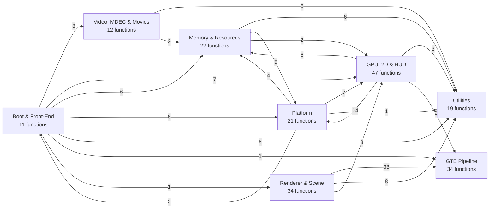
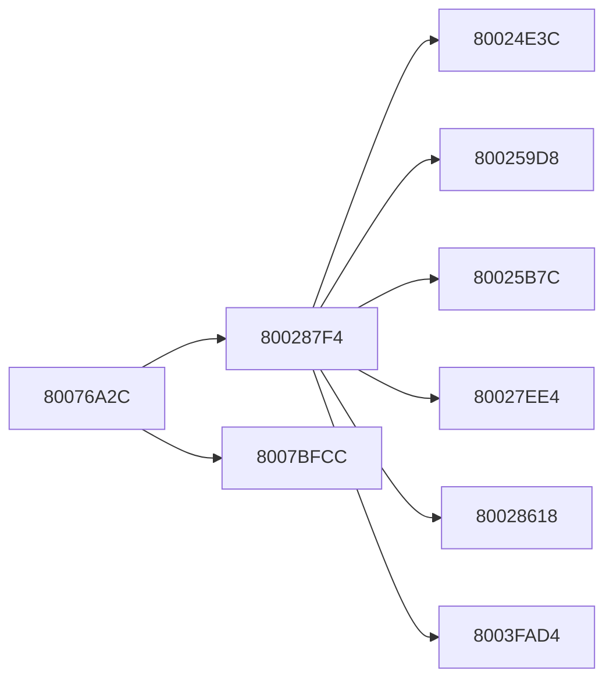
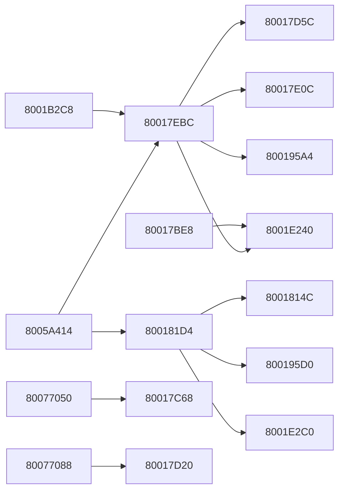
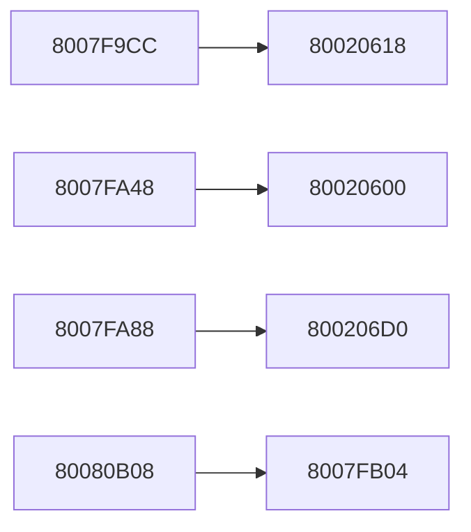
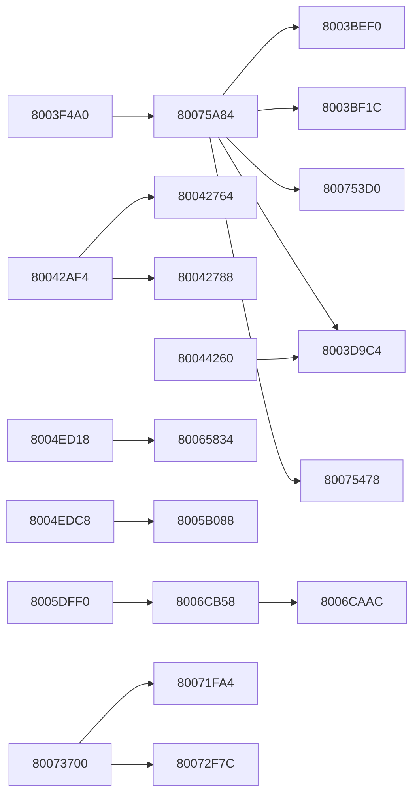
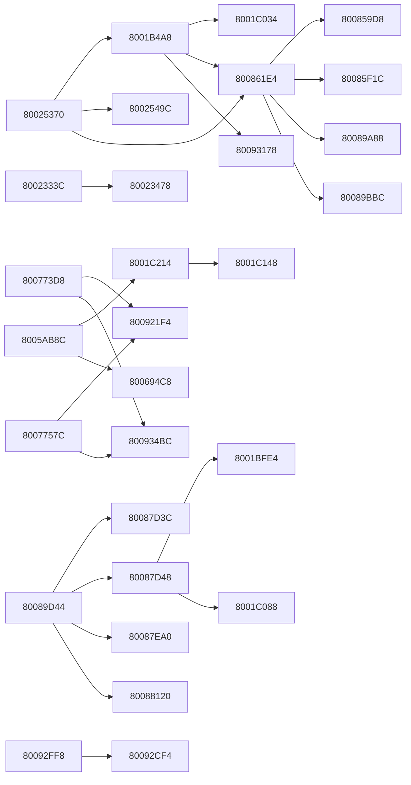
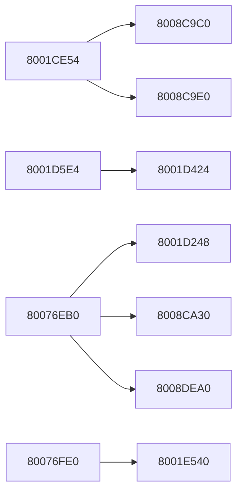
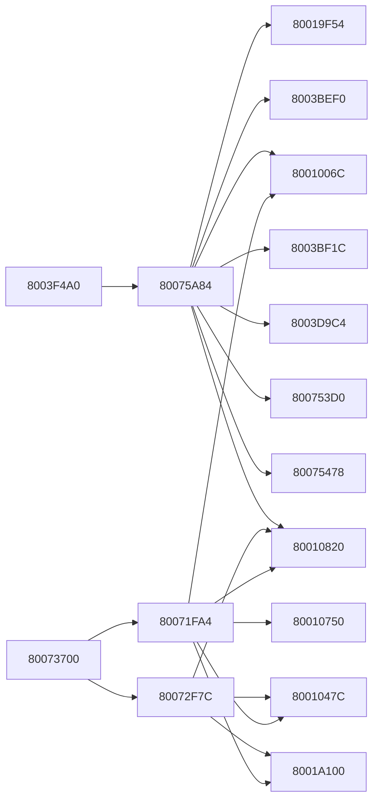

# Function map - documented functions (200 units)

Markdown map of every function whose source carries a `// Categories:` line: the category is the first line of each `src/game/<addr>.c`, sizes come from `config/us/matching_units.json`, edges from `analysis/edges.json`.

**Reading the map.** Each node is a documented function (hex address). Edges are **direct calls** and only between two documented functions, so a missing edge means "the caller lies outside this set" or "not in the graph", never "no call". `jalr` calls, jump tables and `address_taken` edges are not drawn. The category column shows the full primary path, further tags of line 1 in short form after `·`.

Regenerate with `python3 tools/build_function_map.py` (add `--check` in CI to detect a stale map); do not edit this file by hand.

## Areas

One box per area; the number on an edge is the count of direct calls between documented functions of those areas.

## Areas in detail

### Boot & Front-End - 11 functions, 8 calls inside the area

Start, main loop and front-end. `func_80076A2C` is the **logical** entry point: the PS-X-EXE startup (PC0 `0x80096520`) clears `.bss`, computes the heap from `D_8009EA04`/`D_8009EA08`, sets `$gp` and calls it. Memory, file and image paths run from here, then the screen state machine on `D_8009FA00`.

2 further functions of this area without a documented connection (see the table below): `func_8001E4E4`, `func_8001F0B8`.

| Function | Bytes | Categories | calls (documented) | called by (documented) |
|---|---|---|---|---|
| `func_8001F0B8` | 68 | Game Engine > Timing · Interrupts | - | `func_80076EB0` |
| `func_8001E4E4` | 92 | Input > Controller Init · Device Init | `func_80095878` | `func_80076EB0` |
| `func_80024E3C` | 140 | Game Engine > Screen Loading · File Access | `func_8008CD30` | `func_800287F4` |
| `func_80027EE4` | 156 | Game Engine > Interactive Loop · Frame Timing | - | `func_800287F4` |
| `func_8003FAD4` | 188 | Game Engine > Screen Teardown · Scene List, Display Setup | `func_80092C8C`, `func_80092F38` | `func_800287F4` |
| `func_8007BFCC` | 188 | Game Engine > Front-End Configuration · Port Presets | - | `func_80076A2C` |
| `func_800287F4` | 200 | Game Engine > Screen Dispatch · Resources, Graphics | `func_80010030`, `func_80024E3C`, `func_800259D8`, `func_80025B7C`, `func_80027EE4`, `func_80028618`, `func_80029E64`, `func_8003FAD4`, `func_80048E28`, `func_80048E94` | `func_80076A2C` |
| `func_80025B7C` | 384 | Game Engine > Screen State Machine · Module Teardown | `func_80092C8C` | `func_800287F4` |
| `func_800259D8` | 420 | Game Engine > Screen Frame · Display Setup | `func_8001B4A8`, `func_80025370`, `func_80025690`, `func_80092660` | `func_800287F4` |
| `func_80028618` | 476 | Game Engine > Gameplay Frame Loop · Rendering, Camera | - | `func_800287F4` |
| `func_80076A2C` | 1156 | Game Engine > Front-End Main Loop · Resources, Graphics, Input, Platform | `func_8001B2C8`, `func_8001B448`, `func_80025370`, `func_800287F4`, `func_80076EB0`, `func_80076FE0`, `func_80077050`, `func_80077088`, `func_800780C0`, `func_8007BFCC`, `func_8007F8BC`, `func_8007F8CC`, `func_8007F8E0`, `func_8007F9CC`, `func_8007FA48`, `func_8007FA88`, `func_8007FACC`, `func_80080B08`, `func_80083130`, `func_80089D44`, `func_8008CC90`, `func_8008CCB0`, `func_8008CD30`, `func_800965C8` | - |

### Memory & Resources - 22 functions, 13 calls inside the area

Two allocators (block allocator at the bottom, mode allocator at the top), three pools, the four file slots (`D_800A6D78`) and the load/unpack paths. The rest of the program takes its buffers here; the CD-ROM and movie code feeds this layer.

6 further functions of this area without a documented connection (see the table below): `func_80017BA0`, `func_8001B448`, `func_8001E110`, `func_80029650`, `func_80029E64`, `func_80083130`.

| Function | Bytes | Categories | calls (documented) | called by (documented) |
|---|---|---|---|---|
| `func_800195D0` | 32 | Resources > Memory Pools | - | `func_800181D4` |
| `func_80077088` | 32 | Resources > Memory Pools | `func_80017D20` | `func_80076A2C` |
| `func_800195A4` | 44 | Resources > Memory Pools | - | `func_80017EBC` |
| `func_80077050` | 56 | Resources > Memory Pools | `func_80017C68` | `func_80076A2C` |
| `func_80017D20` | 60 | Resources > Memory Pools | - | `func_80077088` |
| `func_8001E2C0` | 68 | Resources > Memory Management · Memory | - | `func_800181D4`, `func_80076FE0` |
| `func_80017BA0` | 72 | Resources > Memory Management · Memory | - | `func_80076FE0` |
| `func_80029E64` | 84 | Resources > Asset Registry | - | `func_800287F4` |
| `func_8001B448` | 96 | Resources > Memory Management | - | `func_80076A2C` |
| `func_80017BE8` | 128 | Resources > Memory Management · Memory | `func_8001E240` | `func_80076EB0` |
| `func_8001E240` | 128 | Resources > Memory Management · Memory | - | `func_80017BE8`, `func_80017EBC`, `func_80076EB0` |
| `func_8001814C` | 136 | Resources > Memory Management | - | `func_800181D4` |
| `func_80017D5C` | 176 | Resources > Memory Management · Memory | - | `func_80017EBC` |
| `func_80017E0C` | 176 | Resources > Memory Management · Memory | - | `func_80017EBC` |
| `func_80017C68` | 184 | Resources > Memory Pools · Memory | - | `func_80077050` |
| `func_80029650` | 208 | Resources > Asset Registry · Reference Counting | - | `func_8001B4A8` |
| `func_8001E110` | 304 | Resources > File Access · CD-ROM | `func_8001D424`, `func_8001D5E4`, `func_8001E004` | `func_80025370` |
| `func_80083130` | 336 | Resources > Mission Table · Front-End Module Lookup | `func_8008CCA0`, `func_8008CCC0`, `func_8008CCF0` | `func_80076A2C` |
| `func_8001B2C8` | 384 | Resources > Memory Allocation · Render Buffers | `func_80017EBC`, `func_8001C034`, `func_80093178` | `func_80076A2C` |
| `func_8005A414` | 576 | Resources > Graphics Assets > Texture Upload · VRAM Transfer | `func_80017EBC`, `func_800181D4`, `func_80092C8C`, `func_80092F38` | - |
| `func_800181D4` | 652 | Resources > Memory Management | `func_8001814C`, `func_800195D0`, `func_8001E2C0`, `func_8001E318`, `func_8001E44C` | `func_80025370`, `func_8005A414`, `func_80063C5C`, `func_8007FA48`, `func_800861E4` |
| `func_80017EBC` | 656 | Resources > Memory Management · Memory | `func_80017D5C`, `func_80017E0C`, `func_800195A4`, `func_8001E240`, `func_8001E318` | `func_8001B2C8`, `func_8005A414`, `func_8007F9CC`, `func_800861E4` |

### Video, MDEC & Movies - 12 functions, 4 calls inside the area

MDEC tables, decode callbacks and movie/image output. Few internal edges because these functions are driven from the (not yet documented) playback path.

4 further functions of this area without a documented connection (see the table below): `func_8007F8BC`, `func_8007F8CC`, `func_8007F8E0`, `func_8007FACC`.

| Function | Bytes | Categories | calls (documented) | called by (documented) |
|---|---|---|---|---|
| `func_80020600` | 16 | Resources > Movie Playback | - | `func_8007FA48` |
| `func_8007F8BC` | 16 | Resources > Movie Playback · Timing | - | `func_80076A2C` |
| `func_8007F8CC` | 20 | Resources > Movie Playback | - | `func_80076A2C` |
| `func_8007F8E0` | 28 | Resources > Movie Playback · Frame State | - | `func_80076A2C` |
| `func_8007FACC` | 56 | Resources > Movie Playback · Display State | - | `func_80076A2C` |
| `func_8007FA48` | 64 | Resources > Movie Playback · Memory Management | `func_800181D4`, `func_80020600` | `func_80076A2C` |
| `func_8007FA88` | 68 | Resources > Movie Playback · State Machine | `func_800206D0` | `func_80076A2C` |
| `func_80080B08` | 104 | Resources > Movie Playback · State Machine | `func_8007FB04` | `func_80076A2C` |
| `func_8007F9CC` | 124 | Resources > Movie Playback · MDEC | `func_80017EBC`, `func_8001E4C0`, `func_80020610`, `func_80020618` | `func_80076A2C` |
| `func_80020618` | 184 | Resources > Movie Playback · MDEC | `func_8001E4C0`, `func_80020610` | `func_8007F9CC` |
| `func_800206D0` | 188 | Resources > Movie Playback · MDEC | `func_8001E4C0` | `func_8007FA88` |
| `func_8007FB04` | 1292 | Resources > Movie Playback · State Machine, MDEC | `func_8001E4C0` | `func_80080B08` |

### GTE Pipeline - 34 functions, 0 calls inside the area

Initialisation (`H`, `DQA`, `DQB`, `ZSF`), matrix loaders, batch transform, projection (RTPS/RTPT) and lighting (NCCS). The renderer requests this chain, the game code does not, which is why the edges point inwards.

_No calls between documented functions of this area._

| Function | Bytes | Categories | calls (documented) | called by (documented) |
|---|---|---|---|---|
| `func_80095A10` | 12 | Graphics > GTE > Projection · GTE | - | `func_80010030` |
| `func_800959F0` | 24 | Graphics > GTE > Projection · GTE | - | `func_80010030` |
| `func_800959D0` | 32 | Graphics > GTE > Depth Cueing · GTE | - | - |
| `func_80095B20` | 32 | Graphics > GTE > Depth Sort · GTE | - | - |
| `func_8001072C` | 36 | Graphics > GTE > Transform · GTE | - | - |
| `func_80015F14` | 36 | Graphics > GTE > Lighting · Shading | - | `func_80015F38`, `func_800172A8` |
| `func_80095AAC` | 36 | Graphics > GTE > Interpolation · GTE | - | - |
| `func_80095B40` | 36 | Graphics > GTE > Depth Sort · GTE | - | - |
| `func_80010704` | 40 | Graphics > GTE > Transform · GTE | - | - |
| `func_80095A20` | 40 | Graphics > GTE > Matrix Transform · GTE | - | - |
| `func_80095A48` | 40 | Graphics > GTE > Depth Cueing · Lighting | - | - |
| `func_80095AD0` | 40 | Graphics > GTE > Mathematics · GTE | - | - |
| `func_80095AF8` | 40 | Graphics > GTE > Mathematics · GTE | - | - |
| `func_800648BC` | 44 | Graphics > GTE > Clipping · GTE | - | - |
| `func_800959A0` | 48 | Graphics > GTE > Lighting · GTE | - | - |
| `func_80013ECC` | 60 | Graphics > GTE > Lighting · GTE | - | - |
| `func_80095A70` | 60 | Graphics > GTE > Depth Cueing · Lighting | - | - |
| `func_800640D8` | 68 | Graphics > GTE > Matrix Transform · Geometry | - | - |
| `func_80095B64` | 88 | Graphics > GTE > Vector Product · GTE | - | - |
| `func_80095BBC` | 88 | Graphics > GTE > Vector Product · GTE | - | - |
| `func_8001010C` | 96 | Graphics > GTE > Vector Batch Transform · Geometry | - | - |
| `func_800101D4` | 96 | Graphics > GTE > Vector Batch Transform · Geometry | - | - |
| `func_8001016C` | 104 | Graphics > GTE > Vector Batch Transform · Geometry | - | - |
| `func_80010234` | 108 | Graphics > GTE > Vector Batch Transform · Geometry | - | `func_800164F4`, `func_80065834` |
| `func_80095878` | 128 | Graphics > GTE > Initialisation · GTE | - | `func_8001E4E4` |
| `func_80010974` | 132 | Graphics > GTE > Vector Product · Geometry | - | - |
| `func_800108D8` | 156 | Graphics > GTE > Vector Product · Geometry | - | - |
| `func_8001006C` | 160 | Graphics > GTE > Batch Transform · Geometry | - | `func_8003DB70`, `func_80044260`, `func_8005D060`, `func_8006CB58`, `func_8006DC24`, `func_80071FA4`, `func_80075A84` |
| `func_80010820` | 184 | Graphics > GTE > Matrix Setup · Geometry | - | `func_80014C64`, `func_800164F4`, `func_8003DB70`, `func_80044260`, `func_8005D060`, `func_8006CB58`, `func_8006DC24`, `func_80071FA4`, `func_80072F7C`, `func_80075A84` |
| `func_8001047C` | 208 | Graphics > GTE > Projection · Clipping | - | `func_80014C64`, `func_800164F4`, `func_8006CB58`, `func_8006DC24`, `func_80071FA4`, `func_80072F7C` |
| `func_80010750` | 208 | Graphics > GTE > Matrix Setup · Geometry | - | `func_800164F4`, `func_80044260`, `func_80065834`, `func_8006CB58`, `func_8006DC24`, `func_80071FA4` |
| `func_80010630` | 212 | Graphics > GTE > Projection · Clipping | - | - |
| `func_8001054C` | 228 | Graphics > GTE > Projection · Geometry | - | - |
| `func_800102A0` | 476 | Graphics > GTE > Projection · Clipping | - | - |

### Renderer & Scene - 34 functions, 15 calls inside the area

Dispatcher `func_80073700` (nodes with geometry go to `func_80071FA4`, empty ones to `func_80072F7C`), six layer lists in `func_8003F4A0` (order 2, 3, 0, 1, 4, 5), polygon pass `func_80075A84`, model entries `func_8006CB58`/`func_8006DC24`.

13 further functions of this area without a documented connection (see the table below): `func_80014C64`, `func_80015F38`, `func_800164F4`, `func_80016E6C`, `func_800172A8`, `func_80025690`, `func_8003DB70`, `func_80047BE8`, `func_8005D060`, `func_800646BC`, `func_8006BF44`, `func_8006DC24`, `func_8006F21C`.

| Function | Bytes | Categories | calls (documented) | called by (documented) |
|---|---|---|---|---|
| `func_80042788` | 32 | Graphics > Effects > Object Pool · Utilities | - | `func_80042AF4` |
| `func_80042764` | 36 | Graphics > Effects > Object Pool · Utilities | - | `func_80042AF4` |
| `func_8003BEF0` | 44 | Graphics > Scene Graph > Object List · Utilities | - | `func_80075A84` |
| `func_8003BF1C` | 52 | Graphics > Scene Graph > Object List · Utilities | - | `func_80075A84` |
| `func_8003D9C4` | 52 | Graphics > Scene Graph > Object List · Utilities | - | `func_80044260`, `func_80075A84` |
| `func_80075478` | 64 | Graphics > Lighting > Scene Node · Memory Management | - | `func_80075A84` |
| `func_80073700` | 124 | Graphics > Model Renderer > Scene Traversal | `func_80071FA4`, `func_80072F7C` | - |
| `func_8005DFF0` | 132 | Graphics > Model Renderer > Effects · Effects | `func_8006CB58` | - |
| `func_8003F4A0` | 144 | Graphics > Renderer > Scene Traversal · Frame | `func_80075A84` | - |
| `func_800753D0` | 168 | Graphics > Lighting > Light Source · Scene Node | - | `func_80075A84` |
| `func_8006CAAC` | 172 | Graphics > Model Renderer > Vertex Deform · Animation | - | `func_8006CB58` |
| `func_8004ED18` | 176 | Graphics > Renderer > Entity Pass · Frame | `func_80065834` | - |
| `func_8006F21C` | 244 | Graphics > Model Renderer > Primitives · GPU Primitives | - | - |
| `func_8006BF44` | 316 | Graphics > Model Renderer > Sprites · HUD | - | - |
| `func_80016E6C` | 492 | Graphics > Model Renderer > Polygons · GPU Primitives | - | - |
| `func_800646BC` | 512 | Graphics > Model Renderer > Textured Surfaces · Clipping | - | - |
| `func_8004EDC8` | 524 | Graphics > Renderer > Object Pass · Primitives | `func_8005B088` | - |
| `func_800172A8` | 608 | Graphics > Model Renderer > Gouraud Polygons · GTE | `func_80015F14` | - |
| `func_80025690` | 840 | Graphics > Effects > Fade Quad · GPU Primitives | `func_8001B4A8` | `func_800259D8` |
| `func_80047BE8` | 840 | Graphics > Model Renderer > Gouraud Quad · Effects | `func_8001C214` | - |
| `func_8005B088` | 844 | Graphics > Effects > Markers · Radar | - | `func_8004EDC8` |
| `func_80044260` | 848 | Graphics > Model Renderer > Object Placement · GTE | `func_8001006C`, `func_80010750`, `func_80010820`, `func_8001A100`, `func_8003D9C4` | - |
| `func_8005D060` | 924 | Graphics > Effects > Particles · Model Renderer | `func_8001006C`, `func_80010820`, `func_80019668` | - |
| `func_80065834` | 1140 | Graphics > Model Renderer > Entity Primitives · Culling | `func_80010234`, `func_80010750`, `func_800694C8` | `func_8004ED18` |
| `func_80072F7C` | 1332 | Graphics > Model Renderer > Flat Polygons · Geometry | `func_8001047C`, `func_80010820`, `func_8001A100` | `func_80073700` |
| `func_800164F4` | 1392 | Graphics > Model Renderer > Textured Polygons · GTE | `func_80010234`, `func_8001047C`, `func_80010750`, `func_80010820` | - |
| `func_80015F38` | 1468 | Graphics > Model Renderer > Shaded Polygons · GTE | `func_80015F14` | - |
| `func_80042AF4` | 1884 | Graphics > Effects > Particles · Model Renderer | `func_80019668`, `func_80042764`, `func_80042788` | - |
| `func_80075A84` | 2092 | Graphics > Renderer > Polygon Pass · Lighting | `func_8001006C`, `func_80010820`, `func_80019F54`, `func_8003BEF0`, `func_8003BF1C`, `func_8003D9C4`, `func_800753D0`, `func_80075478` | `func_8003F4A0` |
| `func_8006CB58` | 2504 | Graphics > Model Renderer > Entry Point · Scene Node | `func_8001006C`, `func_8001047C`, `func_80010750`, `func_80010820`, `func_8006CAAC` | `func_8005DFF0` |
| `func_8006DC24` | 2812 | Graphics > Model Renderer > Textured Mesh · Scene Node | `func_8001006C`, `func_8001047C`, `func_80010750`, `func_80010820`, `func_8001A100` | - |
| `func_80014C64` | 3020 | Graphics > Effects > Screen-Space Sprites · GPU Primitives | `func_8001047C`, `func_80010820` | - |
| `func_8003DB70` | 3604 | Graphics > Effects > Debris Spawner · Motion | `func_8001006C`, `func_80010820`, `func_80019668` | - |
| `func_80071FA4` | 4056 | Graphics > Model Renderer > Full Path · Lighting | `func_8001006C`, `func_8001047C`, `func_80010750`, `func_80010820`, `func_8001A100` | `func_80073700` |

### GPU, 2D & HUD - 47 functions, 25 calls inside the area

Packet and VRAM transfers, rectangles, sprites, fades, text and display state. The 2D layer works in half resolution; primitives come from `D_8009FA90`, 3D packets from `D_8009F9F0` (the last slot is reused, never allocated).

18 further functions of this area without a documented connection (see the table below): `func_80010030`, `func_8001BF78`, `func_8001C040`, `func_80026E9C`, `func_80042004`, `func_80048BF8`, `func_80048E28`, `func_80062FB4`, `func_80063C5C`, `func_80082B0C`, `func_80085074`, `func_80091F90`, `func_80092634`, `func_80092660`, `func_800926C0`, `func_80093A4C`, `func_80093A74`, `func_80093A9C`.

| Function | Bytes | Categories | calls (documented) | called by (documented) |
|---|---|---|---|---|
| `func_8001C034` | 12 | Graphics > Display State | - | `func_8001B2C8`, `func_8001B4A8` |
| `func_80087D3C` | 12 | Graphics > Video Layer | - | `func_80089D44` |
| `func_80093A4C` | 40 | Graphics > GPU Command Lists > Draw Mode · GPU | - | - |
| `func_80093A74` | 40 | Graphics > GPU Command Lists > Draw Mode · GPU | - | - |
| `func_80092634` | 44 | Graphics > GPU Command Lists > Draw Mode · GPU | - | - |
| `func_8001BF78` | 48 | Graphics > Fade Layers · GPU | - | `func_80076EB0` |
| `func_80010030` | 60 | Graphics > Display Setup · GTE | `func_800959F0`, `func_80095A10` | `func_800287F4` |
| `func_800921F4` | 60 | Graphics > Sprites > State · Utilities | - | `func_800773D8`, `func_8007757C` |
| `func_800859D8` | 68 | Graphics > Video Decode Output | - | `func_800861E4` |
| `func_8001C040` | 72 | Graphics > Fade Layers · Colour | - | `func_80076EB0` |
| `func_8001BFE4` | 80 | Graphics > Fade Layers · GPU | - | `func_80076EB0`, `func_80087D48` |
| `func_80093A9C` | 84 | Graphics > GPU Command Lists > Draw Mode · GPU | - | - |
| `func_80048E28` | 96 | Graphics > Text/Font · Asset Selection | - | `func_800287F4` |
| `func_80092660` | 96 | Graphics > Display Lists · Primitives | - | `func_800259D8` |
| `func_8001C214` | 104 | Graphics > 2D Drawing > Rectangles · Blending | `func_8001C148` | `func_80047BE8`, `func_8005AB8C` |
| `func_800926C0` | 108 | Graphics > GPU Command Lists > VRAM Transfer · GPU | - | - |
| `func_80023478` | 136 | Graphics > Sprite/Asset Subsystem · Teardown | - | `func_8002333C`, `func_80076FE0` |
| `func_80089D44` | 156 | Graphics > Image Display · Deferred Initialisation | `func_80087D3C`, `func_80087D48`, `func_80087EA0`, `func_80088120` | `func_80076A2C` |
| `func_80093178` | 172 | Graphics > GPU Command Lists · GPU | - | `func_8001B2C8`, `func_8001B4A8` |
| `func_800694C8` | 184 | Graphics > Camera > Minimap · Map | - | `func_8005AB8C`, `func_80065834` |
| `func_80092FF8` | 184 | Graphics > GPU > VRAM Transfer · GPU | `func_80092CF4` | - |
| `func_8001C088` | 192 | Graphics > Fade Layers · Display Setup | - | `func_80076EB0`, `func_80087D48` |
| `func_8001C148` | 204 | Graphics > 2D Drawing > Rectangles · GPU Primitives | - | `func_8001C214` |
| `func_80026E9C` | 204 | Graphics > 2D Drawing > Rectangles · GPU Primitives | - | - |
| `func_80091F90` | 232 | Graphics > GPU > VRAM Transfer · Textures | `func_80092F38` | - |
| `func_80092CF4` | 284 | Graphics > GPU > Debug Validation · GPU | - | `func_80092F38`, `func_80092FF8` |
| `func_80042004` | 292 | Graphics > Primitives > Textured Quad · Effects | - | - |
| `func_80025370` | 300 | Graphics > Image Loading & Display · File Access | `func_800181D4`, `func_8001B4A8`, `func_8001E110`, `func_8002549C`, `func_800861E4`, `func_8008CD30` | `func_800259D8`, `func_80076A2C` |
| `func_80089A88` | 308 | Graphics > Video Decode Tables · Decompression | - | `func_800861E4` |
| `func_8002333C` | 316 | Graphics > Sprite/Asset Subsystem · Memory Management | `func_80023478` | `func_80076EB0` |
| `func_8007757C` | 316 | Graphics > Debug Display · Debug | `func_800921F4`, `func_800934BC` | - |
| `func_80087D48` | 344 | Graphics > Video Layer · Memory Management | `func_8001BFE4`, `func_8001C088` | `func_80089D44` |
| `func_80063C5C` | 364 | Graphics > 2D Drawing > Images · Memory Management | `func_800181D4`, `func_80092C8C`, `func_80092F38` | - |
| `func_800773D8` | 380 | Graphics > Debug Display · Debug | `func_800921F4`, `func_800934BC` | - |
| `func_80062FB4` | 384 | Graphics > Screen Regions > Viewports · HUD | - | - |
| `func_80089BBC` | 392 | Graphics > Video Decode · Decompression | - | `func_800861E4` |
| `func_80085F1C` | 432 | Graphics > Video Decode Tables · Mathematics | - | `func_800861E4` |
| `func_80085074` | 436 | Graphics > Video Decode Output · VRAM Transfer | `func_80092F38` | - |
| `func_8002549C` | 500 | Graphics > Display Setup · GPU Primitives | - | `func_80025370` |
| `func_80048BF8` | 500 | Graphics > Text > Font Upload · VRAM Transfer | `func_80092C8C`, `func_80092F38` | - |
| `func_80082B0C` | 548 | Graphics > Sprites > Atlas · GPU Primitives | - | - |
| `func_80087EA0` | 640 | Graphics > Video Layer · Movie Playback | - | `func_80089D44` |
| `func_800934BC` | 1076 | Graphics > GPU > Drawing Area · GPU | - | `func_800773D8`, `func_8007757C` |
| `func_8005AB8C` | 1276 | Graphics > HUD > Markers · Radar | `func_8001C214`, `func_800694C8` | - |
| `func_80088120` | 1448 | Graphics > Video Decode Output · Frame Conversion | - | `func_80089D44` |
| `func_800861E4` | 1484 | Graphics > Image Decode & Upload · MDEC, Resources | `func_80017EBC`, `func_800181D4`, `func_8001E4C0`, `func_800859D8`, `func_80085F1C`, `func_80089A88`, `func_80089BBC`, `func_8008C9C0`, `func_8008C9E0`, `func_80092B94` | `func_8001B4A8`, `func_80025370` |
| `func_8001B4A8` | 1796 | Graphics > Frame Submission · Frame End, GPU | `func_8001C034`, `func_80029650`, `func_800861E4`, `func_80092C8C`, `func_80092F38`, `func_80093178`, `func_80093280`, `func_8009398C`, `func_80093A0C`, `func_80095C14` | `func_80025370`, `func_80025690`, `func_800259D8` |

### Platform - 21 functions, 7 calls inside the area

CD-ROM, interrupts, BIOS wrappers and memory card - constraints, not graphics code.

10 further functions of this area without a documented connection (see the table below): `func_8001C680`, `func_8001C718`, `func_8001E004`, `func_80092B94`, `func_80092C8C`, `func_80092F38`, `func_80093280`, `func_8009398C`, `func_80093A0C`, `func_800965C8`.

| Function | Bytes | Categories | calls (documented) | called by (documented) |
|---|---|---|---|---|
| `func_8008C9E0` | 28 | Platform > Interrupts · CPU | - | `func_8001CE54`, `func_800861E4` |
| `func_8008C9C0` | 32 | Platform > Interrupts · CPU | - | `func_8001CE54`, `func_800861E4` |
| `func_80093A0C` | 64 | Platform > GPU · Display Setup | - | `func_8001B4A8` |
| `func_8001E540` | 72 | Platform > Device Shutdown · Controller | - | `func_80076FE0` |
| `func_8008CA30` | 96 | Platform > Memory · Memory Management | - | `func_80076EB0` |
| `func_80092B94` | 96 | Platform > MDEC · Video Decode | - | `func_800861E4` |
| `func_80092F38` | 96 | Platform > GPU · VRAM Transfer | `func_80092CF4` | `func_8001B4A8`, `func_8003FAD4`, `func_80048BF8`, `func_8005A414`, `func_80063C5C`, `func_80085074`, `func_80091F90` |
| `func_80092C8C` | 104 | Platform > GPU | - | `func_8001B4A8`, `func_80025B7C`, `func_8003FAD4`, `func_80048BF8`, `func_8005A414`, `func_80063C5C` |
| `func_80076FE0` | 112 | Platform > System Shutdown · Memory Management | `func_80017BA0`, `func_8001E2C0`, `func_8001E540`, `func_80023478` | `func_80076A2C` |
| `func_80093280` | 112 | Platform > GPU · GPU Command Lists | - | `func_8001B4A8` |
| `func_800965C8` | 112 | Platform > Runtime Init · Utilities | - | `func_80076A2C` |
| `func_8009398C` | 128 | Platform > GPU · Display Setup | - | `func_8001B4A8` |
| `func_8008DEA0` | 144 | Platform > CD-ROM · Device Init | `func_8008E000` | `func_80076EB0` |
| `func_8001C680` | 152 | Platform > Memory Card · Serial Port | - | - |
| `func_8001D5E4` | 236 | Platform > CD-ROM · File Access | `func_8001D424` | `func_8001E110` |
| `func_8001C718` | 240 | Platform > Memory Card · File Access | - | - |
| `func_8001E004` | 268 | Platform > CD-ROM · File Access | - | `func_8001E110` |
| `func_80076EB0` | 304 | Platform > System Init · Boot, Resources, Graphics | `func_80017BE8`, `func_8001BF78`, `func_8001BFE4`, `func_8001C040`, `func_8001C088`, `func_8001D248`, `func_8001E240`, `func_8001E4E4`, `func_8001F0B8`, `func_8002333C`, `func_8008CA30`, `func_8008DEA0` | `func_80076A2C` |
| `func_8001D248` | 352 | Platform > CD-ROM · Device Init | - | `func_80076EB0` |
| `func_8001D424` | 448 | Platform > CD-ROM · File Access | - | `func_8001D5E4`, `func_8001E110` |
| `func_8001CE54` | 588 | Platform > Memory Card > File Operations · File Access | `func_8008C9C0`, `func_8008C9E0` | - |

### Utilities - 19 functions, 0 calls inside the area

Mathematics (vector length, fixed point, reciprocal tables) and the lagged-Fibonacci RNG over `D_800A0480`, used by the renderer and the effects.

_No calls between documented functions of this area._

| Function | Bytes | Categories | calls (documented) | called by (documented) |
|---|---|---|---|---|
| `func_80020610` | 8 | Utilities > Constants · Movie Playback | - | `func_80020618`, `func_8007F9CC` |
| `func_80048E94` | 8 | Utilities > Constants | - | `func_800287F4` |
| `func_8008CD30` | 12 | Utilities > Formatting · Library | - | `func_80024E3C`, `func_80025370`, `func_80076A2C` |
| `func_8008CC90` | 16 | Utilities > String · BIOS | - | `func_80076A2C` |
| `func_8008CCA0` | 16 | Utilities > String · BIOS | - | `func_80083130` |
| `func_8008CCB0` | 16 | Utilities > String · BIOS | - | `func_80076A2C` |
| `func_8008CCC0` | 16 | Utilities > String · BIOS | - | `func_80083130` |
| `func_8008CCF0` | 16 | Utilities > String · BIOS | - | `func_80083130` |
| `func_8008E000` | 16 | Utilities > Output · BIOS | - | `func_8008DEA0` |
| `func_80095C14` | 24 | Utilities > Mathematics · GTE | - | `func_8001B4A8` |
| `func_800780C0` | 28 | Utilities > Character Table · Text | - | `func_80076A2C` |
| `func_8001E4C0` | 36 | Utilities > Memory | - | `func_80020618`, `func_800206D0`, `func_8007F9CC`, `func_8007FB04`, `func_800861E4` |
| `func_8001A100` | 60 | Utilities > Mathematics > Vector Length · Culling | - | `func_80044260`, `func_8006DC24`, `func_80071FA4`, `func_80072F7C` |
| `func_80019668` | 92 | Utilities > Random Numbers | - | `func_8003DB70`, `func_80042AF4`, `func_8005D060` |
| `func_80019904` | 104 | Utilities > Mathematics > Fixed Point · Geometry | - | - |
| `func_8001E44C` | 116 | Utilities > Memory | - | `func_800181D4` |
| `func_80019F54` | 120 | Utilities > Mathematics > Vector Length · Culling | - | `func_80075A84` |
| `func_80095900` | 148 | Utilities > Mathematics > Reciprocal · Geometry | - | - |
| `func_8001E318` | 308 | Utilities > Memory | - | `func_80017EBC`, `func_800181D4` |

## Rendering core chain

Breadth-first walk from `func_8003F4A0` (render pass driver) **and** `func_80073700` (object dispatcher), two levels deep over documented calls: the path a frame takes.

Stage order (measured): matrix load (`func_80010750` / `func_80010820`) - batch transform (`func_8001006C` / `func_80010234`) - projection (`func_800102A0` / `func_8001047C`) - lighting (`func_80015F14`) - packet from `D_8009F9F0`.

## Limits of the map

- **No documented caller (68):** `func_8001010C`, `func_8001016C`, `func_800101D4`, `func_800102A0`, `func_8001054C`, `func_80010630`, `func_80010704`, `func_8001072C`, `func_800108D8`, `func_80010974`, `func_80013ECC`, `func_80014C64`, `func_80015F38`, `func_800164F4`, `func_80016E6C`, `func_800172A8` ... (+52)
- **No documented call (134):** `func_8001006C`, `func_8001010C`, `func_8001016C`, `func_800101D4`, `func_80010234`, `func_800102A0`, `func_8001047C`, `func_8001054C`, `func_80010630`, `func_80010704`, `func_8001072C`, `func_80010750`, `func_80010820`, `func_800108D8`, `func_80010974`, `func_80013ECC` ... (+118)
These are entry points and leaves of the documented part; their counterparts lie outside this set or are reached indirectly.

- **Most called (hubs):**

| Function | calls (documented) | callers (documented) | area |
|---|---|---|---|
| `func_80076A2C` | 24 | 0 | Boot & Front-End |
| `func_80076EB0` | 12 | 1 | Platform |
| `func_8001B4A8` | 10 | 3 | GPU, 2D & HUD |
| `func_800287F4` | 10 | 1 | Boot & Front-End |
| `func_800861E4` | 10 | 2 | GPU, 2D & HUD |
| `func_80075A84` | 8 | 1 | Renderer & Scene |
| `func_80025370` | 6 | 2 | GPU, 2D & HUD |
| `func_80017EBC` | 5 | 4 | Memory & Resources |
| `func_800181D4` | 5 | 5 | Memory & Resources |
| `func_80044260` | 5 | 0 | Renderer & Scene |
| `func_8006CB58` | 5 | 1 | Renderer & Scene |
| `func_8006DC24` | 5 | 0 | Renderer & Scene |

