# Function map - documented functions (401 units)

Markdown map of every function whose source carries a `// Categories:` line: the category is the first line of each `src/game/<addr>.c`, sizes come from `config/us/matching_units.json`, edges from `analysis/edges.json`.

**Reading the map.** Each node is a documented function (hex address). Edges are **direct calls** and only between two documented functions, so a missing edge means "the caller lies outside this set" or "not in the graph", never "no call". `jalr` calls, jump tables and `address_taken` edges are not drawn. The category column shows the full primary path, further tags of line 1 in short form after `·`.

Regenerate with `python3 tools/build_function_map.py` (add `--check` in CI to detect a stale map); do not edit this file by hand.

## Areas

One box per area; the number on an edge is the count of direct calls between documented functions of those areas.

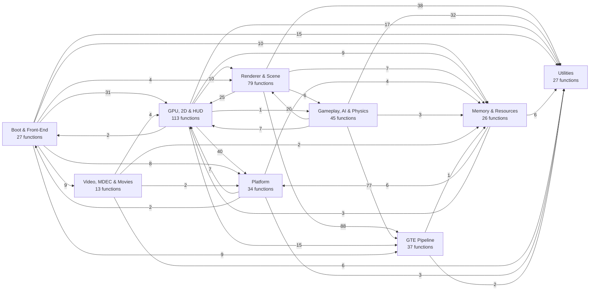

## Areas in detail

### Boot & Front-End - 27 functions, 14 calls inside the area

Start, main loop and front-end. `func_80076A2C` is the **logical** entry point: the PS-X-EXE startup (PC0 `0x80096520`) clears `.bss`, computes the heap from `D_8009EA04`/`D_8009EA08`, sets `$gp` and calls it. Memory, file and image paths run from here, then the screen state machine on `D_8009FA00`.

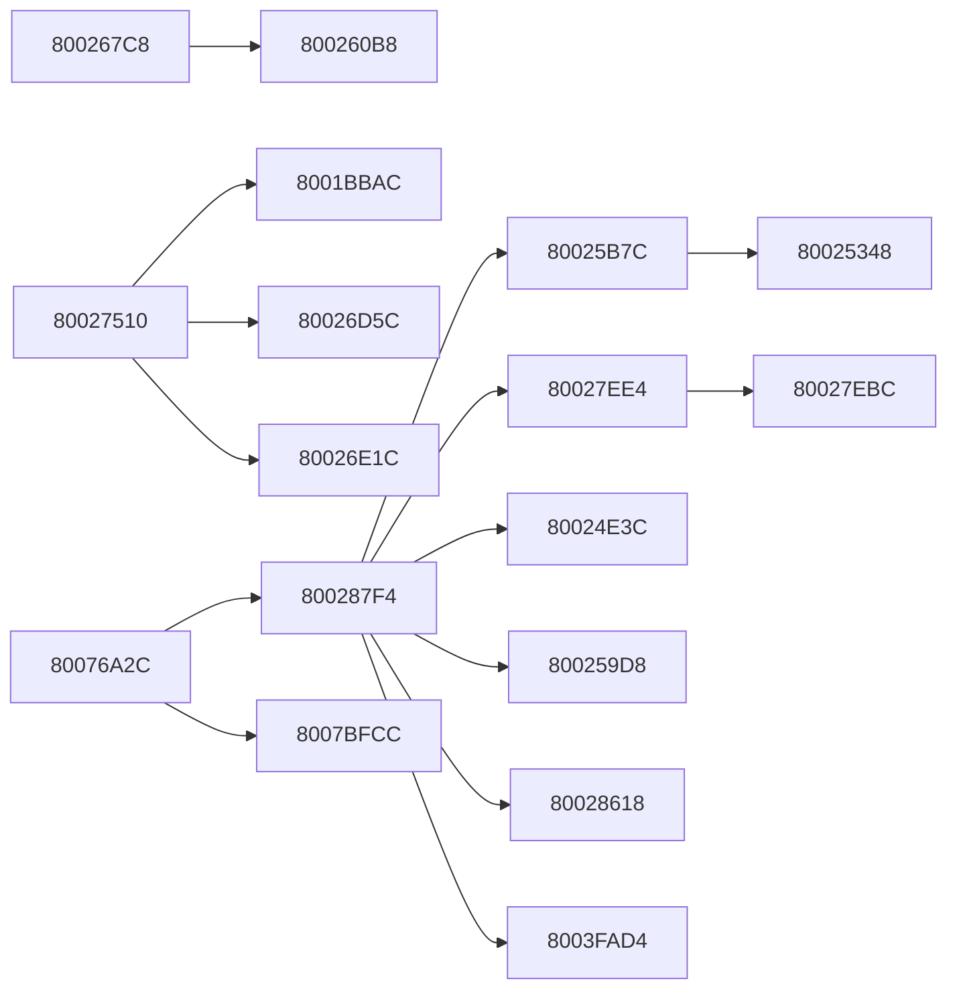

10 further functions of this area without a documented connection (see the table below): `func_8001E4E4`, `func_8001F0B8`, `func_8002C584`, `func_8002E630`, `func_8002EED8`, `func_8003F530`, `func_80070730`, `func_8007F1F8`, `func_8008125C`, `func_80091270`.

| Function | Bytes | Categories | calls (documented) | called by (documented) |
|---|---|---|---|---|
| `func_80025348` | 40 | Game Engine > Frame · Asset Loading | `func_8001B4A8`, `func_80024EC8` | `func_80025B7C` |
| `func_80027EBC` | 40 | Game Engine > Frame · Display | `func_8001B4A8`, `func_80024EC8` | `func_80027EE4` |
| `func_8001BBAC` | 64 | Game Engine > Frame · Display | `func_8001B4A8` | `func_80027510` |
| `func_80026D5C` | 64 | Game Engine > Frame · Scratchpad | `func_80062FB4` | `func_80027510` |
| `func_80026E1C` | 64 | Game Engine > Frame · Scratchpad | `func_80066E98` | `func_80027510` |
| `func_8003F530` | 64 | Game Engine > Frame · Scratchpad | `func_8003F4A0` | - |
| `func_8001F0B8` | 68 | Game Engine > Timing · Interrupts | `func_80091510` | `func_80076EB0` |
| `func_8001E4E4` | 92 | Input > Controller Init · Device Init | `func_80091480`, `func_80095878` | `func_80076EB0` |
| `func_80024E3C` | 140 | Game Engine > Screen Loading · File Access | `func_8008CD30` | `func_800287F4` |
| `func_80027EE4` | 156 | Game Engine > Interactive Loop · Frame Timing | `func_80027EBC` | `func_800287F4` |
| `func_8003FAD4` | 188 | Game Engine > Screen Teardown · Scene List, Display Setup | `func_80092C8C`, `func_80092F38` | `func_800287F4` |
| `func_8007BFCC` | 188 | Game Engine > Front-End Configuration · Port Presets | - | `func_80076A2C` |
| `func_800287F4` | 200 | Game Engine > Screen Dispatch · Resources, Graphics | `func_80010030`, `func_80024E3C`, `func_800259D8`, `func_80025B7C`, `func_80027EE4`, `func_80028618`, `func_80029E64`, `func_8003FAD4`, `func_80048E28`, `func_80048E94` | `func_80076A2C` |
| `func_80091270` | 376 | Game Engine > Frame · Interrupts | - | `func_80085C4C`, `func_80087D48` |
| `func_80025B7C` | 384 | Game Engine > Screen State Machine · Module Teardown | `func_80025348`, `func_80092C8C` | `func_800287F4` |
| `func_800259D8` | 420 | Game Engine > Screen Frame · Display Setup | `func_8001B4A8`, `func_8001BFD8`, `func_8002385C`, `func_80024EC8`, `func_80025370`, `func_80025690`, `func_80086134`, `func_80092660` | `func_800287F4` |
| `func_80028618` | 476 | Game Engine > Gameplay Frame Loop · Rendering, Camera | - | `func_800287F4` |
| `func_8002EED8` | 936 | Game Engine > Object Behaviour > Spawn Path · Object Spawn, Animation Frame | `func_80010234`, `func_80010750`, `func_800188D0` | - |
| `func_8007F1F8` | 976 | Game Engine > Front-End > Character Entry · Rendering, 2D Drawing, Sound | `func_80049100`, `func_800788F0`, `func_80082EF0` | - |
| `func_80076A2C` | 1156 | Game Engine > Front-End Main Loop · Resources, Graphics, Input, Platform | `func_8001B2C8`, `func_8001B448`, `func_80025370`, `func_800287F4`, `func_80076EB0`, `func_80076FE0`, `func_80077050`, `func_80077088`, `func_800780C0`, `func_8007BFCC`, `func_8007F8BC`, `func_8007F8CC`, `func_8007F8E0`, `func_8007F9CC`, `func_8007FA48`, `func_8007FA88`, `func_8007FACC`, `func_80080B08`, `func_80083130`, `func_80089D44`, `func_8008CC90`, `func_8008CCB0`, `func_8008CD30`, `func_800965C8` | - |
| `func_800267C8` | 1364 | Game Engine > Front-End > Map Screen Row · Menu Actions, Tile Renderer, 2D Drawing, Map | `func_8001C214`, `func_800260B8`, `func_80049100`, `func_8005AB8C`, `func_8006680C` | - |
| `func_8002C584` | 1436 | Game Engine > Object Setup > Message 2 · Object Attachment, Actor Transform | `func_80010234`, `func_80010750`, `func_80017668`, `func_800188D0` | - |
| `func_800260B8` | 1808 | Game Engine > Options Menu · Text, Menu Navigation | `func_8001C214`, `func_80049100` | `func_800267C8` |
| `func_80070730` | 1816 | Game Engine > Effects > Impact Placement · Damage, Geometry | `func_8001006C`, `func_80010820`, `func_8001846C`, `func_80019668`, `func_80019F54`, `func_8003D0F0` | - |
| `func_8002E630` | 1868 | Game Engine > Object Update > Tick Handler · Path Movement, Actor Transform, Trigger | `func_80010234`, `func_80010750`, `func_800188D0` | - |
| `func_80027510` | 2144 | Game Engine > Frame · Controller, Rendering, State Machine | `func_80017B60`, `func_8001BBAC`, `func_8001C214`, `func_80026D5C`, `func_80026E1C`, `func_80047F30`, `func_800485AC`, `func_80049100` | - |
| `func_8008125C` | 3524 | Game Engine > Front-End Configuration · Name Entry, Text, Slot Table | `func_80049100`, `func_800788F0`, `func_8007FACC`, `func_80082EF0`, `func_8008CCB0`, `func_8008CCC0`, `func_8008CD30` | - |

### Memory & Resources - 26 functions, 16 calls inside the area

Two allocators (block allocator at the bottom, mode allocator at the top), three pools, the four file slots (`D_800A6D78`) and the load/unpack paths. The rest of the program takes its buffers here; the CD-ROM and movie code feeds this layer.

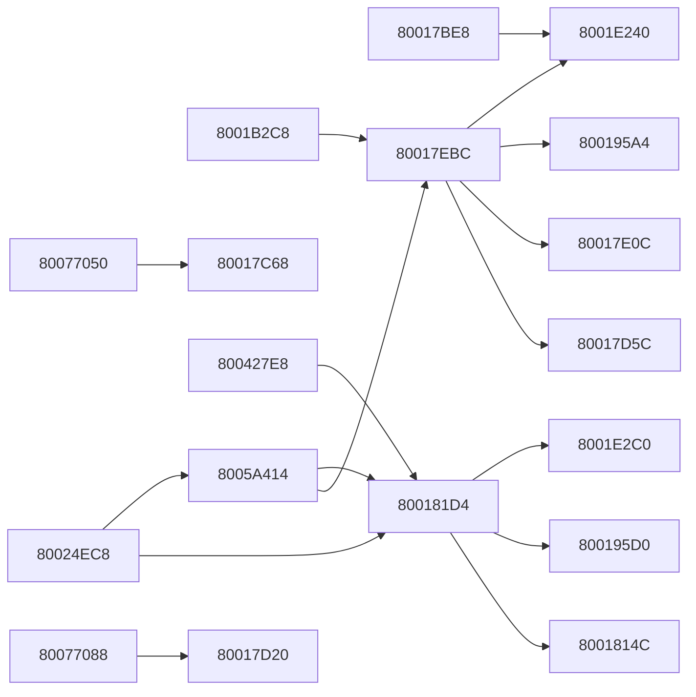

8 further functions of this area without a documented connection (see the table below): `func_80017BA0`, `func_8001B448`, `func_8001E110`, `func_8002385C`, `func_80029650`, `func_80029E64`, `func_80083130`, `func_80098708`.

| Function | Bytes | Categories | calls (documented) | called by (documented) |
|---|---|---|---|---|
| `func_800195D0` | 32 | Resources > Memory Pools | - | `func_800181D4` |
| `func_80077088` | 32 | Resources > Memory Pools | `func_80017D20` | `func_80076A2C` |
| `func_800195A4` | 44 | Resources > Memory Pools | - | `func_80017EBC`, `func_80083A10` |
| `func_80077050` | 56 | Resources > Memory Pools | `func_80017C68` | `func_80076A2C` |
| `func_80017D20` | 60 | Resources > Memory Pools | - | `func_80077088` |
| `func_8001E2C0` | 68 | Resources > Memory Management · Memory | - | `func_800181D4`, `func_80076FE0` |
| `func_80017BA0` | 72 | Resources > Memory Management · Memory | - | `func_80076FE0` |
| `func_80029E64` | 84 | Resources > Asset Registry | - | `func_800287F4` |
| `func_800427E8` | 92 | Resources > Memory Management · Effects | `func_800181D4` | `func_80044610` |
| `func_8001B448` | 96 | Resources > Memory Management | - | `func_80076A2C` |
| `func_80098708` | 124 | Resources > Object Table · Object List | - | `func_80087D48` |
| `func_80017BE8` | 128 | Resources > Memory Management · Memory | `func_8001E240` | `func_80076EB0` |
| `func_8001E240` | 128 | Resources > Memory Management · Memory | - | `func_80017BE8`, `func_80017EBC`, `func_80076EB0` |
| `func_8001814C` | 136 | Resources > Memory Management | - | `func_800181D4` |
| `func_80017D5C` | 176 | Resources > Memory Management · Memory | - | `func_80017EBC` |
| `func_80017E0C` | 176 | Resources > Memory Management · Memory | - | `func_80017EBC` |
| `func_80017C68` | 184 | Resources > Memory Pools · Memory | - | `func_80077050` |
| `func_80029650` | 208 | Resources > Asset Registry · Reference Counting | - | `func_8001B4A8` |
| `func_8002385C` | 212 | Resources > Slot Table · Frame | - | `func_80025690`, `func_800259D8` |
| `func_8001E110` | 304 | Resources > File Access · CD-ROM | `func_8001D424`, `func_8001D5E4`, `func_8001E004` | `func_80025370` |
| `func_80083130` | 336 | Resources > Mission Table · Front-End Module Lookup | `func_8008CCA0`, `func_8008CCC0`, `func_8008CCF0` | `func_80076A2C` |
| `func_8001B2C8` | 384 | Resources > Memory Allocation · Render Buffers | `func_80017EBC`, `func_8001C034`, `func_80093178` | `func_80076A2C` |
| `func_8005A414` | 576 | Resources > Graphics Assets > Texture Upload · VRAM Transfer | `func_80017EBC`, `func_800181D4`, `func_8008CD10`, `func_80092C8C`, `func_80092F38` | `func_80024EC8` |
| `func_800181D4` | 652 | Resources > Memory Management | `func_8001814C`, `func_800195D0`, `func_8001E2C0`, `func_8001E318`, `func_8001E44C` | `func_80024EC8`, `func_80025370`, `func_80040874`, `func_800427E8`, `func_8005A414`, `func_80063C5C`, `func_8006FF44`, `func_80073BBC`, `func_8007FA48`, `func_800861E4`, `func_800879BC` |
| `func_80017EBC` | 656 | Resources > Memory Management · Memory | `func_80017D5C`, `func_80017E0C`, `func_800195A4`, `func_8001E240`, `func_8001E318` | `func_80013A14`, `func_8001B2C8`, `func_8003AA94`, `func_8004ABE4`, `func_8005A414`, `func_80073500`, `func_80073BBC`, `func_8007F9CC`, `func_800861E4` |
| `func_80024EC8` | 1152 | Resources > Asset Loader · Asset Dispatch | `func_800181D4`, `func_8005A414`, `func_80063C5C` | `func_80025348`, `func_80025690`, `func_800259D8`, `func_80027EBC` |

### Video, MDEC & Movies - 13 functions, 4 calls inside the area

MDEC tables, decode callbacks and movie/image output. Few internal edges because these functions are driven from the (not yet documented) playback path.

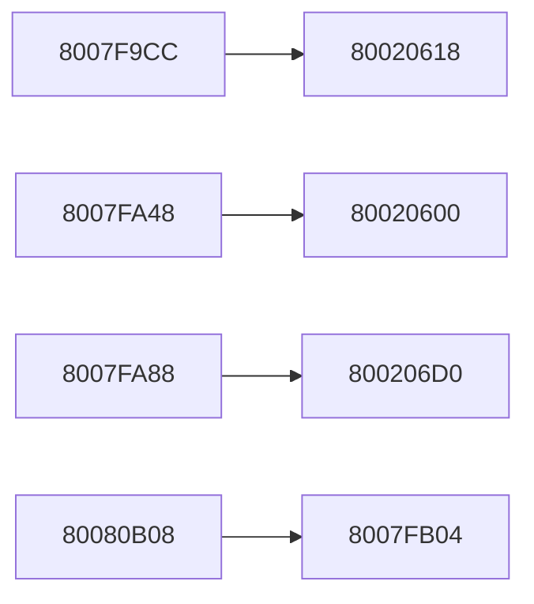

5 further functions of this area without a documented connection (see the table below): `func_8007F8BC`, `func_8007F8CC`, `func_8007F8E0`, `func_8007FACC`, `func_80085228`.

| Function | Bytes | Categories | calls (documented) | called by (documented) |
|---|---|---|---|---|
| `func_80020600` | 16 | Resources > Movie Playback | - | `func_8007FA48` |
| `func_8007F8BC` | 16 | Resources > Movie Playback · Timing | - | `func_80076A2C` |
| `func_8007F8CC` | 20 | Resources > Movie Playback | - | `func_80076A2C` |
| `func_8007F8E0` | 28 | Resources > Movie Playback · Frame State | - | `func_80076A2C` |
| `func_8007FACC` | 56 | Resources > Movie Playback · Display State | - | `func_80076A2C`, `func_8008125C` |
| `func_8007FA48` | 64 | Resources > Movie Playback · Memory Management | `func_800181D4`, `func_80020600` | `func_80076A2C` |
| `func_8007FA88` | 68 | Resources > Movie Playback · State Machine | `func_800206D0` | `func_80076A2C` |
| `func_80080B08` | 104 | Resources > Movie Playback · State Machine | `func_8007FB04` | `func_80076A2C` |
| `func_8007F9CC` | 124 | Resources > Movie Playback · MDEC | `func_80017EBC`, `func_8001E4C0`, `func_80020610`, `func_80020618` | `func_80076A2C` |
| `func_80020618` | 184 | Resources > Movie Playback · MDEC | `func_8001E4C0`, `func_80020610` | `func_8007F9CC` |
| `func_800206D0` | 188 | Resources > Movie Playback · MDEC | `func_8001E4C0` | `func_8007FA88` |
| `func_80085228` | 1032 | Resources > Movie Playback · Frame Slice Upload, MDEC, DMA | `func_80089BBC`, `func_80095E90`, `func_80095FE8`, `func_80095FF4`, `func_80096070`, `func_800960CC` | - |
| `func_8007FB04` | 1292 | Resources > Movie Playback · State Machine, MDEC | `func_8001E4C0` | `func_80080B08` |

### GTE Pipeline - 37 functions, 5 calls inside the area

Initialisation (`H`, `DQA`, `DQB`, `ZSF`), matrix loaders, batch transform, projection (RTPS/RTPT) and lighting (NCCS). The renderer requests this chain, the game code does not, which is why the edges point inwards.

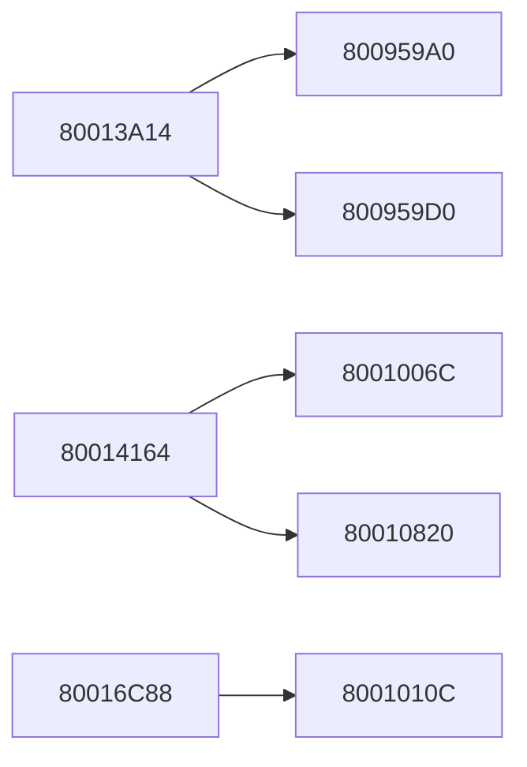

29 further functions of this area without a documented connection (see the table below): `func_8001016C`, `func_800101D4`, `func_80010234`, `func_800102A0`, `func_8001047C`, `func_8001054C`, `func_80010630`, `func_80010704`, `func_8001072C`, `func_80010750`, `func_800108D8`, `func_80010974`, `func_80013ECC`, `func_80015F14`, `func_800640D8`, `func_800648BC`, `func_80095878`, `func_800959F0`, `func_80095A10`, `func_80095A20`, `func_80095A48`, `func_80095A70`, `func_80095AAC`, `func_80095AD0`, `func_80095AF8`, `func_80095B20`, `func_80095B40`, `func_80095B64`, `func_80095BBC`.

| Function | Bytes | Categories | calls (documented) | called by (documented) |
|---|---|---|---|---|
| `func_80095A10` | 12 | Graphics > GTE > Projection · GTE | - | `func_80010030` |
| `func_800959F0` | 24 | Graphics > GTE > Projection · GTE | - | `func_80010030` |
| `func_800959D0` | 32 | Graphics > GTE > Depth Cueing · GTE | - | `func_80013A14` |
| `func_80095B20` | 32 | Graphics > GTE > Depth Sort · GTE | - | - |
| `func_8001072C` | 36 | Graphics > GTE > Transform · GTE | - | - |
| `func_80015F14` | 36 | Graphics > GTE > Lighting · Shading | - | `func_80015F38`, `func_800172A8` |
| `func_80095AAC` | 36 | Graphics > GTE > Interpolation · GTE | - | - |
| `func_80095B40` | 36 | Graphics > GTE > Depth Sort · GTE | - | - |
| `func_80010704` | 40 | Graphics > GTE > Transform · GTE | - | `func_8006F310`, `func_80070158` |
| `func_80095A20` | 40 | Graphics > GTE > Matrix Transform · GTE | - | - |
| `func_80095A48` | 40 | Graphics > GTE > Depth Cueing · Lighting | - | - |
| `func_80095AD0` | 40 | Graphics > GTE > Mathematics · GTE | - | - |
| `func_80095AF8` | 40 | Graphics > GTE > Mathematics · GTE | - | - |
| `func_800648BC` | 44 | Graphics > GTE > Clipping · GTE | - | `func_800648E8` |
| `func_800959A0` | 48 | Graphics > GTE > Lighting · GTE | - | `func_80013A14` |
| `func_80013ECC` | 60 | Graphics > GTE > Lighting · GTE | - | `func_80013F08`, `func_8001428C` |
| `func_80095A70` | 60 | Graphics > GTE > Depth Cueing · Lighting | - | - |
| `func_800640D8` | 68 | Graphics > GTE > Matrix Transform · Geometry | - | `func_8006411C` |
| `func_80095B64` | 88 | Graphics > GTE > Vector Product · GTE | - | - |
| `func_80095BBC` | 88 | Graphics > GTE > Vector Product · GTE | - | - |
| `func_8001010C` | 96 | Graphics > GTE > Vector Batch Transform · Geometry | - | `func_80013F08`, `func_8001428C`, `func_80016C88`, `func_8004A048`, `func_80051CC4`, `func_800597C0`, `func_80070158` |
| `func_800101D4` | 96 | Graphics > GTE > Vector Batch Transform · Geometry | - | `func_80013F08`, `func_800592D0` |
| `func_8001016C` | 104 | Graphics > GTE > Vector Batch Transform · Geometry | - | - |
| `func_80010234` | 108 | Graphics > GTE > Vector Batch Transform · Geometry | - | `func_800164F4`, `func_80017668`, `func_8002B588`, `func_8002C584`, `func_8002CC30`, `func_8002DAA4`, `func_8002DC94`, `func_8002E630`, `func_8002EED8`, `func_8002F30C`, `func_8003015C`, `func_800302E8`, `func_80030C60`, `func_800317BC`, `func_800324E0`, `func_80035B7C`, `func_80036E6C`, `func_80037708`, `func_800378BC`, `func_80037EB4`, `func_8003802C`, `func_80038754`, `func_80038A00`, `func_80039C58`, `func_8003A160`, `func_80041488`, `func_80041728`, `func_80041880`, `func_80041C6C`, `func_8005027C`, `func_800518A8`, `func_80052410`, `func_80052D7C`, `func_80057E40`, `func_80058714`, `func_800588D4`, `func_80065834`, `func_80083A10` |
| `func_80095878` | 128 | Graphics > GTE > Initialisation · GTE | - | `func_8001E4E4` |
| `func_80010974` | 132 | Graphics > GTE > Vector Product · Geometry | - | `func_800192AC`, `func_80019310`, `func_8001937C`, `func_800193F8`, `func_80035B7C`, `func_80051C50` |
| `func_80013A14` | 140 | Graphics > GTE > Initialisation · Renderer Setup | `func_80017EBC`, `func_800959A0`, `func_800959D0` | - |
| `func_800108D8` | 156 | Graphics > GTE > Vector Product · Geometry | - | - |
| `func_8001006C` | 160 | Graphics > GTE > Batch Transform · Geometry | - | `func_80013CB8`, `func_80014164`, `func_800178DC`, `func_80031238`, `func_80035B7C`, `func_80038A00`, `func_8003AA94`, `func_8003D9F8`, `func_8003DB70`, `func_80040A00`, `func_80044260`, `func_8004ABE4`, `func_8004AFC0`, `func_8004C5C8`, `func_80052960`, `func_8005CED4`, `func_8005D060`, `func_800619C0`, `func_80061CAC`, `func_8006CB58`, `func_8006DC24`, `func_80070730`, `func_80071B40`, `func_80071FA4`, `func_80074104`, `func_80075A84`, `func_80083A10` |
| `func_80010820` | 184 | Graphics > GTE > Matrix Setup · Geometry | - | `func_80013CB8`, `func_80014164`, `func_80014C64`, `func_800164F4`, `func_800178DC`, `func_80031238`, `func_80035B7C`, `func_80038A00`, `func_8003AA94`, `func_8003D9F8`, `func_8003DB70`, `func_80040A00`, `func_80044260`, `func_80047888`, `func_8004ABE4`, `func_8004AFC0`, `func_8004C5C8`, `func_80051CC4`, `func_80052960`, `func_800597C0`, `func_8005CED4`, `func_8005D060`, `func_800619C0`, `func_80061CAC`, `func_80066E98`, `func_8006CB58`, `func_8006DC24`, `func_8006F310`, `func_80070158`, `func_80070730`, `func_80071B40`, `func_80071FA4`, `func_80072F7C`, `func_80074104`, `func_80075A84`, `func_80083A10` |
| `func_8001047C` | 208 | Graphics > GTE > Projection · Clipping | - | `func_80013F08`, `func_8001428C`, `func_80014C64`, `func_800164F4`, `func_80042128`, `func_80047888`, `func_8004A048`, `func_8004C5C8`, `func_800592D0`, `func_800597C0`, `func_8006CB58`, `func_8006DC24`, `func_80071FA4`, `func_80072F7C`, `func_80074104` |
| `func_80010750` | 208 | Graphics > GTE > Matrix Setup · Geometry | - | `func_80013F08`, `func_8001428C`, `func_800164F4`, `func_80017668`, `func_8002B588`, `func_8002C584`, `func_8002CC30`, `func_8002DAA4`, `func_8002DC94`, `func_8002E630`, `func_8002EED8`, `func_8002F30C`, `func_8003015C`, `func_800302E8`, `func_80030C60`, `func_800317BC`, `func_800324E0`, `func_80035B7C`, `func_80036E6C`, `func_80037708`, `func_800378BC`, `func_80037EB4`, `func_8003802C`, `func_80038754`, `func_80038A00`, `func_80039C58`, `func_8003A160`, `func_80041488`, `func_80041728`, `func_80041880`, `func_80041C6C`, `func_80042128`, `func_80044260`, `func_8004C5C8`, `func_8005027C`, `func_800518A8`, `func_80052410`, `func_80052D7C`, `func_80057E40`, `func_80058714`, `func_800588D4`, `func_800592D0`, `func_80065834`, `func_8006CB58`, `func_8006DC24`, `func_80071FA4`, `func_80074104`, `func_80083A10` |
| `func_80010630` | 212 | Graphics > GTE > Projection · Clipping | - | - |
| `func_8001054C` | 228 | Graphics > GTE > Projection · Geometry | - | - |
| `func_80014164` | 296 | Graphics > GTE > Matrix Composition · Camera | `func_8001006C`, `func_80010820`, `func_80018DC0` | `func_8001428C` |
| `func_800102A0` | 476 | Graphics > GTE > Projection · Clipping | - | - |
| `func_80016C88` | 484 | Graphics > GTE > Per-Vertex Lighting · Geometry | `func_8001010C`, `func_80019904` | `func_80016E6C` |

### Renderer & Scene - 79 functions, 77 calls inside the area

Dispatcher `func_80073700` (nodes with geometry go to `func_80071FA4`, empty ones to `func_80072F7C`), six layer lists in `func_8003F4A0` (order 2, 3, 0, 1, 4, 5), polygon pass `func_80075A84`, model entries `func_8006CB58`/`func_8006DC24`.

The area is large, so only the connected functions are drawn; the table below lists every member.

```mermaid
graph LR
    f80013f08 --> f80013cb8
    f8001428c --> f80013cb8
    f80017508 --> f80013f08
    f800175a0 --> f8001428c
    f8003cf6c --> f800164f4
    f8003cf6c --> f80017508
    f8003db70 --> f8003d0f0
    f8003f4a0 --> f8006f170
    f8003f4a0 --> f8007364c
    f8003f4a0 --> f80075a84
    f8003f6e4 --> f8003cf6c
    f8003f6e4 --> f800445b0
    f8003f6e4 --> f8004c5c8
    f8003f6e4 --> f8005e160
    f8003f6e4 --> f8006e988
    f8003f6e4 --> f8006f844
    f8003f6e4 --> f80070158
    f8003f6e4 --> f80073700
    f8003f6e4 --> f80074104
    f80042af4 --> f8003d9f8
    f80042af4 --> f80042764
    f80042af4 --> f80042788
    f80044260 --> f8003d9c4
    f800445b0 --> f80044260
    f80044610 --> f8003c7b8
    f80044610 --> f8003db70
    f80044610 --> f80042af4
    f8004c5c8 --> f800172a8
    f8004c5c8 --> f8003d9c4
    f8004ed18 --> f80065834
    f8004edc8 --> f8005b088
    f80052d7c --> f80052960
    f800592d0 --> f800536b4
    f800596c4 --> f80014c64
    f800596c4 --> f80017668
    f800597c0 --> f8001484c
    f800597c0 --> f80017508
    f800597c0 --> f80017668
    f800597c0 --> f800592d0
    f800597c0 --> f800596c4
    f8005bde4 --> f80017668
    f8005bde4 --> f8003bef0
    f8005cbcc --> f80017668
    f8005cbcc --> f8003bef0
    f8005d060 --> f80073500
    f8005dff0 --> f8006cb58
    f8005e160 --> f8005dff0
    f8006b23c --> f80017668
    f8006b23c --> f8005bde4
    f8006b23c --> f80073500
    f8006cb58 --> f8006caac
    f8006dc24 --> f8003d9f8
    f8006e988 --> f8003d9f8
    f8006e988 --> f8006cb58
    f8006e988 --> f8006dc24
    f8006f170 --> f8003bf1c
    f8006f310 --> f8006f21c
    f8006f844 --> f8006f310
    f80070158 --> f80014490
    f80070158 --> f8001484c
    f80070158 --> f8003d9f8
    f80071b40 --> f8003d0f0
    f8007364c --> f80071b40
    f80073700 --> f80071fa4
    f80073700 --> f80072f7c
    f80073bbc --> f8003c7b8
    f80073bbc --> f80073500
    f80074104 --> f8003d9c4
    f80074104 --> f8003d9f8
    f80075a84 --> f80017668
    f80075a84 --> f8003bef0
    f80075a84 --> f8003bf1c
    f80075a84 --> f8003d9c4
    f80075a84 --> f8003d9f8
    f80075a84 --> f800753d0
    f80075a84 --> f80075478
    f80075a84 --> f800754b8
    f80013cb8["80013CB8"]
    f80013f08["80013F08"]
    f8001428c["8001428C"]
    f80014490["80014490"]
    f8001484c["8001484C"]
    f80014c64["80014C64"]
    f800164f4["800164F4"]
    f800172a8["800172A8"]
    f80017508["80017508"]
    f800175a0["800175A0"]
    f80017668["80017668"]
    f8003bef0["8003BEF0"]
    f8003bf1c["8003BF1C"]
    f8003c7b8["8003C7B8"]
    f8003cf6c["8003CF6C"]
    f8003d0f0["8003D0F0"]
    f8003d9c4["8003D9C4"]
    f8003d9f8["8003D9F8"]
    f8003db70["8003DB70"]
    f8003f4a0["8003F4A0"]
    f8003f6e4["8003F6E4"]
    f80042764["80042764"]
    f80042788["80042788"]
    f80042af4["80042AF4"]
    f80044260["80044260"]
    f800445b0["800445B0"]
    f80044610["80044610"]
    f8004c5c8["8004C5C8"]
    f8004ed18["8004ED18"]
    f8004edc8["8004EDC8"]
    f80052960["80052960"]
    f80052d7c["80052D7C"]
    f800536b4["800536B4"]
    f800592d0["800592D0"]
    f800596c4["800596C4"]
    f800597c0["800597C0"]
    f8005b088["8005B088"]
    f8005bde4["8005BDE4"]
    f8005cbcc["8005CBCC"]
    f8005d060["8005D060"]
    f8005dff0["8005DFF0"]
    f8005e160["8005E160"]
    f80065834["80065834"]
    f8006b23c["8006B23C"]
    f8006caac["8006CAAC"]
    f8006cb58["8006CB58"]
    f8006dc24["8006DC24"]
    f8006e988["8006E988"]
    f8006f170["8006F170"]
    f8006f21c["8006F21C"]
    f8006f310["8006F310"]
    f8006f844["8006F844"]
    f80070158["80070158"]
    f80071b40["80071B40"]
    f80071fa4["80071FA4"]
    f80072f7c["80072F7C"]
    f80073500["80073500"]
    f8007364c["8007364C"]
    f80073700["80073700"]
    f80073bbc["80073BBC"]
    f80074104["80074104"]
    f800753d0["800753D0"]
    f80075478["80075478"]
    f800754b8["800754B8"]
    f80075a84["80075A84"]
```

14 further functions of this area without a documented connection (see the table below): `func_80015F38`, `func_80016E6C`, `func_80025690`, `func_80037EB4`, `func_8003AA94`, `func_80042128`, `func_80047BE8`, `func_8004A048`, `func_800518A8`, `func_8005CED4`, `func_800646BC`, `func_800648E8`, `func_80065CA8`, `func_8006BF44`.

| Function | Bytes | Categories | calls (documented) | called by (documented) |
|---|---|---|---|---|
| `func_80042788` | 32 | Graphics > Effects > Object Pool · Utilities | - | `func_80042AF4` |
| `func_80042764` | 36 | Graphics > Effects > Object Pool · Utilities | - | `func_80042AF4` |
| `func_8003BEF0` | 44 | Graphics > Scene Graph > Object List · Utilities | - | `func_8005BDE4`, `func_8005CBCC`, `func_80075A84` |
| `func_8003BF1C` | 52 | Graphics > Scene Graph > Object List · Utilities | - | `func_8006F170`, `func_80075A84` |
| `func_8003D9C4` | 52 | Graphics > Scene Graph > Object List · Utilities | - | `func_80044260`, `func_8004C5C8`, `func_80074104`, `func_80075A84` |
| `func_80075478` | 64 | Graphics > Lighting > Scene Node · Memory Management | - | `func_80075A84` |
| `func_8006F844` | 84 | Graphics > Effects > World Quads · Object List Walk | `func_8006F310` | `func_8003F6E4` |
| `func_800175A0` | 88 | Graphics > Model Renderer > Skinned Parts · GPU Primitives | `func_8001428C` | - |
| `func_8005E160` | 92 | Graphics > Model Renderer > Effects · Effects | `func_8005DFF0` | `func_8003F6E4` |
| `func_800445B0` | 96 | Graphics > Model Renderer > Object Placement · Object List Walk | `func_80044260` | `func_8003F6E4` |
| `func_800536B4` | 124 | Graphics > Renderer > Depth Cue Pass · Effects | - | `func_800592D0` |
| `func_80073700` | 124 | Graphics > Model Renderer > Scene Traversal | `func_80071FA4`, `func_80072F7C` | `func_8003F6E4` |
| `func_8005DFF0` | 132 | Graphics > Model Renderer > Effects · Effects | `func_8006CB58` | `func_8005E160` |
| `func_8003F4A0` | 144 | Graphics > Renderer > Scene Traversal · Frame | `func_80040A00`, `func_8006F170`, `func_8007364C`, `func_80075A84` | `func_8003F530` |
| `func_80073500` | 144 | Graphics > Scene Graph > Node Allocation · Memory Pools | `func_80017EBC` | `func_8005D060`, `func_8005D8F4`, `func_8005F018`, `func_8006B23C`, `func_80073BBC` |
| `func_80017508` | 152 | Graphics > Model Renderer > Instance Submission · Culling | `func_80013F08` | `func_8003CF6C`, `func_800597C0` |
| `func_800753D0` | 168 | Graphics > Lighting > Light Source · Scene Node | - | `func_80075A84` |
| `func_80052D7C` | 172 | Graphics > Model Renderer > Animation · GTE | `func_80010234`, `func_80010750`, `func_80052960` | `func_80057E40` |
| `func_8006CAAC` | 172 | Graphics > Model Renderer > Vertex Deform · Animation | - | `func_8006CB58` |
| `func_8006F170` | 172 | Graphics > Scene Graph > Node Update · Frame | `func_8003BF1C` | `func_8003F4A0` |
| `func_8004ED18` | 176 | Graphics > Renderer > Entity Pass · Frame | `func_80065834` | `func_8006680C` |
| `func_8007364C` | 180 | Graphics > Scene Graph > Object List Walk · Part Animation | `func_80071B40` | `func_8003F4A0` |
| `func_8003F6E4` | 184 | Graphics > Renderer > Scene Traversal · Scene Graph | `func_8003CF6C`, `func_800445B0`, `func_8004C5C8`, `func_8005E160`, `func_8006E988`, `func_8006F844`, `func_80070158`, `func_80073700`, `func_80074104` | `func_80066E98` |
| `func_80017668` | 228 | Graphics > Model Renderer > Vertex Fetch · Animation | `func_80010234`, `func_80010750` | `func_8002C584`, `func_800302E8`, `func_80038A00`, `func_80047888`, `func_80057E40`, `func_80058714`, `func_800596C4`, `func_800597C0`, `func_8005BDE4`, `func_8005CBCC`, `func_8005D8F4`, `func_8005F018`, `func_8006B23C`, `func_80075A84` |
| `func_8006F21C` | 244 | Graphics > Model Renderer > Primitives · GPU Primitives | - | `func_8006F310` |
| `func_800596C4` | 252 | Graphics > Effects · Object Draw Handlers | `func_80014C64`, `func_80017668`, `func_80019668` | `func_800597C0` |
| `func_8006BF44` | 316 | Graphics > Model Renderer > Sprites · HUD | - | `func_8006C080` |
| `func_8003CF6C` | 320 | Graphics > Renderer > Depth Cue Pass · Culling | `func_80013AA0`, `func_800164F4`, `func_80017508`, `func_8001A100` | `func_8003F6E4` |
| `func_8003D0F0` | 336 | Graphics > Model Renderer > Vertex Fetch · Animation | - | `func_8003DB70`, `func_80070730`, `func_80071B40` |
| `func_80044610` | 352 | Graphics > Effects > Dispatcher · Effects | `func_8003C7B8`, `func_8003DB70`, `func_800427E8`, `func_80042AF4` | - |
| `func_80042128` | 356 | Graphics > Effects > Quad Batch · GTE | `func_8001047C`, `func_80010750`, `func_800178DC`, `func_80019E70`, `func_80042004` | - |
| `func_8006E988` | 360 | Graphics > Scene Graph > Object List Walk · Renderer | `func_8001A100`, `func_8003D9F8`, `func_8006CB58`, `func_8006DC24` | `func_8003F6E4` |
| `func_80037EB4` | 376 | Graphics > Model Renderer > Basis Orientation · GTE | `func_80010234`, `func_80010750`, `func_800188D0`, `func_800192AC`, `func_80066F78` | `func_800378BC`, `func_8003802C`, `func_8005027C` |
| `func_8003D9F8` | 376 | Graphics > Scene Graph > Object Resolution · GTE | `func_8001006C`, `func_80010820` | `func_8003E984`, `func_80040874`, `func_80042AF4`, `func_8006DC24`, `func_8006E988`, `func_8006FF44`, `func_80070158`, `func_80074104`, `func_80075A84` |
| `func_8005CED4` | 396 | Graphics > Scene Graph > Attached Parts · Geometry | `func_8001006C`, `func_80010820` | `func_8005D8F4` |
| `func_8003C7B8` | 456 | Graphics > Effects > Pool Guard · Memory Pools | - | `func_80040874`, `func_80044610`, `func_8006FF44`, `func_80073BBC` |
| `func_80016E6C` | 492 | Graphics > Model Renderer > Polygons · GPU Primitives | `func_80016C88` | - |
| `func_800646BC` | 512 | Graphics > Model Renderer > Textured Surfaces · Clipping | - | `func_8006531C` |
| `func_8001428C` | 516 | Graphics > Model Renderer > Skinned Parts · GTE | `func_8001010C`, `func_8001047C`, `func_80010750`, `func_80013CB8`, `func_80013ECC`, `func_80014164`, `func_800178DC` | `func_800175A0` |
| `func_8004EDC8` | 524 | Graphics > Renderer > Object Pass · Primitives | `func_8005A9C4`, `func_8005B088` | `func_80047F30` |
| `func_80013CB8` | 532 | Graphics > Scene Graph > Node Transform · Animation, GTE | `func_8001006C`, `func_80010820`, `func_80018DC0` | `func_80013F08`, `func_8001428C` |
| `func_800518A8` | 544 | Graphics > Effects > Shadow / Cone · GTE | `func_80010234`, `func_80010750`, `func_80095900` | - |
| `func_80070158` | 592 | Graphics > Model Renderer > Node Walk · Projection | `func_8001010C`, `func_80010704`, `func_80010820`, `func_80014490`, `func_8001484C`, `func_80019D90`, `func_8001A100`, `func_8003D9F8` | `func_8003F6E4` |
| `func_80013F08` | 604 | Graphics > Model Renderer > Instance Submission · Projection, Clipping, Animation | `func_8001010C`, `func_800101D4`, `func_8001047C`, `func_80010750`, `func_80013CB8`, `func_80013ECC`, `func_800178DC`, `func_80019E70` | `func_80017508` |
| `func_800172A8` | 608 | Graphics > Model Renderer > Gouraud Polygons · GTE | `func_80015F14` | `func_8004C5C8` |
| `func_8005BDE4` | 612 | Graphics > Renderer > Map Cell Sprite · Object-Attached Effect, Culling | `func_80017668`, `func_8001A100`, `func_8003BEF0` | `func_8006B23C` |
| `func_8004C5C8` | 700 | Graphics > Scene Graph > Attached Parts · Polygon Pass, Culling, Clipping | `func_8001006C`, `func_8001047C`, `func_80010750`, `func_80010820`, `func_80013AA0`, `func_800172A8`, `func_800188D0`, `func_8001A100`, `func_8003D9C4` | `func_8003F6E4` |
| `func_8005CBCC` | 732 | Graphics > Renderer > Map Cell Sprite · Object-Attached Effect, Object Attachment | `func_80017668`, `func_800193F8`, `func_8001A180`, `func_8003BEF0` | - |
| `func_800597C0` | 764 | Graphics > Effects > Glow Discs · Object Draw Handlers, Primitive Submission, Clipping | `func_8001010C`, `func_8001047C`, `func_80010820`, `func_80013AA0`, `func_8001484C`, `func_80017508`, `func_80017668`, `func_80019D90`, `func_800592D0`, `func_800596C4` | - |
| `func_80025690` | 840 | Graphics > Effects > Fade Quad · GPU Primitives | `func_8001B4A8`, `func_8002385C`, `func_80024EC8`, `func_80028FD4` | `func_800259D8` |
| `func_80047BE8` | 840 | Graphics > Model Renderer > Gouraud Quad · Effects | `func_8001C214` | `func_80047F30` |
| `func_8005B088` | 844 | Graphics > Effects > Markers · Radar | - | `func_8004EDC8` |
| `func_80044260` | 848 | Graphics > Model Renderer > Object Placement · GTE | `func_8001006C`, `func_80010750`, `func_80010820`, `func_8001A100`, `func_8003D9C4` | `func_800445B0` |
| `func_8005D060` | 924 | Graphics > Effects > Particles · Model Renderer | `func_8001006C`, `func_80010820`, `func_800188D0`, `func_80019668`, `func_80073500` | `func_8005D8F4` |
| `func_80014490` | 956 | Graphics > Effects > Disc Primitives · Primitive Submission, Trigonometry | `func_8001846C` | `func_80070158` |
| `func_80073BBC` | 972 | Graphics > Effects > Ribbon Beam · Message Handler, Node Allocation | `func_80017EBC`, `func_800181D4`, `func_8003C7B8`, `func_80073500` | - |
| `func_800592D0` | 1012 | Graphics > Effects > Multi-Point Polygon · GTE | `func_800101D4`, `func_8001047C`, `func_80010750`, `func_800178DC`, `func_80018DC0`, `func_80019E70`, `func_800536B4` | `func_800597C0` |
| `func_8001484C` | 1048 | Graphics > Effects > Gouraud Disc · GPU Primitives | `func_8001846C` | `func_800597C0`, `func_80066684`, `func_80070158` |
| `func_80052960` | 1052 | Graphics > Model Renderer > Animation > Joint Chain · Batch Transform, Geometry | `func_8001006C`, `func_80010820`, `func_80018DC0` | `func_80052D7C` |
| `func_80071B40` | 1124 | Graphics > Model Renderer > Part Animation · GTE | `func_8001006C`, `func_80010820`, `func_8003D0F0` | `func_8007364C` |
| `func_80065834` | 1140 | Graphics > Model Renderer > Entity Primitives · Culling | `func_80010234`, `func_80010750`, `func_80049100`, `func_800694C8` | `func_8004ED18` |
| `func_8006F310` | 1332 | Graphics > Effects > World Quads · Primitives, Projection | `func_80010704`, `func_80010820`, `func_8001A100`, `func_8006F21C` | `func_8006F844` |
| `func_80072F7C` | 1332 | Graphics > Model Renderer > Flat Polygons · Geometry | `func_8001047C`, `func_80010820`, `func_8001A100` | `func_80073700` |
| `func_800164F4` | 1392 | Graphics > Model Renderer > Textured Polygons · GTE | `func_80010234`, `func_8001047C`, `func_80010750`, `func_80010820`, `func_80066F78` | `func_8003CF6C`, `func_80062EB8` |
| `func_80015F38` | 1468 | Graphics > Model Renderer > Shaded Polygons · GTE | `func_80015F14` | - |
| `func_800754B8` | 1484 | Graphics > Renderer > Sprite Node · Actor Transform, GTE | `func_80019668`, `func_8001B148` | `func_80075A84` |
| `func_8003AA94` | 1712 | Graphics > Effects > Particles · Object Spawn, Model Renderer | `func_8001006C`, `func_80010820`, `func_80017EBC`, `func_80018DC0`, `func_80019668`, `func_80066F78` | - |
| `func_80042AF4` | 1884 | Graphics > Effects > Particles · Model Renderer | `func_800188D0`, `func_80019668`, `func_8001B148`, `func_8003D9F8`, `func_80042764`, `func_80042788` | `func_80044610` |
| `func_8006B23C` | 2068 | Graphics > Effects > Part Motion · Motion, Line Pass | `func_80017668`, `func_8001846C`, `func_80019668`, `func_8005BDE4`, `func_8006AAEC`, `func_80073500` | - |
| `func_80075A84` | 2092 | Graphics > Renderer > Polygon Pass · Lighting | `func_8001006C`, `func_80010820`, `func_80017668`, `func_80019F54`, `func_8001A81C`, `func_8003BEF0`, `func_8003BF1C`, `func_8003D9C4`, `func_8003D9F8`, `func_80066F78`, `func_800753D0`, `func_80075478`, `func_800754B8` | `func_8003F4A0` |
| `func_800648E8` | 2124 | Graphics > Renderer > Map Cell Geometry · GPU Primitives, Clipping | `func_800648BC` | - |
| `func_8004A048` | 2268 | Graphics > Renderer > Map Cell Sprite · Projection, Clipping | `func_8001010C`, `func_8001047C`, `func_8001846C`, `func_80019D90`, `func_80019E70`, `func_80049EF8` | - |
| `func_80065CA8` | 2368 | Graphics > Renderer > Map Tile Icons · GPU Primitives, 2D Drawing | - | `func_8006680C` |
| `func_8006CB58` | 2504 | Graphics > Model Renderer > Entry Point · Scene Node | `func_8001006C`, `func_8001047C`, `func_80010750`, `func_80010820`, `func_8006CAAC` | `func_8005DFF0`, `func_8006E988` |
| `func_8006DC24` | 2812 | Graphics > Model Renderer > Textured Mesh · Scene Node | `func_8001006C`, `func_8001047C`, `func_80010750`, `func_80010820`, `func_8001846C`, `func_8001A100`, `func_8003D9F8` | `func_8006E988` |
| `func_80014C64` | 3020 | Graphics > Effects > Screen-Space Sprites · GPU Primitives | `func_8001047C`, `func_80010820` | `func_800596C4` |
| `func_8003DB70` | 3604 | Graphics > Effects > Debris Spawner · Motion | `func_8001006C`, `func_80010820`, `func_800188D0`, `func_80019668`, `func_8003D0F0` | `func_8003E984`, `func_80044610` |
| `func_80071FA4` | 4056 | Graphics > Model Renderer > Full Path · Lighting | `func_8001006C`, `func_8001047C`, `func_80010750`, `func_80010820`, `func_8001A100` | `func_80073700` |
| `func_80074104` | 4256 | Graphics > Renderer > Ribbon Pass · Projection, GPU Primitives | `func_8001006C`, `func_8001047C`, `func_80010750`, `func_80010820`, `func_8001A100`, `func_8001A81C`, `func_8003D9C4`, `func_8003D9F8` | `func_8003F6E4` |

### GPU, 2D & HUD - 113 functions, 105 calls inside the area

Packet and VRAM transfers, rectangles, sprites, fades, text and display state. The 2D layer works in half resolution; primitives come from `D_8009FA90`, 3D packets from `D_8009F9F0` (the last slot is reused, never allocated).

The area is large, so only the connected functions are drawn; the table below lists every member.

```mermaid
graph LR
    f80019d60 --> f80010030
    f8001b4a8 --> f8001c034
    f8001b4a8 --> f800861e4
    f8001b4a8 --> f80093178
    f8001be68 --> f80092140
    f8001be68 --> f800921f4
    f8001be68 --> f80092bf4
    f8001bf78 --> f8001be68
    f8001bfa8 --> f8001c088
    f8001c088 --> f800932f0
    f8001c214 --> f8001c148
    f8002333c --> f8001f0fc
    f8002333c --> f800211fc
    f8002333c --> f80021b50
    f8002333c --> f80023478
    f80025370 --> f8001b4a8
    f80025370 --> f8002549c
    f80025370 --> f800861e4
    f80047f30 --> f8001c214
    f80047f30 --> f80047888
    f80047f30 --> f80049100
    f80047f30 --> f8005ab8c
    f80047f30 --> f8006c080
    f80048a14 --> f80048bf8
    f80048a14 --> f80048e28
    f80048f98 --> f800489c8
    f800491f8 --> f80049100
    f8005a9c4 --> f8005a740
    f8005a9c4 --> f8005a828
    f8005ab8c --> f8001c214
    f8005ab8c --> f800694c8
    f80063c5c --> f80048dec
    f8006680c --> f8001c214
    f8006680c --> f80066684
    f8006680c --> f800694c8
    f80066e98 --> f80017b60
    f80066e98 --> f80062eb8
    f80066e98 --> f8006531c
    f8006c080 --> f800491f8
    f800773d8 --> f80077278
    f800773d8 --> f80092140
    f800773d8 --> f800921f4
    f800773d8 --> f80092bf4
    f800773d8 --> f80092e10
    f800773d8 --> f800932f0
    f800773d8 --> f800934bc
    f8007757c --> f80077278
    f8007757c --> f80092140
    f8007757c --> f800921f4
    f8007757c --> f80092bf4
    f8007757c --> f80092e10
    f8007757c --> f800932f0
    f8007757c --> f800934bc
    f800788f0 --> f80048e28
    f800788f0 --> f80049100
    f8007abbc --> f80049100
    f8007abbc --> f80082ef0
    f8007d7cc --> f800788f0
    f8007d7cc --> f80082ab0
    f8007d7cc --> f80082b0c
    f8007d7cc --> f80082ef0
    f8007d7cc --> f80083060
    f800826ac --> f800861e4
    f80082ab0 --> f80082b0c
    f80085074 --> f80096070
    f80085630 --> f80089bbc
    f80085630 --> f80095fe8
    f80085630 --> f80095ff4
    f80085630 --> f80096070
    f80085c4c --> f80085ac4
    f80085c4c --> f80085f1c
    f80085c4c --> f80092140
    f80085c4c --> f800921f4
    f80085c4c --> f80092bf4
    f80085c4c --> f800932f0
    f80085c4c --> f800934bc
    f80085c4c --> f80096108
    f80085c4c --> f8009612c
    f80086134 --> f80085f1c
    f80086134 --> f80089a88
    f800861e4 --> f800859d8
    f800861e4 --> f80085f1c
    f800861e4 --> f80089a88
    f800861e4 --> f80089bbc
    f800861e4 --> f80095ff4
    f800861e4 --> f80096070
    f800861e4 --> f80096108
    f800861e4 --> f8009612c
    f80087d48 --> f8001bfe4
    f80087d48 --> f8001c088
    f80087d48 --> f800858e0
    f80087d48 --> f80085ac4
    f80087d48 --> f800879bc
    f80089a40 --> f80089a88
    f80089d44 --> f80087d3c
    f80089d44 --> f80087d48
    f80089d44 --> f80087ea0
    f80089d44 --> f80088120
    f80091f90 --> f80092230
    f80092140 --> f80091f74
    f80092e10 --> f80092cf4
    f80092f98 --> f80092cf4
    f80092ff8 --> f80092cf4
    f800934bc --> f80091f74
    f80093a9c --> f80093f58
    f80010030["80010030"]
    f80017b60["80017B60"]
    f80019d60["80019D60"]
    f8001b4a8["8001B4A8"]
    f8001be68["8001BE68"]
    f8001bf78["8001BF78"]
    f8001bfa8["8001BFA8"]
    f8001bfe4["8001BFE4"]
    f8001c034["8001C034"]
    f8001c088["8001C088"]
    f8001c148["8001C148"]
    f8001c214["8001C214"]
    f8001f0fc["8001F0FC"]
    f800211fc["800211FC"]
    f80021b50["80021B50"]
    f8002333c["8002333C"]
    f80023478["80023478"]
    f80025370["80025370"]
    f8002549c["8002549C"]
    f80047888["80047888"]
    f80047f30["80047F30"]
    f800489c8["800489C8"]
    f80048a14["80048A14"]
    f80048bf8["80048BF8"]
    f80048dec["80048DEC"]
    f80048e28["80048E28"]
    f80048f98["80048F98"]
    f80049100["80049100"]
    f800491f8["800491F8"]
    f8005a740["8005A740"]
    f8005a828["8005A828"]
    f8005a9c4["8005A9C4"]
    f8005ab8c["8005AB8C"]
    f80062eb8["80062EB8"]
    f80063c5c["80063C5C"]
    f8006531c["8006531C"]
    f80066684["80066684"]
    f8006680c["8006680C"]
    f80066e98["80066E98"]
    f800694c8["800694C8"]
    f8006c080["8006C080"]
    f80077278["80077278"]
    f800773d8["800773D8"]
    f8007757c["8007757C"]
    f800788f0["800788F0"]
    f8007abbc["8007ABBC"]
    f8007d7cc["8007D7CC"]
    f800826ac["800826AC"]
    f80082ab0["80082AB0"]
    f80082b0c["80082B0C"]
    f80082ef0["80082EF0"]
    f80083060["80083060"]
    f80085074["80085074"]
    f80085630["80085630"]
    f800858e0["800858E0"]
    f800859d8["800859D8"]
    f80085ac4["80085AC4"]
    f80085c4c["80085C4C"]
    f80085f1c["80085F1C"]
    f80086134["80086134"]
    f800861e4["800861E4"]
    f800879bc["800879BC"]
    f80087d3c["80087D3C"]
    f80087d48["80087D48"]
    f80087ea0["80087EA0"]
    f80088120["80088120"]
    f80089a40["80089A40"]
    f80089a88["80089A88"]
    f80089bbc["80089BBC"]
    f80089d44["80089D44"]
    f80091f74["80091F74"]
    f80091f90["80091F90"]
    f80092140["80092140"]
    f800921f4["800921F4"]
    f80092230["80092230"]
    f80092bf4["80092BF4"]
    f80092cf4["80092CF4"]
    f80092e10["80092E10"]
    f80092f98["80092F98"]
    f80092ff8["80092FF8"]
    f80093178["80093178"]
    f800932f0["800932F0"]
    f800934bc["800934BC"]
    f80093a9c["80093A9C"]
    f80093f58["80093F58"]
    f80095fe8["80095FE8"]
    f80095ff4["80095FF4"]
    f80096070["80096070"]
    f80096108["80096108"]
    f8009612c["8009612C"]
```

23 further functions of this area without a documented connection (see the table below): `func_80013AA0`, `func_800178DC`, `func_800192AC`, `func_80019310`, `func_8001937C`, `func_800193F8`, `func_80019D90`, `func_80019E70`, `func_8001B148`, `func_8001BFD8`, `func_8001C040`, `func_80026E9C`, `func_80028FD4`, `func_80042004`, `func_800485AC`, `func_80062FB4`, `func_80082FA4`, `func_80083A10`, `func_80092634`, `func_80092660`, `func_800926C0`, `func_80093A4C`, `func_80093A74`.

| Function | Bytes | Categories | calls (documented) | called by (documented) |
|---|---|---|---|---|
| `func_8001BFD8` | 12 | Graphics > Display Setup · GPU | - | `func_800259D8` |
| `func_8001C034` | 12 | Graphics > Display State | - | `func_8001B2C8`, `func_8001B4A8` |
| `func_80087D3C` | 12 | Graphics > Video Layer | - | `func_80089D44` |
| `func_80095FE8` | 12 | Graphics > Video Decode · MDEC | - | `func_80085228`, `func_80085630` |
| `func_80091F74` | 16 | Graphics > GPU > Drawing Area · GPU | - | `func_80092140`, `func_800934BC` |
| `func_80013AA0` | 20 | Graphics > GPU Primitives · Depth Cue Pass | - | `func_8003CF6C`, `func_8004C5C8`, `func_800597C0` |
| `func_800858E0` | 20 | Graphics > Video Layer > Playback Context · Movie Playback | - | `func_80087D48` |
| `func_800879BC` | 32 | Graphics > Video Layer · Memory Management | `func_800181D4` | `func_80087D48` |
| `func_80093F58` | 32 | Graphics > GPU Command Lists > Draw Mode · GPU | - | `func_80093A9C` |
| `func_80096070` | 32 | Graphics > Image Handling · Memory | `func_800962D0` | `func_80085074`, `func_80085228`, `func_80085630`, `func_800861E4` |
| `func_800489C8` | 36 | Graphics > Text > Rendering | - | `func_80048F98` |
| `func_80096108` | 36 | Graphics > MDEC > Decode Callbacks · MDEC | `func_800914E0` | `func_80085C4C`, `func_800861E4` |
| `func_8009612C` | 36 | Graphics > MDEC > Decode Callbacks · MDEC | `func_800914E0` | `func_80085C4C`, `func_800861E4` |
| `func_80017B60` | 40 | Graphics > Map · Asset Selection | - | `func_80027510`, `func_80066E98` |
| `func_80019D60` | 40 | Graphics > Display Setup | `func_80010030` | - |
| `func_80093A4C` | 40 | Graphics > GPU Command Lists > Draw Mode · GPU | - | - |
| `func_80093A74` | 40 | Graphics > GPU Command Lists > Draw Mode · GPU | - | - |
| `func_80092634` | 44 | Graphics > GPU Command Lists > Draw Mode · GPU | - | - |
| `func_8001BF78` | 48 | Graphics > Fade Layers · GPU | `func_8001BE68`, `func_80091F60` | `func_80076EB0` |
| `func_8001BFA8` | 48 | Graphics > Display Setup · Fade Layers | `func_8001C088` | - |
| `func_8001F0FC` | 48 | Graphics > Sprite/Asset Subsystem · Callbacks | - | `func_8002333C` |
| `func_80086134` | 48 | Graphics > Video Decode · MDEC | `func_80085F1C`, `func_80089A88` | `func_800259D8` |
| `func_80010030` | 60 | Graphics > Display Setup · GTE | `func_800959F0`, `func_80095A10` | `func_80019D60`, `func_800287F4` |
| `func_80048DEC` | 60 | Graphics > Text > Font Upload | - | `func_80063C5C` |
| `func_800921F4` | 60 | Graphics > Sprites > State · Utilities | - | `func_8001BE68`, `func_800773D8`, `func_8007757C`, `func_80085C4C` |
| `func_80092230` | 60 | Graphics > GPU > Draw Environment · Textures | - | `func_80091F90` |
| `func_80021B50` | 64 | Graphics > Sprite/Asset Subsystem · Memory Management | - | `func_8002333C` |
| `func_800859D8` | 68 | Graphics > Video Decode Output | - | `func_800861E4` |
| `func_8001C040` | 72 | Graphics > Fade Layers · Colour | - | `func_80076EB0` |
| `func_80089A40` | 72 | Graphics > Video Decode Tables · Movie Playback | `func_80089A88` | - |
| `func_8001BFE4` | 80 | Graphics > Fade Layers · GPU | - | `func_80076EB0`, `func_80087D48` |
| `func_800211FC` | 84 | Graphics > Sprite/Asset Subsystem · Interrupts | - | `func_8002333C` |
| `func_80093A9C` | 84 | Graphics > GPU Command Lists > Draw Mode · GPU | `func_80093F58` | - |
| `func_80028FD4` | 88 | Graphics > Fade Layers · Mathematics | - | `func_80025690` |
| `func_80082AB0` | 92 | Graphics > Sprites > Atlas · GPU Primitives | `func_80082B0C` | `func_8007D7CC` |
| `func_80048E28` | 96 | Graphics > Text/Font · Asset Selection | - | `func_800287F4`, `func_80048A14`, `func_800788F0` |
| `func_80092660` | 96 | Graphics > Display Lists · Primitives | - | `func_800259D8` |
| `func_80092F98` | 96 | Graphics > GPU > VRAM Transfer · GPU | `func_80092CF4` | - |
| `func_800192AC` | 100 | Graphics > Geometry > Basis Construction · Mathematics | `func_80010974`, `func_8001A180` | `func_8002DC94`, `func_80037EB4` |
| `func_8001C214` | 104 | Graphics > 2D Drawing > Rectangles · Blending | `func_8001C148` | `func_800260B8`, `func_800267C8`, `func_80027510`, `func_80047BE8`, `func_80047F30`, `func_8005AB8C`, `func_8006680C` |
| `func_800491F8` | 104 | Graphics > HUD · Rendering, Formatting | `func_80049100`, `func_8008CD30` | `func_8006C080` |
| `func_80077278` | 104 | Graphics > Text > Debug Numbers · Debug | - | `func_800773D8`, `func_8007757C` |
| `func_80019310` | 108 | Graphics > Geometry > Basis Construction · Mathematics | `func_80010974`, `func_8001A180` | `func_800324E0`, `func_80035B7C` |
| `func_800926C0` | 108 | Graphics > GPU Command Lists > VRAM Transfer · GPU | - | - |
| `func_800193F8` | 120 | Graphics > Geometry · Mathematics | `func_80010974`, `func_8001A180` | `func_80036E6C`, `func_8005CBCC` |
| `func_8001937C` | 124 | Graphics > Geometry · Mathematics | `func_80010974`, `func_8001A180` | `func_80036E6C` |
| `func_80095FF4` | 124 | Graphics > Video Decode · MDEC | - | `func_80085228`, `func_80085630`, `func_800861E4` |
| `func_80023478` | 136 | Graphics > Sprite/Asset Subsystem · Teardown | - | `func_8002333C`, `func_80076FE0` |
| `func_80092E10` | 144 | Graphics > GPU > VRAM Transfer · GPU | `func_80092CF4` | `func_800773D8`, `func_8007757C` |
| `func_80092BF4` | 152 | Graphics > GPU > Command Queue · GPU | `func_80095830` | `func_8001BE68`, `func_800773D8`, `func_8007757C`, `func_80085C4C` |
| `func_80089D44` | 156 | Graphics > Image Display · Deferred Initialisation | `func_80087D3C`, `func_80087D48`, `func_80087EA0`, `func_80088120` | `func_80076A2C` |
| `func_80093178` | 172 | Graphics > GPU Command Lists · GPU | - | `func_8001B2C8`, `func_8001B4A8` |
| `func_80082EF0` | 180 | Graphics > GPU Primitives > Gouraud Quad · 2D Drawing | - | `func_8007ABBC`, `func_8007D7CC`, `func_8007F1F8`, `func_8008125C` |
| `func_80092140` | 180 | Graphics > GPU > Drawing Area · 2D Drawing | `func_80091F74` | `func_8001BE68`, `func_800773D8`, `func_8007757C`, `func_80085C4C` |
| `func_800178DC` | 184 | Graphics > Camera > Relative Transform · GTE | `func_8001006C`, `func_80010820` | `func_80013F08`, `func_8001428C`, `func_80042128`, `func_800592D0` |
| `func_800694C8` | 184 | Graphics > Camera > Minimap · Map | - | `func_8005AB8C`, `func_80065834`, `func_8006680C` |
| `func_80092FF8` | 184 | Graphics > GPU > VRAM Transfer · GPU | `func_80092CF4` | - |
| `func_80082FA4` | 188 | Graphics > GPU Primitives > Gouraud Quad · 2D Drawing | - | - |
| `func_8001C088` | 192 | Graphics > Fade Layers · Display Setup | `func_800932F0` | `func_8001BFA8`, `func_80076EB0`, `func_80087D48` |
| `func_800932F0` | 192 | Graphics > GPU > Command Queue · GPU | `func_8008CD10` | `func_8001C088`, `func_800773D8`, `func_8007757C`, `func_80085C4C` |
| `func_8001C148` | 204 | Graphics > 2D Drawing > Rectangles · GPU Primitives | - | `func_8001C214` |
| `func_80026E9C` | 204 | Graphics > 2D Drawing > Rectangles · GPU Primitives | - | - |
| `func_80083060` | 208 | Graphics > GPU Primitives > Textured Quad · 2D Drawing | - | `func_8007D7CC` |
| `func_80019D90` | 224 | Graphics > Culling · Renderer | - | `func_8004A048`, `func_800597C0`, `func_80070158` |
| `func_80066E98` | 224 | Graphics > Region Drawing · Scene Graph | `func_80010820`, `func_80017B60`, `func_8003F6E4`, `func_80062EB8`, `func_8006531C` | `func_80026E1C` |
| `func_80019E70` | 228 | Graphics > Culling · Renderer | - | `func_80013F08`, `func_80042128`, `func_8004A048`, `func_800592D0` |
| `func_8005A740` | 232 | Graphics > 2D Drawing > Lines · Trigonometry | `func_8001846C` | `func_8005A9C4` |
| `func_80091F90` | 232 | Graphics > GPU > VRAM Transfer · Textures | `func_80092230`, `func_80092F38` | - |
| `func_80049100` | 248 | Graphics > Text > Rendering · GPU Primitives | - | `func_800260B8`, `func_800267C8`, `func_80027510`, `func_80047F30`, `func_800491F8`, `func_80065834`, `func_800788F0`, `func_8007ABBC`, `func_8007F1F8`, `func_8008125C` |
| `func_80062EB8` | 252 | Graphics > Region Drawing · Object Update, Model Renderer | `func_800164F4` | `func_80066E98` |
| `func_8005A828` | 268 | Graphics > 2D Drawing > Lines · HUD | `func_8001846C` | `func_8005A9C4` |
| `func_8001BE68` | 272 | Graphics > Display Setup · GPU | `func_80092140`, `func_800921F4`, `func_80092910`, `func_80092A84`, `func_80092BF4` | `func_8001BF78` |
| `func_80092CF4` | 284 | Graphics > GPU > Debug Validation · GPU | - | `func_80092E10`, `func_80092F38`, `func_80092F98`, `func_80092FF8` |
| `func_80042004` | 292 | Graphics > Primitives > Textured Quad · Effects | - | `func_80042128` |
| `func_80025370` | 300 | Graphics > Image Loading & Display · File Access | `func_800181D4`, `func_8001B4A8`, `func_8001E110`, `func_8002549C`, `func_800861E4`, `func_8008CD30` | `func_800259D8`, `func_80076A2C` |
| `func_80089A88` | 308 | Graphics > Video Decode Tables · Decompression | - | `func_80086134`, `func_800861E4`, `func_80089A40` |
| `func_8002333C` | 316 | Graphics > Sprite/Asset Subsystem · Memory Management | `func_8001F0FC`, `func_800211FC`, `func_80021B50`, `func_80021C20`, `func_80023478`, `func_80044F8C` | `func_80076EB0` |
| `func_8007757C` | 316 | Graphics > Debug Display · Debug | `func_80077278`, `func_80091480`, `func_80091510`, `func_80092140`, `func_800921F4`, `func_80092910`, `func_80092BF4`, `func_80092E10`, `func_800932F0`, `func_800934BC` | - |
| `func_800485AC` | 336 | Graphics > HUD > Frame · 2D Drawing | - | `func_80027510` |
| `func_80087D48` | 344 | Graphics > Video Layer · Memory Management | `func_8001BFE4`, `func_8001C088`, `func_800858E0`, `func_80085AC4`, `func_800879BC`, `func_80091270`, `func_80098708` | `func_80089D44` |
| `func_80048F98` | 360 | Graphics > Text > Glyph Rendering · GPU Primitives | `func_800489C8` | - |
| `func_80063C5C` | 364 | Graphics > 2D Drawing > Images · Memory Management | `func_800181D4`, `func_80048DEC`, `func_80092C8C`, `func_80092F38` | `func_80024EC8` |
| `func_800773D8` | 380 | Graphics > Debug Display · Debug | `func_80077278`, `func_80091480`, `func_80091510`, `func_80092140`, `func_800921F4`, `func_80092910`, `func_80092BF4`, `func_80092E10`, `func_800932F0`, `func_800934BC` | - |
| `func_8001B148` | 384 | Graphics > Geometry > Matrix Transform · Mathematics | - | `func_80040874`, `func_80042AF4`, `func_8006FF44`, `func_800754B8` |
| `func_80062FB4` | 384 | Graphics > Screen Regions > Viewports · HUD | - | `func_80026D5C` |
| `func_80066684` | 392 | Graphics > Map > Tile Renderer · Radar, Gouraud Disc | `func_8001484C` | `func_8006680C` |
| `func_80085AC4` | 392 | Graphics > Video Layer > Playback Context · Movie Playback, GPU | - | `func_80085C4C`, `func_80087D48` |
| `func_80089BBC` | 392 | Graphics > Video Decode · Decompression | - | `func_80085228`, `func_80085630`, `func_800861E4` |
| `func_8006C080` | 420 | Graphics > HUD > Status Bar · 2D Drawing | `func_800491F8`, `func_8006AAEC`, `func_8006BF44` | `func_80047F30` |
| `func_80085F1C` | 432 | Graphics > Video Decode Tables · Mathematics | - | `func_80085C4C`, `func_80086134`, `func_800861E4` |
| `func_80085074` | 436 | Graphics > Video Decode Output · VRAM Transfer | `func_80092F38`, `func_80096070` | - |
| `func_8005A9C4` | 456 | Graphics > HUD · Radar, Lines | `func_8005A740`, `func_8005A828` | `func_8004EDC8` |
| `func_8006531C` | 476 | Graphics > Map > Tile Renderer · Radar | `func_800646BC` | `func_80066E98` |
| `func_80048A14` | 484 | Graphics > Text > Rendering · Font Upload | `func_80048BF8`, `func_80048E28` | - |
| `func_8002549C` | 500 | Graphics > Display Setup · GPU Primitives | - | `func_80025370` |
| `func_80048BF8` | 500 | Graphics > Text > Font Upload · VRAM Transfer | `func_80092C8C`, `func_80092F38` | `func_80048A14` |
| `func_80082B0C` | 548 | Graphics > Sprites > Atlas · GPU Primitives | - | `func_8007D7CC`, `func_80082AB0` |
| `func_800788F0` | 580 | Graphics > Text > Rendering · HUD | `func_80048E28`, `func_80049100`, `func_8008CCC0` | `func_8007D7CC`, `func_8007F1F8`, `func_8008125C` |
| `func_80085630` | 620 | Graphics > Video Decode > Frame Slice Upload · DMA, Movie Playback, MDEC | `func_80089BBC`, `func_80092F38`, `func_80095E90`, `func_80095FE8`, `func_80095FF4`, `func_80096070`, `func_800960CC` | - |
| `func_80087EA0` | 640 | Graphics > Video Layer · Movie Playback | - | `func_80089D44` |
| `func_80085C4C` | 720 | Graphics > Video Layer > Playback Context · MDEC, Draw Environments, Movie Playback | `func_8001E4C0`, `func_80085AC4`, `func_80085F1C`, `func_8008C9C0`, `func_8008C9E0`, `func_80091270`, `func_80092140`, `func_800921F4`, `func_80092B94`, `func_80092BF4`, `func_800932F0`, `func_800934BC`, `func_80095E90`, `func_80096108`, `func_8009612C` | - |
| `func_80047888` | 864 | Graphics > Sprites > Target Markers · Targeting, 2D Drawing, Clipping | `func_8001047C`, `func_80010820`, `func_80017668` | `func_80047F30` |
| `func_800826AC` | 1028 | Graphics > Image Compositor · Asset Tables | `func_800861E4` | - |
| `func_800934BC` | 1076 | Graphics > GPU > Drawing Area · GPU | `func_8008CD10`, `func_80091F74` | `func_800773D8`, `func_8007757C`, `func_80085C4C` |
| `func_8007ABBC` | 1096 | Graphics > HUD > Name Entry · Text, Character Table, Front-End Configuration | `func_80049100`, `func_80082EF0` | - |
| `func_8006680C` | 1168 | Graphics > Map > Tile Renderer · Radar | `func_8001C214`, `func_8004ED18`, `func_80065CA8`, `func_80066684`, `func_800694C8` | `func_800267C8` |
| `func_8005AB8C` | 1276 | Graphics > HUD > Markers · Radar | `func_8001846C`, `func_8001C214`, `func_800694C8` | `func_800267C8`, `func_80047F30` |
| `func_8007D7CC` | 1340 | Graphics > HUD > Loadout Row · Atlas, Gouraud Quad, Text | `func_800788F0`, `func_80082AB0`, `func_80082B0C`, `func_80082EF0`, `func_80083060` | - |
| `func_80088120` | 1448 | Graphics > Video Decode Output · Frame Conversion | - | `func_80089D44` |
| `func_800861E4` | 1484 | Graphics > Image Decode & Upload · MDEC, Resources | `func_80017EBC`, `func_800181D4`, `func_8001E4C0`, `func_800859D8`, `func_80085F1C`, `func_80089A88`, `func_80089BBC`, `func_8008C9C0`, `func_8008C9E0`, `func_80092B94`, `func_80095E90`, `func_80095FF4`, `func_80096070`, `func_80096090`, `func_800960CC`, `func_80096108`, `func_8009612C` | `func_8001B4A8`, `func_80025370`, `func_800826AC` |
| `func_80047F30` | 1660 | Graphics > HUD > Race HUD · Text, Scoring | `func_8001C214`, `func_80047888`, `func_80047BE8`, `func_80049100`, `func_8004EDC8`, `func_8005AB8C`, `func_8006C080`, `func_8008CD30` | `func_80027510` |
| `func_80083A10` | 1792 | Graphics > Scene > Node Spawn · Culling, Entity Lifecycle | `func_8001006C`, `func_80010234`, `func_80010750`, `func_80010820`, `func_800188D0`, `func_800195A4`, `func_80019668` | - |
| `func_8001B4A8` | 1796 | Graphics > Frame Submission · Frame End, GPU | `func_8001C034`, `func_80029650`, `func_800861E4`, `func_80092C8C`, `func_80092F38`, `func_80093178`, `func_80093280`, `func_8009398C`, `func_80093A0C`, `func_80095C14` | `func_8001BBAC`, `func_80025348`, `func_80025370`, `func_80025690`, `func_800259D8`, `func_80027EBC` |

### Gameplay, AI & Physics - 45 functions, 14 calls inside the area

Entities, their message and script paths, motion, collision and targeting. These functions barely draw themselves; they move models, step animation frames and trigger effects, while the drawing runs through the renderer areas.

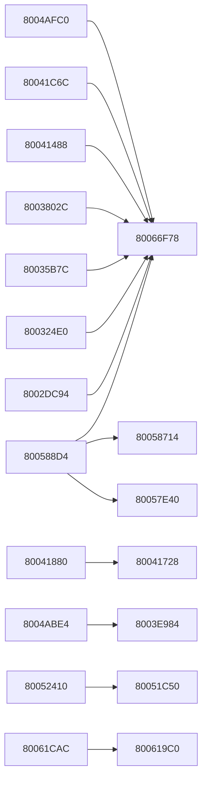

26 further functions of this area without a documented connection (see the table below): `func_8002B588`, `func_8002CC30`, `func_8002DAA4`, `func_8002F30C`, `func_8003015C`, `func_800302E8`, `func_80030C60`, `func_80031238`, `func_800317BC`, `func_800336DC`, `func_80036E6C`, `func_80037708`, `func_800378BC`, `func_80038754`, `func_80038A00`, `func_80039C58`, `func_8003A160`, `func_80040874`, `func_80040A00`, `func_8005027C`, `func_80051CC4`, `func_8005D8F4`, `func_8005F018`, `func_8006411C`, `func_8006AAEC`, `func_8006FF44`.

| Function | Bytes | Categories | calls (documented) | called by (documented) |
|---|---|---|---|---|
| `func_8006AAEC` | 76 | Gameplay > Object Registry · Lookup | - | `func_8006B23C`, `func_8006C080` |
| `func_80051C50` | 116 | Physics > Camera · GTE | `func_80010974`, `func_800188D0` | `func_80052410` |
| `func_80030C60` | 220 | Gameplay > Entity Draw · Model Renderer | `func_80010234`, `func_80010750` | - |
| `func_8002DAA4` | 248 | Gameplay > Entity Animation · Model Renderer | `func_80010234`, `func_80010750`, `func_800188D0` | - |
| `func_8006FF44` | 260 | Gameplay > Entity Update · Entity Lifecycle, Scene Graph | `func_800181D4`, `func_8001B148`, `func_8003C7B8`, `func_8003D9F8` | - |
| `func_800378BC` | 280 | Gameplay > Entity Update · Model Renderer | `func_80010234`, `func_80010750`, `func_80037EB4` | - |
| `func_8002B588` | 320 | Gameplay > AI > Aiming · Model Renderer | `func_80010234`, `func_80010750`, `func_800188D0` | - |
| `func_80052410` | 320 | Gameplay > Collision · Geometry | `func_80010234`, `func_80010750`, `func_80051C50` | - |
| `func_800317BC` | 336 | Gameplay > Entity Update · Model Renderer | `func_80010234`, `func_80010750` | - |
| `func_80041728` | 344 | Gameplay > Entity Script · Model Renderer | `func_80010234`, `func_80010750` | `func_80041880` |
| `func_80041C6C` | 344 | Gameplay > Entity Script · Model Renderer | `func_80010234`, `func_80010750`, `func_800188D0`, `func_80066F78` | - |
| `func_8006411C` | 384 | Physics > Collision · Movement | `func_800640D8` | - |
| `func_8003015C` | 396 | Gameplay > Entity Script · Model Renderer | `func_80010234`, `func_80010750`, `func_800188D0` | - |
| `func_80040874` | 396 | Gameplay > Entity Update · Entity Lifecycle, Scene Graph | `func_800181D4`, `func_8001B148`, `func_8003C7B8`, `func_8003D9F8` | - |
| `func_8003802C` | 424 | Physics > Motion · Scene Graph, Object Dynamics | `func_80010234`, `func_80010750`, `func_80037EB4`, `func_80066F78` | - |
| `func_800302E8` | 432 | Gameplay > Object Spawning · Scene Graph, Animation | `func_80010234`, `func_80010750`, `func_80017668`, `func_800188D0` | - |
| `func_80037708` | 436 | Gameplay > Entity Update · Entity Lifecycle, Scene Graph | `func_80010234`, `func_80010750` | - |
| `func_80031238` | 440 | Physics > Collision | `func_8001006C`, `func_80010820` | - |
| `func_8004AFC0` | 448 | Physics > Motion · Object Dynamics, Scene Graph | `func_8001006C`, `func_80010820`, `func_800188D0`, `func_80066F78` | - |
| `func_80058714` | 448 | Gameplay > Entity Update · Scene Graph, Animation | `func_80010234`, `func_80010750`, `func_80017668` | `func_800588D4` |
| `func_80051CC4` | 500 | Physics > Movement · Navigation | `func_8001010C`, `func_80010820` | - |
| `func_80036E6C` | 504 | Gameplay > Entity Update · Entity Lifecycle, Scene Graph | `func_80010234`, `func_80010750`, `func_8001937C`, `func_800193F8` | - |
| `func_8002DC94` | 532 | Gameplay > Object Spawning · Scene Graph, Animation | `func_80010234`, `func_80010750`, `func_8001846C`, `func_800192AC`, `func_80066F78` | - |
| `func_80039C58` | 564 | Gameplay > Entity Script · Model Renderer | `func_80010234`, `func_80010750` | - |
| `func_80041488` | 672 | Gameplay > Entity Script > Path Sequence · Model Renderer | `func_80010234`, `func_80010750`, `func_800188D0`, `func_80066F78` | - |
| `func_80038754` | 684 | Gameplay > Object Spawning · Message 2, Model Renderer, Animation | `func_80010234`, `func_80010750` | - |
| `func_80041880` | 748 | Gameplay > Entity Script > Path Sequence · Model Renderer | `func_80010234`, `func_80010750`, `func_80041728` | - |
| `func_800619C0` | 748 | Physics > Collision > Oriented Box Against Entries · Batch Transform, Bounding Volumes | `func_8001006C`, `func_80010820` | `func_80061CAC` |
| `func_800588D4` | 872 | Gameplay > Entity Update · Damage, Model Renderer, Entity Script | `func_80010234`, `func_80010750`, `func_80057E40`, `func_80058714`, `func_80066F78` | - |
| `func_80040A00` | 972 | Gameplay > Object Dynamics · Lighting | `func_8001006C`, `func_80010820` | `func_8003F4A0` |
| `func_80057E40` | 976 | Gameplay > Entity Update > Orientation · Matrix Setup, Animation | `func_80010234`, `func_80010750`, `func_80017668`, `func_800188D0`, `func_80052D7C` | `func_800588D4` |
| `func_8004ABE4` | 988 | Gameplay > Object Dynamics · Motion, Particles, Entity Lifecycle | `func_8001006C`, `func_80010820`, `func_80017EBC`, `func_80019668`, `func_8003E984` | - |
| `func_80061CAC` | 1068 | Physics > Collision > Part Pair Test · Geometry, Mathematics | `func_8001006C`, `func_80010820`, `func_800619C0` | - |
| `func_8002F30C` | 1212 | Gameplay > Entity Update > Mover · Motion, Matrix Build, Sound | `func_80010234`, `func_80010750`, `func_800188D0` | - |
| `func_80066F78` | 1288 | Physics > Collision > Ground Query · Map, Geometry | `func_8001A180` | `func_800164F4`, `func_8002DC94`, `func_800324E0`, `func_80035B7C`, `func_80037EB4`, `func_8003802C`, `func_8003AA94`, `func_80041488`, `func_80041C6C`, `func_8004AFC0`, `func_800588D4`, `func_80075A84` |
| `func_8002CC30` | 1392 | Gameplay > Object Update > Steering · Target Selection, Actor Transform | `func_80010234`, `func_80010750`, `func_800188D0`, `func_8001A100` | - |
| `func_8005F018` | 1744 | Gameplay > AI > Aiming · Beams, Collision, Node Allocation | `func_80017668`, `func_8001846C`, `func_80019668`, `func_80019904`, `func_80073500` | - |
| `func_8003A160` | 1764 | Physics > Force Fields · Tick Handler, Fixed Point | `func_80010234`, `func_80010750`, `func_8001A100` | - |
| `func_8005D8F4` | 1788 | Gameplay > Damage > Expanding Contact Field · Radius Tests, Particles | `func_80017668`, `func_80019668`, `func_8005CED4`, `func_8005D060`, `func_80073500` | - |
| `func_80038A00` | 2200 | Gameplay > Entity Update > Orientation · Matrix Build, Steering | `func_8001006C`, `func_80010234`, `func_80010750`, `func_80010820`, `func_80017668`, `func_8001846C`, `func_800188D0` | - |
| `func_8005027C` | 2264 | Gameplay > Path Movement · Motion, Matrix Setup | `func_80010234`, `func_80010750`, `func_8001846C`, `func_800188D0`, `func_80037EB4` | - |
| `func_8003E984` | 2344 | Gameplay > Object Spawning · Spawn Tables, Scene Graph | `func_80019F54`, `func_8001A100`, `func_8003D9F8`, `func_8003DB70` | `func_8004ABE4` |
| `func_800324E0` | 2652 | Gameplay > AI > Hover Enemy Behaviour · Ground Follow, Matrix Build, Entity Lifecycle | `func_80010234`, `func_80010750`, `func_80019310`, `func_80019668`, `func_8001A180`, `func_80066F78` | - |
| `func_80035B7C` | 2728 | Gameplay > Entity Update > Mover · Motion, Matrix Build | `func_8001006C`, `func_80010234`, `func_80010750`, `func_80010820`, `func_80010974`, `func_800188D0`, `func_80019310`, `func_8001A180`, `func_80066F78` | - |
| `func_800336DC` | 6824 | AI > Strategic > Build Order · Economy, Precinct Assault | `func_80019668`, `func_80095900` | - |

### Platform - 34 functions, 9 calls inside the area

CD-ROM, interrupts, BIOS wrappers and memory card - constraints, not graphics code.

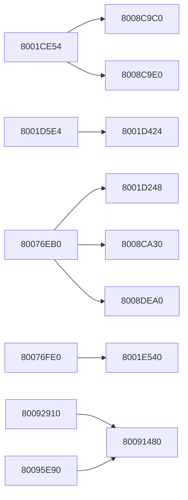

20 further functions of this area without a documented connection (see the table below): `func_8001C680`, `func_8001C718`, `func_8001E004`, `func_80021C20`, `func_80044F8C`, `func_8008CD10`, `func_800914E0`, `func_80091510`, `func_80091F60`, `func_80092A84`, `func_80092B94`, `func_80092C8C`, `func_80092F38`, `func_80093280`, `func_8009398C`, `func_80093A0C`, `func_80096090`, `func_800960CC`, `func_800962D0`, `func_800965C8`.

| Function | Bytes | Categories | calls (documented) | called by (documented) |
|---|---|---|---|---|
| `func_8008CD10` | 16 | Platform > BIOS · Memory | - | `func_8005A414`, `func_800932F0`, `func_800934BC` |
| `func_80091F60` | 20 | Platform > GPU · Draw Environment | - | `func_8001BF78` |
| `func_8008C9E0` | 28 | Platform > Interrupts · CPU | - | `func_8001CE54`, `func_80085C4C`, `func_800861E4` |
| `func_8008C9C0` | 32 | Platform > Interrupts · CPU | - | `func_8001CE54`, `func_80085C4C`, `func_800861E4` |
| `func_80091480` | 48 | Platform > Interrupts · Display | - | `func_8001E4E4`, `func_800773D8`, `func_8007757C`, `func_80092910`, `func_80095E90` |
| `func_800914E0` | 48 | Platform > Interrupts · Display | - | `func_80096108`, `func_8009612C` |
| `func_80091510` | 52 | Platform > Interrupts · Display | - | `func_8001F0B8`, `func_800773D8`, `func_8007757C` |
| `func_80095E90` | 52 | Platform > Interrupts · Display | `func_80091480` | `func_80085228`, `func_80085630`, `func_80085C4C`, `func_800861E4` |
| `func_80096090` | 60 | Platform > DMA · Image Transfer | - | `func_800861E4` |
| `func_800960CC` | 60 | Platform > DMA · Image Transfer | - | `func_80085228`, `func_80085630`, `func_800861E4` |
| `func_80093A0C` | 64 | Platform > GPU · Display Setup | - | `func_8001B4A8` |
| `func_8001E540` | 72 | Platform > Device Shutdown · Controller | - | `func_80076FE0` |
| `func_80092A84` | 92 | Platform > GPU · Display Setup | - | `func_8001BE68` |
| `func_80021C20` | 96 | Platform > Sound | - | `func_8002333C` |
| `func_80044F8C` | 96 | Platform > Sound · Sprite/Asset Subsystem | - | `func_8002333C` |
| `func_8008CA30` | 96 | Platform > Memory · Memory Management | - | `func_80076EB0` |
| `func_80092B94` | 96 | Platform > MDEC · Video Decode | - | `func_80085C4C`, `func_800861E4` |
| `func_80092F38` | 96 | Platform > GPU · VRAM Transfer | `func_80092CF4` | `func_8001B4A8`, `func_8003FAD4`, `func_80048BF8`, `func_8005A414`, `func_80063C5C`, `func_80085074`, `func_80085630`, `func_80091F90` |
| `func_80092C8C` | 104 | Platform > GPU | - | `func_8001B4A8`, `func_80025B7C`, `func_8003FAD4`, `func_80048BF8`, `func_8005A414`, `func_80063C5C` |
| `func_80076FE0` | 112 | Platform > System Shutdown · Memory Management | `func_80017BA0`, `func_8001E2C0`, `func_8001E540`, `func_80023478` | `func_80076A2C` |
| `func_80093280` | 112 | Platform > GPU · GPU Command Lists | - | `func_8001B4A8` |
| `func_800965C8` | 112 | Platform > Runtime Init · Utilities | - | `func_80076A2C` |
| `func_8009398C` | 128 | Platform > GPU · Display Setup | - | `func_8001B4A8` |
| `func_800962D0` | 140 | Platform > DMA · Video Decode | - | `func_80096070` |
| `func_8008DEA0` | 144 | Platform > CD-ROM · Device Init | `func_8008E000` | `func_80076EB0` |
| `func_8001C680` | 152 | Platform > Memory Card · Serial Port | - | - |
| `func_8001D5E4` | 236 | Platform > CD-ROM · File Access | `func_8001D424` | `func_8001E110` |
| `func_8001C718` | 240 | Platform > Memory Card · File Access | - | - |
| `func_8001E004` | 268 | Platform > CD-ROM · File Access | - | `func_8001E110` |
| `func_80076EB0` | 304 | Platform > System Init · Boot, Resources, Graphics | `func_80017BE8`, `func_8001BF78`, `func_8001BFE4`, `func_8001C040`, `func_8001C088`, `func_8001D248`, `func_8001E240`, `func_8001E4E4`, `func_8001F0B8`, `func_8002333C`, `func_8008CA30`, `func_8008DEA0` | `func_80076A2C` |
| `func_8001D248` | 352 | Platform > CD-ROM · Device Init | - | `func_80076EB0` |
| `func_80092910` | 372 | Platform > GPU > Library Reset · Display Setup | `func_8008E000`, `func_80091480`, `func_80095830` | `func_8001BE68`, `func_800773D8`, `func_8007757C` |
| `func_8001D424` | 448 | Platform > CD-ROM · File Access | - | `func_8001D5E4`, `func_8001E110` |
| `func_8001CE54` | 588 | Platform > Memory Card > File Operations · File Access | `func_8008C9C0`, `func_8008C9E0` | - |

### Utilities - 27 functions, 5 calls inside the area

Mathematics (vector length, fixed point, reciprocal tables) and the lagged-Fibonacci RNG over `D_800A0480`, used by the renderer and the effects.

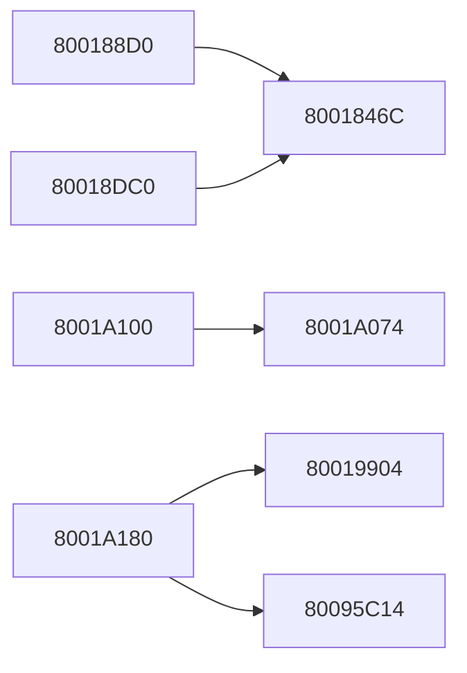

19 further functions of this area without a documented connection (see the table below): `func_80019668`, `func_80019F54`, `func_8001A81C`, `func_8001E318`, `func_8001E44C`, `func_8001E4C0`, `func_80020610`, `func_80048E94`, `func_80049EF8`, `func_800780C0`, `func_8008CC90`, `func_8008CCA0`, `func_8008CCB0`, `func_8008CCC0`, `func_8008CCF0`, `func_8008CD30`, `func_8008E000`, `func_80095830`, `func_80095900`.

| Function | Bytes | Categories | calls (documented) | called by (documented) |
|---|---|---|---|---|
| `func_80020610` | 8 | Utilities > Constants · Movie Playback | - | `func_80020618`, `func_8007F9CC` |
| `func_80048E94` | 8 | Utilities > Constants | - | `func_800287F4` |
| `func_8008CD30` | 12 | Utilities > Formatting · Library | - | `func_80024E3C`, `func_80025370`, `func_80047F30`, `func_800491F8`, `func_80076A2C`, `func_8008125C` |
| `func_8008CC90` | 16 | Utilities > String · BIOS | - | `func_80076A2C` |
| `func_8008CCA0` | 16 | Utilities > String · BIOS | - | `func_80083130` |
| `func_8008CCB0` | 16 | Utilities > String · BIOS | - | `func_80076A2C`, `func_8008125C` |
| `func_8008CCC0` | 16 | Utilities > String · BIOS | - | `func_800788F0`, `func_8008125C`, `func_80083130` |
| `func_8008CCF0` | 16 | Utilities > String · BIOS | - | `func_80083130` |
| `func_8008E000` | 16 | Utilities > Output · BIOS | - | `func_8008DEA0`, `func_80092910` |
| `func_80095C14` | 24 | Utilities > Mathematics · GTE | - | `func_8001A180`, `func_8001B4A8` |
| `func_800780C0` | 28 | Utilities > Character Table · Text | - | `func_80076A2C` |
| `func_8001E4C0` | 36 | Utilities > Memory | - | `func_80020618`, `func_800206D0`, `func_8007F9CC`, `func_8007FB04`, `func_80085C4C`, `func_800861E4` |
| `func_80095830` | 36 | Utilities > Memory · Library | - | `func_80092910`, `func_80092BF4` |
| `func_8001A100` | 60 | Utilities > Mathematics > Vector Length · Culling | `func_8001A074` | `func_8002CC30`, `func_8003A160`, `func_8003CF6C`, `func_8003E984`, `func_80044260`, `func_8004C5C8`, `func_8005BDE4`, `func_8006DC24`, `func_8006E988`, `func_8006F310`, `func_80070158`, `func_80071FA4`, `func_80072F7C`, `func_80074104` |
| `func_80049EF8` | 84 | Utilities > Mathematics · Clipping | - | `func_8004A048` |
| `func_80019668` | 92 | Utilities > Random Numbers | - | `func_800324E0`, `func_800336DC`, `func_8003AA94`, `func_8003DB70`, `func_80042AF4`, `func_8004ABE4`, `func_800596C4`, `func_8005D060`, `func_8005D8F4`, `func_8005F018`, `func_8006B23C`, `func_80070730`, `func_800754B8`, `func_80083A10` |
| `func_80019904` | 104 | Utilities > Mathematics > Fixed Point · Geometry | - | `func_80016C88`, `func_8001A180`, `func_8005F018` |
| `func_8001E44C` | 116 | Utilities > Memory | - | `func_800181D4` |
| `func_80019F54` | 120 | Utilities > Mathematics > Vector Length · Culling | - | `func_8003E984`, `func_80070730`, `func_80075A84` |
| `func_8001A074` | 140 | Utilities > Mathematics > Vector Length · Culling | - | `func_8001A100` |
| `func_80095900` | 148 | Utilities > Mathematics > Reciprocal · Geometry | - | `func_800336DC`, `func_800518A8` |
| `func_8001846C` | 200 | Utilities > Mathematics > Trigonometry · Geometry | - | `func_80014490`, `func_8001484C`, `func_800188D0`, `func_80018DC0`, `func_8002DC94`, `func_80038A00`, `func_8004A048`, `func_8005027C`, `func_8005A740`, `func_8005A828`, `func_8005AB8C`, `func_8005F018`, `func_8006B23C`, `func_8006DC24`, `func_80070730` |
| `func_8001E318` | 308 | Utilities > Memory | - | `func_80017EBC`, `func_800181D4` |
| `func_8001A81C` | 340 | Utilities > Mathematics · Geometry | - | `func_80074104`, `func_80075A84` |
| `func_8001A180` | 404 | Utilities > Mathematics · Geometry | `func_80019904`, `func_80095C14` | `func_800192AC`, `func_80019310`, `func_8001937C`, `func_800193F8`, `func_800324E0`, `func_80035B7C`, `func_8005CBCC`, `func_80066F78` |
| `func_80018DC0` | 1260 | Utilities > Mathematics > Trigonometry · Matrix Setup, Rotation | `func_8001846C` | `func_80013CB8`, `func_80014164`, `func_8003AA94`, `func_80052960`, `func_800592D0` |
| `func_800188D0` | 1264 | Utilities > Mathematics > Trigonometry · Rotation | `func_8001846C` | `func_8002B588`, `func_8002C584`, `func_8002CC30`, `func_8002DAA4`, `func_8002E630`, `func_8002EED8`, `func_8002F30C`, `func_8003015C`, `func_800302E8`, `func_80035B7C`, `func_80037EB4`, `func_80038A00`, `func_8003DB70`, `func_80041488`, `func_80041C6C`, `func_80042AF4`, `func_8004AFC0`, `func_8004C5C8`, `func_8005027C`, `func_80051C50`, `func_80057E40`, `func_8005D060`, `func_80083A10` |

## Rendering core chain

Breadth-first walk from `func_8003F4A0` (render pass driver) **and** `func_80073700` (object dispatcher), two levels deep over documented calls: the path a frame takes.

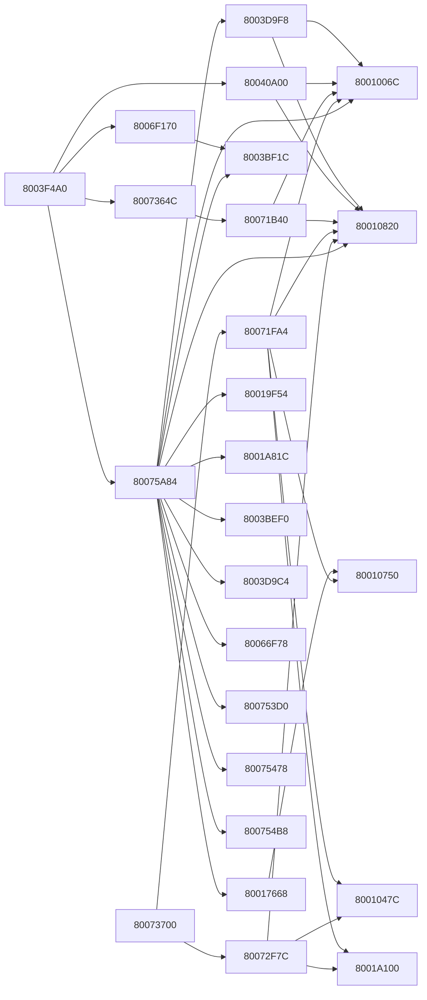

Stage order (measured): matrix load (`func_80010750` / `func_80010820`) - batch transform (`func_8001006C` / `func_80010234`) - projection (`func_800102A0` / `func_8001047C`) - lighting (`func_80015F14`) - packet from `D_8009F9F0`.

## Limits of the map

- **No documented caller (104):** `func_8001016C`, `func_800102A0`, `func_8001054C`, `func_80010630`, `func_8001072C`, `func_800108D8`, `func_80013A14`, `func_80015F38`, `func_80016E6C`, `func_800175A0`, `func_80019D60`, `func_8001BFA8`, `func_8001C680`, `func_8001C718`, `func_8001CE54`, `func_800267C8` ... (+88)
- **No documented call (175):** `func_8001006C`, `func_8001010C`, `func_8001016C`, `func_800101D4`, `func_80010234`, `func_800102A0`, `func_8001047C`, `func_8001054C`, `func_80010630`, `func_80010704`, `func_8001072C`, `func_80010750`, `func_80010820`, `func_800108D8`, `func_80010974`, `func_80013AA0` ... (+159)
These are entry points and leaves of the documented part; their counterparts lie outside this set or are reached indirectly.

- **Most called (hubs):**

| Function | calls (documented) | callers (documented) | area |
|---|---|---|---|
| `func_80076A2C` | 24 | 0 | Boot & Front-End |
| `func_800861E4` | 17 | 3 | GPU, 2D & HUD |
| `func_80085C4C` | 15 | 0 | GPU, 2D & HUD |
| `func_80075A84` | 13 | 1 | Renderer & Scene |
| `func_80076EB0` | 12 | 1 | Platform |
| `func_8001B4A8` | 10 | 6 | GPU, 2D & HUD |
| `func_800287F4` | 10 | 1 | Boot & Front-End |
| `func_800597C0` | 10 | 0 | Renderer & Scene |
| `func_800773D8` | 10 | 0 | GPU, 2D & HUD |
| `func_8007757C` | 10 | 0 | GPU, 2D & HUD |
| `func_80035B7C` | 9 | 0 | Gameplay, AI & Physics |
| `func_8003F6E4` | 9 | 1 | Renderer & Scene |

